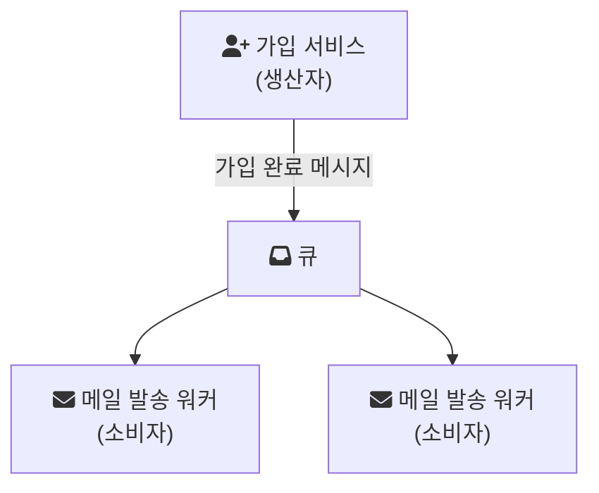

# Message Queue

회원 가입 요청을 처리하면서 환영 메일 발송, 쿠폰 발급, 추천인 포인트 적립까지 한 요청 안에서 동기로 호출한다고 해 보자. 메일 서버가 3초 느려지면 가입 응답도 3초 느려지고, 쿠폰 서비스가 죽으면 가입 자체가 실패한다. 가입과 후속 작업이 시간적으로 묶여 있기 때문이다.

메시지 큐는 이 묶음을 푼다. 가입 서비스는 "가입이 일어났다"는 메시지를 큐에 넣고 바로 응답한다. 후속 작업을 맡은 서비스는 자기 속도로 큐에서 메시지를 꺼내 처리한다.

## 메시지 큐란

AWS는 메시지 큐를 서버리스와 마이크로서비스 아키텍처에서 쓰는 비동기 서비스 간 통신 방식으로 설명한다. 메시지는 처리되고 삭제될 때까지 큐에 저장되고, 각 메시지는 하나의 소비자가 한 번 처리한다([AWS: What is a Message Queue?](https://aws.amazon.com/message-queue/)).

등장인물은 셋이다.

- 생산자(producer): 메시지를 만들어 큐에 넣는다.
- 큐(queue): 메시지를 소비될 때까지 보관한다. 큐를 운영하는 서버를 메시지 브로커라고 부른다.
- 소비자(consumer): 큐에서 메시지를 꺼내 처리한다.

같은 큐에 소비자를 여러 개 붙이면 메시지가 그들 사이에 나뉘어 처리된다. 메시지 하나는 소비자 하나에게만 간다. 처리량이 부족하면 소비자 수를 늘리면 된다.

## 왜 쓰는가

AWS 문서가 정리한 이점을 풀어 쓰면 다음과 같다.

- 분리(decoupling): 생산자는 소비자가 누구인지, 지금 살아 있는지 몰라도 된다. 소비자가 잠시 내려가 있어도 메시지는 큐에 쌓여 기다린다.
- 버퍼링과 부하 평탄화: 순간적으로 몰린 요청을 큐가 받아 두고, 소비자는 감당할 수 있는 속도로 처리한다. 무거운 처리를 요청 경로에서 떼어 내고, 작업을 모아 처리하고, 튀는 부하를 고르게 만드는 데 쓴다고 문서는 적는다.
- 확장성: 생산자와 소비자를 각자 독립적으로 늘리고 줄일 수 있다.

대신 응답 시점에 후속 작업이 끝났다는 보장은 사라진다. 가입 직후 메일이 몇 초 늦게 도착하는 것을 받아들일 수 있는 작업에만 큐를 쓴다.

## 점대점과 발행-구독

메시지 하나를 누가 받는지에 따라 두 모델로 나뉜다.

| 모델 | 메시지 하나를 받는 대상 | 예시 |
| --- | --- | --- |
| 점대점(point-to-point) | 소비자 하나 | 주문 하나를 워커 하나가 처리 |
| 발행-구독(publish-subscribe) | 구독자 전부 | 가입 이벤트를 메일, 쿠폰, 포인트 서비스가 각자 받음 |

AWS 문서는 여러 소비자가 같은 메시지를 받아야 할 때 메시지 큐를 Pub/Sub 메시징과 결합해 팬아웃(fanout)하는 구성을 소개한다. [RabbitMQ](/posts/rabbitmq/)에서는 exchange가 메시지를 여러 큐에 복사해 넣는 방식으로 이 구분을 표현한다.

## 메시지가 사라지지 않게 하는 장치

큐를 쓰면 "메시지를 꺼냈는데 처리 중에 소비자가 죽으면 어떻게 되는가"를 생각해야 한다. 대부분의 브로커는 확인 응답(acknowledgement, ack)으로 이를 다룬다. 소비자는 처리를 마친 뒤 ack를 보내고, 브로커는 ack를 받은 메시지만 지운다.

RabbitMQ 문서에 따르면 수동 ack를 쓰는 경우, ack되지 않은 메시지는 그 메시지를 전달한 채널이나 연결이 닫힐 때 자동으로 큐에 다시 들어간다([RabbitMQ: Consumer Acknowledgements and Publisher Confirms](https://www.rabbitmq.com/docs/confirms)). 처리 도중 죽은 소비자의 메시지는 다른 소비자에게 다시 전달된다.

이 장치에는 대가가 있다. 소비자가 처리를 끝냈지만 ack를 보내기 직전에 죽으면, 같은 메시지가 다시 전달된다. 그래서 같은 문서는 소비자가 재전달을 처리할 수 있어야 하고 멱등성(idempotence)을 염두에 두고 구현해야 한다고 적는다. 같은 메시지를 두 번 처리해도 결과가 한 번 처리한 것과 같아야 한다는 뜻이다. 예를 들어 쿠폰 발급 소비자는 메시지 ID를 기록해 두고 이미 처리한 ID면 건너뛴다.

생산자 쪽에도 같은 질문이 있다. 메시지를 보냈는데 브로커가 받았는지 어떻게 아는가. RabbitMQ의 publisher confirm이 이 역할을 한다. 문서는 소비자 ack와 publisher confirm이 서로 독립적이라고 강조한다. 하나는 소비자와 브로커 사이, 다른 하나는 생산자와 브로커 사이의 확인이다.

## 처리할 수 없는 메시지

형식이 잘못됐거나 버그 때문에 계속 실패하는 메시지가 있다. 이 메시지를 계속 큐에 되돌려 놓으면 같은 실패가 무한히 반복된다. 이런 메시지를 따로 모아 두는 곳이 DLQ(dead letter queue)다. RabbitMQ는 소비자가 재전달 없이 거부한 메시지, TTL이 지난 메시지, 큐 길이 제한을 넘어 버려진 메시지 등을 dead letter exchange로 보낼 수 있다([RabbitMQ: Dead Letter Exchanges](https://www.rabbitmq.com/docs/dlx)). DLQ에 쌓인 메시지는 원인을 고친 뒤 다시 넣거나 버린다.

## 쓸 때 주의할 점

- 순서: 소비자가 여러 개면 메시지가 들어간 순서대로 처리가 끝난다는 보장이 없다. 같은 주문에 대한 "생성"과 "취소" 메시지가 뒤바뀌어 처리될 수 있다.
- 중복: ack 구조 때문에 최소 한 번(at-least-once) 전달이 기본이라고 보고 소비자를 멱등하게 만든다.
- 쌓임: 소비 속도가 생산 속도를 못 따라가면 큐가 계속 길어진다. 큐 길이와 가장 오래된 메시지의 나이를 지표로 본다.
- 디버깅: 요청 하나가 여러 서비스를 비동기로 거치므로, 메시지에 추적용 ID를 실어 로그를 이어 볼 수 있게 한다.

설치와 Spring 연동은 [RabbitMQ Installation](/posts/rabbitmq-installation/), [Spring AMQP](/posts/spring-amqp/)에서 이어 정리한다.

## 참고

- https://medium.com/free-code-camp/how-to-scale-microservices-with-message-queues-spring-boot-and-kubernetes-f691b7ba3acf
- https://steady-snail.tistory.com/165
- https://aws.amazon.com/ko/message-queue/
- https://www.ibm.com/cloud/learn/message-queues
- https://www.ibm.com/docs/en/ibm-mq/8.0?topic=overview-introduction-message-queuing
- https://medium.com/must-know-computer-science/system-design-message-queues-245612428a22
- https://www.cloudamqp.com/blog/what-is-message-queuing.html
- https://medium.com/swlh/everything-you-need-to-know-about-message-queues-a-complete-guide-dbf190d001d7
- [What is a Message Queue?](https://aws.amazon.com/message-queue/) — AWS
- [Consumer Acknowledgements and Publisher Confirms](https://www.rabbitmq.com/docs/confirms) — RabbitMQ Documentation
- [Dead Letter Exchanges](https://www.rabbitmq.com/docs/dlx) — RabbitMQ Documentation
