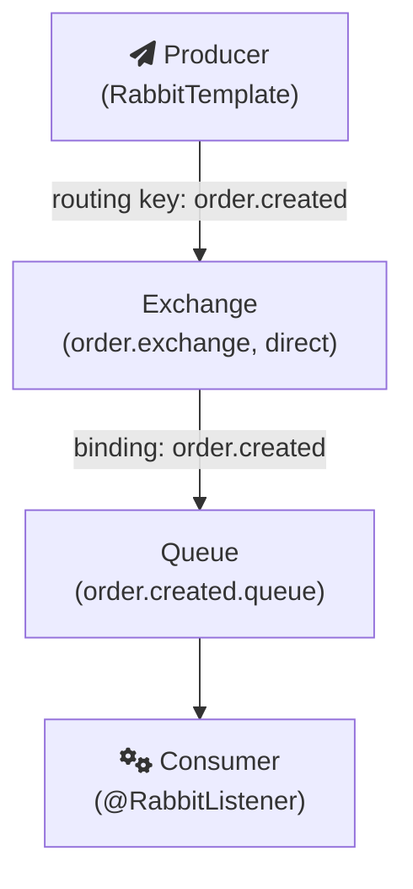

이 글은 Spring Boot 애플리케이션에서 RabbitMQ로 메시지를 보내고 받는 최소 구성을 정리한다. RabbitMQ 자체의 개념은 [RabbitMQ](/posts/rabbitmq/)에, 설치는 [RabbitMQ Installation](/posts/rabbitmq-installation/)에, 메시지 큐를 왜 쓰는지는 [Message Queue](/posts/message-queue/)에 따로 정리했다. 코드는 Spring Boot 3, Spring AMQP 3.x 기준이다.

## 먼저 알아야 할 모델

RabbitMQ가 쓰는 AMQP 0-9-1 모델에서 생산자(producer)는 메시지를 큐에 직접 넣지 않는다. 메시지는 exchange로 발행되고, exchange가 binding이라는 규칙에 따라 메시지 사본을 큐들로 나눠 준다. 소비자(consumer)는 큐에서 메시지를 꺼낸다([RabbitMQ, AMQP 0-9-1 Model Explained](https://www.rabbitmq.com/tutorials/amqp-concepts)).



exchange 종류에 따라 라우팅 방식이 다르다. direct는 routing key가 정확히 일치하는 큐로, fanout은 연결된 모든 큐로, topic은 패턴이 맞는 큐로 보낸다. 이름이 없는 기본 exchange는 모든 큐를 큐 이름과 같은 routing key로 자동 연결해 두기 때문에, routing key에 큐 이름을 주면 그 큐로 바로 들어간다.

## Project Initialization

### RabbitMQ 띄우기

로컬에서는 Docker로 관리 UI가 포함된 이미지를 띄우는 것이 가장 간단하다. 5672는 AMQP 포트, 15672는 관리 UI 포트다.

```bash
docker run -it --rm --name rabbitmq -p 5672:5672 -p 15672:15672 rabbitmq:3-management
```

RabbitMQ 다운로드 문서도 같은 형태의 명령을 안내한다([RabbitMQ, Installing RabbitMQ](https://www.rabbitmq.com/docs/download)). 브라우저에서 `http://localhost:15672`로 접속하면 큐와 exchange, 메시지 흐름을 볼 수 있다.

### 의존성 추가

Spring Initializr에서 "Spring for RabbitMQ"를 고르거나, 직접 스타터를 추가한다. Spring Boot는 `spring-boot-starter-amqp`로 RabbitMQ 지원을 제공한다([Spring Boot Reference, AMQP](https://docs.spring.io/spring-boot/reference/messaging/amqp.html)).

```groovy
dependencies {
    implementation 'org.springframework.boot:spring-boot-starter-amqp'
    implementation 'org.springframework.boot:spring-boot-starter-web'
}
```

### 연결 설정

연결 정보는 `spring.rabbitmq.*` 속성으로 준다. 기본값은 `localhost`, 사용자 `guest`, 비밀번호 `guest`라서 로컬 Docker 환경이라면 생략해도 붙는다.

```yaml
spring:
  rabbitmq:
    host: localhost
    port: 5672
    username: guest
    password: guest
```

다만 RabbitMQ의 기본 `guest` 사용자는 원격 호스트에서 접속할 수 없고 localhost에서만 접속할 수 있다([RabbitMQ, Authentication, Authorisation, Access Control](https://www.rabbitmq.com/docs/access-control)). 애플리케이션과 브로커가 다른 서버에 있다면 별도 사용자를 만들어야 한다.

스타터가 있으면 Spring Boot가 메시지 전송용 `RabbitTemplate`, 큐 선언 등 관리 작업용 `AmqpAdmin`, 리스너 컨테이너를 만드는 `SimpleRabbitListenerContainerFactory`를 자동으로 구성한다.

## 큐, exchange, binding 선언

`Queue`, `Exchange`, `Binding`을 빈으로 등록하면 애플리케이션이 브로커에 연결될 때 자동으로 선언된다. Spring Boot 문서는 정의된 `Queue` 빈이 RabbitMQ에 자동으로 선언된다고 설명한다.

```java
@Configuration
public class RabbitConfig {

    public static final String EXCHANGE = "order.exchange";
    public static final String QUEUE = "order.created.queue";
    public static final String ROUTING_KEY = "order.created";

    @Bean
    public DirectExchange orderExchange() {
        return new DirectExchange(EXCHANGE);
    }

    @Bean
    public Queue orderCreatedQueue() {
        return new Queue(QUEUE, true); // durable: 브로커 재시작 후에도 큐 유지
    }

    @Bean
    public Binding orderCreatedBinding(Queue orderCreatedQueue, DirectExchange orderExchange) {
        return BindingBuilder.bind(orderCreatedQueue).to(orderExchange).with(ROUTING_KEY);
    }

    @Bean
    public MessageConverter messageConverter() {
        return new Jackson2JsonMessageConverter();
    }
}
```

`MessageConverter` 빈은 객체를 메시지 본문으로 바꾸는 방식을 정한다. 기본 변환기인 `SimpleMessageConverter`는 문자열, 바이트 배열, Java 직렬화 객체만 다룬다([Spring AMQP, Message Converters](https://docs.spring.io/spring-amqp/reference/amqp/message-converters.html)). Java 직렬화는 다른 언어의 소비자가 읽을 수 없고 신뢰할 수 없는 메시지를 역직렬화하는 보안 문제도 있으므로, 보통 JSON 변환기를 등록한다. Spring Boot는 `MessageConverter` 빈이 있으면 자동 구성된 `RabbitTemplate`과 리스너 컨테이너 팩토리에 연결한다. (Jackson 3을 쓰는 Spring AMQP 4.x 문서에서는 같은 역할의 클래스가 `JacksonJsonMessageConverter`다.)

## 메시지 보내기

```java
public record OrderCreated(Long orderId, Long memberId) {}

@Service
@RequiredArgsConstructor
public class OrderEventPublisher {

    private final RabbitTemplate rabbitTemplate;

    public void publish(OrderCreated event) {
        rabbitTemplate.convertAndSend(RabbitConfig.EXCHANGE, RabbitConfig.ROUTING_KEY, event);
    }
}
```

`convertAndSend`는 등록된 변환기로 객체를 메시지로 바꾼 뒤, 지정한 exchange에 routing key와 함께 발행한다.

## 메시지 받기

```java
@Component
@Slf4j
public class OrderCreatedListener {

    @RabbitListener(queues = RabbitConfig.QUEUE)
    public void handle(OrderCreated event) {
        log.info("order created: {}", event.orderId());
    }
}
```

`@RabbitListener`를 붙이면 Spring AMQP가 리스너 컨테이너를 만들어 큐를 구독하고, 메시지가 오면 변환기로 객체를 만들어 메서드를 호출한다([Spring AMQP, Annotation-driven Listener Endpoints](https://docs.spring.io/spring-amqp/reference/amqp/receiving-messages/async-annotation-driven.html)).

## 실패했을 때 무슨 일이 일어나는가

예제 코드는 여기까지로도 동작하지만, 운영에서 문제가 되는 것은 리스너가 예외를 던질 때다.

Spring AMQP 리스너 컨테이너의 기본 확인 모드는 `AUTO`다. 리스너가 정상적으로 반환하면 컨테이너가 브로커에 ack를 보내고, 예외를 던지면 메시지를 거절한다. 이때 `defaultRequeueRejected`의 기본값이 `true`라서, 거절된 메시지는 다시 큐로 돌아간다([Spring AMQP, Message Listener Container Configuration](https://docs.spring.io/spring-amqp/reference/amqp/containerAttributes.html)).

그래서 데이터 문제처럼 몇 번을 다시 시도해도 실패하는 메시지는 큐로 돌아갔다가 다시 전달되기를 반복한다. Spring AMQP 문서도 이런 메시지가 계속 재전달될 수 있다고 경고한다([Spring AMQP, Exception Handling](https://docs.spring.io/spring-amqp/reference/amqp/exception-handling.html)). 메시지 변환 실패 같은 복구 불가능한 오류는 기본 오류 처리기(`ConditionalRejectingErrorHandler`)가 재큐잉 없이 거절하지만, 비즈니스 로직에서 던진 예외는 그렇지 않다.

막는 방법은 세 가지를 조합하는 것이다.

1. 재시도 횟수를 제한한다. Spring Boot에서는 리스너 재시도를 켜고 최대 시도 횟수를 정할 수 있다. 기본값은 꺼져 있고, 켜면 최대 시도 횟수 기본값은 3이다.
2. 재시도를 다 써도 실패한 메시지는 재큐잉하지 않는다. `default-requeue-rejected`를 `false`로 두거나, 리스너에서 `AmqpRejectAndDontRequeueException`을 던진다.
3. 버려지는 메시지를 dead-letter exchange(DLX)로 보낸다. RabbitMQ는 재큐잉 없이 거절된 메시지를 큐에 설정된 DLX로 보낸다([RabbitMQ, Dead Letter Exchanges](https://www.rabbitmq.com/docs/dlx)). DLX에 연결한 큐(DLQ)를 보면 어떤 메시지가 왜 실패했는지 확인하고 나중에 다시 처리할 수 있다.

```yaml
spring:
  rabbitmq:
    listener:
      simple:
        default-requeue-rejected: false
        retry:
          enabled: true
          max-attempts: 3
```

DLX는 큐 인자(`x-dead-letter-exchange`)로도 지정할 수 있지만, RabbitMQ 문서는 큐를 다시 선언하지 않고 바꿀 수 있는 정책(policy)으로 지정하는 방법을 권한다.

마지막으로, RabbitMQ도 같은 메시지를 두 번 전달할 수 있다. ack를 보내기 직전에 소비자가 죽으면 브로커는 그 메시지를 처리되지 않은 것으로 보고 다시 전달한다. 그래서 리스너는 같은 메시지를 두 번 받아도 결과가 같도록 멱등하게 작성하는 편이 안전하다.

## 정리

Spring Boot에서 RabbitMQ를 붙이는 일 자체는 스타터, 연결 설정, 큐 선언, `RabbitTemplate`, `@RabbitListener`로 끝난다. 실제로 신경 써야 하는 부분은 그 다음이다. 기본 설정에서는 실패한 메시지가 큐로 되돌아가 반복 처리되므로, 재시도 상한과 DLX를 처음부터 함께 설정하고, 리스너는 중복 전달을 견디도록 만들어야 한다.

## 참고

- [Spring Boot Reference, Messaging: AMQP](https://docs.spring.io/spring-boot/reference/messaging/amqp.html)
- [Spring AMQP Reference, Annotation-driven Listener Endpoints](https://docs.spring.io/spring-amqp/reference/amqp/receiving-messages/async-annotation-driven.html)
- [Spring AMQP Reference, Message Listener Container Configuration](https://docs.spring.io/spring-amqp/reference/amqp/containerAttributes.html)
- [Spring AMQP Reference, Exception Handling](https://docs.spring.io/spring-amqp/reference/amqp/exception-handling.html)
- [Spring AMQP Reference, Message Converters](https://docs.spring.io/spring-amqp/reference/amqp/message-converters.html)
- [RabbitMQ, AMQP 0-9-1 Model Explained](https://www.rabbitmq.com/tutorials/amqp-concepts)
- [RabbitMQ, Dead Letter Exchanges](https://www.rabbitmq.com/docs/dlx)
- [RabbitMQ, Access Control](https://www.rabbitmq.com/docs/access-control)
