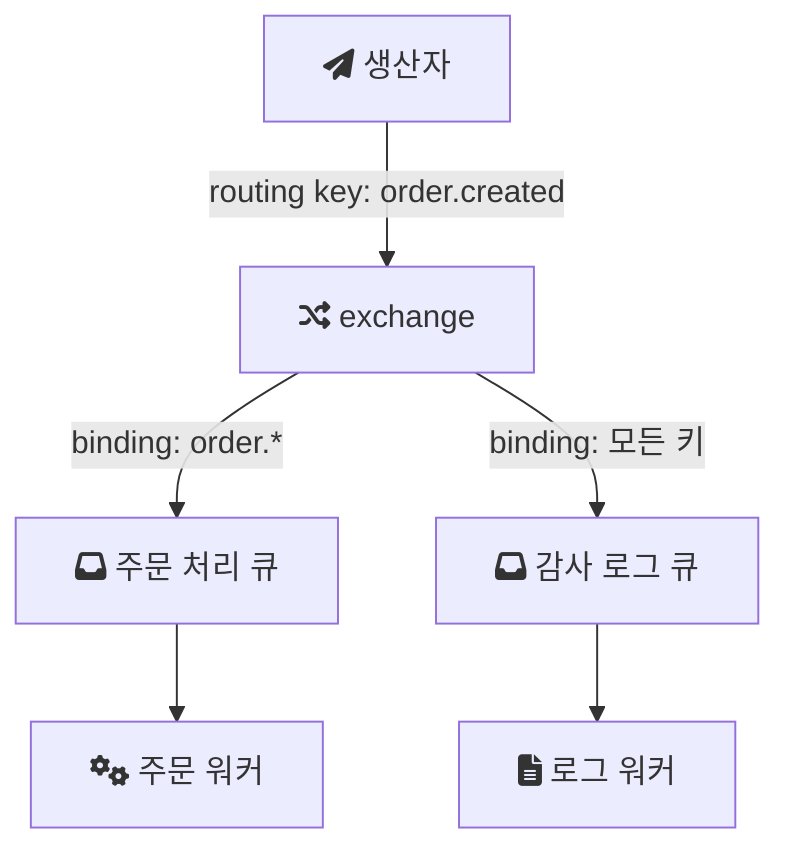

# RabbitMQ

RabbitMQ는 오픈 소스 메시지 브로커다. [메시지 큐](/posts/message-queue/)에서 정리한 생산자, 큐, 소비자 구조를 실제로 운영해 주는 서버이고, 기본 프로토콜로 AMQP 0-9-1(Advanced Message Queuing Protocol)을 쓴다. 아래 tutlane 튜토리얼은 RabbitMQ를 Erlang으로 만든 AMQP 브로커로 소개하고, .NET, Java, Python 등 여러 언어의 클라이언트가 있다고 설명한다.

- https://www.tutlane.com/tutorial/rabbitmq/introduction-to-rabbitmq

이 노트는 RabbitMQ 공식 문서의 AMQP 0-9-1 모델 설명을 중심으로 핵심 개념을 정리한다. 설치는 [RabbitMQ Installation](/posts/rabbitmq-installation/)에 따로 적었다.

---

## 생산자는 큐가 아니라 exchange에 보낸다

RabbitMQ를 처음 볼 때 가장 헷갈리는 부분이다. 생산자는 메시지를 큐에 직접 넣지 않는다. 공식 문서는 메시지가 우체국이나 우편함에 비유되는 exchange로 발행되고, exchange가 바인딩(binding)이라는 규칙에 따라 메시지 사본을 큐에 나눠 준다고 설명한다([AMQP 0-9-1 Model Explained](https://www.rabbitmq.com/tutorials/amqp-concepts)).

- exchange: 메시지를 받아 어느 큐로 보낼지 정한다.
- queue: 메시지를 보관하고 소비자에게 전달한다.
- binding: exchange와 queue를 잇는 규칙이다. 보통 binding key를 함께 지정한다.
- routing key: 생산자가 메시지에 붙이는 주소 같은 값이다. exchange는 이 값과 binding key를 비교해 보낼 큐를 고른다.

이렇게 한 단계를 더 두는 이유는 생산자가 큐 구성을 몰라도 되게 하기 위해서다. 생산자는 "주문이 생성됐다"는 routing key로 발행만 하고, 그 메시지를 받을 큐를 추가하거나 빼는 일은 바인딩만 바꿔서 처리한다.

---

## exchange의 네 가지 타입

| 타입 | 라우팅 방식 | 쓰임 |
| --- | --- | --- |
| direct | routing key와 binding key가 정확히 같은 큐로 보낸다 | 작업을 특정 큐에 배정 |
| fanout | routing key를 무시하고 바인딩된 모든 큐로 보낸다 | 브로드캐스트 |
| topic | 점으로 구분한 routing key를 패턴으로 매칭한다 | 이벤트 종류별 선택 구독 |
| headers | routing key 대신 메시지 헤더 속성으로 매칭한다 | 여러 속성 조합으로 라우팅 |

topic exchange의 routing key는 점으로 구분된 단어 목록이어야 하고, 길이는 255바이트까지다. binding key에서 `*`는 정확히 한 단어를, `#`는 0개 이상의 단어를 대신한다([RabbitMQ Tutorial 5: Topics](https://www.rabbitmq.com/tutorials/tutorial-five-java)). 위 그림에서 `order.*`는 `order.created`, `order.cancelled`와 맞고 `order.item.added`와는 맞지 않는다. `#` 하나만 쓰면 모든 메시지를 받는다. 그림의 감사 로그 큐가 이렇게 바인딩된 경우다.

별도로 선언하지 않아도 존재하는 default exchange도 있다. 이름이 빈 문자열인 direct exchange이고, 새로 만든 모든 큐는 큐 이름과 같은 routing key로 여기에 자동 바인딩된다. 그래서 튜토리얼 예제처럼 큐 이름을 routing key로 주고 발행하면 마치 큐에 직접 넣는 것처럼 보인다.

---

## 소비자의 확인 응답과 prefetch

브로커가 메시지를 언제 지워도 되는지는 ack 모드가 정한다. 공식 문서는 두 가지를 구분한다.

- 자동 ack: 브로커가 메시지를 애플리케이션에 보낸 직후 지운다. 소비자가 처리 중에 죽으면 메시지는 사라진다.
- 명시적 ack: 애플리케이션이 확인 응답을 보낸 뒤에 지운다.

RabbitMQ는 여기에 nack(negative acknowledgement)를 더해, 소비자가 메시지를 거부하고 다시 큐에 넣거나 버리게 할 수 있다.

prefetch는 소비자 하나가 ack하지 않은 상태로 받아 둘 수 있는 메시지 수의 상한이다. RabbitMQ 문서는 100에서 300 사이 값이 보통 처리량과 안정성의 균형이 좋고, 1은 가장 보수적이지만 처리량이 크게 떨어지며, 제한을 두지 않으면 ack 없이 메시지를 쌓은 소비자의 메모리가 계속 늘어날 수 있다고 설명한다([Consumer Acknowledgements and Publisher Confirms](https://www.rabbitmq.com/docs/confirms)).

---

## 내구성은 큐와 메시지에 따로 설정한다

브로커가 재시작돼도 메시지가 남아 있게 하려면 두 가지가 모두 필요하다.

- durable 큐: 큐의 메타데이터가 디스크에 저장된다. transient 큐의 메타데이터는 메모리에만 있다.
- persistent 메시지: 생산자가 메시지를 persistent로 표시해야 한다.

공식 문서는 durable 큐만으로 메시지 영속성이 보장되지 않는다고 강조한다. durable 큐에 persistent가 아닌 메시지를 넣으면 재시작 후 큐는 남아 있지만 메시지는 없다.

---

## 연결, 채널, 가상 호스트

- 연결(connection): 클라이언트와 브로커 사이의 오래 유지되는 TCP 연결이다.
- 채널(channel): 하나의 TCP 연결을 나눠 쓰는 가벼운 논리적 연결이다. 문서는 채널을 "lightweight connections that share a single TCP connection"이라고 표현한다(하나의 TCP 연결을 공유하는 가벼운 연결). 스레드마다 TCP 연결을 새로 여는 대신 채널을 연다.
- 가상 호스트(virtual host): 하나의 브로커 안에서 exchange, 큐, 권한을 분리한 독립 공간이다. 여러 서비스나 환경이 브로커 하나를 나눠 쓸 때 쓴다.

---

## 실패한 메시지 모으기

계속 처리에 실패하는 메시지는 DLX(dead letter exchange)로 보낼 수 있다. 소비자가 재큐잉 없이 거부한 메시지, 메시지별 TTL이 지난 메시지, 큐 길이 제한을 넘어 버려진 메시지 등이 대상이다. 설정은 정책(policy)의 `dead-letter-exchange` 키나 큐 선언 인자 `x-dead-letter-exchange`로 한다. 공식 문서는 애플리케이션을 다시 배포하지 않고 바꿀 수 있는 정책 방식을 권장한다([Dead Letter Exchanges](https://www.rabbitmq.com/docs/dlx)).

---

## 설정을 볼 때 확인할 것

- 생산자 코드에서 큐 이름이 보인다면 default exchange를 쓰고 있는 것이다. 소비자가 늘어날 가능성이 있다면 이름 있는 exchange로 바꾸는 편이 낫다.
- 재시작 후에도 남아야 하는 메시지라면 durable 큐와 persistent 메시지를 둘 다 설정했는지 본다.
- 명시적 ack를 쓰면 같은 메시지가 다시 올 수 있다. 소비자 로직이 멱등한지 확인한다.

Spring에서 RabbitMQ를 쓰는 방법은 [Spring AMQP](/posts/spring-amqp/)와 [RabbitMQ with Spring Boot](/posts/rabbitmq-springboot/)로 이어진다.

## 참고

- [Introduction to RabbitMQ](https://www.tutlane.com/tutorial/rabbitmq/introduction-to-rabbitmq) — tutlane
- [AMQP 0-9-1 Model Explained](https://www.rabbitmq.com/tutorials/amqp-concepts) — RabbitMQ Documentation
- [RabbitMQ Tutorial 5: Topics (Java)](https://www.rabbitmq.com/tutorials/tutorial-five-java) — RabbitMQ Documentation
- [Consumer Acknowledgements and Publisher Confirms](https://www.rabbitmq.com/docs/confirms) — RabbitMQ Documentation
- [Dead Letter Exchanges](https://www.rabbitmq.com/docs/dlx) — RabbitMQ Documentation
