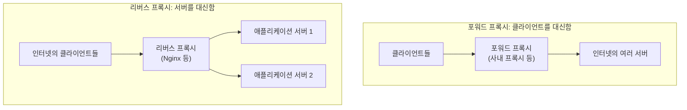

사용자가 `https://example.com`에 요청을 보내면, 그 요청을 실제로 처리하는 애플리케이션 서버가 인터넷에 직접 노출되어 있는 경우는 드물다. 보통은 그 앞에 Nginx 같은 서버가 먼저 요청을 받고, 뒤에 있는 애플리케이션 서버로 넘긴다. 이렇게 서버 쪽에서 요청을 대신 받아 뒤의 서버로 전달하는 중개자를 리버스 프록시(reverse proxy)라고 한다.

## 포워드 프록시와 리버스 프록시

프록시는 클라이언트와 서버 사이에서 요청을 대신 전달하는 중개자다. 누구를 대신하느냐에 따라 둘로 나뉜다.



- 포워드 프록시는 클라이언트 쪽에 있다. 클라이언트가 프록시를 쓰도록 설정하고, 프록시가 클라이언트 대신 외부 서버에 접속한다. 서버 입장에서는 프록시가 요청한 것으로 보인다.
- 리버스 프록시는 서버 쪽에 있다. 클라이언트는 프록시의 존재를 모른 채 그것을 원래 서버라고 생각하고 요청한다. 프록시가 뒤의 실제 서버를 골라 요청을 넘긴다.

HTTP 명세(RFC 9110)는 리버스 프록시를 gateway라는 이름으로 정의한다. 바깥쪽 연결에 대해서는 원 서버(origin server)처럼 행동하지만, 받은 요청을 변환해 안쪽의 다른 서버로 전달하는 중개자다. 같은 절은 gateway가 레거시 시스템을 감싸거나, 캐시로 성능을 높이거나, 여러 서버에 부하를 나누는 데 흔히 쓰인다고 설명한다([RFC 9110, Section 3.7 Intermediaries](https://www.rfc-editor.org/rfc/rfc9110.html#section-3.7)).

## 리버스 프록시가 맡는 일

애플리케이션 서버 앞에 한 단계를 더 두는 이유는, 여러 서버에 공통으로 필요한 일을 한 곳에서 처리할 수 있기 때문이다.

- 부하 분산: 같은 애플리케이션을 여러 대 띄우고 요청을 나눠 보낸다. 한 대가 죽으면 나머지로 보낸다.
- TLS 종료: HTTPS 인증서와 암호화 처리를 프록시가 맡고, 뒤의 서버와는 내부망에서 HTTP로 통신한다. 인증서를 한 곳에서만 관리하면 된다.
- 단일 진입점: 경로에 따라 다른 서버로 보낸다. `/api`는 API 서버로, `/`는 프론트엔드 서버로 보내는 식이다. 클라이언트는 도메인 하나만 알면 된다.
- 내부 구조 숨기기: 애플리케이션 서버의 주소와 포트가 외부에 드러나지 않는다. 방화벽은 프록시만 외부에 열어 두면 된다.
- 정적 파일, 캐시, 압축: 이미지나 JS 파일은 애플리케이션까지 가지 않고 프록시가 바로 응답한다.
- 느린 클라이언트 흡수: 프록시가 응답을 버퍼에 받아 두고 클라이언트에게 천천히 보내는 동안, 애플리케이션 서버는 바로 다음 요청을 처리할 수 있다.

## Nginx로 보는 기본 설정

Nginx에서 리버스 프록시의 핵심은 `proxy_pass`다. 받은 요청을 지정한 서버로 넘긴다([Nginx, ngx_http_proxy_module](https://nginx.org/en/docs/http/ngx_http_proxy_module.html)). 여러 서버로 나눠 보내려면 `upstream` 블록으로 서버 그룹을 정의한다([Nginx, ngx_http_upstream_module](https://nginx.org/en/docs/http/ngx_http_upstream_module.html)).

```nginx
upstream app {
    server 10.0.0.11:8080;
    server 10.0.0.12:8080;
}

server {
    listen 443 ssl;
    server_name example.com;

    location / {
        proxy_pass http://app;
        proxy_set_header Host              $host;
        proxy_set_header X-Real-IP         $remote_addr;
        proxy_set_header X-Forwarded-For   $proxy_add_x_forwarded_for;
        proxy_set_header X-Forwarded-Proto $scheme;
    }
}
```

`upstream`의 기본 분산 방식은 가중치 기반 라운드 로빈이다. 서버마다 `weight`(기본 1)를 주면 그 비율로 요청이 나뉜다. 활성 연결이 가장 적은 서버로 보내는 `least_conn`, 클라이언트 IP로 서버를 고정하는 `ip_hash`도 고를 수 있다. 서버가 `fail_timeout`(기본 10초) 안에 `max_fails`(기본 1회)만큼 실패하면 그 시간 동안 사용할 수 없는 서버로 표시된다.

`proxy_set_header` 줄들이 필요한 이유는 다음 절에서 다룬다.

## 프록시 뒤에서 잃어버리는 정보

리버스 프록시를 두면 애플리케이션 서버가 보는 요청의 출발지는 프록시가 된다. 그래서 몇 가지 정보가 사라진다.

- 클라이언트 IP: 애플리케이션이 보는 접속 IP는 프록시의 IP다. 접근 로그, 접속 제한, 이상 탐지가 모두 틀어진다.
- 원래 Host: Nginx는 따로 지정하지 않으면 `Host` 헤더를 `$proxy_host`, 즉 `proxy_pass`에 적은 주소로 바꿔 보낸다. 애플리케이션이 도메인에 따라 다르게 동작하거나 절대 URL을 만든다면 잘못된 값을 쓰게 된다.
- 원래 프로토콜: TLS를 프록시가 끝냈으므로 애플리케이션에는 HTTP 요청으로 들어온다. 리다이렉트 URL을 `http://`로 만드는 문제가 여기서 생긴다.

위 설정의 헤더들이 이 정보를 되살린다. `$proxy_add_x_forwarded_for`는 클라이언트가 보낸 `X-Forwarded-For` 값 뒤에 직전 접속 주소(`$remote_addr`)를 쉼표로 이어 붙인 값이다. `X-Forwarded-*` 헤더는 관례로 널리 쓰여 왔고, 같은 목적의 표준 헤더로는 RFC 7239의 `Forwarded`가 있다. `Forwarded`는 `for`(클라이언트), `by`(프록시), `host`(원래 Host), `proto`(원래 프로토콜) 파라미터로 같은 정보를 담는다([RFC 7239](https://www.rfc-editor.org/rfc/rfc7239.html)).

```text
Forwarded: for=192.0.2.43, for=198.51.100.17;by=203.0.113.60;proto=http;host=example.com
```

주의할 점은 이 헤더들을 클라이언트도 마음대로 보낼 수 있다는 것이다. 애플리케이션은 자기가 신뢰하는 프록시가 붙인 값만 믿어야 한다. Spring Boot라면 `server.forward-headers-strategy` 설정(`NATIVE` 또는 `FRAMEWORK`)으로 이 헤더를 해석하게 할 수 있다. 클라우드 플랫폼이 아니면 기본값은 `NONE`이고, 앞단에 신뢰할 수 있는 프록시가 있을 때만 켜야 한다([Spring Boot, Running Behind a Front-end Proxy Server](https://docs.spring.io/spring-boot/how-to/webserver.html)).

## 운영할 때 주의할 점

- 타임아웃: Nginx의 `proxy_read_timeout` 기본값은 60초이고, 이 값은 응답 전체가 아니라 연속된 두 번의 읽기 사이의 시간이다. 60초 넘게 아무 데이터도 보내지 않는 긴 API는 애플리케이션이 정상이어도 프록시에서 끊긴다. 연결 수립 시간은 `proxy_connect_timeout`(기본 60초)이 따로 정한다.
- 버퍼링: `proxy_buffering`은 기본으로 켜져 있어 응답을 버퍼에 받아 두고 클라이언트에 보낸다. 서버가 조금씩 흘려보내는 스트리밍 응답이라면 이 설정 때문에 클라이언트가 한참 뒤에 한꺼번에 받을 수 있다.
- 연결 재사용: Nginx는 기본으로 뒤의 서버에 `Connection: close`를 보내 요청마다 연결을 새로 맺는다. 트래픽이 많으면 upstream keepalive 설정을 검토한다.
- 단일 장애 지점: 모든 요청이 프록시를 지나므로 프록시가 죽으면 전체가 멈춘다. 프록시 자체도 이중화해야 한다.

## 정리

리버스 프록시는 서버를 대신해 요청을 받는 중개자이고, 부하 분산, TLS 종료, 단일 진입점처럼 여러 서버에 공통인 일을 한 곳으로 모은다. 그 대가로 클라이언트 IP, Host, 프로토콜 같은 원래 요청의 정보가 프록시에서 끊기므로, 전달 헤더와 그 헤더를 어디까지 믿을지를 함께 설계해야 한다. 네트워크 계층에서 IP와 포트가 하는 역할은 [HTTP 웹 기본 지식 2](/posts/http-basics-02-network/)에 정리했다.

## 참고

- [RFC 9110, HTTP Semantics, Section 3.7 Intermediaries](https://www.rfc-editor.org/rfc/rfc9110.html#section-3.7)
- [RFC 7239, Forwarded HTTP Extension](https://www.rfc-editor.org/rfc/rfc7239.html)
- [Nginx, Module ngx_http_proxy_module](https://nginx.org/en/docs/http/ngx_http_proxy_module.html)
- [Nginx, Module ngx_http_upstream_module](https://nginx.org/en/docs/http/ngx_http_upstream_module.html)
- [Spring Boot How-to, Embedded Web Servers: Running Behind a Front-end Proxy Server](https://docs.spring.io/spring-boot/how-to/webserver.html)
