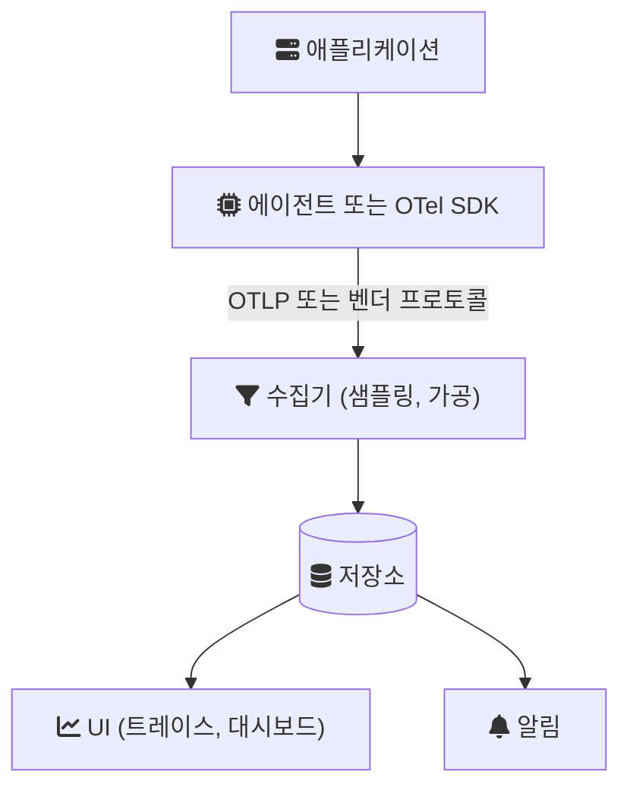
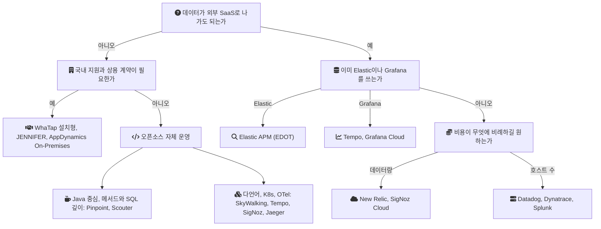

APM(Application Performance Monitoring)을 고르는 일은 대시보드 화면을 고르는 일처럼 보이지만, 실제로는 세 가지를 함께 고르는 일이다. 애플리케이션에 무엇을 붙일지(에이전트), 데이터를 어디에 쌓을지(저장소), 그리고 나중에 다른 도구로 옮길 수 있는지(종속성)다. 이 글은 시장에 있는 APM 도구를 이 세 축과 비용 구조로 나누어 비교하고, 팀 상황별로 어떤 선택이 맞는지 정리한다.

모든 제품 정보는 2026-10-05에 각 제품의 공식 문서, 가격 페이지, 저장소 README에서 확인한 내용이다. 가격과 기능 구성은 자주 바뀌므로 도입 전에는 같은 페이지를 다시 열어 봐야 한다. 이 글에 나오는 도구 중 어느 것도 직접 벤치마크하지 않았고, 성능 오버헤드 수치는 해당 벤더나 프로젝트가 스스로 밝힌 것만 그대로 옮겼다.

## APM이 보는 것과 데이터가 흐르는 길

APM은 요청 하나가 서버 안에서 어떻게 처리됐는지를 보여 주는 도구다. 메트릭이 "p99 응답 시간이 올랐다"를 말한다면, APM은 "그 느린 요청은 어느 서비스의 어느 SQL에서 시간을 썼다"를 말한다. 무엇을 집계 지표로 볼지는 [RED와 USE](/posts/red-and-use-method/)가 정리하고, APM은 그 지표가 튄 순간의 개별 요청을 따라간다.

이때 쓰이는 단위가 트레이스(trace)와 스팬(span)이다. 스팬은 "HTTP 요청 처리", "DB 쿼리 1회"처럼 시작과 끝이 있는 작업 하나이고, 트레이스는 요청 하나에 속한 스팬들을 부모-자식 관계로 묶은 것이다. 서비스가 여럿이면 트레이스 ID를 헤더로 넘겨 하나의 트레이스로 이어 붙이는데, 이를 분산 추적(distributed tracing)이라 한다.

도구마다 이름은 다르지만 데이터가 지나가는 길은 거의 같다. 애플리케이션 안의 에이전트나 SDK가 스팬과 지표를 만들고, 수집기(collector)가 받아 가공한 뒤 저장소에 쓰고, UI와 알림이 저장소를 읽는다.

도구를 비교할 때 갈리는 지점이 이 그림의 각 칸이다. 에이전트가 벤더 전용인지 OpenTelemetry인지, 수집기와 저장소를 누가 운영하는지(SaaS냐 자체 설치냐), 저장소가 무엇인지(HBase, Elasticsearch, 오브젝트 스토리지 등)에 따라 비용과 운영 부담이 달라진다.

## 바닥에 깔린 표준: OpenTelemetry와 OTLP

비교에 앞서 OpenTelemetry(OTel)를 먼저 짚어야 한다. 대부분의 도구가 이제 OTel과의 관계로 자기 위치를 설명하기 때문이다.

OTel은 트레이스, 메트릭, 로그 같은 텔레메트리를 만들고 내보내는 프레임워크이자 도구 모음이고, 특정 벤더에 묶이지 않는다. 공식 문서는 OTel이 관측 백엔드 자체는 아니며, 저장과 시각화는 의도적으로 다른 도구에 맡긴다고 설명한다([What is OpenTelemetry?](https://opentelemetry.io/docs/what-is-opentelemetry/)). 즉 OTel은 그림의 앞쪽 두 칸(계측과 전송)을 표준화하고, 뒤쪽(저장소와 UI)은 각 도구가 채운다.

OTLP(OpenTelemetry Protocol)는 계측 지점에서 수집기, 수집기에서 백엔드로 데이터를 보낼 때의 인코딩과 전송 방식을 정한 규격이다. gRPC(기본 포트 4317)와 HTTP(기본 포트 4318) 두 전송을 지원하고, 트레이스, 메트릭, 로그 신호는 Stable 상태이며 프로파일 신호는 아직 Development 단계다([OTLP Specification](https://opentelemetry.io/docs/specs/otlp/)).

Java에서는 OTel Java 에이전트 JAR을 `-javaagent`로 붙이면 코드 수정 없이 계측이 된다. 에이전트가 클래스 로딩 시점에 바이트코드를 주입해 인바운드 요청, 외부 HTTP 호출, DB 호출 같은 지점에서 스팬을 만든다([Java Agent](https://opentelemetry.io/docs/zero-code/java/agent/)). 바이트코드 계측(bytecode instrumentation)은 컴파일된 클래스 파일을 로딩 시점에 고쳐 측정 코드를 끼워 넣는 기법이고, 아래에 나오는 상용 APM의 Java 에이전트도 대부분 같은 방식이다.

오버헤드에 대해 OTel 문서는 하나의 수치를 내놓지 않는다. 문서는 "the final agent overhead depends on multiple factors"(최종 에이전트 오버헤드는 여러 요인에 따라 달라진다)라고 쓰고, 자기 환경에서 직접 재라고 권한다([Performance](https://opentelemetry.io/docs/zero-code/java/agent/performance/)).

## 비교 기준과 각 기준이 중요한 이유

백엔드 팀이 도구를 고를 때 실제로 차이를 만드는 기준은 여섯 가지다.

| 기준 | 보는 것 | 백엔드 팀에 중요한 이유 |
| --- | --- | --- |
| 커버리지 | 트레이스, 메트릭, 로그, 프로파일링, RUM, DB 쿼리, 알림 | 장애 조사 중 도구를 오가는 횟수가 줄어든다. 한 도구에 없는 신호는 다른 도구를 붙여야 한다 |
| 계측 방식 | 벤더 바이트코드 에이전트, SDK, OTel | 코드 수정량, 지원 라이브러리 범위, 다른 언어 서비스(Go 등)를 볼 수 있는지가 정해진다 |
| 배포 모델과 저장소 | SaaS, 자체 설치, 저장소 종류 | 자체 설치라면 HBase나 Elasticsearch 같은 저장소를 팀이 운영해야 한다. SaaS라면 데이터가 외부로 나간다 |
| 가격 모델 | 호스트당, GB당, 사용자당, 오픈소스 | 트래픽, 서버 수, 조직 인원 중 무엇이 늘 때 비용이 느는지가 정해진다 |
| 샘플링과 보존 | 어떤 트레이스를 얼마나 오래 남기는가 | 드물게 느린 요청을 나중에 찾을 수 있는지, 저장 비용이 얼마인지가 여기서 정해진다 |
| 종속성 | 다른 도구로 옮길 때의 비용 | 벤더 전용 에이전트는 교체 시 모든 서비스의 배포 설정을 바꿔야 한다. OTel 계측은 내보낼 곳만 바꾸면 된다 |

RUM(Real User Monitoring)은 브라우저나 앱에서 실제 사용자가 겪은 로딩 시간과 오류를 수집하는 기능이다. 백엔드 팀에게는 "서버는 빨랐는데 사용자는 느렸다"를 가르는 데 쓰인다. 샘플링은 모든 요청을 저장하지 않고 일부만 남기는 것이다. 요청 시작 시점에 남길지를 정하면 헤드 샘플링, 트레이스가 끝난 뒤 전체를 보고 정하면 테일 샘플링이고, OTel에서는 테일 샘플링을 Collector의 프로세서로 처리한다([Sampling](https://opentelemetry.io/docs/concepts/sampling/)).

## 상용 SaaS APM

### Datadog APM

Java에서는 `dd-java-agent.jar`를 `-javaagent`로 붙이는 방식이다([Tracing Java Applications](https://docs.datadoghq.com/tracing/trace_collection/automatic_instrumentation/dd_libraries/java/)). OTel 데이터도 받는다. Datadog Agent에 내장된 DDOT Collector, 표준 OTel Collector에서 OTLP로 내보내기, OTLP 직접 수집의 세 경로가 있고, 경로에 따라 쓸 수 있는 Datadog 기능이 달라진다고 문서가 밝힌다([OpenTelemetry in Datadog](https://docs.datadoghq.com/opentelemetry/)).

APM 외에 JDK Flight Recorder 등을 이용해 운영 환경에서 상시 동작하는 Continuous Profiler([Continuous Profiler](https://docs.datadoghq.com/profiler/)), 쿼리 지표와 실행 계획을 보여 주는 Database Monitoring([Database Monitoring](https://docs.datadoghq.com/database_monitoring/)), RUM과 로그 관리 제품이 같은 플랫폼에 있다([RUM](https://docs.datadoghq.com/real_user_monitoring/), [Log Management](https://docs.datadoghq.com/logs/)).

샘플링은 단계가 둘이다. 수집(ingestion) 단계에서는 Agent의 헤드 샘플링이 기본값으로 Agent당 초당 10개 트레이스를 목표로 하고, 오류 트레이스와 드문 트레이스를 따로 보충한다([Ingestion Mechanisms](https://docs.datadoghq.com/tracing/trace_pipeline/ingestion_mechanisms/)). 보존(retention) 단계에서는 항상 켜져 있는 intelligent retention filter가 대표 트레이스를 고르고, 인덱싱된 스팬은 15일 보존된다([Trace Retention](https://docs.datadoghq.com/tracing/trace_pipeline/trace_retention/)).

가격 페이지는 APM을 APM 호스트당 월 과금으로, 수집량은 GB당, 인덱싱 스팬은 100만 개당 보존 기간별로 따로 매긴다. 확인 시점의 연간 결제 기준 표시가는 APM 호스트당 $31, 수집 GB당 $0.10이었다([Datadog Pricing List](https://www.datadoghq.com/pricing/list/)). 호스트 수와 트래픽 양이 모두 비용에 들어간다. 회사에서는 API 구조를 바꾸기 전후의 응답 시간을 Datadog 대시보드로 비교했다.

### New Relic

Java 에이전트는 JSR 163 규격의 javaagent로, 클래스 로딩 흐름에 끼어들어 ASM 엔진으로 바이트코드를 계측한다. 트랜잭션, 오류, JVM 지표, 스레드 프로파일러, 분산 추적을 다룬다([Introduction to the Java agent](https://docs.newrelic.com/docs/apm/agents/java-agent/getting-started/introduction-new-relic-java/)). 브라우저 모니터링과 로그 관리도 같은 플랫폼에 있다([Browser monitoring](https://docs.newrelic.com/docs/browser/browser-monitoring/getting-started/introduction-browser-monitoring/), [Log management](https://docs.newrelic.com/docs/logs/get-started/get-started-log-management/)).

OTel 지원이 가장 직접적인 SaaS 중 하나다. New Relic은 OTLP 네이티브 수집을 지원하고 OTel 데이터를 보낼 때 이 방식을 권장하며, gRPC와 HTTP 모두 받는다([OTLP endpoint](https://docs.newrelic.com/docs/opentelemetry/best-practices/opentelemetry-otlp/)).

가격 구조가 다른 SaaS와 다르다. 호스트가 아니라 수집 데이터 GB와 사용자 유형으로 과금한다. 확인 시점에 월 100GB 수집과 기본 사용자는 무료였고, 초과분은 GB당 $0.40(Data Plus 옵션은 $0.60), 전체 플랫폼 사용자는 에디션별 사용자당 요금이었다([New Relic Pricing](https://newrelic.com/pricing)). 기본 보존 기간은 APM 데이터와 분산 트레이스가 8일, Data Plus에서는 98일이다([Data retention](https://docs.newrelic.com/docs/data-apis/manage-data/manage-data-retention/)). 서버 수보다 데이터 양과 대시보드를 볼 엔지니어 수가 비용을 정한다.

### Dynatrace

OneAgent라는 단일 에이전트를 호스트마다 하나 설치하면, 프로세스를 자동으로 찾아 계측을 켠다([OneAgent](https://docs.dynatrace.com/docs/ingest-from/dynatrace-oneagent)). 애플리케이션마다 `-javaagent`를 붙이는 방식과 달리 호스트 단위로 배포한다는 점이 차이다. OTel 데이터는 API 엔드포인트로 직접, 표준 OTel Collector로, 또는 Dynatrace OTel Collector로 받을 수 있고 OneAgent도 OTLP를 받는다([OpenTelemetry and Dynatrace](https://docs.dynatrace.com/docs/ingest-from/opentelemetry)).

SaaS 외에 Dynatrace Managed라는 자체 운영형이 있다([Dynatrace Managed](https://docs.dynatrace.com/managed)). 가격은 메모리 GiB-시간 단위다. 확인 시점의 Full-Stack 표시가는 메모리-GiB-시간당 $0.01(8GiB 호스트 기준 월 $58)이었고, 이 단계에 APM, 코드 레벨 프로파일링, OTel 메트릭과 트레이스, 10일 트레이스 보존이 포함된다고 적혀 있다([Dynatrace Pricing](https://www.dynatrace.com/pricing/)). 호스트 메모리가 큰 서버일수록 비용이 커지는 구조다.

### Splunk Observability Cloud와 AppDynamics

Splunk는 APM 제품이 둘이다. Splunk Observability Cloud의 APM은 OTel 기반이다. Java 계측은 OTel Java 에이전트의 Splunk 배포판(Splunk Distribution of OpenTelemetry Java)으로 한다([splunk-otel-java](https://github.com/signalfx/splunk-otel-java)). 문서는 연결된 서비스의 모든 스팬과 트레이스를 수집해 full-fidelity 데이터를 제공한다고 설명하고, DB 쿼리 성능, AlwaysOn Profiling, RED 지표 기반 알림(detector)을 기능으로 든다([Introduction to Splunk APM](https://docs.splunk.com/observability/en/apm/intro-to-apm.html)). 가격은 호스트당 월 과금이고, 확인 시점에 APM이 포함된 가장 낮은 단계(App & Infra)는 연간 결제 기준 호스트당 월 $60부터였다([Splunk Observability Pricing](https://www.splunk.com/en_us/products/pricing/observability.html)).

AppDynamics는 Cisco 산하에서 Splunk AppDynamics라는 이름으로 이어지고 있다. 제품 페이지는 하이브리드와 온프레미스 애플리케이션을 대상으로 내세우고([Splunk AppDynamics](https://www.splunk.com/en_us/products/splunk-appdynamics.html)), Splunk 문서 포털에 AppDynamics SaaS와 AppDynamics On-Premises 문서가 따로 있다([AppDynamics On-Premises](https://help.splunk.com/en/appdynamics-on-premises)). 온프레미스 요건이 있는 조직이 Splunk 제품군 안에서 고를 수 있는 선택지가 이쪽이다.

### Elastic APM

Elastic APM은 Elastic Stack 위의 APM이다. 요청 응답 시간, DB 쿼리, 캐시 호출, 외부 HTTP 호출을 트레이스로 수집하고, 처리되지 않은 예외를 스택 트레이스 기준으로 묶으며, JVM 지표 같은 에이전트 메트릭을 함께 모은다([Elastic APM](https://www.elastic.co/docs/solutions/observability/apm)). RUM도 있다([Real user monitoring](https://www.elastic.co/docs/solutions/observability/applications/user-experience)).

계측 방향은 OTel로 옮겨 가고 있다. Elastic은 이제 EDOT(Elastic Distributions of OpenTelemetry) 언어 SDK를 권장 경로로 두고, 기존 Elastic APM 에이전트는 OTel 브리지와 함께 기존 계측을 재사용하는 선택지로 남겨 두었다([OpenTelemetry with Elastic APM](https://www.elastic.co/docs/solutions/observability/apm/opentelemetry)). EDOT는 자체 관리(self-managed) Elastic Stack에서도 쓸 수 있다([Elastic Distributions of OpenTelemetry](https://www.elastic.co/docs/reference/opentelemetry)). 문서에서 기존 에이전트를 지원 종료로 표시한 문장은 찾지 못했다.

이미 로그를 Elasticsearch에 쌓고 있는 팀에게는 저장소를 하나 더 늘리지 않는다는 점이 크다. 배포는 Elastic Cloud(호스팅형, 서버리스)와 자체 설치 중에서 고른다. 서버리스 Observability는 수집 GB와 월 보존 GB로 과금하고, 확인 시점에 Complete 단계의 로그와 트레이스 수집은 GB당 $0.09부터였다([Elastic Observability Serverless Pricing](https://www.elastic.co/pricing/serverless-observability)). 호스팅형은 자원 기반 과금이다([Elastic Pricing](https://www.elastic.co/pricing)).

## 국내 벤더와 국내 오픈소스

### 와탭(WhaTap)

와탭의 Java APM은 BCI(Byte Code Instrumentation)로 SQL, HTTP 호출, 메서드 수준까지 추적하고, 실행 중인 트랜잭션을 실시간으로 보여 준다. 와탭은 메서드 단위 분석을 위한 Active Stack을 자사 특허 기술로 소개한다([WhaTap Java 소개](https://docs.whatap.io/java/introduction)). OTel 데이터는 OTel Collector의 OTLP Exporter가 와탭 OpenTelemetry 에이전트로 보내는 방식으로 받는다([WhaTap OpenTelemetry](https://docs.whatap.io/en/opentelemetry/introduction)).

가격 페이지는 상품별로 과금 단위가 다르다. 애플리케이션 모니터링은 vCPU(또는 CPU 코어)당, 서버는 호스트당, 쿠버네티스는 컨테이너당, 브라우저(RUM)는 1,000세션당, 로그는 로그 건수 단위다. 확인 시점에 애플리케이션 모니터링은 vCPU당 월 25,000원(VAT 별도)이었다. 설치형(On-Premise) 요금은 별도 문의로 안내한다([WhaTap 요금](https://www.whatap.io/pricing)). 원화 결제와 설치형 선택지가 함께 있다는 점이 해외 SaaS와 다르다.

### 제니퍼(JENNIFER)

제니퍼소프트의 APM으로, Java, .NET, PHP, Python, Node.js를 지원한다([제니퍼소프트](https://jennifersoft.com/ko/)). 대표 기능은 개별 트랜잭션의 응답 시간을 점으로 찍는 X-View 차트와, 서버에 들어와 처리 중인 요청을 실시간으로 보여 주는 액티브 서비스다. 메서드 프로파일링 없이 스택 트레이스 샘플링으로 메서드 수준 성능을 보는 SFR(Stacktrace Flight Recorder)과 지표 이상 탐지도 있다([제니퍼 주요 기능](https://jennifersoft.com/ko/product/apm/features?feat=transaction)). 지원 플랫폼 페이지는 OTel로 수집한 데이터를 제니퍼 대시보드에서 보는 기능을 소개한다([제니퍼 지원 플랫폼](https://jennifersoft.com/ko/product/apm/platform?env=java)).

배포 방식은 라이선스 키를 발급받아 제품을 내려받아 설치하는 형태다. 평가판도 2주 라이선스 키로 제공된다([제니퍼 라이센스키 신청](https://jennifersoft.com/ko/jennifer-trial/)). 공식 사이트에서 공개 가격표는 찾지 못했다.

### Scouter

Scouter는 Apache License 2.0의 오픈소스 APM이다. JVM 애플리케이션(WAS와 독립 실행 애플리케이션)과 OS 자원을 모니터링한다. 구성은 Java Agent와 Host Agent, 데이터를 저장하는 Server(Collector), RCP 기반 데스크톱 Client(Viewer), HTTP로 데이터를 꺼내는 Web API다. 사용자 정의 알림은 플러그인 스크립트로 만든다. Zipkin-Scouter 저장소를 쓰면 Zipkin으로 계측한 다른 언어 서비스를 XLog 차트에 함께 띄울 수 있다([Scouter README](https://github.com/scouter-project/scouter/blob/master/README_kr.md)). 확인 시점의 최신 릴리스는 2026-02-15의 v2.21.3이다([Scouter Releases](https://github.com/scouter-project/scouter/releases/)). OTLP 수집에 대한 언급은 README에 없다.

## 오픈소스 추적과 APM

### Pinpoint

Pinpoint는 Dapper 논문에서 영감을 받은 대규모 분산 시스템용 APM이다. README의 저작권 표기는 NAVER Corp.이고 라이선스는 Apache 2.0이다. Java가 중심이고 PHP와 Python은 별도 에이전트 저장소로 지원한다. README는 오버헤드를 "approximately 3% increase in resource usage"(자원 사용량 약 3% 증가)로 밝힌다([Pinpoint README](https://github.com/pinpoint-apm/pinpoint)). 이 수치는 프로젝트의 주장이고, 내 환경에서 잰 값은 아니다.

에이전트는 바이트코드 계측으로 메서드 호출 스택과 실행된 SQL을 코드 수정 없이 기록한다. 저장소는 트레이스용 HBase와, 3.0부터 인스펙터(JVM 지표) 데이터를 맡은 Apache Pinot이다. 3.1.0에서는 Collector가 OTLP로 메트릭을 받는 기능이 들어왔지만, 이 기능은 메트릭에 한정되고 트레이스는 여전히 Pinpoint 에이전트가 만든다([v3.1.0 release](https://github.com/pinpoint-apm/pinpoint/releases/tag/v3.1.0)). 확인 시점의 최신 릴리스는 2026-10-02의 v3.1.1이고, 에이전트는 JDK 8 이상, Collector와 Web은 JDK 17 이상을 요구한다([v3.1.1 release](https://github.com/pinpoint-apm/pinpoint/releases/tag/v3.1.1)).

샘플링은 에이전트 설정 파일에서 정한다. 기본 루트 설정은 `profiler.sampling.counting.sampling-rate=1`(모든 트랜잭션)이고, 함께 들어 있는 release 프로필은 20(20건 중 1건, 5%)이다([pinpoint-root.config](https://github.com/pinpoint-apm/pinpoint/blob/v3.1.1/agent-module/agent/src/main/resources/pinpoint-root.config), [release pinpoint.config](https://github.com/pinpoint-apm/pinpoint/blob/v3.1.1/agent-module/agent/src/main/resources/profiles/release/pinpoint.config)).

[monticker](/posts/monticker-opentelemetry-tracing/)에서는 OTel과 Jaeger로 서비스 사이의 경로를 보고, Pinpoint는 그 안의 메서드와 SQL을 보는 용도로 로컬 프로파일에만 두기로 했다. 운영 클러스터에 넣지 않은 이유는 HBase와 ZooKeeper, Collector, Web까지 운영해야 하는 부담이었다. 에이전트를 켰을 때의 오버헤드는 아직 재지 않았다.

### Apache SkyWalking

SkyWalking은 트레이스, 메트릭, 로그, 프로파일링(eBPF 포함), 브라우저 모니터링, 알림을 한 플랫폼에서 다루는 Apache 프로젝트다. Java, Go, Python, Node.js, PHP용 자체 에이전트가 있고, OTLP 트레이스와 메트릭, Zipkin 트레이스도 받는다([SkyWalking Overview](https://skywalking.apache.org/docs/main/latest/readme/)). 이 목록에서 자체 에이전트와 OTel 수집을 둘 다 제대로 지원하는 오픈소스 쪽 대표다.

저장소는 기본값이 SkyWalking 전용으로 만든 BanyanDB이고, Elasticsearch와 OpenSearch, MySQL과 PostgreSQL도 고를 수 있다. 문서는 대규모에는 BanyanDB와 Elasticsearch를, SQL 데이터베이스는 샘플링 비율이 낮은 중간 규모에 권한다([Backend Storage](https://skywalking.apache.org/docs/main/latest/en/setup/backend/backend-storage/)). Java 에이전트의 기본 샘플링 설정은 `agent.sample_n_per_3_secs`이고 0 이하면 샘플링을 끈다([agent.config v9.7.0](https://github.com/apache/skywalking-java/blob/v9.7.0/apm-sniffer/config/agent.config)). OAP 서버의 기본 보존 설정은 레코드 데이터 3일, 메트릭 데이터 7일이다([application.yml v11.0.0](https://github.com/apache/skywalking/blob/v11.0.0/oap-server/server-starter/src/main/resources/application.yml)).

### Jaeger

Jaeger는 Uber가 2016년에 공개해 CNCF에 기증한 분산 추적 플랫폼이고, CNCF graduated 프로젝트다([Jaeger Introduction](https://www.jaegertracing.io/docs/latest/)). Jaeger v2 바이너리는 OpenTelemetry Collector 프레임워크 위에 만들어졌고, 예전 Jaeger agent 역할에는 표준 OTel Collector를 쓰라고 권한다. 저장소는 Cassandra, Elasticsearch, OpenSearch, Badger, ClickHouse, 메모리, Kafka(버퍼)를 지원하며, Badger를 쓰는 all-in-one은 단일 인스턴스라 적은 데이터량에서만 운영용으로 쓸 수 있다([Jaeger Architecture](https://www.jaegertracing.io/docs/latest/architecture/)).

Jaeger는 트레이스만 다룬다. 메트릭과 로그, 메서드 수준 프로파일은 다른 도구의 몫이다. 계측은 OTel SDK나 에이전트에 맡기므로 종속성이 가장 낮은 축에 든다.

### Zipkin

Zipkin은 서비스 아키텍처의 지연 문제를 조사하는 데 필요한 타이밍 데이터를 모으는 분산 추적 시스템이다([Zipkin](https://zipkin.io/)). 데이터는 HTTP, Kafka, gRPC, RabbitMQ 등으로 받고, 저장소는 Cassandra, Elasticsearch(OpenSearch 포함), 레거시 v1 컴포넌트인 MySQL, 그리고 테스트용 메모리다([Zipkin README](https://github.com/openzipkin/zipkin)). 확인 시점의 최신 릴리스는 2026-04-08의 3.6.1이다([Zipkin Releases](https://github.com/openzipkin/zipkin/releases)). Jaeger와 같이 트레이스 전용이고, 다른 도구가 Zipkin 형식을 받는 경우가 많다(SkyWalking, Tempo, Scouter의 Zipkin 저장소).

### Grafana Tempo와 LGTM 스택

Tempo는 오브젝트 스토리지만 있으면 동작하는 분산 추적 백엔드다. S3, GCS, Azure, 로컬 디스크를 저장소로 쓰고, Jaeger, Zipkin, Kafka, OpenTelemetry 형식을 받는다. 라이선스는 AGPL-3.0이며 일부는 Apache-2.0 예외다([Tempo README](https://github.com/grafana/tempo)). 질의는 TraceQL로 한다([Tempo docs](https://grafana.com/docs/tempo/latest/)). 블록 보존 기본값은 336시간(14일)이다([Tempo configuration](https://grafana.com/docs/tempo/latest/configuration/)).

Tempo는 혼자보다 Grafana의 다른 프로젝트와 묶어 쓰는 경우가 많다. 흔히 LGTM이라 부르는 조합은 로그의 Loki, 시각화와 알림의 Grafana, 트레이스의 Tempo, 메트릭의 Mimir다. 여기에 지속 프로파일링의 Pyroscope, OTel Collector 배포판인 Alloy가 붙는다([Grafana OSS](https://grafana.com/oss/)). LGTM이라는 이름은 Grafana의 OSS 페이지에 쓰인 용어는 아니다.

같은 스택을 Grafana Cloud로 쓸 수도 있다. 확인 시점에 무료 단계는 트레이스와 로그 월 50GB에 14일 보존이었고, 유료는 트레이스와 로그를 처리, 쓰기, 보존 GB 단위로 따로 과금했으며, Application Observability는 호스트-시간 단위였다([Grafana Pricing](https://grafana.com/pricing/)).

### SigNoz

SigNoz는 스스로를 OpenTelemetry 네이티브 관측 플랫폼으로 소개하고, 로그, 메트릭, 트레이스, 알림, 대시보드, 예외를 한 화면에서 다룬다. 자체 설치(Docker, Kubernetes 등)와 SigNoz Cloud를 고를 수 있고, 저장소의 라이선스는 MIT에 엔터프라이즈 기능용 `ee/` 디렉터리가 따로 있다([SigNoz README](https://github.com/SigNoz/signoz)). 수집은 OTel Collector가 맡아 OTLP, Jaeger, Zipkin 등을 받아 ClickHouse에 쓰고, 알림은 SigNoz 바이너리 안의 Alert Manager가 처리한다([SigNoz Architecture](https://signoz.io/docs/architecture/)). 클라우드는 트레이스와 로그를 수집 GB당, 메트릭을 샘플 수 단위로 과금하고, 커뮤니티 에디션은 직접 설치해 쓸 수 있다([SigNoz Pricing](https://signoz.io/pricing/)).

## 한눈에 보는 비교

아래 표는 위에서 확인한 내용만 옮긴 것이다. 칸이 비어 있지 않더라도 기능의 깊이는 제품마다 다르다.

| 도구 | 다루는 신호 (문서 기준) | 계측 | OTel과의 관계 | 배포와 저장소 |
| --- | --- | --- | --- | --- |
| Datadog | 트레이스, 프로파일링, DB 모니터링, RUM, 로그 | 자체 에이전트 (`dd-java-agent`) | 자체 에이전트와 OTLP 수집 둘 다 | SaaS |
| New Relic | 트레이스, JVM 지표, 스레드 프로파일러, 브라우저, 로그 | 자체 에이전트 (BCI) | OTLP 네이티브 수집, 권장 | SaaS |
| Dynatrace | APM, 코드 레벨 프로파일링, RUM, OTel 메트릭과 트레이스 | 호스트당 OneAgent | 자체 에이전트와 OTLP 둘 다 | SaaS, Managed(자체 운영) |
| Splunk Observability | 트레이스, DB 쿼리, 프로파일링, 알림 | OTel Java 배포판 | OTel 기반 | SaaS |
| Splunk AppDynamics | (이 글에서 세부 미확인) | (미확인) | (미확인) | SaaS, On-Premises |
| Elastic APM | 트레이스, 오류, 에이전트 메트릭, RUM | EDOT 권장, 기존 에이전트 | EDOT 권장 | Elastic Cloud, 자체 설치 (Elasticsearch) |
| WhaTap | 트랜잭션, SQL, 메서드, 서버, K8s, 로그, 브라우저 | 자체 에이전트 (BCI) | OTLP 에이전트로 수집 | SaaS, 설치형 |
| JENNIFER | 트랜잭션, 액티브 서비스, SFR 프로파일링, 이상 탐지 | 자체 에이전트 | OTel 데이터 수집 기능 | 라이선스 설치형 |
| Scouter | 트랜잭션 프로파일(SQL, API 호출), 호스트 자원, 알림 플러그인 | 자체 Java 에이전트 | Zipkin 연동, OTLP 언급 없음 | 자체 설치 |
| Pinpoint | 트레이스, 메서드와 SQL, 인스펙터 | 자체 Java 에이전트 (바이트코드) | OTLP는 메트릭만 수신 | 자체 설치 (HBase, Pinot) |
| SkyWalking | 트레이스, 메트릭, 로그, 프로파일링, 브라우저, 알림 | 자체 에이전트 | OTLP와 Zipkin 수신 | 자체 설치 (BanyanDB 기본, ES, SQL) |
| Jaeger | 트레이스 | OTel SDK 또는 에이전트 | OTel Collector 기반 | 자체 설치 (Cassandra, ES, ClickHouse 등) |
| Zipkin | 트레이스 | Zipkin 계측 라이브러리 | (README에 OTLP 언급 없음) | 자체 설치 (Cassandra, ES, MySQL) |
| Tempo (+LGTM) | 트레이스 (+로그, 메트릭, 프로파일링) | OTel SDK 또는 에이전트 | OTLP 수신, Alloy가 OTel Collector | 자체 설치 (오브젝트 스토리지), Grafana Cloud |
| SigNoz | 트레이스, 메트릭, 로그, 예외, 알림 | OTel SDK 또는 에이전트 | OTel 네이티브 | 자체 설치 (ClickHouse), SigNoz Cloud |

가격 모델은 무엇이 늘 때 비용이 느는지로 다시 묶을 수 있다. 숫자는 확인 시점의 표시가이고 할인, 약정, 지역에 따라 달라진다.

| 과금 축 | 도구 | 비용이 커지는 조건 |
| --- | --- | --- |
| 호스트당 | Datadog APM(+수집 GB), Splunk Observability, Dynatrace(메모리 GiB-시간) | 서버나 노드 수, 호스트 메모리 크기 |
| 데이터 GB와 사용자 | New Relic | 수집량, 전체 기능을 쓰는 엔지니어 수 |
| 수집 GB와 보존 GB | Elastic 서버리스, Grafana Cloud, SigNoz Cloud | 트레이스와 로그의 양, 보존 기간 |
| vCPU, 호스트, 컨테이너 | WhaTap | 애플리케이션 서버의 코어 수 |
| 라이선스 문의 | JENNIFER, WhaTap 설치형, AppDynamics On-Premises | 계약 조건 |
| 오픈소스 (운영 비용) | Pinpoint, SkyWalking, Scouter, Jaeger, Zipkin, Tempo, SigNoz CE | 저장소 클러스터와 그것을 운영하는 사람의 시간 |

오픈소스의 비용은 0이 아니다. Pinpoint라면 HBase 클러스터를, SkyWalking이라면 BanyanDB나 Elasticsearch를, Tempo라면 오브젝트 스토리지와 Tempo 컴포넌트들을 누군가 운영해야 한다. 라이선스 비용이 운영 인력 비용으로 바뀌는 것이다.

## 종속성: 바꾸기 어려운 것은 에이전트다

도구를 바꿀 때 가장 비싼 부분은 UI가 아니라 계측이다. 벤더 전용 에이전트를 쓰면 모든 서비스의 기동 옵션(`-javaagent` 경로), 설정 파일, 커스텀 계측 코드가 그 벤더에 묶인다. 대시보드와 알림 규칙도 벤더 질의 언어로 쓰여 있어 옮길 때 다시 만들어야 한다.

OTel로 계측해 두면 이 중 첫 번째가 풀린다. SDK나 에이전트는 그대로 두고 OTLP를 보낼 곳만 바꾸면 되고, Collector를 가운데 두면 같은 데이터를 두 백엔드로 동시에 보내며 비교할 수도 있다. 다만 대시보드, 알림 규칙, 보존 정책은 OTel 범위 밖이라 백엔드를 바꾸면 여전히 다시 만들어야 한다. Datadog처럼 경로에 따라 쓸 수 있는 기능이 달라지는 경우도 있어, OTel로 보내면 벤더의 일부 기능을 포기해야 할 수 있다.

반대로 자체 에이전트가 OTel보다 깊이 보는 영역도 있다. OTel 자동 계측은 요청, HTTP 호출, DB 호출 같은 경계에 스팬을 만들고, 그 안쪽은 직접 계측한 곳만 보인다. 메서드 단위 호출 스택을 코드 수정 없이 남기는 것은 Pinpoint, WhaTap, JENNIFER 같은 자체 에이전트가 앞세우는 기능이다. 그 공백은 프로파일러로 메울 수도 있다([off-CPU 프로파일링 실험](/posts/off-cpu-profiling-experiment/)). 종속성을 낮추는 선택은 이 깊이를 다른 도구로 메우는 비용을 함께 받아들이는 선택이다.

## 팀 상황별 선택

아래 흐름도는 이 글의 비교를 판단 순서로 옮긴 것이다. 각 분기는 하나의 정답이 아니라 출발점이다.

### 예산이 작은 소규모 팀

서비스가 몇 개이고 인원이 적다면 저장소를 직접 운영하는 비용이 가장 크다. 무료 수집량이 있는 데이터 기반 SaaS(New Relic의 월 100GB, Grafana Cloud의 무료 단계)로 시작하면 운영 부담 없이 트레이스를 볼 수 있다. 계측은 처음부터 OTel로 해 두는 것이 좋다. 무료 한도를 넘거나 다른 백엔드로 옮길 때 애플리케이션을 다시 배포하지 않아도 된다. 이 선택은 트래픽이 늘면 비용도 함께 는다는 점과, 데이터가 외부로 나간다는 점을 받아들인다.

### 온프레미스 요건이 있는 국내 기업

금융이나 공공처럼 데이터 반출이 어렵고 한국어 기술 지원과 계약 주체가 필요한 경우다. WhaTap 설치형, JENNIFER, AppDynamics On-Premises가 이 조건에 맞는다. 셋 다 자체 Java 에이전트로 트랜잭션과 SQL을 깊이 보고, WhaTap과 JENNIFER는 OTel 데이터 수집 경로도 있다. 이 선택은 라이선스 비용과 벤더 에이전트에 대한 종속을 받아들인다. 오픈소스로 같은 요건을 채우려면 Pinpoint나 Scouter가 후보지만, 그때는 저장소 운영과 장애 대응을 팀이 직접 맡는다.

### Kubernetes 기반 클라우드 네이티브 팀

서비스가 여러 언어로 쓰여 있고 파드가 자주 뜨고 지는 환경에서는 언어별 벤더 에이전트보다 OTel 계측과 OTel Collector가 다루기 쉽다. 백엔드는 트레이스만이면 Jaeger나 Tempo, 신호를 한곳에 모으려면 SkyWalking이나 SigNoz, 운영을 맡기려면 OTLP를 받는 SaaS다. Pinpoint는 Java 중심이라 Go 같은 다른 언어 서비스는 별도로 계측해야 한다. 이 선택은 메서드 단위 깊이를 프로파일러나 수동 스팬으로 메워야 한다는 점을 받아들인다.

### 이미 Elastic이나 Grafana를 쓰는 팀

로그가 이미 Elasticsearch에 있다면 Elastic APM을 붙이는 것이 저장소와 권한 체계를 하나로 유지하는 길이다. 메트릭과 대시보드가 Prometheus와 Grafana에 있다면 Tempo를 붙여 Grafana 안에서 메트릭, 로그, 트레이스를 오가게 한다. 둘 다 계측은 OTel(Elastic은 EDOT)로 하므로 종속성은 백엔드 쪽에만 남는다. 이 선택은 기존 클러스터의 용량 계획에 트레이스 데이터가 더해진다는 점을 받아들인다. Tempo는 오브젝트 스토리지를 쓰므로 저장 단가는 낮지만, 컴포넌트 수가 늘어난다.

### 운영 인력보다 기능 범위가 중요한 팀

프로파일링, DB 모니터링, RUM, 로그를 한 화면에서 연결해 보고 싶고 그 비용을 낼 수 있다면 Datadog, Dynatrace, Splunk 같은 통합 SaaS가 맞다. 호스트 단위 과금이므로 서버 수가 예측 가능한 조직에 잘 맞는다. 이 선택은 호스트 수와 수집량이 늘 때 비용이 선형으로 는다는 점과, 대시보드와 알림을 벤더 질의 언어로 쌓게 된다는 점을 받아들인다.

## 고를 때 확인할 것

어느 쪽을 고르든 도입 전에 재야 할 것은 같다. 에이전트를 켠 상태와 끈 상태에서 같은 부하를 걸어 지연과 처리량 차이를 보고, 하루치 트래픽이 만드는 트레이스 양(GB)을 재서 가격 모델에 넣어 본다. 벤더와 프로젝트가 밝힌 오버헤드 수치는 출발점일 뿐이다. OTel 문서가 말하듯 결과는 환경에 따라 달라진다.

참고로 OTLP 수집을 전제로 한 APM 플랫폼을 사이드 프로젝트(montracer)로 설계하고 있다.

## 참고

- [What is OpenTelemetry?](https://opentelemetry.io/docs/what-is-opentelemetry/) — OpenTelemetry
- [OTLP Specification](https://opentelemetry.io/docs/specs/otlp/) — OpenTelemetry
- [Java Agent](https://opentelemetry.io/docs/zero-code/java/agent/) — OpenTelemetry
- [Java Agent Performance](https://opentelemetry.io/docs/zero-code/java/agent/performance/) — OpenTelemetry
- [Sampling](https://opentelemetry.io/docs/concepts/sampling/) — OpenTelemetry
- [Tracing Java Applications](https://docs.datadoghq.com/tracing/trace_collection/automatic_instrumentation/dd_libraries/java/) — Datadog
- [OpenTelemetry in Datadog](https://docs.datadoghq.com/opentelemetry/) — Datadog
- [Continuous Profiler](https://docs.datadoghq.com/profiler/) — Datadog
- [Database Monitoring](https://docs.datadoghq.com/database_monitoring/) — Datadog
- [Real User Monitoring](https://docs.datadoghq.com/real_user_monitoring/) — Datadog
- [Log Management](https://docs.datadoghq.com/logs/) — Datadog
- [Ingestion Mechanisms](https://docs.datadoghq.com/tracing/trace_pipeline/ingestion_mechanisms/) — Datadog
- [Trace Retention](https://docs.datadoghq.com/tracing/trace_pipeline/trace_retention/) — Datadog
- [Datadog Pricing List](https://www.datadoghq.com/pricing/list/) — Datadog
- [Introduction to the Java agent](https://docs.newrelic.com/docs/apm/agents/java-agent/getting-started/introduction-new-relic-java/) — New Relic
- [Introduction to browser monitoring](https://docs.newrelic.com/docs/browser/browser-monitoring/getting-started/introduction-browser-monitoring/) — New Relic
- [Get started with log management](https://docs.newrelic.com/docs/logs/get-started/get-started-log-management/) — New Relic
- [OpenTelemetry OTLP endpoint](https://docs.newrelic.com/docs/opentelemetry/best-practices/opentelemetry-otlp/) — New Relic
- [Manage data retention](https://docs.newrelic.com/docs/data-apis/manage-data/manage-data-retention/) — New Relic
- [New Relic Pricing](https://newrelic.com/pricing) — newrelic.com: New Relic
- [OneAgent](https://docs.dynatrace.com/docs/ingest-from/dynatrace-oneagent) — Dynatrace
- [OpenTelemetry and Dynatrace](https://docs.dynatrace.com/docs/ingest-from/opentelemetry) — Dynatrace
- [Real User Monitoring Classic concepts](https://docs.dynatrace.com/docs/observe/digital-experience/rum-concepts) — Dynatrace
- [Dynatrace Managed](https://docs.dynatrace.com/managed) — Dynatrace
- [Dynatrace Pricing](https://www.dynatrace.com/pricing/) — Dynatrace
- [Introduction to Splunk APM](https://docs.splunk.com/observability/en/apm/intro-to-apm.html) — Splunk
- [Splunk Distribution of OpenTelemetry Java](https://github.com/signalfx/splunk-otel-java) — GitHub: Splunk
- [Splunk Observability Cloud Pricing](https://www.splunk.com/en_us/products/pricing/observability.html) — Splunk
- [Splunk AppDynamics](https://www.splunk.com/en_us/products/splunk-appdynamics.html) — Splunk
- [AppDynamics On-Premises](https://help.splunk.com/en/appdynamics-on-premises) — Splunk Docs
- [Elastic APM](https://www.elastic.co/docs/solutions/observability/apm) — Elastic
- [OpenTelemetry with Elastic APM](https://www.elastic.co/docs/solutions/observability/apm/opentelemetry) — Elastic
- [Elastic Distributions of OpenTelemetry](https://www.elastic.co/docs/reference/opentelemetry) — Elastic
- [Real user monitoring (User Experience)](https://www.elastic.co/docs/solutions/observability/applications/user-experience) — Elastic
- [Elastic Pricing](https://www.elastic.co/pricing) — Elastic
- [Elastic Observability Serverless Pricing](https://www.elastic.co/pricing/serverless-observability) — Elastic
- [WhaTap Java 모니터링 소개](https://docs.whatap.io/java/introduction) — WhaTap
- [WhaTap OpenTelemetry](https://docs.whatap.io/en/opentelemetry/introduction) — WhaTap
- [WhaTap 요금](https://www.whatap.io/pricing) — WhaTap
- [제니퍼소프트](https://jennifersoft.com/ko/) — jennifersoft.com: 제니퍼소프트
- [제니퍼 주요 기능](https://jennifersoft.com/ko/product/apm/features?feat=transaction) — jennifersoft.com: 제니퍼소프트
- [제니퍼 지원 플랫폼](https://jennifersoft.com/ko/product/apm/platform?env=java) — jennifersoft.com: 제니퍼소프트
- [제니퍼 라이센스키 신청](https://jennifersoft.com/ko/jennifer-trial/) — jennifersoft.com: 제니퍼소프트
- [Scouter README (한국어)](https://github.com/scouter-project/scouter/blob/master/README_kr.md) — GitHub: scouter-project
- [Scouter Releases](https://github.com/scouter-project/scouter/releases/) — GitHub: scouter-project
- [Pinpoint README](https://github.com/pinpoint-apm/pinpoint) — GitHub: pinpoint-apm
- [Pinpoint v3.1.0 release](https://github.com/pinpoint-apm/pinpoint/releases/tag/v3.1.0) — GitHub: pinpoint-apm
- [Pinpoint v3.1.1 release](https://github.com/pinpoint-apm/pinpoint/releases/tag/v3.1.1) — GitHub: pinpoint-apm
- [pinpoint-root.config (v3.1.1)](https://github.com/pinpoint-apm/pinpoint/blob/v3.1.1/agent-module/agent/src/main/resources/pinpoint-root.config) — GitHub: pinpoint-apm
- [release pinpoint.config (v3.1.1)](https://github.com/pinpoint-apm/pinpoint/blob/v3.1.1/agent-module/agent/src/main/resources/profiles/release/pinpoint.config) — GitHub: pinpoint-apm
- [SkyWalking Overview](https://skywalking.apache.org/docs/main/latest/readme/) — Apache SkyWalking
- [Backend Storage](https://skywalking.apache.org/docs/main/latest/en/setup/backend/backend-storage/) — Apache SkyWalking
- [agent.config (skywalking-java v9.7.0)](https://github.com/apache/skywalking-java/blob/v9.7.0/apm-sniffer/config/agent.config) — Apache SkyWalking
- [application.yml (skywalking v11.0.0)](https://github.com/apache/skywalking/blob/v11.0.0/oap-server/server-starter/src/main/resources/application.yml) — Apache SkyWalking
- [Jaeger Introduction](https://www.jaegertracing.io/docs/latest/) — Jaeger
- [Jaeger Architecture](https://www.jaegertracing.io/docs/latest/architecture/) — Jaeger
- [Zipkin](https://zipkin.io/) — zipkin.io: OpenZipkin
- [Zipkin README](https://github.com/openzipkin/zipkin) — GitHub: OpenZipkin
- [Zipkin Releases](https://github.com/openzipkin/zipkin/releases) — GitHub: OpenZipkin
- [Tempo README](https://github.com/grafana/tempo) — Grafana Labs
- [Tempo documentation](https://grafana.com/docs/tempo/latest/) — Grafana Labs
- [Tempo configuration](https://grafana.com/docs/tempo/latest/configuration/) — Grafana Labs
- [Grafana OSS](https://grafana.com/oss/) — Grafana Labs
- [Grafana Pricing](https://grafana.com/pricing/) — Grafana Labs
- [SigNoz README](https://github.com/SigNoz/signoz) — SigNoz
- [SigNoz Architecture](https://signoz.io/docs/architecture/) — SigNoz
- [SigNoz Pricing](https://signoz.io/pricing/) — SigNoz
