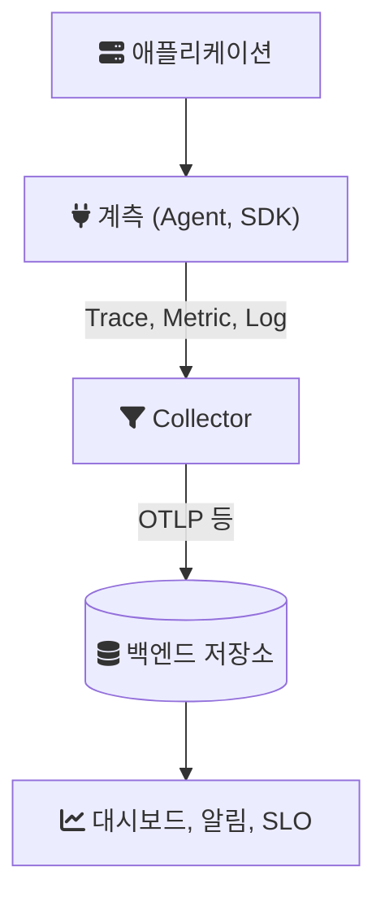

APM 도구를 비교하고 직접 붙여 보는 동안 같은 단어가 도구마다 조금씩 다른 뜻으로 쓰였다. Datadog 문서의 "trace", Jaeger 화면의 "operation", OpenTelemetry 명세의 "span"은 같은 것을 가리키기도 하고 다른 것을 가리키기도 한다. 이 글은 그 용어를 한곳에 모은다. 정의는 가능한 한 OpenTelemetry 용어집과 명세, Google SRE 책처럼 용어를 처음 정한 쪽의 문장을 따랐고, 도구별 이름은 괄호로 덧붙였다.

용어는 데이터가 흐르는 순서대로 묶었다. 애플리케이션 안에서 데이터를 만드는 쪽(계측), 그 데이터의 모양(신호), 데이터를 옮기는 쪽(수집), 그리고 그 데이터로 무엇을 판단하는지(지표와 목표)다.



---

## 큰 개념

### Monitoring과 Observability

Google SRE 책은 모니터링(monitoring)을 시스템에 대한 정량 데이터(요청 수와 종류, 오류 수와 종류, 처리 시간, 서버 가동 시간 같은 것)를 실시간으로 수집, 처리, 집계, 표시하는 일로 정의한다. 무엇을 볼지 미리 정해 두고 그 값을 계속 지켜보는 활동이다.

관측 가능성(observability)은 OpenTelemetry 입문서의 설명을 빌리면 시스템 내부를 모르는 상태에서도 바깥에서 질문을 던져 시스템을 이해할 수 있는 성질이다. 입문서는 이것이 처음 보는 문제, 즉 "왜 이런 일이 일어나는가"에 답하게 해 준다고 쓴다. 정리하면 모니터링은 아는 질문에 대한 답을 지키는 일이고, 관측 가능성은 모르는 질문을 나중에 던질 수 있게 데이터를 남겨 두는 성질이다. 그래서 관측 가능성은 도구가 아니라 시스템의 성질로 말해진다.

### Telemetry

텔레메트리(telemetry)는 시스템이 자기 동작에 대해 내보내는 데이터다. OpenTelemetry는 트레이스, 메트릭, 로그를 텔레메트리의 형태로 다룬다. OpenTelemetry라는 이름은 이 데이터를 만들고(SDK, 에이전트) 옮기는(프로토콜, 컬렉터) 표준을 만들겠다는 뜻이고, 저장소나 화면은 만들지 않는다.

### Signal

신호(signal)는 OpenTelemetry가 텔레메트리의 종류를 부르는 말이다. 용어집은 트레이스, 메트릭, 로그 중 하나라고 정의한다. 신호 문서는 여기에 Baggage를 함께 나열하고, 프로파일(profile)은 아직 개발 중이거나 제안 단계인 신호로 따로 표시한다. 세 신호의 쓰임은 [메트릭, 로그, 트레이스](/posts/metrics-logs-traces/)에 정리해 두었다.

### APM

APM(Application Performance Monitoring)은 애플리케이션 안에서 요청 하나가 어디서 시간을 썼는지를 보여 주는 도구 묶음을 부르는 업계 용어다. 표준이 정한 말이 아니어서 도구마다 범위가 다르다. 대부분 에이전트로 트레이스를 모으고, 그 트레이스에서 서비스별 지연, 처리량, 오류율 같은 메트릭을 뽑아 화면에 보여 준다. 도구별 차이는 [APM 도구 비교](/posts/apm-tools-comparison/)에 있다.

---

## 트레이스를 이루는 말

### Trace, Span

트레이스(trace)는 요청 하나가 시스템을 지나간 기록이다. OpenTelemetry 용어집은 트레이스를 부모와 자식 관계로 이어진 스팬(span)들의 방향 비순환 그래프(DAG)로 정의한다. 스팬은 트레이스 안의 작업 하나다. 이름, 시작과 끝 시각, 속성을 가진다. HTTP 요청을 받은 처리 하나, 그 안에서 날린 SQL 하나, 외부 API 호출 하나가 각각 스팬이다.

분산 추적(distributed tracing)은 이 트레이스가 여러 서비스를 거쳐 가는 과정을 따라가는 일이다. Jaeger 화면의 "operation"은 대개 스팬 이름을 뜻하고, SkyWalking은 HTTP 경로나 gRPC 메서드처럼 서비스로 들어오는 요청의 경로를 엔드포인트(endpoint)라고 부른다. 도구마다 묶는 단위의 이름이 다르니 화면의 단어를 스팬, 트레이스 중 어디에 대응하는지부터 확인하는 편이 빠르다.

### Trace ID, Span ID, Context Propagation

스팬이 같은 트레이스에 속한다는 것은 같은 트레이스 ID를 가졌다는 뜻이다. 서비스 A가 B를 부를 때 A는 자기 트레이스 ID와 현재 스팬 ID를 요청에 실어 보내고, B는 그것을 읽어 자기 스팬의 부모로 삼는다. 이 과정을 컨텍스트 전파(context propagation)라고 한다.

HTTP에서는 W3C Trace Context 권고안(2021년 11월 Recommendation)이 정한 `traceparent` 헤더가 표준이다. 값은 버전, 트레이스 ID(16바이트, 16진수 32자), 부모 스팬 ID(8바이트, 16진수 16자), 플래그를 대시로 잇는다. 플래그의 가장 낮은 비트가 "샘플링됨" 표시다.

```text
traceparent: 00-4bf92f3577b34da6a3ce929d0e0e4736-00f067aa0ba902b7-01
             버전 트레이스 ID                         부모 스팬 ID       플래그
```

함께 정의된 `tracestate` 헤더는 벤더가 자기 정보를 키와 값으로 덧붙이는 자리다. 전파가 한 곳에서라도 끊기면 트레이스가 둘로 쪼개져 보인다. 메시지 큐를 지나는 비동기 처리에서 가장 자주 끊긴다.

### Span Kind

스팬 종류(span kind)는 스팬이 경계의 어느 쪽에 있는지를 나타낸다.

| 종류 | 뜻 |
| --- | --- |
| Server | 동기로 들어온 원격 호출을 처리한다(받은 HTTP 요청, RPC) |
| Client | 동기로 나가는 원격 호출이다(보낸 HTTP 요청, DB 호출) |
| Producer | 나중에 비동기로 처리될 작업을 만든다(큐에 넣기) |
| Consumer | Producer가 만든 작업을 처리한다. Producer 스팬이 끝난 한참 뒤에 시작할 수 있다 |
| Internal | 프로세스 경계를 넘지 않는 작업이다 |

이 구분이 있어야 백엔드가 Client 스팬과 상대편 Server 스팬을 짝지어 서비스 지도를 그린다.

### Attribute, Span Event, Span Status, Span Link

속성(attribute)은 스팬에 붙는 키와 값이다. `http.request.method=POST`, `db.system=postgresql` 같은 것이다. 용어집은 속성을 OpenTelemetry가 메타데이터를 부르는 말로 정의한다.

스팬 이벤트(span event)는 스팬이 진행되는 동안 특정 시각에 일어난 일을 남기는 구조화된 메시지다. 예외가 던져진 시각처럼 시각 자체가 의미 있을 때 쓰고, 시각이 상관없으면 속성을 쓴다.

스팬 상태(status)는 `Unset`, `Error`, `Ok` 셋이다. 기본값은 `Unset`이고 오류 없이 끝났다는 뜻이다. `Ok`는 개발자가 명시적으로 성공이라고 표시할 때만 쓴다.

스팬 링크(span link)는 부모와 자식은 아니지만 인과 관계가 있는 스팬을 잇는다. 여러 메시지를 한 번에 처리하는 배치 소비자처럼, 부모가 여럿인 상황을 표현할 때 쓴다.

### Baggage

배기지(baggage)는 컨텍스트와 함께 전파되는 키와 값이다. 용어집은 이벤트와 서비스 사이의 인과 관계를 세우는 데 쓰는 메타데이터 전파 수단으로 정의한다. 속성은 그 스팬에만 붙지만, 배기지는 다음 서비스로 넘어간다. 그래서 앞단에서 정한 테넌트 ID를 뒷단 스팬에 붙이는 데 쓸 수 있다. 다음 서비스의 HTTP 헤더로 실려 가므로 민감한 값을 넣으면 안 된다.

---

## 메트릭을 이루는 말

### Metric, Time Series, Cardinality

메트릭(metric)은 용어집의 표현으로 원시 측정값이나 미리 집계한 값을 메타데이터와 함께 시계열로 기록한 것이다. 시계열(time series)은 같은 이름과 같은 속성 조합을 가진 값의 시간순 나열이다.

카디널리티(cardinality)는 이 시계열이 몇 개 생기는가를 말한다. Prometheus 문서는 라벨의 키와 값 조합 하나하나가 새 시계열이 되어 저장량을 크게 늘릴 수 있다고 경고한다. 사용자 ID나 주문 ID를 메트릭 라벨에 넣으면 요청 수만큼 시계열이 생긴다. 이런 값은 메트릭이 아니라 트레이스 속성이나 로그에 둔다.

### Sum, Gauge, Histogram

OpenTelemetry 메트릭 데이터 모델의 주요 종류는 다음과 같다.

| 종류 | 뜻 | 예 |
| --- | --- | --- |
| Sum | 누적되는 값. 단조 증가 여부를 함께 가진다 | 처리한 요청 수 |
| Gauge | 어느 시각에 잰 값. 마지막 값만 보고한다 | 현재 힙 사용량 |
| Histogram | 측정값을 구간(bucket)에 나눠 담는다. 개수와 합도 가진다 | 응답 시간 분포 |
| ExponentialHistogram | 구간 경계를 지수식으로 정하는 히스토그램 | 범위가 넓은 지연 분포 |
| Summary | 분위수를 미리 계산해 보내는 예전 형식. 새 애플리케이션에는 권하지 않는다 | |

Prometheus의 Counter가 OpenTelemetry의 단조 증가 Sum에 해당한다.

### Aggregation, Temporality

집계(aggregation)는 일정 구간의 측정값 여러 개를 통계값 하나로 합치는 일이다. 시간 속성(temporality)은 그 값을 어떤 기준으로 보내는지를 정한다. 누적(cumulative)은 고정된 시작 시각부터의 합계를 매번 보내고, 델타(delta)는 직전 보고 이후의 변화량만 보낸다. Prometheus의 카운터는 누적값이고, 백엔드에 따라 델타를 받기도 한다. 그래서 그래프의 값이 "합계"인지 "증가량"인지 헷갈릴 때 먼저 확인할 것이 이것이다.

### Percentile

p50, p95, p99는 백분위수다. p95가 200ms라는 것은 요청의 95%가 200ms 안에 끝났다는 뜻이다. 평균은 소수의 아주 느린 요청을 가리기 때문에 지연은 백분위수로 본다. 히스토그램에서 계산한 백분위수는 구간 경계에 따른 근사값이다. 그리고 여러 서버의 p95를 평균 내면 전체의 p95가 되지 않는다. 서버별 히스토그램을 합친 뒤 계산해야 한다.

### Exemplar

예시값(exemplar)은 메트릭의 한 측정값에 그때의 트레이스 ID와 스팬 ID를 붙여 둔 것이다. 명세는 이를 OpenTelemetry 컨텍스트를 메트릭 이벤트와 연결하는 기록값으로 정의한다. 지연 히스토그램의 튀는 점을 누르면 그 순간의 트레이스로 넘어갈 수 있는 것이 이 기능 덕분이다. 메트릭에서 트레이스로 가는 다리다.

---

## 로그를 이루는 말

### Log, Log Record, Event

로그(log)는 용어집에서 타임스탬프와 심각도를 가진 데이터 기록이다. 용어집은 로그가 기록 하나를 뜻하기도 하고 기록의 모음을 뜻하기도 해서 모호한 말이라고 따로 적는다. 그래서 명세는 기록 하나를 로그 레코드(log record)라고 부른다.

이벤트(event)는 이름이 있고 구조가 정해진 로그 레코드다. 자유 문장이 아니라 "결제 승인됨" 같은 정해진 이름과 필드를 가진다. 앞에서 본 스팬 이벤트와 이름은 같지만, 스팬 이벤트는 스팬에 붙은 기록이고 이 이벤트는 독립된 로그 레코드다.

로그에 트레이스 ID를 함께 남기면 트레이스 화면에서 그 요청의 로그로 바로 넘어갈 수 있다. OpenTelemetry 입문서도 로그는 스팬이나 트레이스와 연결될 때 더 쓸모 있다고 쓴다.

---

## 계측과 수집

### Instrumentation

계측(instrumentation)은 텔레메트리를 만들어 내는 코드를 애플리케이션에 넣는 일이다. 직접 코드에 스팬을 여는 수동 계측과, 소스를 고치지 않고 에이전트가 라이브러리를 감싸 주는 자동 계측이 있다. OpenTelemetry는 후자를 zero-code 계측이라고 부르고, 용어집은 자동 계측을 사용자가 애플리케이션 소스를 고치지 않아도 되는 수집 방법으로 정의한다. Java에서는 `-javaagent`로 붙는 에이전트가 바이트코드를 바꿔 이 일을 한다. 계측 라이브러리(instrumentation library)는 Spring MVC나 JDBC처럼 특정 라이브러리를 위한 계측을 제공하는 라이브러리다.

### Agent, SDK

에이전트(agent)는 애플리케이션 프로세스 안에서 자동 계측을 하는 구성 요소다. SDK는 계측 API의 구현으로, 스팬을 만들고 샘플링하고 내보내는 실제 동작을 담는다. 같은 단어가 다른 것을 가리키는 대표적인 경우가 있다. Datadog 문서는 Datadog Agent를 호스트에서 돌며 이벤트와 메트릭을 모아 Datadog으로 보내는 소프트웨어로 설명한다. 애플리케이션 안에 붙는 것은 `dd-java-agent` 같은 트레이싱 라이브러리이고, 이름에 agent가 들어가도 역할은 OpenTelemetry의 에이전트에 해당한다. 반대로 Datadog Agent는 역할로 보면 컬렉터에 가깝다.

### Resource

리소스(resource)는 텔레메트리를 만든 주체를 설명하는 속성 묶음이다. `service.name`, `service.version`, `host.name`, `k8s.pod.name` 같은 값이다. 스팬 하나하나가 아니라 프로세스 단위로 한 번 정해진다. 서비스 목록에 서비스가 이상한 이름으로 뜨면 대개 `service.name`을 정하지 않은 것이다.

### Semantic Conventions

시맨틱 컨벤션(semantic conventions)은 속성의 이름과 값을 표준으로 정한 것이다. 용어집은 벤더에 묶이지 않는 텔레메트리를 위해 메타데이터의 이름과 값을 정의한 것이라고 설명한다. 모든 계측이 HTTP 메서드를 `http.request.method`로 남기면, 백엔드가 어떤 라이브러리에서 온 데이터인지 몰라도 같은 화면을 그릴 수 있다.

### Exporter, OTLP

익스포터(exporter)는 텔레메트리를 소비자에게 내보내는 구성 요소다. 푸시 방식(직접 보내기)일 수도 있고 풀 방식(Prometheus가 긁어 가기)일 수도 있다. OTLP(OpenTelemetry Protocol)는 OpenTelemetry가 정한 전송 프로토콜로, gRPC와 HTTP 위에서 트레이스, 메트릭, 로그를 모두 실어 나른다. 지금은 많은 백엔드가 OTLP를 직접 받는다.

### Collector, Receiver, Processor, Pipeline

컬렉터(collector)는 용어집의 표현으로 텔레메트리를 받고, 처리하고, 내보내는 일을 벤더 중립으로 구현한 것이다. 애플리케이션과 백엔드 사이에 놓는 중간 프로세스다.

- 리시버(receiver): 데이터를 받는 입구다. 포트에서 기다리거나, 직접 긁어 온다.
- 프로세서(processor): 파이프라인 안에서 차례로 데이터를 바꾸거나 거른다. 속성 추가와 삭제, 배치, 샘플링이 여기서 일어난다.
- 익스포터: 처리한 데이터를 목적지로 보낸다.
- 파이프라인(pipeline): 리시버에서 프로세서를 거쳐 익스포터로 가는 경로 하나다. 트레이스, 메트릭, 로그마다 따로 둔다.

애플리케이션은 늘 컬렉터로 보내고 백엔드 선택은 컬렉터 설정에서 하면, 백엔드를 바꿀 때 애플리케이션을 다시 배포하지 않아도 된다. [직접 붙여 본 글](/posts/apm-tools-hands-on-parity-pay/)의 교체 구조가 이 방식이다.

### Sampling

샘플링(sampling)은 내보내는 데이터의 양을 조절하는 장치다. 트레이스를 시작할 때 남길지 정하는 헤드 샘플링(head sampling)과, 트레이스가 끝난 뒤 내용을 보고 정하는 테일 샘플링(tail sampling)이 있다. 헤드 샘플링의 결정은 `traceparent`의 샘플링 플래그로 다음 서비스에 전해진다. 선택 기준은 [트레이스 샘플링](/posts/trace-sampling/)에 따로 정리했다.

---

## 무엇을 볼지 정하는 말

### Golden Signals, RED, USE

Google SRE 책은 사용자 앞에 있는 시스템에서 네 가지만 잴 수 있다면 지연(latency), 트래픽(traffic), 오류(errors), 포화도(saturation)를 재라고 한다. 이것을 네 가지 황금 신호(four golden signals)라고 부른다. 요청 단위로 보는 RED(Rate, Errors, Duration)와 자원 단위로 보는 USE(Utilization, Saturation, Errors)는 같은 생각을 대상에 맞게 나눈 것이다. 둘의 쓰임은 [RED와 USE](/posts/red-and-use-method/)에 있다.

### White-box, Black-box Monitoring

화이트박스 모니터링은 로그, JVM 프로파일링 인터페이스, 내부 통계를 내보내는 HTTP 핸들러처럼 시스템 내부가 드러내는 메트릭에 기댄다. 블랙박스 모니터링은 사용자가 보듯 바깥에서 동작을 시험한다. SRE 책은 블랙박스 모니터링이 앞으로 생길 문제가 아니라 지금 일어나고 있는 문제를 보여 준다고 쓴다. APM은 화이트박스 쪽이고, 주기적으로 외부에서 엔드포인트를 호출해 보는 합성 모니터링(synthetic monitoring)은 블랙박스 쪽이다.

### SLI, SLO, SLA, Error Budget

SRE 책의 정의는 다음과 같다.

- SLI(Service Level Indicator): 제공하는 서비스 수준의 한 측면을 정밀하게 정의한 정량 척도다. 지연, 오류율, 처리량, 가용성이 예다.
- SLO(Service Level Objective): SLI로 잰 서비스 수준의 목표값이나 범위다. "SLI ≤ 목표" 같은 형태다.
- SLA(Service Level Agreement): SLO를 지키거나 못 지켰을 때의 결과를 담은 사용자와의 약속이다. 결과는 환불 같은 금전적인 것일 수도 있다.

에러 버짓(error budget)은 SLO를 놓쳐도 되는 비율이다. SLO가 99.9%면 0.1%가 버짓이고, 이 버짓이 남아 있는 동안은 배포 같은 위험을 감수하고, 다 쓰면 안정화에 집중한다. SRE 책은 이것을 "다른 SLO를 지키기 위한 SLO"라고 표현한다.

### Apdex

Apdex는 응답 시간을 0에서 1 사이의 점수 하나로 바꾸는 공개 표준이다. 목표 시간 T를 정하면, T 이하는 만족, T 초과 4T 이하는 허용, 4T 초과는 불만으로 나누고 다음과 같이 계산한다.

```text
Apdex = (만족 수 + 허용 수 × 0.5) / 전체 수
```

T가 0.5초이고 요청 100건 중 60건이 만족, 30건이 허용, 10건이 불만이면 (60 + 15) / 100 = 0.75다. 점수는 T를 어떻게 정했는지에 따라 달라지므로, 서로 다른 서비스의 Apdex를 그대로 비교하면 안 된다.

---

## 헷갈리는 짝

| 짝 | 차이 |
| --- | --- |
| Monitoring과 Observability | 정해 둔 질문을 지켜보는 활동과, 모르는 질문을 나중에 던질 수 있는 시스템의 성질 |
| Attribute와 Resource | 스팬이나 측정 하나에 붙는 값과, 그 데이터를 만든 프로세스 전체를 설명하는 값 |
| Attribute와 Baggage | 그 스팬에만 남는 값과, 다음 서비스로 전파되는 값 |
| Span Event와 Event | 스팬 안의 시각 기록과, 독립된 구조화 로그 레코드 |
| Agent와 Collector | 애플리케이션 안에서 데이터를 만드는 쪽과, 밖에서 받아 처리해 내보내는 쪽(Datadog Agent는 이름과 달리 후자) |
| Sampling과 Aggregation | 데이터를 골라 버리는 것과, 여러 값을 통계값 하나로 합치는 것 |
| Metric 라벨과 Trace 속성 | 값의 종류가 적어야 하는 쪽과, 요청마다 달라도 되는 쪽 |
| p95와 평균 | 느린 쪽 꼬리를 보는 값과, 꼬리를 가리는 값 |

## 참고

- [Glossary](https://opentelemetry.io/docs/concepts/glossary/) — OpenTelemetry
- [Observability primer](https://opentelemetry.io/docs/concepts/observability-primer/) — OpenTelemetry
- [Signals](https://opentelemetry.io/docs/concepts/signals/) — OpenTelemetry
- [Traces](https://opentelemetry.io/docs/concepts/signals/traces/) — OpenTelemetry: span kind, status, span event
- [Metrics Data Model](https://opentelemetry.io/docs/specs/otel/metrics/data-model/) — OpenTelemetry Specification
- [Collector Architecture](https://opentelemetry.io/docs/collector/architecture/) — OpenTelemetry
- [Trace Context](https://www.w3.org/TR/trace-context/) — W3C Recommendation, 2021-11-23
- [Metric and label naming](https://prometheus.io/docs/practices/naming/) — Prometheus
- [Monitoring Distributed Systems](https://sre.google/sre-book/monitoring-distributed-systems/) — Google SRE Book
- [Service Level Objectives](https://sre.google/sre-book/service-level-objectives/) — Google SRE Book
- [Apdex](https://en.wikipedia.org/wiki/Apdex) — Wikipedia
- [Agent](https://docs.datadoghq.com/agent/) — Datadog Docs
- [Overview](https://skywalking.apache.org/docs/main/latest/en/concepts-and-designs/overview/) — Apache SkyWalking
