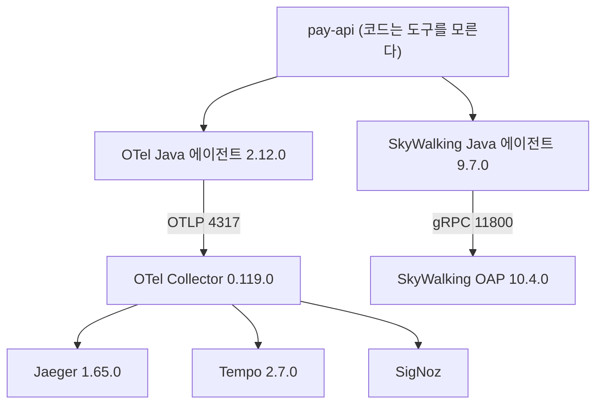
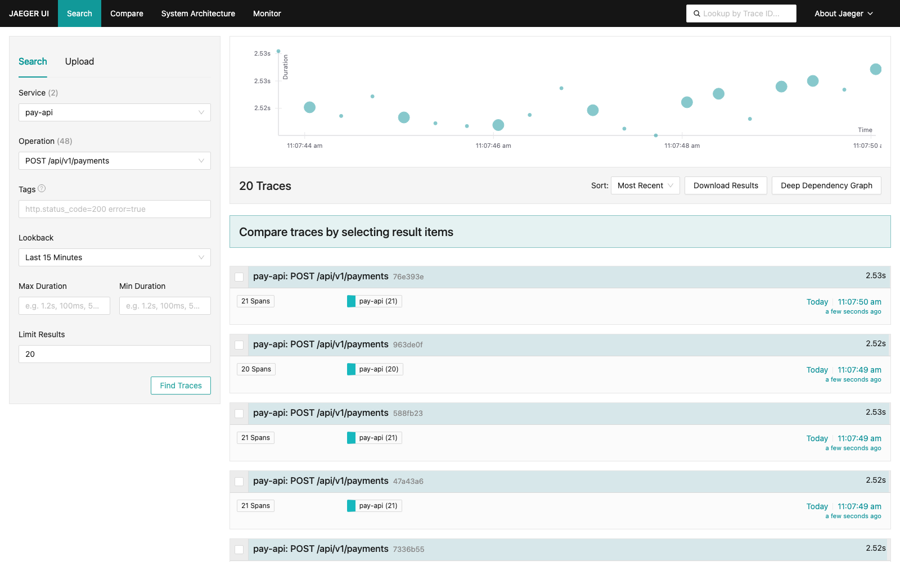
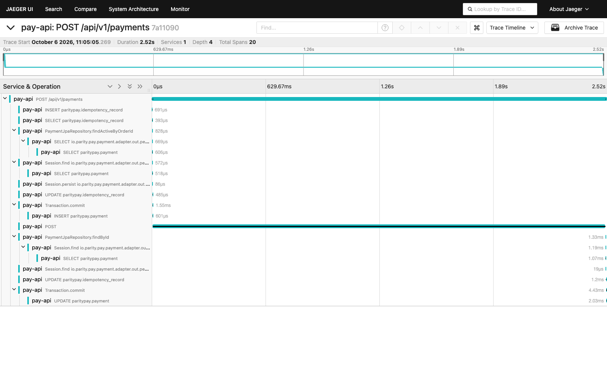
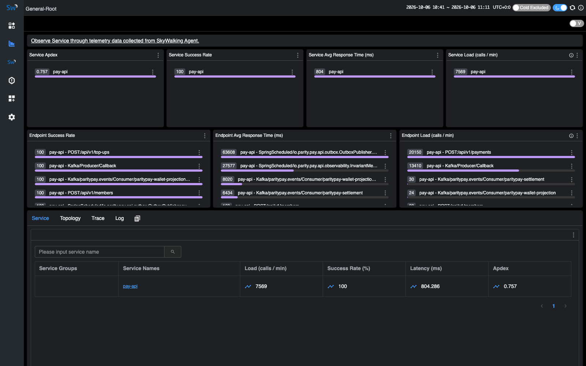
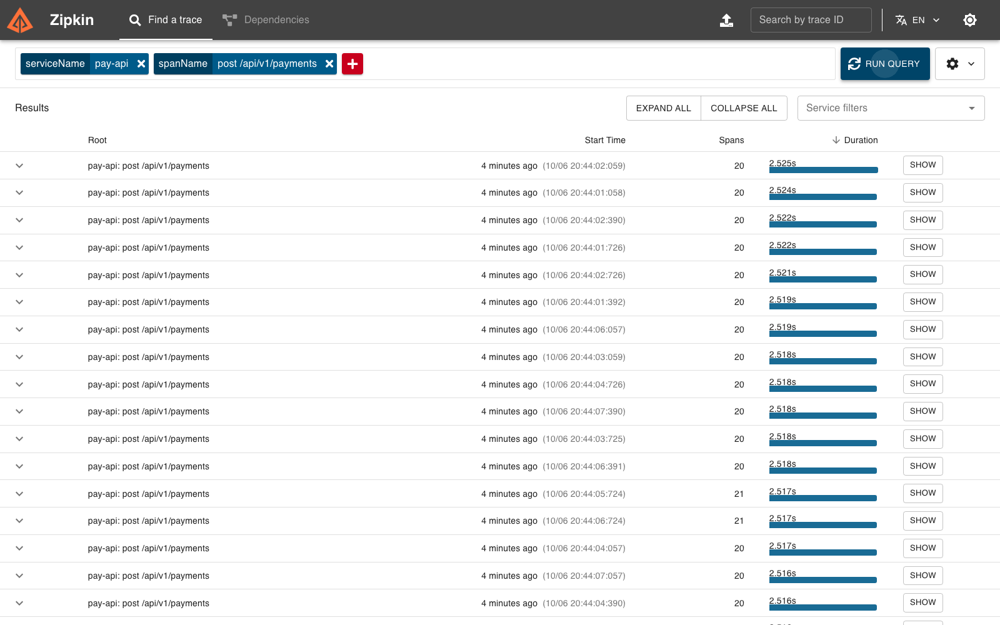
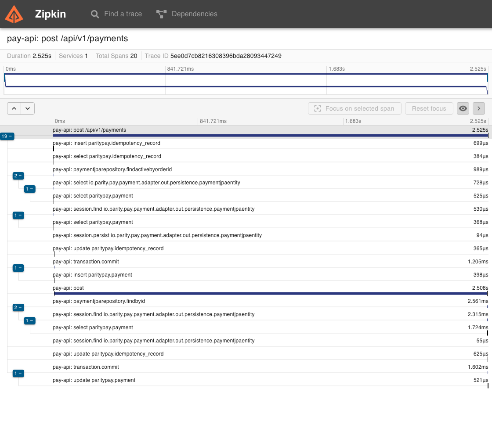
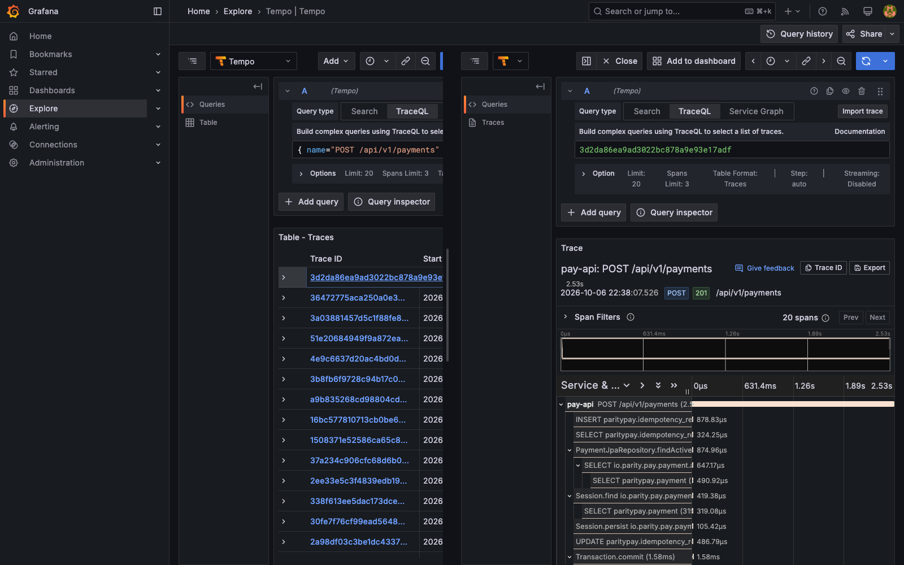

[APM 도구 비교](/posts/apm-tools-comparison/)는 Datadog부터 Pinpoint, OpenTelemetry까지 15종을 계측 방식, 저장소, 가격, 종속성으로 갈라 놓고 이렇게 끝났다. 도입 전에 에이전트를 켠 상태와 끈 상태로 같은 부하를 걸어 보라고. 그 글의 오버헤드 수치는 전부 벤더와 프로젝트가 스스로 밝힌 값이었다. Pinpoint README의 "약 3%"도, OpenTelemetry 문서가 숫자 대신 "환경에 따라 달라진다"고 쓴 것도 옮겨 적었을 뿐이다.

이 글은 그 측정이다. 계정이 필요 없는 여섯 가지를 붙여 봤다. Jaeger, Zipkin, Grafana Tempo, SigNoz, Apache SkyWalking, Pinpoint다. 이 중 넷은 떴고 둘은 뜨지 않았는데, 뜨지 않은 쪽에서 나온 기록이 뜬 쪽만큼 쓸모가 있었다. Datadog은 체험판 계정과 API 키가 필요해 손대지 않았다.

이 글을 쓴 뒤 나머지 둘도 띄웠다. 그 과정과, 여기 적어 둔 SigNoz 원인이 틀렸다는 것은 [다음 글](/posts/apm-startup-troubleshooting/)에 있다. 아래 설치 비용 표의 "끝내 실패" 둘은 이 글을 쓰던 시점의 상태다.

그 뒤에 셋을 더 붙였다. "Datadog 대안 10선"에 올라오는 열 개를 같은 배선에 대 본 기록은 [세 번째 글](/posts/datadog-alternatives-plugged-in/)에 있다. 컨테이너 한 개로 뜨는 도구가 하나 더 늘었고, 그쪽은 저장소까지 내장이다.

대상 애플리케이션은 [ParityPay](/posts/parity-pay-invariants/)다. 이중부기 원장 위에서 충전과 결제, 취소, 정산을 처리하는 모듈러 모놀리스이고, [외부 기관 호출](/posts/parity-pay-external-isolation/)과 Outbox 발행기, 복구 작업이 배경에서 계속 돈다. 트레이스 하나에 스팬이 20개쯤 달리는 정도의 복잡도다.

---

## 애플리케이션이 도구를 모르게 만든 다음에 쟀다

도구를 갈아 끼우며 재려면 먼저 갈아 끼울 수 있어야 한다. 벤더 SDK를 코드에 넣으면 비교할 때마다 애플리케이션을 고쳐야 하고, 그러면 비교 대상이 둘(도구와 코드)이 된다.

그래서 애플리케이션 코드에는 어떤 도구의 이름도 들어가지 않게 했다. 계측은 `-javaagent`로 붙는 자동계측 에이전트가 하고, OTLP 계열은 컬렉터 설정 파일 하나만 바꾼다.

전환은 `scripts/apm.sh up jaeger` 같은 한 줄이다. 그것이 백엔드를 띄우고 `.apm/env`에 `JAVA_TOOL_OPTIONS`를 적으면, 애플리케이션을 띄우는 쪽이 그 파일을 읽어 넘긴다. **OTLP 계열끼리는 애플리케이션을 재시작하지 않고도 바꿀 수 있다.** 컬렉터의 exporter만 바뀌기 때문이다. SkyWalking처럼 자체 에이전트를 쓰는 쪽은 `-javaagent` 자체가 바뀌므로 재시작이 필요하다.

---

## 에이전트를 켜는 값: 처리량 18.7%

부하는 k6 v1.0.0으로 가상 사용자 20명이 서로 다른 지갑에 결제를 거는 조건이고, 측정 창은 70초, 팔마다 3회 돌렸다. 아래 숫자는 70초 동안의 승인 건수다.

| 팔 | 3회 결과 | 중앙값 | p50 | p95 | 실패 |
| --- | --- | ---: | ---: | ---: | ---: |
| 에이전트 없음 | 64,499 / 60,868 / 62,580 | 62,580 | 18 ms | 29 ms | 0 |
| OTel 에이전트 + Jaeger | 39,954 / 55,754 / 50,897 | 50,897 | 21 ms | 38 ms | 0 |

처리량 18.7% 감소, p50(절반이 이보다 빠른 지점) +3 ms, p95(느린 쪽 5%가 시작되는 지점) +9 ms다. 샘플링은 끄고 전량을 보냈으므로 이 값은 상한에 가깝다. 운영에서는 헤드 샘플링으로 비율을 낮추면 줄어든다.

**주목할 것은 평균보다 꼬리가 더 많이 늘었다는 점이다.** p50은 17% 늘었는데 p95는 31% 늘었다. 에이전트가 하는 일(스팬 생성, 큐 적재, 배치 전송)이 요청마다 균일하게 붙는 것이 아니라 가끔 더 붙는다는 뜻이다.

---

## 팔별로 몰아서 재면 다른 숫자가 나온다

첫 측정은 18.7%가 아니었다. 15.9%였다.

| 측정 방식 | 에이전트 없음 | OTel + Jaeger | 차이 |
| --- | ---: | ---: | ---: |
| 팔별로 몰아서 (처음) | 64,519 | 54,269 | 15.9% |
| 번갈아 (다시) | 62,580 | 50,897 | 18.7% |

하니스도 부하도 같은데 3퍼센트포인트가 움직였다. 차이는 순서뿐이다. 처음에는 `none`을 3회 연속으로 돌린 뒤 `jaeger`를 3회 연속으로 돌렸고, 다시 잴 때는 `none`, `jaeger`, `none`, `jaeger` 순으로 번갈아 돌렸다.

몰아서 돌리면 팔과 시간이 같이 움직인다. 나중에 도는 팔은 "나중"이라는 조건을 통째로 떠안는다. 이 기계에는 다른 프로젝트의 컨테이너가 20여 개 떠 있고, JIT 컴파일과 디스크 캐시와 커널 상태도 측정 중에 계속 변한다. 번갈아 돌리면 그 변화가 두 팔에 고르게 섞인다.

이건 처음 겪은 함정이 아니다. 같은 저장소의 [부하·장애 실험](/posts/parity-pay-experiments-and-defects/)에서 코드와 전혀 무관한 4.8배 차이를 같은 방식으로 만든 적이 있고, 그래서 `load-tests/README.md`에 "빌드를 비교할 때는 번갈아 돌린다"가 규칙으로 적혀 있었다. 그 규칙을 적어 둔 저장소에서 그 규칙을 어겼다. 하니스는 지금 번갈아 돌리는 쪽이 기본값이고, 몰아서 돌리려면 `--grouped`를 줘야 한다.

---

## 백엔드를 바꿔도 숫자가 안 움직이면 에이전트를 재고 있는 것이다

처음 팔별로 몰아서 돌린 묶음에서 백엔드만 Tempo로 바꾼 팔을 하나 더 돌렸다. 그래서 아래 Jaeger 값은 앞 표의 첫 줄(54,269)과 같다. 에이전트는 그대로 OTel이고 컬렉터의 내보낼 곳만 다르다.

| 팔 | 승인 건수 |
| --- | ---: |
| OTel + Jaeger | 54,269 |
| OTel + Tempo | 53,944 |

0.6% 차이다. 에이전트가 같으니 같아야 맞고, 실제로 같았다. 이 결과는 Tempo가 Jaeger만큼 빠르다는 뜻이 아니라, **이 하니스가 재는 것이 백엔드 성능이 아니라 애플리케이션 안의 에이전트 비용이라는 뜻**이다. 백엔드는 다른 프로세스에서 비동기로 받으므로 요청 경로에 끼어들지 않는다.

백엔드 성능을 재려면 다른 실험이 필요하다. 수집량을 올려 가며 드롭이 생기는 지점과 저장소가 먹는 디스크를 봐야 하고, 그건 하지 않았다.

---

## 자체 에이전트는 더 비쌌다: 42.7%

SkyWalking은 OTLP도 받지만, 자기 Java 에이전트를 썼을 때 보여 주는 것이 다르다. 그쪽으로 쟀다.

| 팔 | 3회 결과 | 중앙값 | p50 | p95 | 실패 |
| --- | --- | ---: | ---: | ---: | ---: |
| 에이전트 없음 | 42,769 / 33,757 / 49,625 | 42,769 | 25 ms | 54 ms | 0 |
| SkyWalking 9.7.0 | 24,503 / 32,551 / 23,183 | 24,503 | 41 ms | 97 ms | 0 |

처리량 42.7% 감소, p50 +16 ms, p95 +43 ms다.

**이 숫자를 앞 표의 18.7%와 나란히 빼서 비교하면 안 된다.** 두 측정은 다른 시각에 돌았고, 대조군 자체가 62,580에서 42,769으로 떨어져 있다. 그 사이 BanyanDB와 OAP 컨테이너가 떠 있었고 기계가 더 바빴다. 각 묶음 안에서의 짝 비교만 유효하다. 세 팔을 한 묶음에서 번갈아 돌린 측정은 하지 못했는데, 바로 그것이 두 결과를 직접 견주지 못하는 이유다.

자체 에이전트가 더 비싼 이유를 따로 프로파일링해 확인하지는 않았다. 다만 뒤에 나오는 가시성 차이(의존 서비스까지 토폴로지에 올리고 스케줄 작업을 엔드포인트로 집계하는 것)를 보면 더 많은 지점을 계측하고 있는 것으로 보인다. 이건 관찰이고 측정이 아니다.

---

## 같은 측정이 날마다 9%와 19% 사이에서 움직였다

앞 절들의 숫자는 팔 두 개짜리 묶음에서 나왔다. 세 팔을 한 묶음에서 번갈아 돌린 측정은 못 했다고 적어 뒀는데, 다음 날 그것을 했다. `none`, `jaeger`, `zipkin`을 한 라운드로 묶어 세 번 돌렸다.

| 팔 | 3회 결과 | 중앙값 | p50 | p95 | 대조군 대비 |
| --- | --- | ---: | ---: | ---: | ---: |
| 에이전트 없음 | 53,403 / 53,518 / 55,909 | 53,518 | 20 ms | 38 ms | |
| OTel 에이전트 + Jaeger | 50,898 / 46,207 / 48,587 | 48,587 | 22 ms | 42 ms | 9.2% |
| OTel 에이전트 + Zipkin | 47,063 / 48,645 / 45,083 | 47,063 | 23 ms | 45 ms | 12.1% |

앞에서 18.7%였던 것이 여기서는 9.2%다. 같은 하니스, 같은 부하, 같은 기계인데 다른 날 다른 묶음이고 대조군 자체가 62,580에서 53,518로 다르다. **이 두 묶음이 함께 말하는 것은 "에이전트 비용은 18.7%"가 아니라 "같은 측정이 날마다 9%와 19% 사이에서 움직인다"이다.** 그래서 한 묶음 안의 짝만 비교해야 한다는 규칙이 다시 확인된다.

Zipkin이 Jaeger보다 3.1% 낮게 나온 것도 그냥 두기로 했다. 에이전트가 같으므로 원칙적으로 같아야 하고 앞의 Tempo 검산은 0.6%였는데, 이번에는 각 팔의 3회 편차가 그보다 크다. Jaeger는 46,207에서 50,898까지, Zipkin은 45,083에서 48,645까지 퍼져 있다. 3회로는 3%를 가릴 수 없다. 횟수를 늘린 측정은 하지 않았다.

---

## 아무도 세지 않는 비용: 컬렉터 자신

하니스가 팔마다 APM 컨테이너의 메모리를 함께 적는다. 그 숫자가 뜻밖이었다.

| 팔 | run 1 | run 2 | run 3 |
| --- | ---: | ---: | ---: |
| 에이전트 없음 | 47.6 MiB | 3.705 GiB | 3.834 GiB |
| OTel + Jaeger | 1.659 GiB | 1.318 GiB | 1.666 GiB |
| OTel + Zipkin | 2.582 GiB | 2.628 GiB | 2.371 GiB |

OpenTelemetry Collector 한 컨테이너의 값이다. 전량 샘플링으로 70초를 받으면 기가바이트 단위로 자란다. "에이전트 없음"의 첫 값이 47.6 MiB이고 그다음이 3.7 GiB인 이유는, 대조군으로 바꿀 때 컨테이너를 건드리지 않기 때문이다. 앞 팔에서 자란 컬렉터가 그대로 남아 누적된다.

읽을 때 주의할 것이 둘이다. 첫째, Jaeger와 Zipkin에는 메모리 상한을 걸어 뒀지만 컬렉터에는 걸지 않았다. 상한이 없어서 자란 것이므로 이 값은 "필요한 양"이 아니라 "허용된 양"이다. 둘째, Zipkin 경로가 Jaeger 경로보다 꾸준히 크다. exporter가 OTLP를 Zipkin 형식으로 바꾸는 일이 끼어 있어 그럴듯하지만 그 인과는 확인하지 않았다.

**도구를 고르는 자리에서 비교하는 것은 보통 백엔드의 메모리인데, OTLP 경로에서는 컬렉터가 백엔드보다 컸다.** Tempo와 Zipkin이 부하 뒤 유휴에서 157 MiB쯤일 때 컬렉터는 기가바이트 단위였다.

---

## 설치 비용은 컨테이너 수가 아니라 막히는 횟수다

| 도구 | 컨테이너 | 저장소 | 첫 기동까지 막힌 횟수 | 메모리 |
| --- | ---: | --- | ---: | --- |
| Zipkin | 1 (+컬렉터) | 메모리 | 0 | 약 157 MiB |
| Jaeger | 1 (+컬렉터) | 메모리 | 0 | 미측정 |
| Grafana Tempo | 1 (+컬렉터) | 로컬 디스크 | 0 | 약 157 MiB |
| SkyWalking | 3 | BanyanDB (필수) | 3 | 미측정 |
| Pinpoint | 5 | HBase + MySQL + ZooKeeper + Redis | 5 (이 글 시점) | 약 3.2 GiB |
| SigNoz | 6 | ClickHouse + Keeper + PostgreSQL | 1 (이 글 시점) | 약 970 MiB |

**컨테이너 수와 막힌 횟수가 같이 움직인다.** 한 개짜리는 한 번에 떴고, 다섯 개와 여섯 개짜리는 둘 다 끝까지 못 갔다.

Zipkin에서 막힌 것은 없다. 비교에서 가장 쉬웠다. 컨테이너 하나에 저장소는 메모리이고 받자마자 조회된다. 특이한 점은 OTLP를 받지 않는다는 것이다. 자기 형식만 받으므로 컬렉터의 exporter만 `zipkin`으로 바꿨다. 그래도 애플리케이션은 한 줄도 바뀌지 않았다. 2012년에 나온 도구와 2026년의 표준 사이를 컬렉터가 메운 셈이다.

SkyWalking은 세 번 막혔다. 먼저 `SW_STORAGE=h2`로 띄우자 `no provider found for module storage`로 종료했다. 10.x 이미지의 `oap-libs`에는 `storage-banyandb-plugin`만 들어 있다. 메모리나 임베디드 저장소로 가볍게 띄워 보는 경로가 없다. 다음으로 BanyanDB 최신 버전인 0.11.1을 붙이자 `Incompatible BanyanDB server API version: 0.11. But accepted versions: 0.10`으로 종료했다. 0.10.3으로 내리자 이번에는 앞 버전이 쓴 볼륨을 읽지 못해 `unknown field "created…"`로 종료했다. 볼륨을 지우고서야 떴다.

SigNoz는 한 번 막혔는데 그 한 번이 끝까지 안 풀렸다. 2025년에 docker-compose 설치가 폐기되고 전용 설치기로 옮겨서, 공식 안내는 `curl … | bash`다. 이 실험은 같은 일을 단계로 나눠 했다. 공식 릴리스의 tarball과 checksums를 받아 sha256을 검증한 뒤 설치하는 방식이다. 컨테이너는 6개가 떴지만 ClickHouse 분산 DDL 스키마 마이그레이션이 10분 넘게 끝나지 않았고, 그동안 수집기가 OTLP를 받지 않아 트레이스가 한 건도 들어오지 않았다. 중간에 컨테이너를 recreate 했더니 클러스터 메타데이터에 죽은 복제본 호스트가 남아(`Cannot resolve host (a39b5c2f3c57)`) 마이그레이션이 영원히 끝나지 않는 상태가 됐다. 볼륨까지 지우고 한 번에 올려야 했다.

**이 진단은 절반만 맞았다.** 나중에 볼륨을 지우고 한 번에 올려 마이그레이션을 2분 만에 끝낸 뒤에도 트레이스는 0건이었다. 진짜 문턱은 다른 데 있었고 [다음 글](/posts/apm-startup-troubleshooting/)에 적었다.

Pinpoint는 다섯 번 막혔고, 그래도 뜨지 않았다. 이 글에서 가장 길게 붙잡은 도구다.

| 막은 것 | 어떻게 드러났나 |
| --- | --- |
| `depends_on`은 "컨테이너가 떴다"까지만 본다 | HBase가 초기화하는 2분 동안 collector와 web이 죽는다 |
| HBase 이미지에 ZooKeeper 주소가 박혀 있다 | 이미지 안 `hbase-site.xml`에 `zoo1,zoo2,zoo3`. 다른 이름이면 `zoo1: Name or service not known`으로 테이블조차 못 만든다 |
| HBase 주소와 클러스터 조정이 한 변수를 공유한다 | collector 설정이 `hbase.client.host=${pinpoint.zookeeper.address}`. 별도 ZooKeeper를 가리키면 `NoNode for /hbase/hbaseid` |
| 공식 예시의 MySQL 비밀번호가 `admin/admin` | 비밀값에 기본값을 두지 않는다는 이 저장소 규칙에 어긋난다 |
| `pinpoint-hbase` 이미지가 amd64 단일 아키텍처 | Apple Silicon에서는 에뮬레이션으로 돌고, 리전을 16개로 미리 쪼개 만드는 동안 ZooKeeper 세션이 만료되어 `Session expired for /hbase/master`로 마스터가 스스로 죽는다 |

앞의 넷은 뚫었다. ZooKeeper 컨테이너 하나에 `zoo1`, `zoo2`, `zoo3` 별칭 세 개를 달고, 비밀번호는 설치할 때 한 번 만들어 쓰게 했다. 다섯 번째는 뚫지 못했다. 세션 시간을 10분으로 늘리자 이번에는 죽지 않고 멈춘다. `StringMetaData`의 리전을 만들다가 13분 넘게 진척이 없고 CPU는 2.6%다. 테이블 30여 개 중 4개만 만들어진 상태에서 Pinpoint Web은 `TableNotFoundException: Application`을 돌려준다. 세션 만료가 사라지자 빨리 실패하던 것이 조용히 매달리는 것으로 바뀌었을 뿐이다.

`docker manifest inspect`로 확인한 사실 하나는 분명하다. `pinpointdocker/pinpoint-hbase:3.1.1`은 단일 아키텍처이고, 같은 프로젝트의 collector와 web, 그리고 Zipkin과 SkyWalking OAP는 전부 `linux/amd64`와 `linux/arm64`를 함께 낸다. **이 스택에서 arm64 빌드가 없는 것은 저장소 하나뿐이고, 막힌 것도 그 하나다.** 에이전트 쪽은 붙었다. `pinpoint agent started normally`가 뜨고 collector는 포트를 듣는다. 다만 저장이 안 되는 상태에서 오버헤드를 재는 것은 의미가 없어서 Pinpoint의 숫자는 없다.

Jaeger는 막히지 않았지만 기본값이 위험했다. all-in-one의 메모리 저장소는 상한이 없어서, 전량 샘플링 부하에서 자라다가 컨테이너가 두 번 OOM으로 죽었다(`Exited (137)`). `MEMORY_MAX_TRACES=20000`과 `mem_limit: 1g`로 묶자 이번에는 보관이 수 분으로 줄었다. 1시간 조회가 0건이고 방금 넣은 부하만 보인다. Outbox 발행기와 복구 작업, 불변조건 지표가 쉬지 않고 스팬 하나짜리 트레이스를 만들어 링버퍼를 밀어내기 때문이다. 배경 작업이 많은 애플리케이션에서는 "메모리 저장소로 일단 띄워 보기"가 생각보다 짧은 창만 준다.

---

## 같은 장애를 네 도구에 보여 줬다

Mock PG가 승인 직전에 2,500 ms를 붙잡게 하고(읽기 타임아웃 3초 아래로 둬서 타임아웃이 아니라 "느린 성공"이 되게 했다) 결제 3 rps와 잔액 조회 5 rps를 걸었다. 클라이언트가 본 결제 지연은 중앙값 2.52초였다. 질문은 하나다. 도구를 처음 열어서 "외부 호출이 느리다"에 도달하기까지 몇 단계가 걸리는가.

Jaeger는 두 단계였다. 서비스와 오퍼레이션을 고르면 2.52~2.53초짜리 트레이스가 20건 나온다.

하나를 열면 끝이다.

루트 `POST /api/v1/payments`가 2.52초, 그 아래 이름이 `POST`뿐인 자식 스팬(외부 기관 호출)이 2.506초다. 전체의 99.4%다. 같은 트레이스의 DB 스팬은 전부 µs 단위다. `INSERT paritypay.idempotency_record` 691 µs, `SELECT paritypay.payment` 606 µs 식이다. 스팬 20개에 깊이 4단계인데, 눈으로 봐야 할 것은 가로로 끝까지 뻗은 막대 하나뿐이다.

SkyWalking은 한 단계였다. 대시보드 첫 화면에 서비스 Apdex와 평균 응답 시간, 엔드포인트별 부하와 지연이 이미 떠 있다.

다만 그 첫 화면이 보여 주는 것이 기대와 달랐다. "Endpoint Avg Response Time" 상위는 결제 엔드포인트가 아니라 스케줄 작업이다. `SpringScheduled/…OutboxPublisher`가 63,608 ms, 불변조건 지표 작업이 27,577 ms로 1·2위를 차지한다. 스케줄 작업 한 번이 엔드포인트 한 건으로 집계되기 때문이다. 느린 요청을 찾으러 와서 처음 보는 것이 배치 작업이다. 결제는 "Endpoint Load" 쪽에서 20,150 calls/min으로 1위다.

**두 도구는 같은 요청을 다른 단위로 본다.** SkyWalking 자체 에이전트는 의존 대상까지 서비스로 올려서, 서비스 목록에 `pay-api` 외에 `localhost:5435`(PostgreSQL)와 `localhost:9092`(Kafka)가 잡혔다. OTel 에이전트와 Jaeger 조합에서는 DB 호출이 `pay-api` 안의 스팬으로 남는다. 토폴로지에서 "PostgreSQL이 느리다"를 보고 싶으면 전자가, 요청 하나의 시간 배분을 보고 싶으면 후자가 바로 답한다.

Zipkin도 두 단계다. 그리고 숫자가 Jaeger와 정확히 겹친다.

Duration 2.525초, Services 1, Total Spans 20, 외부 호출 스팬 2.508초다. 같은 에이전트가 만든 같은 트레이스이므로 당연하지만, 그 당연함이 이 실험의 결론이기도 하다. **백엔드를 바꿔도 보이는 내용이 아니라 보이는 방식만 바뀐다.** 다른 점은 Zipkin이 오른쪽에 스팬별 태그를 함께 펼친다는 것 정도다. `http.route`, `http.response.status_code=201` 같은 것들인데, 호스트 이름도 같이 나와서 공개용 캡처에서는 그 패널을 잘라냈다.

Tempo는 세 단계였다. 화면이 없기 때문이다.

Grafana를 열고 Explore로 들어가 TraceQL로 `{ name="POST /api/v1/payments" }`를 던져야 같은 트레이스가 나온다. 결과는 같다. 2.53초, 20 스팬, 201이다. 다만 Tempo를 쓰려면 Grafana를 함께 운영해야 한다는 뜻이고, 이건 컨테이너 수를 셀 때 빠지기 쉬운 비용이다.

SigNoz는 앞에서 쓴 이유로 트레이스가 한 건도 들어오지 않았고, Pinpoint는 저장소가 뜨지 않아 아무것도 못 봤다. SkyWalking 트레이스 화면도 못 찍었다. UI의 해시 라우트가 계속 대시보드로 되돌아갔고, 그 사이 Jaeger 쪽 보관 창이 닫혀 재현 부하를 다시 넣어야 했다.

---

## 조용히 틀린 것: 장애를 주입했는데 아무 일도 없었다

가시성 실험을 처음 돌렸을 때 느린 호출이 하나도 안 보였다. 도구가 못 보는 줄 알았다.

Mock PG의 장애 모드를 넣는 관리 API에 필드 이름을 `mode`로 추측해서 보냈기 때문이다. 실제 필드는 `approvalMode`다. 관리 API는 알 수 없는 필드를 무시하고 204를 돌려줬고, 부하는 정상 속도로 끝났다.

이게 특히 조용한 이유는 모든 신호가 정상이기 때문이다. 요청은 성공하고, 응답 코드는 2xx이고, 트레이스도 잘 들어온다. "장애를 주입했는데 도구에 안 보인다"는 결론으로 가기 딱 좋다. 측정 도구를 평가하는 실험에서 **주입이 먹었는지를 먼저 확인하지 않으면 도구를 잘못 탓하게 된다.** 지금은 부하를 걸기 전에 클라이언트가 본 지연의 중앙값부터 보고, 그것이 2.5초 근처가 아니면 주입이 안 먹은 것으로 친다.

하니스에서 틀린 것은 이것 말고도 여덟 개 더 있었다. 포트를 고르고 나서 앞 백엔드를 내려 살아 있는 컬렉터가 포트를 쥐고 있었던 것, 포트 예약 함수를 서브셸에서 불러 두 백엔드가 같은 포트를 받은 것, 에이전트 내려받기 진행 메시지를 표준 출력으로 보내 `-javaagent:` 경로에 한글 문장이 섞인 것 같은 것들이다.

둘째 날에 셋이 더 붙었다. 전환 스크립트를 거치지 않고 `docker compose up`을 직접 불러서 Pinpoint Web이 스크립트가 알려 준 포트가 아니라 기본 포트에 붙은 것, 환경 파일을 `set -a; . .apm/env`로 읽어서 공백이 들어간 Pinpoint의 `JAVA_TOOL_OPTIONS`가 셸에 쪼개진 것, 그리고 조회 조건을 URL에만 넣고 캡처를 돌린 것이다. Jaeger도 Zipkin도 조건은 URL이 채우지만 조회는 버튼이 한다. 전부 [실험 보고서](https://github.com/polynomeer/parity-pay/blob/main/reports/14-apm-tool-comparison.md)에 적어 뒀다.

---

## 한계

이 숫자들이 어디서 나왔는지부터 말해야 한다. 노트북 한 대다. Apple M1 Max 32 GB, macOS 26.6.2, Docker Desktop에 7.7 GiB를 준 상태이고, **측정 내내 다른 프로젝트의 컨테이너가 20여 개 떠 있었다.** 그래서 절대 처리량은 의미가 없고, 같은 묶음 안에서 팔끼리 비교한 비율만 쓸 수 있다. 서버 여러 대, 다른 JVM 설정, 다른 트래픽 모양에서는 다른 값이 나온다.

Pinpoint와 SigNoz는 이 글 뒤에 둘 다 띄웠다. Pinpoint는 미리 쪼개는 리전 수와 ZooKeeper 세션 상한을 함께 고쳐야 했고, SigNoz는 첫 관리자 계정이 만들어지기 전까지 수집 경로가 열리지 않는 것이었다([후속 글](/posts/apm-startup-troubleshooting/)).

Pinpoint의 결과는 이 기계에 대한 것이지 Pinpoint에 대한 것이 아니다. x86 호스트나 arm64 빌드가 있는 환경에서는 같은 자리에서 막히지 않을 가능성이 크다. 다섯 번째를 빼면 나머지 넷은 어디서나 만나는 종류이고, 그 넷만으로도 컨테이너 한 개짜리와는 다른 작업이다.

재지 않은 것도 많다. SkyWalking과 SigNoz와 Pinpoint의 기본 샘플링과 보관, 부하 중 백엔드 메모리, 백엔드 쪽 수집 한계, 자체 에이전트를 OTel 에이전트와 한 묶음에서 번갈아 돌린 측정이 그렇다. Zipkin과 Jaeger의 3.1% 차이도 3회로는 가릴 수 없는 상태로 남겼다. Datadog은 손대지 않았다. 이미지 내려받기가 유난히 느린 날이어서(SkyWalking OAP와 UI만 약 19분) 소요 시간 쪽 인상에는 그 조건이 섞여 있다.

그래도 하나는 재기 전과 후가 다르다. 앞 글은 "오버헤드는 환경에 따라 다르다"로 끝났고, 그건 맞지만 아무것도 정해 주지 않는다. 지금은 이 애플리케이션, 이 부하에서 자동계측 에이전트의 값이 9%에서 19% 사이이고 p95가 9 ms에서 7 ms쯤 늘어난다는 것을 안다. 폭이 넓다는 것까지가 측정 결과다. 그 값을 낼지 말지는 그다음 질문이고, 적어도 숫자를 놓고 따질 수 있다.

측정에 쓴 전환 스크립트와 하니스, 캡처 스크립트, 원본 결과 JSON은 [ParityPay 저장소](https://github.com/polynomeer/parity-pay)의 `scripts/apm.sh`, `load-tests/apm-overhead-experiment.py`, `load-tests/apm-capture.mjs`, `reports/data/14-apm-lab/`에 있다.

## 참고

- [APM 도구 비교: Datadog부터 Pinpoint, OpenTelemetry까지](/posts/apm-tools-comparison/) — 이 글의 앞 글. 문서 기준 비교
- [Java Agent Performance](https://opentelemetry.io/docs/zero-code/java/agent/performance/) — OpenTelemetry
- [Jaeger Architecture](https://www.jaegertracing.io/docs/latest/architecture/) — Jaeger
- [Backend Storage](https://skywalking.apache.org/docs/main/latest/en/setup/backend/backend-storage/) — Apache SkyWalking
- [Tempo configuration](https://grafana.com/docs/tempo/latest/configuration/) — Grafana Labs
- [SigNoz Architecture](https://signoz.io/docs/architecture/) — SigNoz
- [RPT-04 APM 도구 비교 실험 보고서](https://github.com/polynomeer/parity-pay/blob/main/reports/14-apm-tool-comparison.md) — GitHub: 원본 측정 기록
