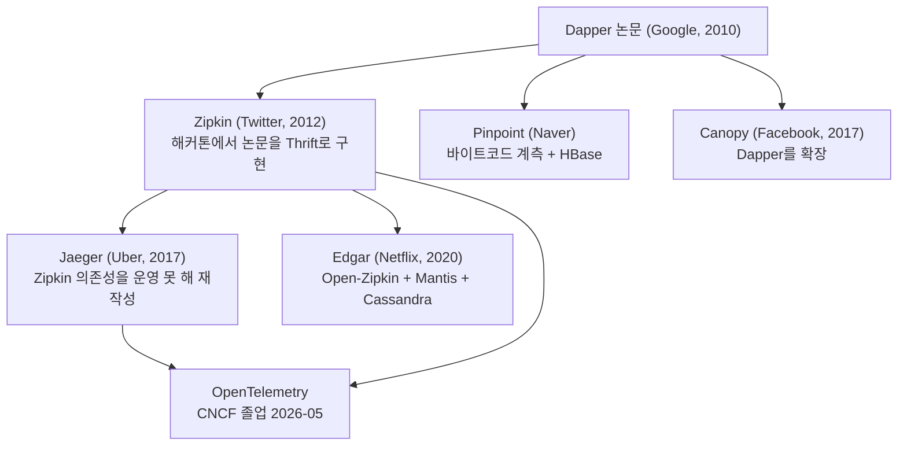

[앞 글](/posts/apm-tools-comparison/)에서 APM 도구 15종을 문서 기준으로 비교했고, [그다음 글](/posts/apm-tools-hands-on-parity-pay/)에서 그중 넷을 직접 붙여 재 봤다. 그러고 나서 "더 유명한 도구가 많지 않나"라는 질문을 받았다. 맞는 말이다. 널리 읽히는 비교 글 하나는 Dynatrace, Datadog, New Relic, Elastic APM, Sentry, AppDynamics, Riverbed Aternity, Splunk Observability, Instana, Prometheus와 Grafana, SigNoz 열한 가지를 다룬다([Kaan Berk ÖZBEK, "Top APM Tools", 2025-05-14](https://medium.com/@kaanberkozbek/top-apm-tools-real-world-comparison-of-pros-cons-cost-performance-and-use-cases-b7dc77f97102)).

그런데 그 열한 가지 중에 구글, 메타, 넷플릭스, 우버가 자기 서비스를 들여다볼 때 쓰는 시스템은 하나도 없다. 그 목록은 **살 수 있는 제품**의 목록이지 큰 회사가 쓰는 것의 목록이 아니다. 이 글은 각 회사가 직접 낸 논문과 엔지니어링 글만 근거로, 그들이 무엇을 만들었고 왜 만들었는지, 그리고 그중 무엇이 지금 우리가 쓸 수 있는 형태로 남았는지를 정리한다.

---

## 빅테크는 사서 쓰지 않고 만들어서 공개했다

| 회사 | 시스템 | 공개한 것 | 시점 |
| --- | --- | --- | --- |
| Google | Dapper | 논문 | 2010 |
| Twitter | Zipkin | 코드(APLv2) | 2012 |
| Naver | Pinpoint | 코드(Apache 2.0) | 2014 |
| Facebook | Canopy | 논문(SOSP '17) | 2017 |
| Uber | Jaeger | 코드, 뒤에 CNCF 기증 | 2017 |
| Netflix | Edgar | 엔지니어링 글 | 2020 |

여기서 갈린다. 논문만 낸 쪽(Google, Facebook)의 시스템은 쓸 수 없고 읽을 수만 있다. 코드를 낸 쪽(Twitter, Naver, Uber)의 것은 지금 `docker run`으로 띄울 수 있다. 우리가 "오픈소스 APM"이라 부르는 것의 상당 부분이 사실 **빅테크가 자기 문제를 풀고 내놓은 결과물**이다.

---

## 오늘 쓰는 도구는 대부분 Dapper의 자식이다

시작은 2010년 구글의 Dapper 논문이다([Sigelman 외, "Dapper, a Large-Scale Distributed Systems Tracing Infrastructure", Google, 2010](https://research.google/pubs/dapper-a-large-scale-distributed-systems-tracing-infrastructure/)). 설계 목표가 셋이었다. 낮은 오버헤드, 애플리케이션 수준의 투명성(코드를 고치지 않아도 계측이 되는 것), 그리고 아주 큰 시스템 전체에 빠짐없이 배포되는 것이다. 이 셋을 동시에 만족시키려고 고른 수단이 샘플링과, 계측을 소수의 공통 라이브러리에만 넣는 것이었다.

이 두 선택이 지금도 거의 모든 도구에 남아 있다. Java 에이전트가 애플리케이션 코드가 아니라 서블릿 컨테이너와 JDBC 드라이버와 HTTP 클라이언트에 바이트코드를 끼워 넣는 이유가 두 번째 선택이고, 기본값이 전량 수집이 아닌 이유가 첫 번째 선택이다.

Zipkin의 출신이 특히 직접적이다. 트위터의 공개 글은 첫 해커톤 주간에 "Dapper 논문의 기본 버전을 Thrift용으로 구현했다"고 적는다([Twitter Engineering, 2012-06-07](https://blog.x.com/engineering/en_us/a/2012/distributed-systems-tracing-with-zipkin)). 그렇게 시작한 것이 Http, Thrift, Memcache, SQL, Redis까지 늘었고, 트위터는 이것으로 memcache 요청 제거, 느린 MySQL SELECT 재작성, 잘못 잡힌 서비스 타임아웃 수정 같은 것을 찾았다고 밝힌다. 저장소는 Cassandra, 전송은 Scribe, 설정은 ZooKeeper였다.

**Jaeger가 생긴 이유가 바로 그 의존성이다.** 우버는 Zipkin을 그대로 쓰지 않았는데, Scribe와 Cassandra를 운영해 본 경험이 없었기 때문이다([Uber Engineering, 2017-02-02](https://www.uber.com/blog/distributed-tracing/)). 2015년 가을에 500개쯤이던 마이크로서비스가 2017년 초에 2,000개를 넘었고, 그 규모에서 운영 경험이 없는 저장소를 떠안는 것이 더 큰 위험이었다. 그래서 Go로 수집기를 다시 쓰고 네 개 언어의 클라이언트를 만들었다. 지금 우리가 Jaeger를 "가볍다"고 느끼는 것은 그때의 판단이 남긴 결과다.

---

## 샘플링 방침은 빅테크 안에서도 정반대다

도구 비교 글이 잘 다루지 않는 지점이다. 같은 규모의 회사들이 "트레이스를 얼마나 남길 것인가"에서 반대편에 서 있다.

구글은 샘플링이 전제다. Dapper 논문이 낮은 오버헤드를 지키는 수단으로 샘플링을 가장 먼저 든다.

아마존은 반대다. AWS Builders' Library의 계측 글은 요청마다 로그를 남기는 것을 기본으로 둔다([David Yanacek, "Instrumenting distributed systems for operational visibility"](https://builder.aws.com/content/3EuxPBdIiiUhB5IK47p3O3fxhy7/instrumenting-distributed-systems-for-operational-visibility)).

> "At Amazon we log first, and produce aggregate metrics later."

아마존에서는 로그를 먼저 남기고 집계 지표는 그다음에 만든다는 뜻이다. 같은 글은 피크에 초당 2천만 건이 넘는 내부 트래픽을 받는 DynamoDB조차 장애 조사와 감사를 위해 모든 요청을 로그로 남긴다고 적는다. 그러면서 아마존의 대다수 서비스에서는 요청마다 로그를 남기는 것이 과한 비용이 아니라고 본다.

둘이 다른 이유는 데이터의 용도가 다르기 때문이다. Dapper가 답하는 질문은 "이 요청 유형은 보통 어디서 시간을 쓰는가"이고, 그건 표본으로 답할 수 있다. 아마존이 답하려는 질문에는 "이 고객의 이 요청이 왜 실패했는가"가 들어 있고, 그건 표본으로 답할 수 없다. 샘플링을 켜는 순간 **찾고 싶은 그 요청이 남아 있을 보장이 사라진다.** 샘플링을 고를 때 재야 하는 것은 저장 비용만이 아니라 이 질문을 포기할 수 있는지다. 헤드 샘플링과 테일 샘플링의 구분은 [따로 정리해 뒀다](/posts/trace-sampling/).

넷플릭스는 그 사이에 섰다. Edgar의 추적 인프라는 혼합형 헤드 샘플링을 쓴다. 지정한 요청 집합은 100% 기록하고 나머지는 진입 지점의 정책대로 무작위 추출한다([Netflix Technology Blog, 2020-10-19](https://netflixtechblog.com/building-netflixs-distributed-tracing-infrastructure-bb856c319304)). 스트리밍 핵심 서비스는 전량, 오프라인 배치 같은 보조 시스템은 최소로 가져가는 식이다.

---

## 빅테크의 진짜 문제는 안 보이는 것이 아니라 너무 많이 보이는 것이다

작은 팀의 문제는 "트레이스가 없다"이지만, 큰 회사의 글을 읽으면 문제가 반대다.

메타의 Canopy 논문은 하루 13억 개의 트레이스를 만들고 처리하며 129개의 성능 데이터셋을 떠받친다고 적는다([Kaldor 외, "Canopy: An End-to-End Performance Tracing And Analysis System", SOSP '17](https://cs.brown.edu/~jcmace/papers/kaldor2017canopy.pdf)). 그 규모에서 논문이 밝히는 어려움은 저장이 아니라 읽기다. 트레이스 하나에 엔지니어가 볼 일 없는 데이터가 대부분이고, 설계상 트레이스는 누군가에게 필요한 모든 것을 담고 있어 정보 과부하가 생긴다고 쓴다. 그래서 Canopy의 기여는 트레이스를 보여 주는 것이 아니라 **계측을 트레이스 모델에서 떼어내고, 트레이스에서 기능(feature)을 뽑아 집계 데이터셋으로 만드는 파이프라인**이다.

Canopy 이전의 메타에는 추적 시스템이 여러 개 있었다는 서술도 눈여겨볼 만하다. 백엔드 서비스의 RPC 호출 트리, 브라우저 페이지 로드, 모바일 OS가 주는 추적이 따로 있었고, 서로 경계를 넘지 못해 엔지니어가 어느 도구를 언제 쓸지 알아야 했다. 도구를 하나 더 들이는 선택이 어떻게 끝나는지에 대한 기록이기도 하다.

넷플릭스 쪽 숫자는 더 노골적이다. 같은 글은 **Edgar 사용자가 수집된 트레이스의 1% 미만만 열어 본다**고 적는다. 그래서 버퍼에 모인 스팬을 검사해 경고, 오류, 재시도 태그가 붙은 것만 남기는 규칙 기반 테일 필터를 넣었고, 사용자 경험을 해치지 않으면서 데이터 양을 20% 줄였다.

저장 비용을 깎은 과정도 적혀 있다. Elasticsearch로 시작했지만 색인 생성이 쓰기와 읽기를 함께 망가뜨려 Cassandra로 옮겼고, EC2 SSD 인스턴스 스토어 대신 EBS 볼륨을 쓰고 TWCS 파라미터를 조정하고 Zstd 블록 압축을 켰다. 결과는 클러스터 운영 비용 71% 감소에 저장량 35배다. 도구 선택이 아니라 저장소 운영이 비용을 정했다는 이야기다.

---

## 2026년의 수렴점은 OpenTelemetry다

각자 만들던 시대는 계측 부분에서 끝났다.

OpenCensus(구글)와 OpenTracing(Lightstep의 Ben Sigelman이 시작했고, 그는 Dapper 논문의 제1저자다)이 2019년 5월 21일 OpenTelemetry로 합쳤다. 구글 오픈소스 블로그는 합친 이유를 두 프로젝트가 둘이라는 사실 자체가 가장 큰 문제였다고 적는다([Google Open Source Blog, 2019-05-21](https://opensource.googleblog.com/2019/05/opentelemetry-merger-of-opencensus-and.html)). 초기 거버넌스 위원회가 구글, Lightstep, 마이크로소프트, 우버로 구성됐다.

정확히 7년 뒤인 2026년 5월 21일, OpenTelemetry가 CNCF를 졸업했다([CNCF, 2026-05-21](https://www.cncf.io/announcements/2026/05/21/cloud-native-computing-foundation-announces-opentelemetrys-graduation-solidifying-status-as-the-de-facto-observability-standard/)). 발표는 240개가 넘는 CNCF 프로젝트 중 쿠버네티스 다음으로 높은 속도를 기록했고, 2,800개 넘는 회사에서 1만 2천 건 이상이 기여했다고 밝힌다. 운영 환경 채택 사례로 Alibaba, Anthropic, Bloomberg, Capital One, eBay, FICO, Heroku, AWS, Google Cloud를 든다.

**이 수렴은 도구 쪽에서도 확인된다.** Jaeger는 2022년에 자기 클라이언트를 은퇴시키고 OpenTelemetry SDK로 가라고 안내한다. 이유는 OTel이 기능 면에서 따라잡았고 Jaeger로 내보내는 경로가 충분히 갖춰졌기 때문이라고 적혀 있다([Jaeger SDK Migration](https://www.jaegertracing.io/sdk-migration/)). 자기 프로젝트의 클라이언트를 자기 손으로 접은 것이다. Jaeger v2는 아예 OpenTelemetry Collector 프레임워크 위에 올라가 있다.

즉 지금 상태는 이렇다. 계측과 전송은 표준이 하나로 모였고, 저장소와 UI와 알림은 여전히 각자다. 벤더를 바꾸는 비용에서 가장 비싼 부분이 빠진 것이고, 대시보드와 알림 규칙을 다시 만드는 비용은 그대로 남았다.

---

## 국내 쪽 사례

국내에서 가장 널리 쓰이는 축은 Pinpoint다. 저작권 표기가 NAVER Corp.이고 Apache 2.0이며, 바이트코드 계측으로 메서드 호출 스택과 실행된 SQL을 코드 수정 없이 기록한다. 저장소는 트레이스용 HBase다([Pinpoint README](https://github.com/pinpoint-apm/pinpoint)).

토스는 SLASH 23에서 Pinpoint를 쓰면서 코루틴 구간이 끊기는 문제를 코루틴 바이트코드를 읽어 플러그인으로 메운 과정을 발표했다([발표 리뷰](/posts/slash23-connected-observations/)). 도구를 고르는 일이 끝이 아니라, 고른 뒤에 자기 스택에 맞게 계측을 붙이는 일이 남는다는 사례다. 같은 행사에서 글로벌 trace ID와 TCP 전문에 문맥을 심는 이야기도 나왔다([발표 리뷰](/posts/slash23-observability-tracing-logs/)).

---

## 이 계보를 실제로 붙여 봤다

여기까지가 읽은 것이고, 그중 돌릴 수 있는 것은 돌려 봤다. 결제 서비스 하나에 Zipkin, Jaeger, Tempo, SkyWalking, SigNoz, Pinpoint를 차례로 붙이고 같은 부하를 걸었다. 자세한 수치와 원본은 [따로 적었고](/posts/apm-tools-hands-on-parity-pay/), 여기서는 이 글의 계보와 맞닿는 세 가지만 옮긴다.

**Zipkin은 지금도 가장 쉬웠다.** 컨테이너 하나에 저장소는 메모리이고 한 번에 떴다. 특이한 점은 OTLP를 받지 않는다는 것이다. 2012년에 자기 형식으로 시작했고 그 자리를 지키고 있다. 그래서 OpenTelemetry Collector의 exporter만 `zipkin`으로 바꿨고, 애플리케이션은 한 줄도 바뀌지 않았다. 14년 차이를 수집기가 메운 셈인데, 이것이 OTel 합류가 실제로 사는 방식이다.

**Pinpoint는 뜨지 않았다.** 다섯 군데에서 막혔고 넷은 뚫었는데 마지막을 못 뚫었다. HBase 이미지가 amd64 단일 아키텍처라서 Apple Silicon에서는 에뮬레이션으로 돌고, 테이블을 만들다가 ZooKeeper 세션이 만료되어 마스터가 죽는다. 같은 프로젝트의 collector와 web은 arm64 빌드가 있다. 저장소 하나가 막은 것이고, HBase를 쓰는 선택이 2015년과 2026년에 다른 비용을 갖는다는 뜻이기도 하다.

**같은 트레이스는 어느 도구에서나 같았다.** 외부 기관이 2.5초를 붙잡는 조건에서 Jaeger와 Zipkin과 Tempo가 모두 같은 숫자를 보여 줬다. 2.52초짜리 요청, 스팬 20개, 그중 외부 호출 하나가 99.4%다. 계측이 같으면 백엔드는 **보이는 내용이 아니라 보이는 방식만** 바꾼다. Dapper가 계측과 저장을 갈라 둔 설계가 그대로 남아 있는 자리다.

---

## 그래서 이 목록이 작은 팀에 주는 것

빅테크가 만든 것을 그대로 가져다 쓸 수는 없다. Canopy는 공개되지 않았고, Edgar는 Mantis와 넷플릭스의 저장소 운영 조직 위에 서 있다. 가져올 수 있는 것은 판단의 근거다.

계측은 OpenTelemetry로 한다. Jaeger가 자기 클라이언트를 접고 그쪽으로 보낸 것이 가장 분명한 신호다. 백엔드는 나중에 바꿀 수 있지만 계측은 모든 서비스를 다시 배포해야 바뀐다.

샘플링 방침은 저장 비용이 아니라 질문으로 정한다. "이 고객의 이 요청"을 답해야 한다면 아마존 쪽이고, "이 엔드포인트가 보통 어디서 느린가"면 구글 쪽이다. 넷플릭스처럼 핵심 경로만 전량으로 가져가는 중간도 있다.

그리고 에이전트를 켜는 값은 자기 환경에서 직접 재야 한다. 위에서 말한 측정에서 OTel 자동계측 에이전트는 한 묶음에서 18.7%, 다른 날 다른 묶음에서 9.2%였고 SkyWalking 자체 에이전트는 42.7%였다. 노트북 한 대에서 나온 숫자이므로 그대로 옮길 값은 아니다. 다만 벤더가 밝힌 한 자릿수 퍼센트와 자기 측정이 다를 수 있다는 것, 그리고 같은 측정이 날마다 두 배 가까이 움직인다는 것은 보여 준다.

---

## 이 글이 재지 않은 것

여기 있는 숫자는 전부 각 회사가 공개한 자료에서 옮긴 것이고, 내가 측정한 것은 없다. 공개 시점의 값이므로 지금의 그 회사 상태가 아니다. Canopy의 13억 건은 2017년 논문 기준이고, 넷플릭스의 71%와 35배는 2020년 글 기준이다.

비교의 축도 공정하지 않다. 상용 APM은 구매 가능한 제품이고 Dapper와 Canopy는 사내 시스템이다. 둘을 같은 표에 넣으면 "어느 쪽이 낫다"는 결론이 나올 것 같지만 그런 결론은 이 자료들로 나오지 않는다. 이 글이 말할 수 있는 것은 큰 회사들이 어떤 문제를 만났고 어느 쪽으로 움직였는지까지다.

실측 쪽의 한계는 [그 글](/posts/apm-tools-hands-on-parity-pay/)에 적어 뒀다. 요약하면 노트북 한 대이고, 다른 프로젝트 컨테이너가 20여 개 떠 있는 상태였으며, Pinpoint의 실패는 그 기계에 대한 것이지 Pinpoint에 대한 것이 아니다.

빠진 회사도 많다. 마이크로소프트의 Application Insights, 알리바바의 ARMS, 링크드인과 핀터레스트와 쇼피파이의 사례는 확인하지 않았다. 국내도 네이버와 토스 외에는 공개 자료를 찾아보지 않았다.

## 참고

- [Dapper, a Large-Scale Distributed Systems Tracing Infrastructure](https://research.google/pubs/dapper-a-large-scale-distributed-systems-tracing-infrastructure/) — Google Research: Sigelman 외, Google, 2010
- [Distributed Systems Tracing with Zipkin](https://blog.x.com/engineering/en_us/a/2012/distributed-systems-tracing-with-zipkin) — Twitter Engineering, 2012-06-07
- [Evolving Distributed Tracing at Uber Engineering](https://www.uber.com/blog/distributed-tracing/) — Uber Engineering, 2017-02-02
- [Canopy: An End-to-End Performance Tracing And Analysis System](https://cs.brown.edu/~jcmace/papers/kaldor2017canopy.pdf) — cs.brown.edu: Kaldor 외, SOSP '17
- [Building Netflix's Distributed Tracing Infrastructure](https://netflixtechblog.com/building-netflixs-distributed-tracing-infrastructure-bb856c319304) — Netflix Technology Blog, 2020-10-19
- [Instrumenting distributed systems for operational visibility](https://builder.aws.com/content/3EuxPBdIiiUhB5IK47p3O3fxhy7/instrumenting-distributed-systems-for-operational-visibility) — builder.aws.com: David Yanacek, Amazon Builders' Library
- [OpenTelemetry: merger of OpenCensus and OpenTracing](https://opensource.googleblog.com/2019/05/opentelemetry-merger-of-opencensus-and.html) — Google Open Source Blog, 2019-05-21
- [CNCF Announces OpenTelemetry's Graduation](https://www.cncf.io/announcements/2026/05/21/cloud-native-computing-foundation-announces-opentelemetrys-graduation-solidifying-status-as-the-de-facto-observability-standard/) — CNCF, 2026-05-21
- [Migration to OpenTelemetry SDK](https://www.jaegertracing.io/sdk-migration/) — Jaeger
- [Pinpoint README](https://github.com/pinpoint-apm/pinpoint) — GitHub: pinpoint-apm
- [Top APM Tools: Real-World Comparison](https://medium.com/@kaanberkozbek/top-apm-tools-real-world-comparison-of-pros-cons-cost-performance-and-use-cases-b7dc77f97102) — Medium: Kaan Berk ÖZBEK, 2025-05-14
