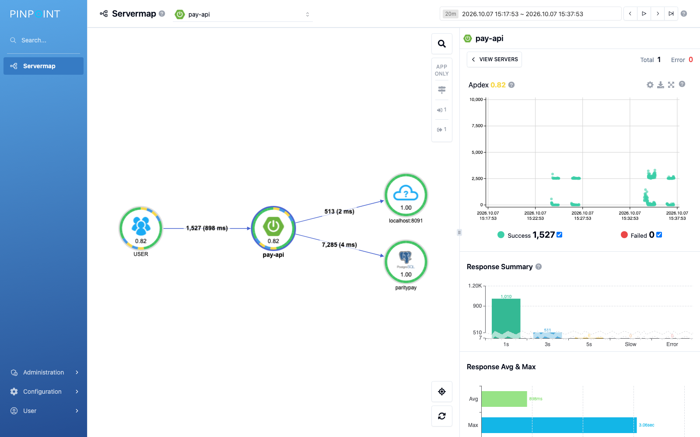
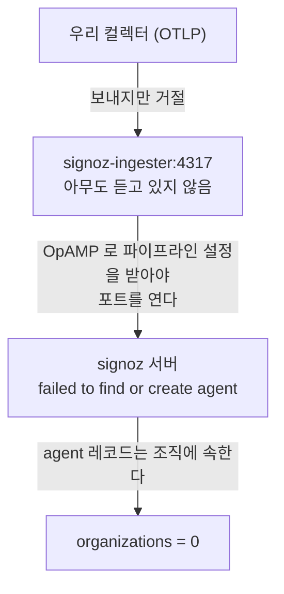
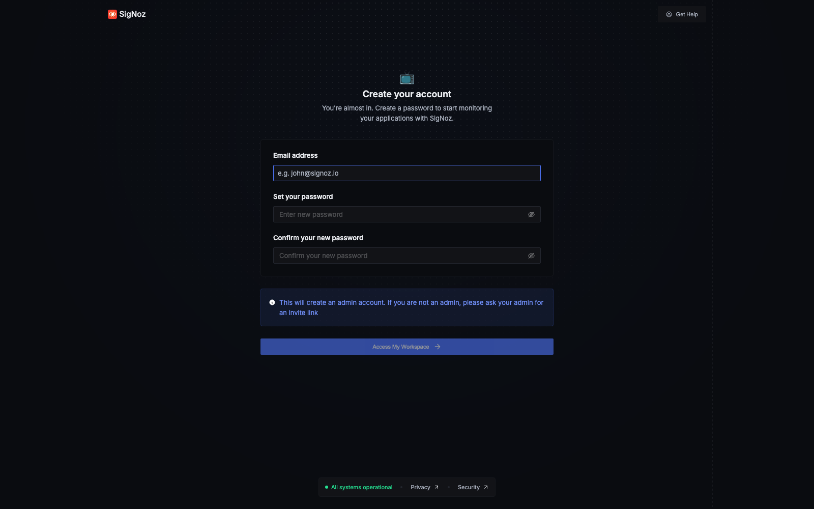

[앞 글](/posts/apm-tools-hands-on-parity-pay/)에서 결제 서비스 하나에 APM 백엔드 여섯 개를 붙여 오버헤드와 설치 비용을 쟀다. 그중 둘은 못 띄웠다. Pinpoint는 HBase가 테이블 22개 중 4~6개를 만든 뒤 멈췄고, SigNoz는 컨테이너 여섯 개가 전부 `Up`인데 트레이스가 한 건도 들어오지 않았다. 둘 다 "못 했다"로 적어 두고 넘어갔다.

이 글은 그 둘을 끝까지 판 기록이다. 결과부터 적으면 Pinpoint는 떴고, SigNoz가 수집하지 않은 이유는 내가 적어 둔 것과 달랐다.

## 빈 화면의 원인은 다섯 가지였다

이 실험에서 가장 자주 본 화면은 빈 화면이다. 그런데 원인이 매번 달랐다.

| 보이는 것 | 실제 원인 | 어떻게 갈랐나 |
| --- | --- | --- |
| 트레이스 목록이 비어 있음 | 조회 버튼을 누르지 않음. Jaeger와 Zipkin은 URL이 조건을 채워도 조회는 버튼이 한다 | 버튼을 누르니 나왔다 |
| 1시간 조회가 0건 | Jaeger 메모리 저장소의 보관이 수 분. 배경 작업이 링버퍼를 밀어낸다 | 방금 넣은 부하만 보였다 |
| 부하를 걸었는데 느린 요청이 없음 | 장애 주입이 안 먹음. 필드 이름을 `mode`로 추측했는데 실제는 `approvalMode`였다 | 클라이언트가 본 지연 중앙값이 2.5초가 아니었다 |
| Pinpoint에 "There are no running agents" | 시간대. 헤드리스 브라우저가 UTC라 서버가 KST로 읽으면 9시간 어긋난다 | 같은 순간에 브라우저 창에서는 데이터가 보였다 |
| SigNoz에 트레이스 0건 | 조직이 없어서 수집기가 OTLP 포트를 아예 열지 않음 | 호스트에서 그 포트가 닫혀 있었다 |

**증상으로 원인을 좁힐 수 없다는 것이 이 표의 요점이다.** 세 번째와 다섯 번째가 특히 조용하다. 둘 다 모든 신호가 정상이다. 관리 API는 204를 돌려주고, 컨테이너는 전부 `Up`이고, 헬스체크도 통과한다.

## Pinpoint: 두 가지를 함께 고쳐야 떴다

Pinpoint는 컨테이너 여섯 개가 필요하다. HBase, ZooKeeper, MySQL, Redis, Collector, Web이다. 막힌 자리가 전부 다른 층에 있었고, 앞 네 개는 비교적 금방 풀렸다.

`depends_on`은 "컨테이너가 떴다"까지만 본다. HBase가 테이블을 만드는 동안 collector와 web이 `NoNode for /hbase/hbaseid`로 죽어서 `restart`에 맡겼다. HBase 이미지 안 `hbase-site.xml`에는 `zoo1,zoo2,zoo3`이 박혀 있어서, ZooKeeper 컨테이너를 다른 이름으로 띄우면 HBase가 `zoo1: Name or service not known`으로 테이블조차 못 만든다. 컨테이너 하나에 별칭 세 개를 달았다. collector 설정의 `hbase.client.host`가 `${pinpoint.zookeeper.address}`라서 HBase 접속과 클러스터 조정이 한 변수를 공유한다는 것도 그 과정에서 알았다.

문제는 다섯 번째였다.

### 리전 1,900개는 한 노드에서 흩어질 곳이 없다

`docker manifest inspect`로 보면 `pinpointdocker/pinpoint-hbase:3.1.1`은 단일 아키텍처다. 같은 프로젝트의 collector와 web, 그리고 Zipkin과 SkyWalking OAP는 전부 `linux/amd64`와 `linux/arm64`를 함께 낸다. **이 스택에서 arm64 빌드가 없는 것은 저장소 하나뿐이고, 막힌 것도 그 하나였다.**

Apple Silicon에서는 그 하나가 에뮬레이션으로 돈다. 그리고 Pinpoint의 스키마는 운영 클러스터를 전제로 쓰여 있다.

```text
create 'TraceV2', { ... }, {NUMREGIONS => 256, SPLITALGO => 'UniformSplit'}
create 'MapAppSelf',   { ... }, {NUMREGIONS => 256, SPLITALGO => 'UniformSplit'}
create 'MapAgentSelf', { ... }, {NUMREGIONS => 256, SPLITALGO => 'UniformSplit'}
```

테이블 22개 중 7개가 `NUMREGIONS => 256`이고 9개에 명시적 `SPLITS`가 있다. 합치면 1,900개가 넘는다. 노드가 여럿일 때는 그래야 쓰기가 흩어지지만, 한 노드짜리 실험 스택에서는 흩어질 곳이 없다. 에뮬레이션 속도로 그것을 만들다가 ZooKeeper 세션이 만료되고 마스터가 스스로 죽는다.

```text
ERROR [master/...:60000] regionserver.HRegionServer: ***** ABORTING region server ...
org.apache.zookeeper.KeeperException$SessionExpiredException:
    KeeperErrorCode = Session expired for /hbase/master
```

그래서 리전 수만 줄인 스키마를 따로 만들었다. `NUMREGIONS => 4`로 내리고 명시적 `SPLITS`를 뺐다. 테이블 이름과 컬럼 패밀리와 TTL은 원본 그대로다. 그러자 4~6개에서 멈추던 것이 16개까지 갔다. 그리고 또 멈췄다.

### 세션 시간은 한쪽만 올리면 조용히 깎인다

먼저 한 일은 `hbase-site.xml`의 `zookeeper.session.timeout`을 10분으로 올리는 것이었다. 아무것도 달라지지 않았다. 정확히는 달라지긴 했다. 죽지 않고 멈췄다. 마스터 로그가 13분째 그대로이고 CPU는 2.6%였다.

이유는 **세션 시간의 상한을 ZooKeeper 서버가 쥐고 있기 때문이다.** 클라이언트가 10분을 달라고 해도 서버의 `maxSessionTimeout`을 넘으면 조용히 깎인다. 그래서 서버 쪽을 올리려고 했는데, 이것도 한 번 더 막혔다.

```bash
docker run --rm --entrypoint sh zookeeper:3.4.13 -c \
  'grep -oE "ZOO_[A-Z_]+" /docker-entrypoint.sh | sort -u'
```

```text
ZOO_AUTOPURGE_PURGEINTERVAL
ZOO_AUTOPURGE_SNAPRETAINCOUNT
ZOO_CONF_DIR
...
ZOO_TICK_TIME
ZOO_USER
```

`ZOO_MAX_SESSION_TIMEOUT`은 없다. 내가 그 이름으로 넣어 둔 환경변수는 아무 일도 하지 않고 있었다. 지원하는 것은 `ZOO_TICK_TIME`이고, ZooKeeper의 `maxSessionTimeout` 기본값이 `20 × tickTime`이다. tick을 15초로 올리면 상한이 300초가 된다.

```yaml
ZOO_TICK_TIME: "15000"          # 상한 = 20 x 15초 = 300초
zookeeper.session.timeout: 300000   # 요청도 같은 값으로
```

둘을 함께 고치자 테이블 22개가 약 4분 30초에 전부 만들어졌다. **하나만 고치면 각각 16개와 4개에서 멈춘다.** 둘 다 필요했다.

### 떠 보니 보는 단위가 달랐다



애플리케이션을 고르면 서버맵이 이미 그려져 있다. USER에서 pay-api로 1,527건(평균 898 ms), pay-api에서 PostgreSQL로 7,285건(4 ms), 외부 기관으로 513건(2 ms)이다. 오른쪽 산점도에는 2.5초 무리와 0 근처 무리가 갈라져 보인다. 외부 기관이 2.5초를 붙잡게 해 둔 조건이 그대로 두 덩어리로 나타난 것이다.

Jaeger와 Zipkin에서 같은 장애를 보려면 트레이스 하나를 열어야 했다. Pinpoint는 첫 화면이 토폴로지다. 어느 쪽이 낫다기보다 **묻는 질문이 다르다.** "이 요청의 시간이 어디로 갔나"는 트레이스가 답하고, "어느 구간이 느린가"는 서버맵이 답한다.

## SigNoz: 계정을 만들기 전에는 수집이 열리지 않는다

앞 글에서 SigNoz가 트레이스를 못 받은 이유를 ClickHouse 분산 DDL 스키마 마이그레이션이 끝나지 않은 것으로 적었다. 마이그레이션이 멈춘 것은 사실이다. 컨테이너를 recreate 했더니 클러스터 메타데이터에 죽은 복제본 호스트가 남아(`Cannot resolve host (a39b5c2f3c57)`) 영원히 끝나지 않는 상태가 됐고, 볼륨까지 지우고 한 번에 올려야 했다.

이번에는 볼륨을 지우고 한 번에 올렸다. 마이그레이터가 2분 안에 `Exited (0)`으로 끝났고 `signoz_traces`에 테이블 36개가 생겼다. 그런데도 트레이스는 0건이었다.

네 단계로 좁혔다.

```text
1. 우리 컬렉터 로그
   Exporting failed ... error reading server preface: EOF

2. ingester 가 실제로 듣고 있는 포트 (컨테이너 안 /proc/net/tcp)
   8888  13133  1777        <- 지표, 헬스체크, pprof. 4317 도 4318 도 없다

3. 그런데 호스트에서는
   nc -z localhost 4327     <- succeeded

4. SigNoz 서버 로그
   ERROR "failed to find or create agent" agent_id=01a11527-...
```

3번이 함정이다. 공개한 포트는 Docker의 userland 프록시가 호스트 쪽에서 붙잡고 있어서, 컨테이너 안에서 아무도 듣지 않아도 **TCP 연결은 받아들인다.** `nc`는 "열림"이라 답하고, 실제 gRPC 핸드셰이크에 가서야 끊긴다. 처음에는 `nc`로 "닫혀 있다"를 확인했다고 적었는데, 다음 날 같은 상태에서 같은 명령이 "열림"을 돌려줬다. **포트가 살아 있는지는 `nc`가 아니라 컨테이너 안의 `/proc/net/tcp`로 본다.**

마지막 줄이 실마리였다. 메타스토어를 직접 봤다.

```sql
SELECT count(*) FROM organizations;  --  0
SELECT count(*) FROM users;          --  0
```

연결하면 이렇게 된다.



**SigNoz는 첫 관리자 계정이 만들어지기 전까지 아무것도 수집하지 않는다.** 화면을 못 보는 것이 아니라 수집 경로 자체가 열리지 않는다.



이 화면을 넘기는 것이 남은 전부다. 설치를 자동화하고 계정 생성만 사람에게 맡기는 파이프라인이라면 정확히 여기서 멈춘다. 그리고 그때 보이는 증상은 "설치는 다 됐는데 데이터가 안 들어온다"이므로, 원인을 수집 경로에서 찾게 된다.

### 계정을 만들자 그 자리에서 열렸다

저장소 주인이 계정을 만들어 줬고, 같은 명령을 다시 돌렸다.

| | 계정 전 | 계정 후 |
| --- | --- | --- |
| `organizations` / `users` | 0 / 0 | 1 / 1 |
| ingester 가 듣는 포트(컨테이너 안) | `8888` · `13133` · `1777` | 여기에 **`4317` · `4318` 추가** |
| 컬렉터 내보내기 실패(45초) | 35건 | **0건** |
| ClickHouse 스팬 | 0 | **7,902** |

같은 부하에서 `POST /api/v1/payments` p50 **2,608 ms**, 자식 외부 호출 p50 **2,524 ms**다. Jaeger 2.52초, Zipkin 2.525초, Tempo 2.53초와 같은 값이라 여섯 도구가 같은 트레이스를 보고 있다는 것도 함께 확인됐다. **원인은 조직이 맞았다.**

화면은 찍지 않았다. 이 글의 다른 캡처는 전부 로그인 없이 찍은 것이라, 여기만 저장소 주인의 자격 증명을 쓰면 같은 조건이 아니다.

## 못 찍은 화면 두 장을 쫓다가

앞 글에 "SkyWalking 트레이스 화면과 Zipkin 의존성 화면을 못 찍었다"고 적어 뒀다. 둘 다 다시 해 봤고, 둘 다 이미지를 얻지 못했다. 다만 이유가 정반대였다.

**SkyWalking 트레이스 화면은 주소가 없다.** 처음에는 "해시 라우트가 대시보드로 되돌아간다"고 적었는데 그게 틀렸다. 그 화면은 왼쪽 메뉴에도 없고 `/General-Service/Trace` 같은 주소로 가면 404다. **서비스 대시보드 아래쪽 탭**(`Service · Topology · Trace · Log`)이고, 그 탭은 화면 밖에 있어 **스크롤해서 그려지기 전에는 DOM에도 없다.** 그리고 `/General-Service/Services`조차 직접 열면 404다. `/`에서 SPA가 부팅한 뒤에만 유효한 클라이언트 라우트이기 때문이다.

경로를 찾아 직접 열어 봤다. 최소 지속시간 2,000 ms로 조회하면 결제 트레이스가 나오고 `Show`를 누르면 호출 트리가 열린다. 루트는 `pay-api: POST:/api/v1/payments` 2,555 ms에 18 스팬이고, 표에 Exec(ms)·Exec(%)·Self(ms) 열이 붙는다. 눈에 띈 것은 `HikariCP/Connection/getConnection`과 `PostgreSQL/JDBC/PreparedStatement/execute`가 **각각 따로** 잡힌다는 점이다. OTel 자동계측은 이 둘을 이렇게 나누지 않는다.

그런데 그 화면을 스크립트로 다시 밟는 동안 OAP의 대시보드 템플릿이 사라졌다. 대시보드 목록이 `No Data`가 되고 서비스 화면 자체가 열리지 않는다. UI 컨테이너를 다시 띄워도 돌아오지 않았다. 브라우저 창에 남아 있던 화면은 다른 캡처(1600×1000)보다 해상도가 낮아 섞어 쓰지 않았다.

**Zipkin 의존성 화면이 비어 있는 것은 고장이 아니다.** `/api/v2/dependencies`가 `[]`를 돌려준다. 의존성 그래프는 서비스 **둘 이상** 사이의 호출로 그려지는데 이 랩은 `pay-api` 하나만 계측한다. 외부 기관은 계측 대상이 아니라 클라이언트 스팬으로만 남고 별도 서비스가 되지 않는다. 기관 대역에도 에이전트를 붙이면 `pay-api → mock-pg`가 그려질 것이고, 그건 하지 않았다. **도구를 의심하기 전에 내가 몇 개를 계측했는지부터 봐야 한다.** 빈 화면은 찍지 않았다.

## 내가 틀리게 진단한 것

이 절이 기록할 값이 가장 큰 부분이다.

**"Pinpoint가 Spring Boot 4와 Tomcat 11을 계측하지 못한다."** 틀렸다. 수집기 로그의 `grpcSpanReceiver CurrentTransport:1, CurrentGrpcStream:0`을 보고 "스팬이 하나도 안 온다"로 읽었다. 우리 앱이 Tomcat 11이라는 사실과 묶어 플러그인 미지원으로 결론 내렸고, 플러그인이 후킹하는 `StandardHostValve`가 Tomcat 11에도 있다는 것을 확인하고도 그 방향을 계속 팠다. Pinpoint의 예제 앱까지 띄워 대조군으로 삼았다.

갈라 준 것은 둘이다. 에이전트 로그에 `SpanBatchGrpcDataSender -- ConnectivityState changed before:CONNECTING, change:READY`가 있었다. 스팬 전송 채널은 보낼 것이 생겨야 연결된다. 그리고 조회 구간을 바로잡고 UI를 열자 Apdex 0.82에 Success 1,527이 나왔다. `CurrentGrpcStream`은 그 순간 열려 있는 스트림 수이고 배치 전송은 열고 닫는다. 0은 실패가 아니라 "지금은 안 보내는 중"이다.

**계수기 하나로 "없다"를 결론 내리지 않는다.** 반대편, 보내는 쪽 로그를 함께 봐야 한다.

**"SigNoz는 스키마 마이그레이션 때문에 못 받는다."** 절반만 맞았다. 마이그레이션이 멈춘 것은 사실인데, 그것을 끝내 놓고도 증상이 그대로였다. 눈에 띄는 고장 하나를 고친 뒤 증상이 사라지는지 확인하지 않으면, 그것이 원인이었다고 믿게 된다.

**"Pinpoint의 실패는 Pinpoint의 문제."** 아니다. 다섯 가지 중 넷은 이 기계와 한 노드짜리 구성 때문이다. x86 호스트에서는 리전 문제가 아예 없고, 노드가 여럿이면 세션 상한도 만날 일이 적다. 도구의 성질과 환경의 성질을 섞어 적으면 다음 사람이 잘못된 결론을 가져간다.

## 다음 사람이 쓸 여섯 줄

같은 자리를 다시 밟지 않으려고 체크리스트로 줄여 두었다.

1. 이미지의 아키텍처를 먼저 본다. `docker manifest inspect`로 단일 아키텍처면 에뮬레이션이고, 저장소 계열이면 초기화에서 막힐 가능성이 크다.
2. 스택은 전환 스크립트로만 띄운다. 포트 배정과 환경 파일 작성이 거기서 끝난다. 급해서 건너뛰면 스크립트가 알려 준 주소와 실제 주소가 달라진다. 이걸 두 번 했다.
3. 백엔드가 포트를 실제로 듣고 있는지 호스트에서 확인한다. 컨테이너가 `Up`인 것과 포트가 열린 것은 다르다.
4. 부하를 걸기 전에 장애 주입이 먹었는지 확인한다. 클라이언트가 본 지연의 중앙값부터 본다.
5. 조회 구간과 시간대를 의심한다. 빈 화면의 절반은 여기서 나온다.
6. "없다"를 결론 내리기 전에 보내는 쪽 로그를 본다.

## 한계

여기 적힌 것은 노트북 한 대에서 나왔다. Apple M1 Max, Docker에 7.7 GiB를 준 상태이고 다른 프로젝트의 컨테이너가 스무 개쯤 떠 있었다. Pinpoint에서 막힌 다섯 중 넷은 그 조건에서만 나온다.

Pinpoint의 에이전트 오버헤드도 쟀지만 쓰지 않기로 했다. 대조군이 한 묶음 안에서 43,232에서 9,265로 4.7배 떨어졌다. 번갈아 돌렸는데도 그렇다. 팔이 아니라 시간이 지배하고 있다는 뜻이고, 짐작되는 이유는 Pinpoint 백엔드 자신이다. 에뮬레이션으로 도는 HBase가 같은 기계에서 스팬을 계속 쓰고 있다. 방향은 세 쌍 모두에서 같았지만 크기는 말할 수 없다.

SigNoz 화면은 로그인이 필요해 캡처하지 않았다. 수집이 열린 것까지만 확인했다.

전체 기록은 [ParityPay 저장소](https://github.com/polynomeer/parity-pay)의 `docs/22-apm-troubleshooting-log.md`에 있고, 측정값은 `reports/14-apm-tool-comparison.md`에 있다.

## 참고

- [APM 도구 여섯 개를 직접 붙여 봤다](/posts/apm-tools-hands-on-parity-pay/) — 이 글의 앞 글. 오버헤드와 설치 비용 측정
- [빅테크는 APM을 사지 않고 만들었다](/posts/big-tech-apm-and-tracing/) — Pinpoint와 Zipkin이 어디서 왔는지
- [Pinpoint README](https://github.com/pinpoint-apm/pinpoint) — pinpoint-apm
- [SigNoz Architecture](https://signoz.io/docs/architecture/) — SigNoz
- [Backend Storage](https://skywalking.apache.org/docs/main/latest/en/setup/backend/backend-storage/) — Apache SkyWalking
