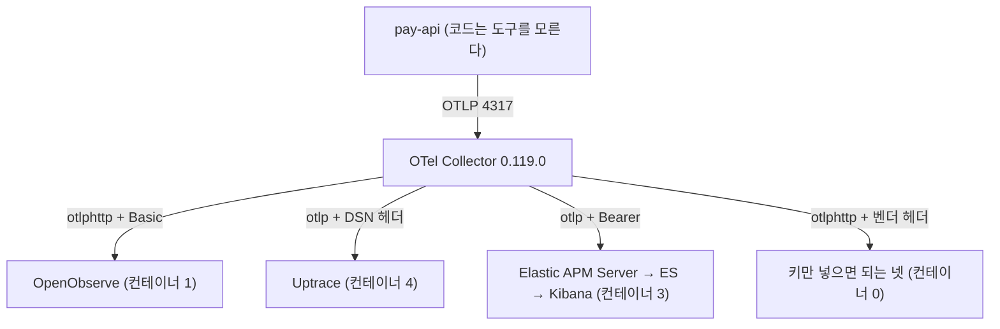
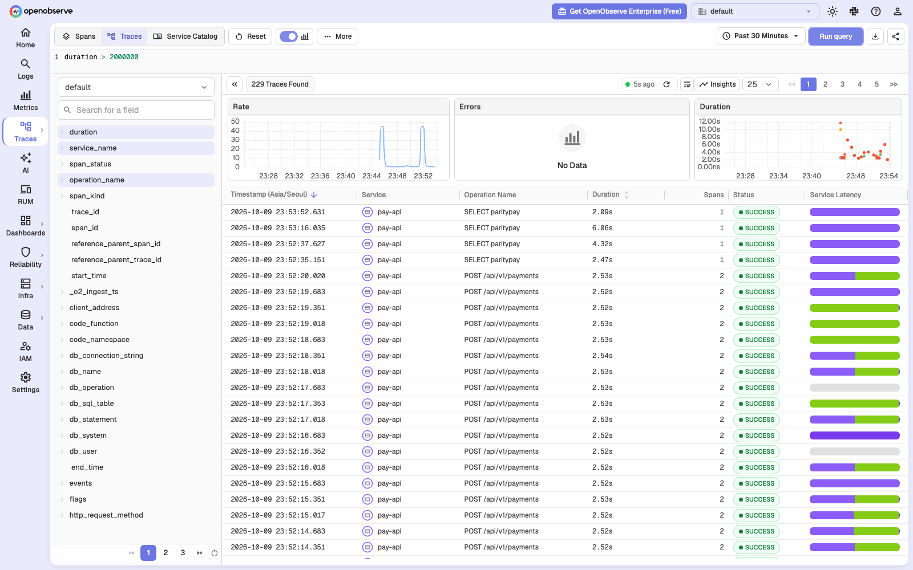
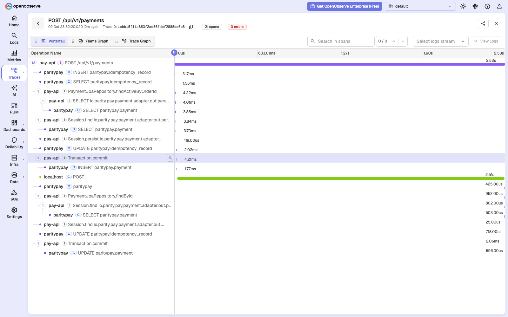
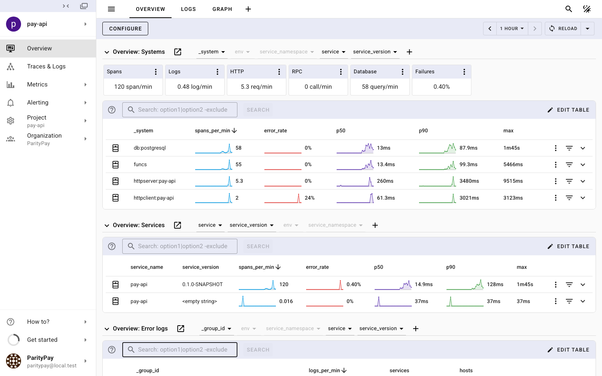
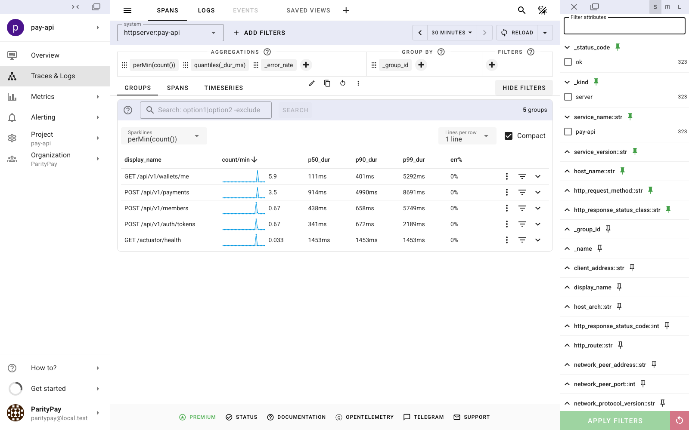
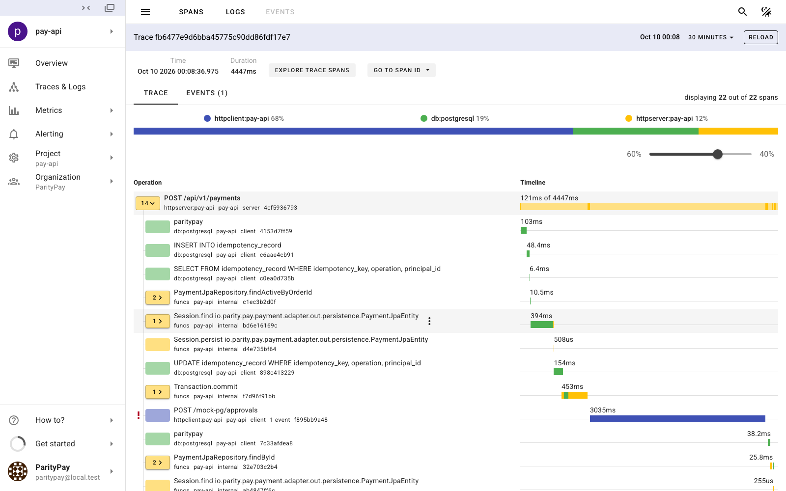
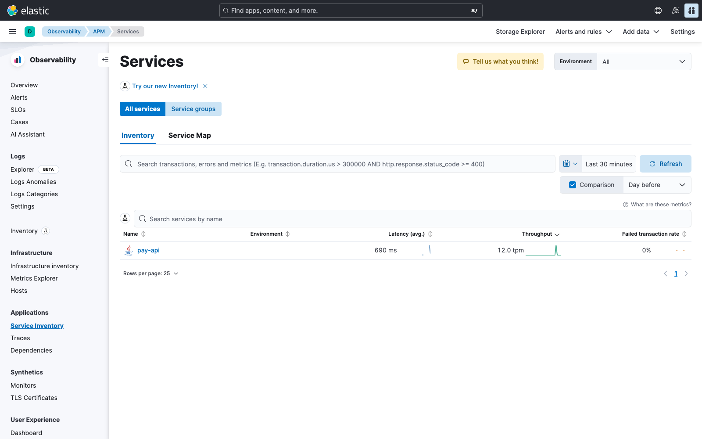
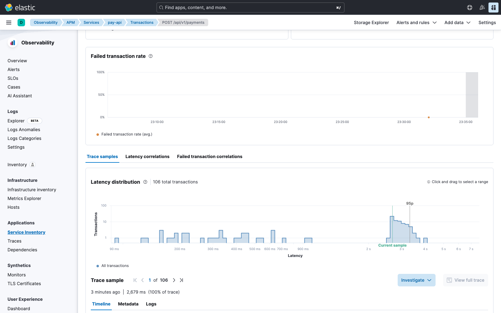

[APM 도구 비교](/posts/apm-tools-comparison/)에서 15종을 공식 문서로 갈라 놓고, [그다음 글](/posts/apm-tools-hands-on-parity-pay/)에서 여섯 개를 결제 서비스에 직접 붙여 쟀다. [막힌 자리들](/posts/apm-startup-troubleshooting/)까지 적고 나서 랩은 닫은 셈이었다.

그러다 "Datadog 대안 10선" 류의 글을 하나 읽었다. 이런 글은 대체로 열 개를 표에 나란히 세우고 오픈소스 여부와 가격과 장단점을 적는다. 읽고 나면 아는 것이 늘어난 느낌은 드는데, 정작 내가 가진 배선에 그중 몇 개가 꽂히는지는 여전히 모른다.

이번에는 그 질문만 봤다. 열 개를 전부 같은 애플리케이션, 같은 컬렉터, 같은 부하에 대 봤다.

판정 기준은 둘이다. 받는 길이 있는가. 이 기계에서 뜨는가.

---

## 벤더 문서보다 컬렉터 목록을 먼저 봤다

모든 도구가 "OpenTelemetry를 지원한다"고 쓴다. 그 문장이 무엇을 뜻하는지는 도구마다 다르다. 전용 exporter가 있다는 뜻일 수도, 표준 OTLP를 받는다는 뜻일 수도, 자기 에이전트를 쓰면서 OTLP도 받는다는 뜻일 수도 있다.

그래서 벤더 문서를 읽기 전에 내가 핀으로 박아 둔 컬렉터가 실제로 무엇을 가지고 있는지부터 뽑았다.

```bash
docker run --rm otel/opentelemetry-collector-contrib:0.119.0 components
```

짐작과 다른 것이 셋 있었다.

| exporter | 0.119.0에서 | 뜻 |
| --- | --- | --- |
| `datadog` | 있음 (traces Beta) | 전용 경로가 있다 |
| `elasticsearch` | 있음 (traces Beta) | 있지만 색인이 APM 화면과 다르다 (뒤에서) |
| `splunk_hec` | 있음 (traces Beta). `sapm`은 Deprecated | 보낼 수는 있다 |
| `dynatrace` | 없음 | 있던 것은 메트릭 전용이었고 폐기됐다 |
| New Relic 전용 | 없음 | 2022년에 폐기하고 OTLP로 옮겼다 |
| Honeycomb 전용 | 없음 | `honeycombmarker`가 있지만 로그를 마커로 바꾸는 것이다 |

**전용 exporter가 없다는 것이 "못 보낸다"는 뜻은 아니다.** 셋 다 표준 OTLP로 받고, Honeycomb은 자기 문서에서 추가 플러그인 없이 표준 OTLP exporter를 쓰라고 명시한다. 다만 "지원한다"는 문장 하나를 놓고 셋을 같은 칸에 넣으면 안 된다는 것은 분명해졌다. 보내는 쪽 설정이 전부 다르다.

이미지 아키텍처도 먼저 봤다. 앞 글에서 Pinpoint의 HBase가 amd64 단일 아키텍처라 에뮬레이션에서 막혔던 적이 있다.

```bash
docker manifest inspect splunk/splunk:9.4   # amd64 뿐
```

`splunk/splunk:9.4`가 amd64 단독이다. OpenObserve, Uptrace, Elasticsearch, Kibana, Zabbix는 arm64가 있다.

---

## 열 개가 어디로 갔는가

| # | 도구 | 판정 | 근거 |
| --- | --- | --- | --- |
| 1 | OpenObserve | 띄웠다 | 컨테이너 1개. 계정이 환경변수. 수집, 조회, 캡처까지 확인 |
| 2 | Grafana Stack | 이미 있다 | Tempo로 들어가 있다. Loki와 Prometheus는 로그와 메트릭이라 이 비교의 축이 아니다 |
| 3 | New Relic | 키 대기 | 전용 exporter 없이 `otlphttp`에 `api-key` 헤더 |
| 4 | Dynatrace | 키 대기 (한 단계 더) | exporter가 없고 주소에 테넌트 ID가 들어가 키만으로는 안 된다 |
| 5 | Elastic | 띄웠다 | Elasticsearch, APM Server, Kibana. APM 화면까지 확인 |
| 6 | Splunk | 키 대기 (자체 설치는 불가) | 이미지가 amd64 단독이고, 더 중요한 것은 APM 화면이 자체 설치 제품에 없다는 점이다 |
| 7 | Honeycomb | 키 대기 | `otlphttp`에 `x-honeycomb-team` 헤더 |
| 8 | AppDynamics | 넣지 않았다 | 자체 에이전트에 SaaS 컨트롤러. 로컬 기동 경로가 없다 |
| 9 | Zabbix | 넣지 않았다 | 인프라 모니터링이고 트레이스라는 개념이 없다. 떠도 이 비교에서 볼 화면이 없다 |
| 10 | Uptrace | 띄웠다 | OTLP 네이티브. 토큰이 필요하지만 설정 파일에서 정한다 |

9번이 이 표에서 제일 할 말이 많은 칸이다. Zabbix는 좋은 도구이고 오래 썼고 arm64 이미지도 있다. 그런데 이 랩이 묻는 질문은 "결제 요청 하나가 2.5초 걸렸을 때 어디서 걸렸는가"이고, Zabbix에는 그 질문에 답할 자료 구조가 없다. 같은 표에 들어가 있다고 해서 같은 것을 대체하지는 않는다.



---

## OpenObserve: 컨테이너 하나, 그리고 계정이 환경변수다

이 랩에서 가장 짧은 설치다. 컨테이너 하나에 저장소가 내장이라 ClickHouse도 HBase도 BanyanDB도 따로 띄우지 않는다.

더 중요한 성질은 따로 있다. 첫 관리자 계정을 `ZO_ROOT_USER_EMAIL`과 `ZO_ROOT_USER_PASSWORD` 환경변수로 받는다.

[앞 글](/posts/apm-startup-troubleshooting/)에서 SigNoz가 막혔던 자리가 정확히 여기였다. SigNoz는 사람이 화면에서 첫 관리자 계정을 만들기 전까지 수집기가 OTLP 포트를 아예 열지 않는다. 컨테이너는 여섯 개가 전부 `Up`이고 헬스체크도 통과하는데 트레이스가 0건이다. **같은 "계정이 있어야 받는" 구조인데 한쪽은 사람 손을 요구하고 한쪽은 설정 파일이 지난다.** 측정을 자동화하려면 이 차이가 크다.

막힌 것은 하나였고, 비밀번호였다. 전환 스크립트가 만드는 24자 영숫자를 `v1.0.4`가 거절하면서 기동 중에 패닉한다.

```text
panicked at src/jobs/src/job/mod.rs:355:13:
ZO_ROOT_USER_PASSWORD is too weak: Password must be 8-128 characters and contain
at least one lowercase letter, one uppercase letter, one digit, and one special character.
Error: backend job init failed: channel closed
```

길이가 아니라 종류가 문제였다. 그리고 같은 값을 `v0.14.4`는 받았다. 1.0에서 생긴 규칙이다. 생성기에 조건을 만족할 때까지 다시 뽑는 길을 더했다. 고정 접미사를 붙이는 쪽이 코드는 짧지만 그러면 모든 설치의 비밀번호가 같은 꼬리를 갖는다.

받는 주소는 OTLP인데 경로가 표준이 아니다. 조직 이름이 경로에 들어간다.

```yaml
exporters:
  otlphttp/openobserve:
    endpoint: http://openobserve:5080/api/default   # /v1/traces 는 exporter 가 붙인다
    headers:
      Authorization: Basic ${env:PARITYPAY_OPENOBSERVE_AUTH}
```

같은 장애를 보여 줬다. Mock PG가 승인 직전에 2,500 ms를 붙잡게 하고 결제 3 rps를 걸었다. 앞 글들과 같은 조건이다.



오른쪽 Duration 산점도에 2초에서 3초 사이 무리가 모여 있다. 하나를 열면 Jaeger나 Zipkin과 같은 폭포다.



`POST /api/v1/payments` 2.53초, 21 스팬, 그 아래 초록 막대 하나가 2.51초다. 외부 기관 호출이다. 앞 글에서 Jaeger와 Zipkin이 보여 준 것과 숫자가 같다. 같은 에이전트가 만든 같은 트레이스이니 당연하다.

---

## Uptrace: 컨테이너 넷인데 한 번에 떴다

앞 글에서 컨테이너 수와 막히는 횟수가 같이 움직인다고 썼다. 한 개짜리는 한 번에 떴고 다섯, 여섯 개짜리는 전부 막혔다.

Uptrace가 그 규칙을 깼다. ClickHouse, PostgreSQL, Redis, Uptrace 넷인데 한 번에 떴다. 스키마 마이그레이션도 수십 초에 끝난다.

```text
migrated to group #1 (13 migrations (20250101000000 ... 20250991110010))
serving GRPC... addr=:4317
```

차이는 개수가 아니라 벤더가 자기 compose를 유지보수하는가였다. Uptrace 예시에는 ClickHouse와 PostgreSQL의 버전이 박혀 있고 healthcheck와 `condition: service_healthy`가 이미 들어 있다. Pinpoint의 예시는 HBase 스키마가 이 기계에서 돌지 않는 상태로 남아 있었다.

고쳐야 했던 것은 비밀값뿐이다.

| 벤더 예시 | 바꾼 것 |
| --- | --- |
| `service.secret: FIXME` | 생성. 2.x는 `FIXME`면 뜨지 않는다. 벤더가 그 자리는 막아 뒀다 |
| 관리자 비밀번호 `admin` | 생성해서 파일에 보관 |
| 프로젝트 토큰 `project1_secret` | 생성 |
| ClickHouse와 PostgreSQL 비밀번호 `uptrace` | 각각 생성 |

Pinpoint의 `admin/admin`과 같은 문제다. 벤더 예시가 알려진 값을 적어 두면 그대로 뜨는 배포가 생긴다.

그런데 토큰이 필요한데도 자동화가 된다. 수집 토큰과 첫 사용자를 설정 파일의 `seed_data`에 적을 수 있다. SigNoz와 갈라지는 지점이 정확히 여기다.

화면은 셋 중 가장 많은 것을 먼저 말해 줬다. 로그인하면 트레이스 목록이 아니라 시스템별 표가 먼저 나온다.



`httpclient:pay-api` 행이 p50 61 ms, p90 3,021 ms, error_rate 24%로 떠 있다. 트레이스를 한 건도 열기 전에 "밖으로 나가는 호출이 느리다"가 읽힌다. 엔드포인트별로 들어가면 결제가 p90 4,990 ms다.



트레이스 하나를 열면 상단에 구성 비율이 먼저 나온다.



`httpclient 68%`, `db:postgresql 19%`, `httpserver 12%`다. 그리고 느린 자식의 이름이 `POST /mock-pg/approvals` 3,035 ms로 적혀 있다. **앞 글에서 Jaeger가 보여 준 자식 스팬의 이름은 `POST`뿐이었다.** 같은 OTel 에이전트가 만든 같은 트레이스인데 받는 쪽이 경로를 살려 붙인 것이다. 백엔드를 바꾸면 보이는 내용이 아니라 보이는 방식만 바뀐다고 앞 글에 썼는데, 이 한 칸은 내용 쪽에 가깝다.

---

## Elastic: 색인에는 들어가고 화면에는 안 나오는 길이 있다

컨테이너 셋인데 역할이 전부 다르다. 수신은 APM Server, 저장은 Elasticsearch, 화면은 Kibana다. Jaeger가 한 컨테이너에 넣은 일을 셋으로 나눈 구조다.

처음 막은 것은 메모리였다. 기본 힙으로는 이 기계에서 뜨지 않았다. 다른 프로젝트 컨테이너가 이미 4.5 GiB를 쓰고 있었고, Elastic 셋을 더하자 Docker 데몬 자체가 내려가면서 이 스택의 컨테이너가 전부 `Exited (255)`가 됐다. Elasticsearch 512 MB, Kibana 700 MB로 묶고서야 들어갔다.

두 번째는 고르는 길이었다. 그리고 이쪽이 기록할 값이 있다.

컬렉터에 `elasticsearch` exporter가 있고 트레이스도 보낸다. 자연스러운 선택처럼 보인다. 그런데 그 exporter의 기본 색인은 `traces-generic-default`이고, Kibana의 APM 화면이 읽는 자리는 `traces-apm*`이다.

**그 길로 가면 색인에는 들어가고 화면에는 안 나온다.** 빈 화면의 또 다른 원인이고, 더 나쁜 것은 아무도 에러를 내지 않는다는 점이다. 컬렉터는 성공으로 보고하고 Elasticsearch에는 문서가 쌓인다. APM 화면만 비어 있다.

그래서 APM Server로 받게 했다. OTLP를 받아 APM 데이터스트림으로 적으므로 화면까지 이어진다.

```yaml
exporters:
  otlp/elastic:
    endpoint: elastic-apm-server:8200   # OTLP gRPC 와 HTTP 가 같은 포트다
    tls: { insecure: true }
    headers:
      Authorization: Bearer ${env:PARITYPAY_ELASTIC_APM_TOKEN}
```

확인은 색인이 아니라 화면의 API로 했다. `traces-apm*`에 문서가 쌓이는 것만으로는 "화면에 나온다"가 아니어서, Kibana의 `/internal/apm/services`가 서비스를 돌려주는 것까지 봤다.



트랜잭션 화면에는 이 랩에서 유일한 그림이 하나 있다.



지연 분포 히스토그램이다. 90 ms 부근의 잔액 조회와 2초에서 4초 사이의 결제가 두 무리로 갈라져 보이고 95p 표시가 느린 쪽에 걸린다. 다른 도구는 트레이스 목록의 산점도나 백분위 수치로 같은 사실을 전하는데, 두 봉우리가 눈에 한 번에 들어오는 것은 이쪽이다.

---

## 키만 남은 넷

New Relic, Honeycomb, Dynatrace, Splunk은 받는 쪽이 남의 서비스다. 컨테이너가 하나도 없고 바뀌는 것은 설정 파일 하나다.

| 도구 | 보내는 곳 | 인증 헤더 |
| --- | --- | --- |
| New Relic | `https://otlp.nr-data.net` (EU는 `otlp.eu01`) | `api-key` |
| Honeycomb | `https://api.honeycomb.io` (EU는 `api.eu1`) | `x-honeycomb-team` |
| Dynatrace | `https://<환경ID>.live.dynatrace.com/api/v2/otlp` | `Authorization: Api-Token` 또는 `Bearer` |
| Splunk | `https://ingest.<realm>.signalfx.com/v2/trace/otlp` | `X-SF-Token` |

Splunk은 경로가 표준이 아니라 `endpoint`가 아니라 `traces_endpoint`로 전체 경로를 줘야 한다. `endpoint`로 주면 뒤에 `/v1/traces`가 붙어 404가 난다.

Dynatrace는 넷 중 한 단계가 더 멀다. 주소에 테넌트 ID가 들어가서 키만으로는 안 되고 환경이 먼저 있어야 한다.

전환 스크립트는 키가 없으면 시작하지 않게 했다.

```text
받는 쪽이 SaaS 인 백엔드입니다: newrelic
필요한 값이 없어 진행하지 않습니다 — NEW_RELIC_LICENSE_KEY
```

띄워 놓고 조용히 아무것도 보내지 않는 것이 최악이기 때문이다. 측정했다고 믿은 뒤에 데이터가 없다는 것을 알게 된다. 설정 자체는 더미 키로 컬렉터가 `Everything is ready`까지 가는 것을 일곱 개 전부 확인했다. 실제 전송은 검증하지 못했다. 전부 키가 필요하고 키는 내가 만들지 않는다.

---

## 또 틀렸다: 이번엔 포트를 가정했다

[앞 글의 체크리스트](/posts/apm-startup-troubleshooting/)에 "스택은 전환 스크립트로만 띄운다"고 적어 뒀다. 이번에는 스크립트로 띄웠다. 그리고 읽는 쪽을 가정했다.

컬렉터에 스팬을 하나 보내 보려고 `localhost:4318`로 POST 했다. 200이 돌아왔다. 그런데 OpenObserve에는 아무것도 없었고 컬렉터 로그에도 에러가 없었다.

호스트 4318은 다른 프로젝트의 Jaeger가 쥐고 있었다. 우리 컬렉터는 4319로 밀려 있었다. 내 스팬은 남의 Jaeger에 들어갔고, 그쪽도 정상이니 200을 돌려줬다.

```bash
docker port paritypay-otel-collector 4318/tcp
# 4318/tcp -> 0.0.0.0:4319
```

같은 호스트에 다른 프로젝트가 떠 있다는 조건은 앞 글에서도 계속 적어 둔 것이었다. 포트 배정 로직을 만든 이유가 그것이었다. 그런데 **배정하는 쪽만 고치고 읽는 쪽은 여전히 기본값을 적고 있었다.**

같은 뿌리에서 하나가 더 나왔다. 상태 출력이 도구 이름으로 컨테이너를 걸러 보여 주고 있었다. Elastic을 추가하면서 `elastic`을 패턴에 넣자 남의 프로젝트 `monticker-elasticsearch`가 우리 APM 컨테이너인 것처럼 목록에 섞였다. 도구 이름이 아니라 우리 접두사로 거르게 고쳤다.

캡처에서도 하나 더 있었다. 부하가 끝나고 1분만 지나면 트레이스 목록이 배경 작업으로 덮인다. 이 애플리케이션의 스케줄 작업은 루트 스팬을 만들지 않아서 JDBC 스팬 하나하나가 1-스팬 트레이스가 된다. 앞 글에서 Jaeger의 보관 창이 수 분이라고 쓴 것과 원인이 같은데, 보관이 긴 저장소를 쓰는 도구에서도 똑같이 나온다. 지속 시간 필터를 걸어야 결제가 돌아온다.

---

## 한계

재지 않은 것이 하나 있다. 새로 붙인 셋의 에이전트 오버헤드다.

계측하는 쪽이 같은 OTel 에이전트이니 앞 글에서 Jaeger와 Zipkin이 보인 값과 같아야 맞다. 하지만 같아야 한다는 것은 측정이 아니다. 받는 쪽이 느려서 컬렉터가 밀리면 애플리케이션까지 영향이 온다. 앞 글에서 컬렉터 자신이 70초 부하에 2.6 GiB까지 자란 것을 보고 난 뒤로는 더 그렇다. 하니스는 그대로 있으니 팔 이름만 바꿔 돌리면 되는데, 돌리지 않았으므로 숫자가 없다.

SaaS 넷의 전송도 검증하지 못했다. 설정이 뜨는 것까지만 확인했다.

Elastic의 메모리 수치는 이 기계에 맞춰 깎은 값이지 권장값이 아니다. Elasticsearch 512 MB 힙은 랩에서 트레이스를 보려는 목적에만 맞는다.

그리고 열 개를 고른 것은 내가 아니라 그 글이다. 이 글은 그 목록이 좋은 목록인지를 따지지 않았다. 그 목록을 내 배선에 대면 어디로 가는지만 봤다.

그래도 하나는 분명해졌다. 아홉 개째 백엔드까지 와서도 `apps/`와 `modules/` 아래 자바 코드는 한 줄도 바뀌지 않았다. 새로 생긴 것은 컬렉터 설정 파일 일곱 개와 compose 서비스뿐이다. 다만 "설정 하나로 바꾼다"는 말이 모든 도구에 똑같이 맞지는 않았다. OpenObserve는 정말 파일 하나였고, Elastic은 받는 쪽을 고르는 판단이 필요했다. 교체가 싼 것은 애플리케이션 쪽이고, 백엔드 쪽은 여전히 그 도구를 알아야 한다.

전환 스크립트와 설정 파일, 캡처 스크립트는 [ParityPay 저장소](https://github.com/polynomeer/parity-pay)의 `scripts/apm.sh`와 `deploy/observability/otel/`, `load-tests/apm-capture.mjs`에 있다.

## 참고

- [APM 도구 여섯 개를 직접 붙여 봤다](/posts/apm-tools-hands-on-parity-pay/) — 오버헤드와 설치 비용 측정
- [빈 화면의 원인은 매번 달랐다](/posts/apm-startup-troubleshooting/) — Pinpoint와 SigNoz를 끝까지 판 기록
- [APM 도구 비교: Datadog부터 Pinpoint, OpenTelemetry까지](/posts/apm-tools-comparison/) — 문서 기준 비교
- [OpenTelemetry Collector Contrib exporters](https://github.com/open-telemetry/opentelemetry-collector-contrib/tree/main/exporter) — 어떤 exporter가 실제로 있는지
- [OpenObserve Quickstart](https://openobserve.ai/docs/quickstart/) — OpenObserve
- [Self-hosting Uptrace](https://uptrace.dev/get/hosted) — Uptrace
- [Elastic APM Server OTLP](https://www.elastic.co/guide/en/observability/current/apm-open-telemetry.html) — Elastic
- [RPT-04 APM 도구 비교 실험 보고서](https://github.com/polynomeer/parity-pay/blob/main/reports/14-apm-tool-comparison.md) — GitHub: 원본 측정 기록
