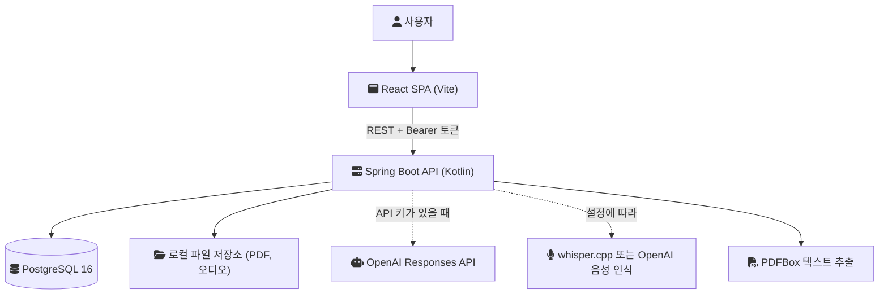
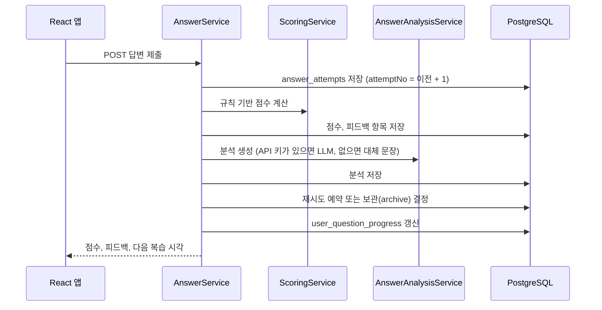
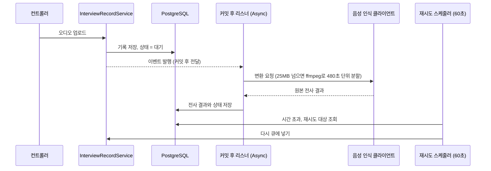

[GitHub 저장소](https://github.com/polynomeer/iterview)

iterview는 경력 개발자가 자기 이력서를 근거로 면접을 준비하는 서비스다. 이력서 PDF를 올리면 문장과 프로젝트에서 질문을 만들고, 답변을 채점하고, 약한 질문을 다시 풀게 한다. 이 글은 모노레포의 첫 커밋 [`5c51675`](https://github.com/polynomeer/iterview/commit/5c51675ed281d5541f29eba9cf103481992fbcb8)부터 그날 마지막 커밋 [`a753094`](https://github.com/polynomeer/iterview/tree/a75309473ef85c23953215885437d5859bb8ef54)까지, 2026-07-23 하루의 상태를 기준으로 처음 설계를 정리한다.

한 가지를 먼저 밝혀 둔다. 이날 저장소는 처음부터 코드를 쓴 것이 아니라, 따로 있던 백엔드와 프론트엔드를 `apps/api`, `apps/web`으로 옮겨 온 것이다. 그래서 첫날 이미 Flyway 마이그레이션이 37개 있었다. 기술 선택의 이유는 당시 문서에 대안 비교로 남아 있지 않았다. 이번에 그 이유를 재구성해 저장소에 [ADR 0087](https://github.com/polynomeer/iterview/blob/bda27da3926d7c2a08545c3bd6d96449725a0792/docs/adr/0087-record-initial-technology-selection.md)로 기록했고, 이 글의 결정 섹션은 그 문서를 바탕으로 한다. 저장소 문서에 적힌 요구사항은 그대로 옮겼고, 대안과의 비교는 재구성이라는 점을 구분해 둔다.

---

## 풀려던 문제와 조건

처음 문서([`01-product-overview.md`](https://github.com/polynomeer/iterview/blob/cf4c803f2e51f2f767ad47b6046b1262d285a9f6/apps/api/docs/01-product-overview.md))는 사용자가 앱을 열 때마다 세 가지 질문에 답하게 하는 것을 목표로 적었다. 오늘 무엇을 연습할지, 이력서와 목표 직무에 비해 어디가 약한지, 아직 방어하지 못하는 꼬리 질문이 무엇인지다. 일반 면접 질문 은행이 아니라, 내 이력서의 특정 문장이 어떤 질문을 불러오는지를 다루는 것이 출발점이었다.

학습 루프는 문서에 이렇게 고정되어 있었다.

```text
Resume PDF Upload -> Resume Version -> Raw Text Parse -> LLM Structured Extraction
-> Question Selection -> Interview Session or Practice Question -> Answer Submission
-> Score + Feedback -> Progress + Review Queue -> Next Recommended Question
```

설계를 묶은 조건은 다음과 같다.

- 개발자는 나 혼자였고, 운영 트래픽은 없었다. 로컬 실행과 CI 검증이 전부였다.
- 답변 시도(answer attempt)와 이력서 버전은 한 번 저장하면 바꾸지 않는다(immutable). 사용자별 질문 진행도는 그 기록에서 계산한 캐시 집계로 둔다.
- 답변 제출, 점수 저장, 피드백 생성, 진행도 갱신, 재시도 예약은 한 트랜잭션에서 끝난다.
- 스키마 변경은 모두 Flyway 마이그레이션으로 하고, Hibernate의 스키마 자동 생성은 쓰지 않는다.
- PDF 파싱, LLM 호출, 음성 인식 같은 작업은 서비스 인터페이스 뒤에 두고 컨트롤러로 새지 않게 한다.
- AI 자격 증명이 없어도 로컬에서 쓸 수 있도록 LLM을 쓰지 않는 결정적(deterministic) 대체 경로를 둔다.
- 한국어와 영어를 지원하되, 사용자가 쓴 원문은 번역하지 않고 원래 언어로 저장한다.

규모는 이 정도였다. `apps/api`의 Kotlin 소스가 399개 파일, 테스트가 38개 파일, 마이그레이션이 V1부터 V37까지였다. `apps/web/src`는 343개 파일이었다.

---

## 처음 아키텍처

구성은 단순하다. 브라우저의 React 앱이 하나의 Spring Boot API를 부르고, API는 PostgreSQL 하나와 로컬 파일 시스템, 그리고 선택적으로 OpenAI API나 로컬 whisper.cpp를 쓴다. 캐시도 메시지 브로커도 없다.



API 안은 도메인별 패키지로 나뉘어 있었다. `auth`, `user`, `resume`, `question`, `answer`, `review`, `dailycard`, `feed`, `interview`, `skill`, `jobposting`이 있고, 각 패키지 안은 `controller`, `service`, `repository`, `entity`, `dto`, `mapper`, `enum`으로 같은 모양을 유지한다. 파일 수로 보면 `resume`(124)과 `interview`(59), `question`(59)이 가장 컸다.

### 답변 제출은 하나의 트랜잭션이다

이 루프의 중심은 답변 제출이다. `AnswerService.submitAnswer`는 `@Transactional` 하나 안에서 다음 순서로 일한다.



점수 자체는 LLM이 아니라 `ScoringService`가 정한다. 문장 수, 숫자 포함 여부, 기술 키워드 수 같은 텍스트 특징으로 구조, 구체성, 기술 정확성 등의 항목 점수를 내고 가중합으로 통과 여부를 정한다. LLM은 그 위에 서술형 피드백을 덧붙이는 역할이다. 그래서 API 키가 없어도 채점과 복습 루프는 그대로 돈다.

### 실제 면접 녹음은 커밋 뒤에 비동기로 처리한다

유일하게 비동기인 흐름은 실제 면접 녹음을 올렸을 때의 음성 인식이다. 업로드 트랜잭션이 커밋되면 이벤트 리스너가 별도 스레드에서 변환을 시작하고, 1분 간격 스케줄러가 멈췄거나 실패한 기록을 다시 큐에 넣는다. 큐라고 해도 별도 시스템이 아니라 `interview_records` 테이블의 `transcript_status`와 재시도 시각 컬럼이다.



이 리스너는 Spring의 `@TransactionalEventListener(phase = AFTER_COMMIT)`이다. Spring 문서는 이 리스너가 트랜잭션이 성공적으로 커밋된 뒤에 실행되도록 묶인다고 설명한다. 동작 방식은 [@TransactionalEventListener가 무시되는 이유](/posts/transactional-event-listener/)에 따로 정리해 두었다.

---

## 결정 1. 저장소: 두 앱을 한 저장소에 나란히 둔다

첫날 커밋 13개 중 대부분은 이 결정을 위한 것이었다. 두 앱을 옮기고, 루트 스크립트와 루트 CI를 만들고, 무엇이 루트에 남고 무엇이 앱에 남는지를 [`monorepo-conventions.md`](https://github.com/polynomeer/iterview/blob/a75309473ef85c23953215885437d5859bb8ef54/docs/monorepo-conventions.md)에 적었다. 루트 `AGENTS.md`는 "do not introduce a root build orchestrator unless there is a concrete need"라고 못 박았다(구체적인 필요가 없으면 루트 빌드 오케스트레이터를 들이지 말라는 뜻이다).

| 선택지 | 요구사항에 비춘 평가 |
| --- | --- |
| 저장소 두 개 유지 (옮기기 전 상태) | API 계약 문서와 프론트 연동 문서가 따로 놀고, CI도 두 벌이다 |
| 워크스페이스 도구 (npm workspaces, Gradle composite build) | npm workspaces는 하나의 루트 패키지 아래 여러 npm 패키지를, Gradle composite build는 다른 Gradle 빌드를 묶는다. 둘 다 한 툴체인 안의 도구인데, 이 저장소는 툴체인마다 패키지가 하나뿐이다 |
| 앱을 나란히 두고 셸 스크립트로 묶기 (선택) | 각 앱의 빌드 시스템을 그대로 두라는 원칙과 맞는다 |

치른 비용도 분명하다. 바뀐 앱만 빌드하는 기능이나 공유 빌드 캐시가 없어서 CI는 매번 두 앱을 다 돈다. 두 앱이 타입을 공유하지 않으므로 `04-api-contracts.md`와 `04-api-integration.md`를 손으로 맞춰야 한다.

---

## 결정 2. 백엔드: Kotlin과 Spring Boot, 서블릿 스택

빌드 파일([`build.gradle.kts`](https://github.com/polynomeer/iterview/blob/cf4c803f2e51f2f767ad47b6046b1262d285a9f6/apps/api/build.gradle.kts))은 Kotlin 1.9.25, Spring Boot 3.3.5, Java 21 툴체인, Spring MVC(`spring-boot-starter-web`)였다.

| 선택지 | 평가 |
| --- | --- |
| Java + Spring Boot | 같은 생태계지만 DTO와 엔티티에서 Kotlin의 컴파일 타임 null 안전성을 잃는다 |
| Kotlin + Ktor | Ktor는 스스로를 Kotlin으로 처음부터 작성한 비동기 프레임워크라고 소개한다. 이 프로젝트에 필요한 JPA, Bean Validation, Spring Security, springdoc을 따로 붙여야 한다 |
| Node.js (NestJS 등) | 프론트와 언어가 같아지지만 PDFBox, JPA, Flyway로 이어지는 스택을 바꿔야 한다 |
| Kotlin + Spring Boot (선택) | Spring Boot 3.3은 Java 17 이상을 요구하고 빌드는 21에 고정했다 |

Kotlin과 Spring을 같이 쓰려면 설정이 몇 가지 필요하다. Kotlin 클래스는 기본이 `final`이라 Spring AOP 프록시를 만들 수 없는데, `kotlin-spring` 플러그인이 `@Component`, `@Transactional`, `@Async` 같은 애너테이션이 붙은 클래스를 자동으로 열어 준다. JPA는 인자 없는 생성자가 필요해서 `kotlin-jpa` 플러그인이 `@Entity`에 합성 생성자를 만들어 준다. `-Xjsr305=strict`는 Spring API의 nullability 선언을 Kotlin 타입에 반영하는 옵션인데, Spring Boot 문서는 이 선언이 마이너 릴리스 사이에도 바뀔 수 있다고 경고한다.

서블릿 스택을 고른 대가는 LLM 호출에서 드러난다. 모델 호출이 길어지면 요청 스레드가 그동안 묶인다. 클라이언트마다 타임아웃(기본 30초)을 둔 이유다.

---

## 결정 3. 아키텍처: 배포 단위 하나, 패키지는 도메인별로

| 선택지 | 평가 |
| --- | --- |
| 도메인별 마이크로서비스 | 핵심 트랜잭션이 `answer`, `review`, 진행도 테이블에 걸쳐 있어서 나누면 분산 조율이 필요하다 |
| 계층별 패키지 (controller/service/...가 최상위) | 한 도메인이 트리 전체에 흩어진다. 문서는 새 기능이 기존 도메인 폴더에 들어가길 요구했다 |
| Spring Modulith | 모듈 구조를 검증해 주는 도구지만 도입하지 않았다 |
| 도메인별 패키지의 단일 애플리케이션 (선택) | 답변 파이프라인을 트랜잭션 하나로 끝낼 수 있다 |

비용은 경계를 지키는 장치가 규칙뿐이라는 점이다. 한 도메인의 서비스가 다른 도메인의 리포지토리를 직접 불러도 컴파일러는 막지 않는다. 처음 문서는 "Do not move product rules into `common`" 같은 문장과 리뷰로 이를 막으려 했다. 경계를 코드로 강제하는 방법은 [모듈러 모놀리스 글](/posts/modular-monolith-boundaries/)에 정리했다.

---

## 결정 4. 데이터베이스: PostgreSQL, Flyway, JPA

| 선택지 | 평가 |
| --- | --- |
| MySQL 8 | MySQL 문서에 따르면 `CREATE TABLE`, `ALTER TABLE` 같은 DDL은 암묵적 커밋을 일으킨다. 마이그레이션이 중간에 실패하면 스키마가 반쯤 바뀐 채 남을 수 있다 |
| MongoDB | 사용자, 이력서, 버전, 질문, 시도, 진행도, 복습 항목, 세션과 그 연결 테이블로 이뤄진 관계형 데이터다 |
| PostgreSQL (선택) | DDL을 트랜잭션 안에서 실행하고 롤백할 수 있다. Testcontainers에 PostgreSQL 모듈이 있다 |

JPA 설정은 `ddl-auto: validate`, `open-in-view: false`였다. Hibernate는 스키마를 검사만 하고, 실제 스키마는 Flyway가 소유한다. 로컬 개발용 `docker-compose.yml`에는 `postgres:16-alpine` 하나만 있었다.

대가는 두 가지다. Kotlin에서 JPA 엔티티를 쓰려면 앞의 플러그인이 필요하다. 통합 테스트가 메모리 DB 대신 실제 PostgreSQL 컨테이너를 띄우므로 테스트를 돌리려면 Docker가 있어야 한다.

---

## 결정 5. 캐시와 브로커 없이, 커밋 후 비동기와 DB 상태로

| 선택지 | 평가 |
| --- | --- |
| Kafka나 RabbitMQ | 전달이 내구적이지만, 백그라운드 흐름 하나를 위해 상태를 가진 서비스를 하나 더 운영해야 한다 |
| Spring Modulith 이벤트 발행 레지스트리 | 업무 트랜잭션 안에서 이벤트 발행 로그를 쓰고, 실패한 항목은 남겨 재시도할 수 있게 한다. 의존성이 하나 늘어난다 |
| 커밋 후 `@Async` + 상태 컬럼 + 스케줄러 (선택) | 기록의 상태 컬럼이 곧 내구적인 작업 상태이고, 스케줄러가 멈춘 작업을 되살린다 |

캐시는 아예 없었다. 아키텍처 문서는 비정규화된 읽기 모델을 "성능 때문에 나중에 도입해도 된다"고만 적었다.

이 선택의 약점은 메모리 안의 이벤트다. 커밋 직후 프로세스가 죽으면 이벤트는 사라지고, 복구는 스케줄러 주기(기본 60초)를 기다린다. 인스턴스가 여러 개가 되면 일을 나눠 가지는 장치도 없다. 같은 문제를 Transactional Outbox로 푼 사례는 이후 [ParityPay 아웃박스 글](/posts/parity-pay-outbox/)에 정리했다.

---

## 결정 6. LLM 연동: 용도별 인터페이스와 평범한 HTTP 호출

처음 코드에는 OpenAI 클라이언트가 용도별로 따로 있었다. 첫 면접 질문 생성, 꼬리 질문 생성, 답변 심화 피드백, 질문 참고 자료 생성, 녹음 전사 라벨링, 전사 구조화다. 모두 Responses API에 `text.format.type = json_schema`, `strict: true`로 요청하고, `java.net.http.HttpClient`를 감싼 작은 transport로 보낸다. API 키가 비어 있으면 `isEnabled()`가 `false`가 되고 서비스는 대체 경로로 간다.

| 선택지 | 평가 |
| --- | --- |
| 공식 OpenAI Java SDK | 타입이 있는 클라이언트지만, 모델을 부르는 모든 도메인이 그 의존성과 릴리스 주기를 따라가야 한다 |
| 여러 제공자를 감싸는 추상화 라이브러리 | 제공자를 바꾸기 쉽지만 좁은 인터페이스 여섯 개에 비해 간접 계층이 크다 |
| HTTP 직접 호출 + strict JSON Schema 출력 (선택) | OpenAI 문서는 Structured Outputs가 스키마 준수를 보장해 필수 키 누락이나 잘못된 enum 값을 걱정하지 않아도 된다고 설명한다. 그래서 Kotlin 타입으로의 파싱이 예측 가능하다 |

음성 인식은 설정으로 두 구현 중 하나를 고른다. OpenAI 전사 엔드포인트, 또는 로컬 `whisper-cli`(whisper.cpp)다. whisper.cpp는 의존성 없는 C/C++ 구현이고 CPU와 Apple Silicon에서 돈다. 녹음을 밖으로 보내지 않아도 되지만, 품질과 속도는 실행하는 기계에 달려 있다. OpenAI 전사 엔드포인트는 파일을 25MB까지 받는다. 그래서 클라이언트는 26214400바이트를 넘으면 `ffmpeg`로 480초 단위로 잘라 보낸다. 업로드 자체는 50MiB까지 허용했다.

대가는 손으로 쓴 코드다. 요청과 응답 형태를 클라이언트마다 직접 작성했고, transport도 `interview`와 `resume` 쪽에 비슷한 구현이 두 벌 있었다.

---

## 결정 7. 인증: API가 직접 서명하는 토큰

`SignedTokenService`는 `userId|email|expiresAt`을 Base64URL로 인코딩하고 HmacSHA256으로 서명한다. 서명 비교는 `MessageDigest.isEqual`로 상수 시간에 한다. 웹 앱은 이 토큰을 `localStorage`에 두고 `Authorization: Bearer` 헤더로 보낸다.

| 선택지 | 평가 |
| --- | --- |
| 서버 세션 + 쿠키 | 서버에 세션 상태가 필요하고, 개발 중에는 SPA와 API의 출처가 달라 쿠키에 교차 출처 설정이 붙는다 |
| JWT 라이브러리 | JWT는 `exp`, `sub` 같은 등록 클레임을 가진 표준 형식이다. 여기 필요한 내용은 사용자 ID, 이메일, 만료 시각뿐이었다 |
| 외부 인증 제공자 (OAuth/OIDC) | `users` 테이블에 `provider` 컬럼은 있었지만 연동은 없었다 |
| 최소한의 HMAC 토큰 (선택) | 상태가 없고 코드가 수십 줄이다 |

토큰은 만료(기본 86400초) 전에는 폐기할 수 없다. OWASP는 세션 식별자를 `localStorage`에 두지 말라고 권한다. 자바스크립트가 항상 읽을 수 있어서 XSS 한 번이면 빼앗기기 때문이다. 이 부분은 처음부터 알고 남긴 빚에 가깝다. JWT 쪽의 같은 한계는 [JWT의 구조와 검증](/posts/jwt-structure-and-verification/)에서 다뤘다.

---

## 결정 8. 프론트엔드: Vite 위의 React SPA

`package.json`은 React 19, Vite 6, React Router 7(`createBrowserRouter`로 클라이언트 라우터로만 사용), TanStack Query 5, Vitest였다.

| 선택지 | 평가 |
| --- | --- |
| Next.js | 풀스택 React 프레임워크다. 이 프로젝트는 이미 API가 따로 있고, 문서에 SSR이나 검색 노출 요구가 없었다 |
| React Router 프레임워크 모드 | 프레임워크 기능을 쓸 수 있지만 여기서는 라우터만 필요했다 |
| Vite SPA (선택) | 개발 중에는 네이티브 ES 모듈로 필요한 파일만 변환해 제공하고, 배포 때는 번들링한다. 결과물은 정적 파일이다 |

서버 상태(server state)는 TanStack Query가 맡고, 폼이나 필터 같은 잠깐의 상태는 컴포넌트에 둔다. TanStack Query 문서는 서버 상태를 내가 소유하지 않은 곳에 저장되고 다른 사람이 바꿀 수 있어 낡을 수 있는 데이터로 구분한다. 처음 `queryClient`는 4xx는 재시도하지 않고, `staleTime`을 30초로 두었다.

폴더는 `app`, `pages`, `widgets`, `features`, `entities`, `shared`로 나뉜다. Feature-Sliced Design의 계층 이름과 같지만, 당시 문서는 FSD라는 이름을 쓰지 않았다.

React 문서는 프레임워크 없이 시작하면 "often the same as building your own adhoc framework"라고 경고한다(사실상 자기만의 임시 프레임워크를 만드는 셈이라는 뜻이다). 라우팅, 데이터 로딩, 코드 분할이 모두 이 앱의 몫이 된다. 실제로 첫날 빌드부터 메인 번들이 크다는 경고가 나왔다.

---

## 첫날 커밋들이 실제로 만든 것

2026-07-23의 커밋 13개는 기능이 아니라 저장소의 뼈대를 만들었다.

| 커밋 | 내용 |
| --- | --- |
| `5c51675` | 루트 README, AGENTS.md, `apps/`, `docs/`, `scripts/` 골격 |
| `cf4c803`, `e316471` | 기존 백엔드와 프론트엔드를 `apps/api`, `apps/web`으로 이전 |
| `edc33f9`, `fc85f61`, `ebe7f71` | `build_all`, `test_all`, `dev_all`, `setup_all` 스크립트 |
| `00dc732`, `45e101e`, `2ed3636` | 앱별 CI를 루트 워크플로 하나로 합치고 `verify_all.sh ci`를 실행 |
| `0207c4c`, `7a0db38` | 루트와 앱의 소유 규칙, 공유 제품 문서 세 개(`01`~`03`) |
| `a753094` | [`monorepo-status.md`](https://github.com/polynomeer/iterview/blob/a75309473ef85c23953215885437d5859bb8ef54/docs/monorepo-status.md)에 남은 위험 기록 |

CI는 GitHub Actions에서 JDK 21과 Node 20을 준비하고 `scripts/verify_all.sh ci`를 돌린다. 백엔드 통합 테스트는 Testcontainers의 PostgreSQL 컨테이너에서 돈다. 웹은 Vitest와 Testing Library를 쓴다. 로컬에서는 PostgreSQL만 컨테이너로 띄우고 API와 웹은 호스트에서 `dev_all.sh`로 실행한다. 관측성은 Spring 기본 로깅 말고는 없었다.

---

## 처음 설계가 남긴 질문

`monorepo-status.md`가 첫날 직접 적은 위험은 세 가지였다. 프론트 설치 직후 npm audit 취약점 8건, 메인 번들 크기 경고, Gradle 10 업그레이드 전에 정리해야 할 deprecation 경고다.

코드를 다시 읽으면서 보인 것도 있다. `submitAnswer`는 트랜잭션 안에서 `AnswerAnalysisService.analyze`를 부르고, 이 메서드는 API 키가 있으면 OpenAI를 호출한다. 타임아웃이 30초이므로 최악의 경우 DB 커넥션 하나를 그만큼 붙잡는다. 실패하면 대체 문장으로 넘어가서 제출 자체는 깨지지 않지만, 외부 호출을 트랜잭션 밖으로 빼야 하는지는 열린 질문으로 남았다.

비동기 아키텍처 문서에는 이력서 파싱, 신호 추출, 답변 심화 분석, 스킬 점수 재계산 같은 작업이 "future async boundaries"로 적혀 있었다. 이 작업들을 지금처럼 동기로 둘지, 녹음 전사처럼 상태 컬럼과 스케줄러로 옮길지는 첫날 정하지 않았다. 토큰 폐기와 `localStorage` 보관, 파일을 로컬 디스크에 두는 저장 방식도 배포를 생각하기 전까지 미뤄 둔 결정이다.

## 참고

- [iterview 저장소](https://github.com/polynomeer/iterview) — GitHub
- [ADR 0087 - Record the Initial Technology Selection](https://github.com/polynomeer/iterview/blob/bda27da3926d7c2a08545c3bd6d96449725a0792/docs/adr/0087-record-initial-technology-selection.md) — GitHub
- [apps/api/docs/01-product-overview.md (cf4c803)](https://github.com/polynomeer/iterview/blob/cf4c803f2e51f2f767ad47b6046b1262d285a9f6/apps/api/docs/01-product-overview.md) — GitHub
- [apps/api/docs/02-backend-architecture.md (cf4c803)](https://github.com/polynomeer/iterview/blob/cf4c803f2e51f2f767ad47b6046b1262d285a9f6/apps/api/docs/02-backend-architecture.md) — GitHub
- [apps/api/AGENTS.md (cf4c803)](https://github.com/polynomeer/iterview/blob/cf4c803f2e51f2f767ad47b6046b1262d285a9f6/apps/api/AGENTS.md) — GitHub
- [apps/web/docs/02-frontend-architecture.md (e316471)](https://github.com/polynomeer/iterview/blob/e316471c23f7730b4c0aa01c5512710a7fbe220c/apps/web/docs/02-frontend-architecture.md) — GitHub
- [docs/monorepo-conventions.md (a753094)](https://github.com/polynomeer/iterview/blob/a75309473ef85c23953215885437d5859bb8ef54/docs/monorepo-conventions.md) — GitHub
- [docs/monorepo-status.md (a753094)](https://github.com/polynomeer/iterview/blob/a75309473ef85c23953215885437d5859bb8ef54/docs/monorepo-status.md) — GitHub
- [Spring Boot 3.3 System Requirements](https://docs.spring.io/spring-boot/3.3/system-requirements.html) — Spring Docs
- [Spring Boot 3.3 Kotlin Support](https://docs.spring.io/spring-boot/3.3/reference/features/kotlin.html) — Spring Docs
- [Kotlin All-open compiler plugin](https://kotlinlang.org/docs/all-open-plugin.html) — Kotlin Docs
- [Kotlin No-arg compiler plugin](https://kotlinlang.org/docs/no-arg-plugin.html) — Kotlin Docs
- [Ktor README](https://github.com/ktorio/ktor) — GitHub
- [Spring Modulith Reference](https://docs.spring.io/spring-modulith/reference/) — Spring Docs
- [Spring Modulith Events](https://docs.spring.io/spring-modulith/reference/events.html) — Spring Docs
- [Transaction-bound Events](https://docs.spring.io/spring-framework/reference/data-access/transaction/event.html) — Spring Framework
- [MySQL 8.0, Statements That Cause an Implicit Commit](https://dev.mysql.com/doc/refman/8.0/en/implicit-commit.html) — MySQL Docs
- [Transactional DDL in PostgreSQL](https://wiki.postgresql.org/wiki/Transactional_DDL_in_PostgreSQL:_A_Competitive_Analysis) — PostgreSQL Wiki
- [Testcontainers Postgres Module](https://java.testcontainers.org/modules/databases/postgres/) — java.testcontainers.org
- [Spring Boot Testcontainers](https://docs.spring.io/spring-boot/3.3/reference/testing/testcontainers.html) — Spring Docs
- [OpenAI Structured Outputs](https://developers.openai.com/api/docs/guides/structured-outputs) — OpenAI
- [OpenAI Speech to text](https://developers.openai.com/api/docs/guides/speech-to-text) — OpenAI
- [OpenAI Java SDK](https://github.com/openai/openai-java) — GitHub
- [whisper.cpp](https://github.com/ggml-org/whisper.cpp) — GitHub
- [Apache PDFBox](https://pdfbox.apache.org/) — Apache PDFBox
- [RFC 7519, JSON Web Token](https://www.rfc-editor.org/rfc/rfc7519) — IETF
- [OWASP HTML5 Security Cheat Sheet](https://cheatsheetseries.owasp.org/cheatsheets/HTML5_Security_Cheat_Sheet.html) — OWASP Cheat Sheet Series
- [npm Workspaces](https://docs.npmjs.com/cli/v10/using-npm/workspaces) — docs.npmjs.com
- [Gradle Composite Builds](https://docs.gradle.org/current/userguide/composite_builds.html) — Gradle Docs
- [Build a React app from Scratch](https://react.dev/learn/build-a-react-app-from-scratch) — React
- [Next.js Docs](https://nextjs.org/docs) — Next.js
- [Why Vite](https://vite.dev/guide/why) — Vite
- [TanStack Query Overview](https://tanstack.com/query/latest/docs/framework/react/overview) — TanStack
- [Layers](https://feature-sliced.design/docs/reference/layers) — Feature-Sliced Design
