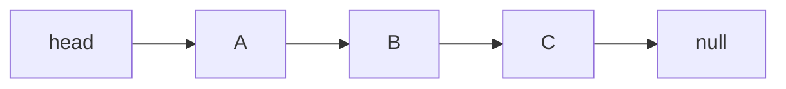
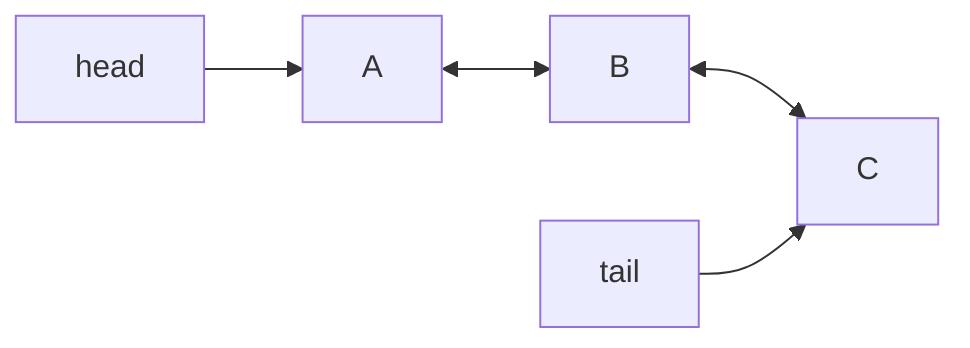
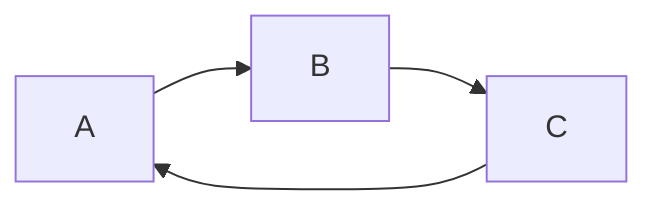

연결 리스트는 노드가 다음 노드를 참조하는 방식으로 이어지는 자료구조다. 구현 방식에 따라 단일 연결 리스트, 이중 연결 리스트, 환형 연결 리스트로 나뉜다.

배열은 원소를 메모리에 연속으로 놓고 인덱스로 위치를 계산한다. 연결 리스트는 원소를 각자 흩어진 노드에 담고, 각 노드가 다음 노드의 참조를 들고 있다. 그래서 i번째 원소를 찾으려면 앞에서부터 참조를 따라가야 하지만, 노드 사이에 새 노드를 끼우거나 빼는 일은 참조 몇 개만 바꾸면 된다. 세 가지 종류는 이 참조를 몇 개, 어떤 방향으로 두느냐의 차이다. 배열과의 비교는 [배열과 연결 리스트는 언제 차이가 커지는가](/posts/array-vs-linked-list/)에 정리했다.

## 단일 연결 리스트

각 노드가 다음 노드만 가리키는 구조다.



```java
class Node<E> {
    E value;
    Node<E> next;
}
```

- 구현이 단순하다
- 메모리 오버헤드가 적다
- 뒤로 이동은 어렵다

앞에서 순차적으로 순회하는 용도에는 충분하지만, 이전 노드로 되돌아가야 하는 경우에는 불편하다.

삭제에서 이 불편함이 구체적으로 드러난다. 노드 B를 지우려면 A의 `next`를 C로 바꿔야 하는데, B는 A를 모른다. 그래서 B를 지우려면 head부터 다시 따라가서 A를 찾아야 한다. 맨 앞에 넣고 빼는 일은 O(1)이지만, 맨 뒤를 지우는 일은 마지막 직전 노드를 찾느라 O(n)이 든다. 맨 뒤 노드를 가리키는 `tail` 참조를 따로 두면 맨 뒤에 추가하는 것은 O(1)이 되지만, 맨 뒤를 지우는 것은 여전히 O(n)이다.

## 이중 연결 리스트

각 노드가 다음 노드와 이전 노드를 모두 가진다.



```java
class Node<E> {
    E value;
    Node<E> prev;
    Node<E> next;
}
```

- 양방향 탐색이 가능하다
- 삭제와 삽입 위치 조정이 더 유연하다
- 메모리 사용량이 더 크다

Deque 같은 구조를 구현할 때 이중 연결 리스트가 자주 등장하는 이유도 여기에 있다.

노드가 이전 노드를 알기 때문에, 지울 노드의 참조만 있으면 `prev.next = next`, `next.prev = prev` 두 줄로 O(1)에 지울 수 있다. `head`와 `tail`을 모두 두면 양 끝에서의 추가와 삭제가 모두 O(1)이 된다. Deque(double-ended queue)가 정확히 이 연산들의 집합이다. 대가는 노드마다 참조 하나가 더 붙는 메모리와, 삽입과 삭제 때마다 참조를 두 배로 맞춰야 하는 구현 복잡도다.

Java 표준 라이브러리의 `LinkedList`가 이 구조다. Javadoc은 `LinkedList`를 `List`와 `Deque` 인터페이스의 이중 연결 리스트 구현이라고 설명하고, 인덱스로 접근하는 연산은 지정한 인덱스에 더 가까운 쪽 끝(처음 또는 끝)부터 따라간다고 적는다([LinkedList Javadoc](https://docs.oracle.com/en/java/javase/21/docs/api/java.base/java/util/LinkedList.html)). 양방향 참조가 있으니 뒤에서부터 따라가는 것도 가능하지만, 인덱스 접근이 여전히 O(n)이라는 점은 변하지 않는다. 직접 구현해 보는 과정은 [LinkedList로 Deque를 구현할 때 알아야 할 것](/posts/implementing-deque-with-linked-list/)에 정리했다.

## 환형 연결 리스트

마지막 노드가 다시 처음 노드를 가리키는 구조다.



- 끝과 처음이 이어져 있다
- 순환 구조를 표현하기 쉽다
- 종료 조건을 잘못 두면 무한 순회에 빠지기 쉽다

스케줄링, 라운드 로빈, 순환 버퍼와 비슷한 문제를 생각할 때 개념적으로 자주 등장한다.

`null`로 끝나는 지점이 없으므로 순회의 종료 조건은 "시작 노드로 돌아왔는가"가 된다. `while (node != null)` 같은 습관적인 조건을 쓰면 무한 루프가 된다.

```java
Node<E> node = start;
do {
    visit(node.value);
    node = node.next;
} while (node != start);
```

환형 구조는 이중 연결 리스트와 함께 쓰이기도 한다. 리눅스 커널의 연결 리스트가 그 예다. 커널 문서는 커널의 이중 연결 리스트가 환형이라서 head 노드에서 tail로 가려면 뒤로 한 칸만 가면 된다고 설명한다([Linux kernel, Linked Lists in Linux](https://docs.kernel.org/core-api/list.html)). tail 참조를 따로 두지 않아도 양 끝에 O(1)로 접근할 수 있다.

## 연산 비용 비교

| 연산 | 단일 (head만) | 단일 (head, tail) | 이중 (head, tail) |
| --- | --- | --- | --- |
| 맨 앞 추가/삭제 | O(1) | O(1) | O(1) |
| 맨 뒤 추가 | O(n) | O(1) | O(1) |
| 맨 뒤 삭제 | O(n) | O(n) | O(1) |
| 참조를 가진 노드 삭제 | O(n) | O(n) | O(1) |
| i번째 원소 접근 | O(n) | O(n) | O(n) |
| 노드당 참조 수 | 1 | 1 | 2 |

## 어떻게 고를 것인가

- 단순 순차 처리: 단일 연결 리스트
- 양방향 이동과 양끝 조작: 이중 연결 리스트
- 순환 구조 표현: 환형 연결 리스트

실무에서는 직접 구현보다 표준 컬렉션을 더 자주 쓰지만, 각 연결 리스트의 차이를 이해하면 자료구조 선택 이유를 설명하기 쉬워진다.

표준 컬렉션을 쓸 때도 연결 리스트가 기본 선택은 아니다. 큐나 스택이 필요하다면 `ArrayDeque`를 먼저 고려할 만하다. Javadoc은 `ArrayDeque`가 스택으로 쓸 때는 `Stack`보다, 큐로 쓸 때는 `LinkedList`보다 빠를 가능성이 높다고 적는다([ArrayDeque Javadoc](https://docs.oracle.com/en/java/javase/21/docs/api/java.base/java/util/ArrayDeque.html)). 다만 `ArrayDeque`는 `null` 원소를 허용하지 않는다. 큐 구현 자체는 [LinkedList로 Queue를 구현할 때 핵심은 무엇인가](/posts/implementing-queue-with-linked-list/)에서 다뤘다.

## 참고

- [LinkedList (Java SE 21)](https://docs.oracle.com/en/java/javase/21/docs/api/java.base/java/util/LinkedList.html)
- [ArrayDeque (Java SE 21)](https://docs.oracle.com/en/java/javase/21/docs/api/java.base/java/util/ArrayDeque.html)
- [Linux kernel documentation, Linked Lists in Linux](https://docs.kernel.org/core-api/list.html)
