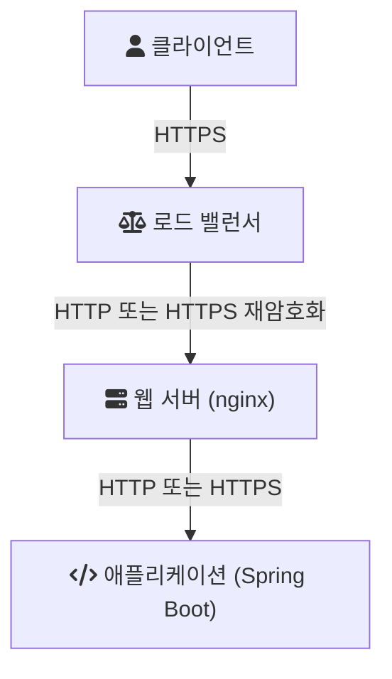

# SSL/TLS

HTTPS는 HTTP를 TLS 위에서 주고받는 것이다. 그런데 서비스 구성도를 그려 보면 "TLS를 어디서 끝내는가"라는 질문이 남는다. 클라이언트의 암호화된 연결을 로드 밸런서가 풀 수도 있고, 웹 서버가 풀 수도 있고, 애플리케이션이 직접 풀 수도 있다. 이 노트는 TLS가 무엇을 보장하는지 짧게 정리한 뒤, 이 세 위치에서 각각 무엇을 설정하는지 본다.

## SSL과 TLS

SSL(Secure Sockets Layer)과 TLS(Transport Layer Security)는 같은 계열의 프로토콜이다. SSL이 먼저 나왔고, 이후 IETF 표준으로 이어진 것이 TLS다. 지금 "SSL 인증서", "SSL 설정"이라고 부르는 것도 실제로는 대부분 TLS를 뜻한다.

SSL은 이미 쓰면 안 되는 프로토콜이다.

- SSL 2.0: RFC 6176은 TLS 클라이언트와 서버가 SSL 2.0을 협상하지 않아야 한다고 정했다.
- SSL 3.0: RFC 7568은 SSLv3가 충분히 안전하지 않으므로 사용하지 않아야 한다고 정했다([RFC 7568](https://www.rfc-editor.org/rfc/rfc7568)).
- TLS 1.0, 1.1: RFC 8996이 공식적으로 폐기했다. 현재 권장되는 암호 알고리즘과 메커니즘을 지원하지 않는다는 이유다([RFC 8996](https://www.rfc-editor.org/rfc/rfc8996)).

남은 선택지는 TLS 1.2와 TLS 1.3이다. RFC 8996의 설명에 따르면 TLS 1.2는 2008년부터 IETF 프로토콜의 권장 버전이었고, 2018년 TLS 1.3이 나왔다.

## TLS가 보장하는 것

RFC 8446은 TLS를 클라이언트와 서버가 도청(eavesdropping), 변조(tampering), 메시지 위조(message forgery)를 막도록 설계된 방식으로 통신하게 하는 프로토콜로 소개한다([RFC 8446](https://www.rfc-editor.org/rfc/rfc8446)). 세 가지로 나눠 보면 다음과 같다.

- 기밀성: 중간에서 패킷을 봐도 내용을 읽을 수 없다.
- 무결성: 중간에서 내용을 바꾸면 받는 쪽이 알아챈다.
- 인증: 클라이언트는 인증서로 상대 서버가 진짜인지 확인한다. 필요하면 서버도 클라이언트 인증서를 요구할 수 있다(mTLS).

이 보장은 연결 전에 핸드셰이크를 거쳐 만들어진다. 핸드셰이크에서 양쪽은 프로토콜 버전과 암호 알고리즘을 협상하고, 서버를 인증하고, 공유 비밀 키를 만든다. 이후의 HTTP 데이터는 그 키로 보호된다.

TLS 1.3에서 바뀐 점 중 운영자가 알아 둘 만한 것은 이렇다(RFC 8446 1.2절).

- 레거시 알고리즘을 정리해 대칭 암호는 AEAD 알고리즘만 남겼다.
- 정적 RSA와 정적 Diffie-Hellman 키 교환을 제거해, 모든 공개 키 기반 키 교환이 forward secrecy를 제공한다.
- ServerHello 이후의 핸드셰이크 메시지를 모두 암호화한다.
- 일부 데이터를 첫 왕복 없이 보내는 0-RTT 모드가 추가됐다. 단, 일부 보안 속성을 포기하는 대가다.

## 인증서와 체인

서버 인증서는 보통 루트 CA가 직접 서명하지 않고 중간(intermediate) CA가 서명한다. 클라이언트는 서버 인증서에서 중간 인증서를 거쳐 자기가 신뢰하는 루트까지 이어지는 체인을 검증한다. 서버가 중간 인증서를 함께 보내지 않으면 일부 클라이언트에서만 검증이 실패하는 문제가 생긴다. 아래 세 위치 어디서 TLS를 끝내든 인증서와 함께 체인을 설정해야 하는 이유다.

하나의 IP에서 여러 도메인의 HTTPS를 운영할 수 있는 것은 SNI(Server Name Indication) 덕분이다. 클라이언트가 핸드셰이크 첫 메시지에 접속하려는 호스트 이름을 실어 보내고, 서버는 그 이름에 맞는 인증서를 고른다.

## TLS를 끝내는 세 위치



TLS 연결을 받아 복호화하는 지점을 TLS 종료(termination) 지점이라고 한다. 종료 지점 뒤로는 평문 HTTP가 흐르거나, 다시 암호화된 별도의 TLS 연결이 이어진다.

## In LB

AWS Application Load Balancer(ALB)의 HTTPS 리스너는 로드 밸런서에 배포한 서버 인증서로 프런트엔드 연결을 종료하고, 요청을 복호화한 뒤 타깃으로 보낸다. 리스너를 만들 때 인증서와 함께 보안 정책(security policy)을 지정해야 하는데, 이 정책이 클라이언트와 협상할 프로토콜 버전과 암호 스위트를 정한다([ALB: Create an HTTPS listener](https://docs.aws.amazon.com/elasticloadbalancing/latest/application/create-https-listener.html)).

- 인증서는 AWS Certificate Manager(ACM)에서 고르거나 가져온다. 기본 인증서는 SNI 목록에도 들어가고, 도메인별 인증서를 추가로 등록할 수 있다.
- 문서의 CLI 예시는 `ELBSecurityPolicy-TLS13-1-2-2021-06` 정책을 쓴다. 이름처럼 TLS 1.3과 1.2를 허용하는 정책이다.
- 로드 밸런서가 복호화하지 않고 암호화된 트래픽을 그대로 넘겨야 한다면, ALB 대신 TCP 443 리스너를 둔 Network Load Balancer를 쓰라고 문서가 안내한다.

LB와 타깃 사이도 HTTPS로 다시 암호화할 수 있다. 타깃 그룹 프로토콜을 HTTPS로 두면 ALB는 타깃에 설치된 인증서로 TLS 연결을 맺는다. 이때 ALB는 타깃 인증서를 검증하지 않으므로 자체 서명 인증서나 만료된 인증서도 동작한다. 문서는 LB와 타깃이 같은 VPC 안에 있어 패킷 수준에서 인증되므로 중간자 공격 위험이 없다고 설명한다([ALB: Target groups](https://docs.aws.amazon.com/elasticloadbalancing/latest/application/load-balancer-target-groups.html)).

LB에서 TLS를 끝내면 애플리케이션은 원래 요청이 HTTPS였는지 알 수 없다. ALB는 이를 `X-Forwarded-Proto` 헤더로 전달한다([ALB: X-Forwarded headers](https://docs.aws.amazon.com/elasticloadbalancing/latest/application/x-forwarded-headers.html)). 이 헤더를 애플리케이션에서 읽는 방법은 아래 In Application에서 다룬다.

## In Server

nginx에서 TLS를 끝낼 때의 최소 설정은 다음과 같다([nginx: Configuring HTTPS servers](https://nginx.org/en/docs/http/configuring_https_servers.html)).

```nginx
server {
    listen              443 ssl;
    server_name         www.example.com;
    ssl_certificate     www.example.com.chained.crt;
    ssl_certificate_key www.example.com.key;
    ssl_protocols       TLSv1.2 TLSv1.3;
    ssl_ciphers         HIGH:!aNULL:!MD5;
}
```

설정할 때 확인할 점은 세 가지다.

- 체인 파일 순서: 중간 인증서는 서버 인증서와 하나의 파일로 합쳐 `ssl_certificate`에 지정한다. 서버 인증서가 반드시 앞에 와야 하고, 순서가 바뀌면 nginx가 키 불일치 오류를 낸다.
- 세션 캐시: 핸드셰이크는 CPU를 쓰는 작업이므로 재접속하는 클라이언트의 세션을 재사용하면 비용이 줄어든다. `ssl_session_cache shared:SSL:10m`처럼 워커 프로세스가 공유하는 캐시를 둔다. 문서에 따르면 1MB에 약 4,000개 세션이 들어가고, 기본 타임아웃은 5분이다.
- SNI: nginx는 SNI를 지원하는 OpenSSL과 함께 빌드되면 별도 설정 없이 `server_name`별로 다른 인증서를 쓴다. 문서는 SNI가 TLSv1.3에서 필수 구현 확장이지만 일부 오래된 클라이언트는 쓰지 않을 수 있다고 적는다.

LB 뒤에 nginx를 두는 구성이라면 둘 중 한 곳에서만 공개 인증서를 관리하고, 나머지 구간은 내부 인증서나 평문으로 둘지 정책을 정해 두는 편이 혼란이 적다.

## In Application

Spring Boot 애플리케이션이 직접 TLS를 받을 수도 있다. Spring Boot의 SSL 번들(SSL bundle)은 키스토어와 트러스트스토어 설정을 이름 붙인 묶음으로 관리하고, 내장 웹 서버는 `server.ssl.bundle`로 그 번들을 참조한다([Spring Boot: SSL](https://docs.spring.io/spring-boot/reference/features/ssl.html)).

```yaml
spring:
  ssl:
    bundle:
      pem:
        web-server:
          keystore:
            certificate: "classpath:application.crt"
            private-key: "classpath:application.key"
server:
  ssl:
    bundle: "web-server"
```

PEM 대신 JKS나 PKCS12 키스토어도 쓸 수 있다. `reload-on-update: true`를 주면 인증서 파일이 갱신될 때 애플리케이션을 재시작하지 않고 번들을 다시 읽는다. 문서는 Certbot이 갱신하는 Let's Encrypt 인증서 경로를 예로 든다.

애플리케이션이 TLS를 직접 받지 않고 LB나 nginx 뒤에 있다면, 오히려 프록시가 보낸 헤더를 믿도록 설정하는 일이 중요하다. 그렇지 않으면 애플리케이션은 모든 요청을 HTTP로 보고, 리다이렉트 URL을 `http://`로 만들거나 보안 쿠키 처리를 잘못할 수 있다. Spring Boot 문서는 프록시가 `X-Forwarded-For`와 `X-Forwarded-Proto`를 붙인다면 `server.forward-headers-strategy=NATIVE`로 충분하다고 설명한다([Spring Boot: Running Behind a Front-end Proxy Server](https://docs.spring.io/spring-boot/how-to/webserver.html)).

```properties
server.forward-headers-strategy=NATIVE
```

애플리케이션이 클라이언트로서 사내 HTTPS API를 호출할 때도 같은 SSL 번들의 트러스트스토어를 쓴다. 사설 CA가 발급한 인증서를 쓰는 서버라면 그 CA 인증서를 트러스트스토어 번들에 넣고, `SslBundles`에서 번들을 꺼내 HTTP 클라이언트의 `SSLContext`로 쓴다. 검증을 끄는 `TrustManager`를 만드는 방식은 TLS가 보장하던 인증을 통째로 버리는 것이므로 피한다.

## 어디서 끝낼지 고르는 기준

| 종료 위치 | 장점 | 신경 쓸 점 |
| --- | --- | --- |
| LB | 인증서를 한곳에서 관리하고, 애플리케이션 서버의 암복호화 부담이 사라진다 | LB 뒤 구간의 암호화 여부, 원래 프로토콜 전달 |
| 웹 서버 | 프로토콜과 암호 스위트를 세밀하게 제어한다 | 서버마다 인증서 배포와 갱신 |
| 애플리케이션 | 프록시 없이 단독으로 운영할 수 있다 | 인증서 갱신을 애플리케이션 배포와 분리해야 한다 |

## 참고

- [RFC 8446: The Transport Layer Security (TLS) Protocol Version 1.3](https://www.rfc-editor.org/rfc/rfc8446) — IETF
- [RFC 8996: Deprecating TLS 1.0 and TLS 1.1](https://www.rfc-editor.org/rfc/rfc8996) — IETF
- [RFC 7568: Deprecating Secure Sockets Layer Version 3.0](https://www.rfc-editor.org/rfc/rfc7568) — IETF
- [RFC 6176: Prohibiting Secure Sockets Layer (SSL) Version 2.0](https://www.rfc-editor.org/rfc/rfc6176) — IETF
- [Create an HTTPS listener for your Application Load Balancer](https://docs.aws.amazon.com/elasticloadbalancing/latest/application/create-https-listener.html) — Elastic Load Balancing User Guide
- [Target groups for your Application Load Balancers](https://docs.aws.amazon.com/elasticloadbalancing/latest/application/load-balancer-target-groups.html) — Elastic Load Balancing User Guide
- [HTTP headers and Application Load Balancers](https://docs.aws.amazon.com/elasticloadbalancing/latest/application/x-forwarded-headers.html) — Elastic Load Balancing User Guide
- [Configuring HTTPS servers](https://nginx.org/en/docs/http/configuring_https_servers.html) — nginx documentation
- [SSL](https://docs.spring.io/spring-boot/reference/features/ssl.html) — Spring Boot Reference
- [Embedded Web Servers: Running Behind a Front-end Proxy Server](https://docs.spring.io/spring-boot/how-to/webserver.html) — Spring Boot Reference
