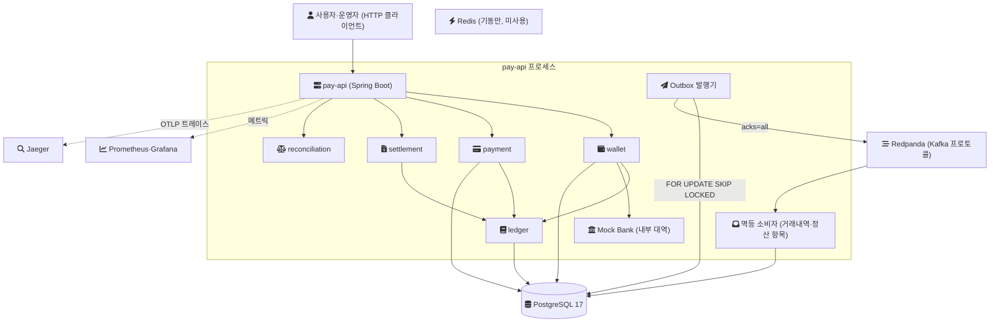
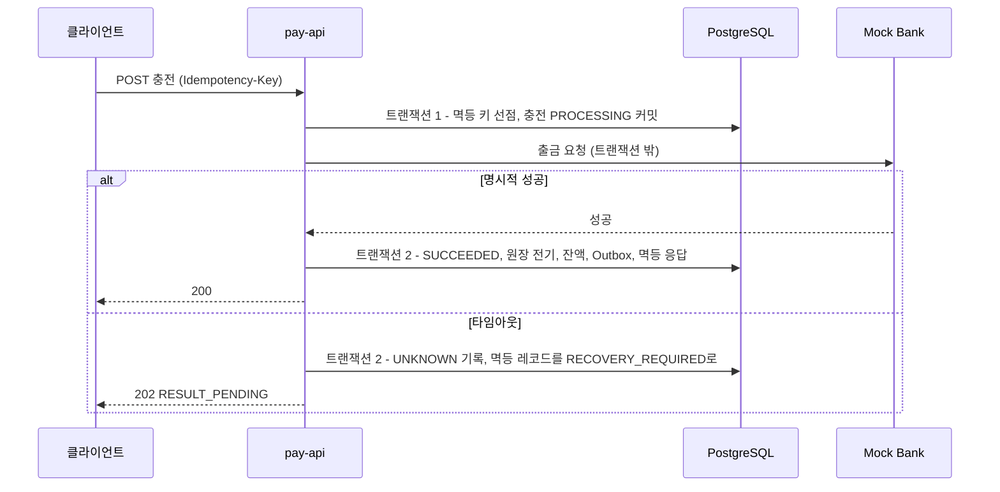

[GitHub 저장소](https://github.com/polynomeer/parity-pay)

ParityPay 저장소의 첫 커밋은 2026-09-07이다. 이 글은 그날의 커밋들이 보여 주는 설계를 정리한다. 무엇을 풀려고 했는지, 컴포넌트와 데이터가 어떻게 흐르게 했는지, 그리고 언어·데이터베이스·브로커·테스트·관측성을 각각 무엇과 비교해서 골랐는지다. 이후에 추가된 프론트엔드, 배포 형태, 외부 호출 격리는 첫날 설계에 없었으므로 다루지 않는다.

근거는 두 갈래다. 아키텍처·원장·이벤트 전달의 결정은 첫 설계 커밋([`cfcaa3d`](https://github.com/polynomeer/parity-pay/tree/cfcaa3de107bd3d7bb3938ca92f8f3fbfbfc4fc1/docs))에 ADR(Architecture Decision Record, 결정의 맥락·대안·결과를 남기는 짧은 문서)로 대안과 함께 적혀 있다. 반면 Java·Spring Boot·Redpanda·Testcontainers 같은 스택은 설계서의 표에 "목적" 한 줄만 있었다. 그래서 이 글을 쓰면서 첫 커밋과 기존 문서를 근거로 스택 선택 이유를 재구성해 [ADR-015](https://github.com/polynomeer/parity-pay/blob/c8f7dceadbb2919900044d864bef9c2b6b801123/docs/adr/015-initial-technology-stack.md)로 저장소에 남겼다. 아래에서 그 ADR을 인용할 때는 재구성이라는 점을 밝혀 둔다.

## 무엇을 풀려고 했는가

ParityPay는 가상의 커머스 플랫폼에 내장되는 페이머니 결제 서비스다. 사용자는 Mock Bank 계좌에서 페이머니를 충전하고, 그 잔액으로 결제하고, 취소한다. 구매확정 뒤에는 판매자에게 정산되고, 운영자는 내부 원장과 외부기관 기록이 어긋나는지 대사(reconciliation, 두 기록을 맞춰 보는 작업)한다.

제품 기획서([docs/01](https://github.com/polynomeer/parity-pay/blob/cfcaa3de107bd3d7bb3938ca92f8f3fbfbfc4fc1/docs/01-product-plan.md))는 풀려는 문제를 기능이 아니라 실패 목록으로 적었다. 클라이언트 재시도로 같은 결제가 두 번 승인되는 것, 잔액 조회와 차감 사이의 경쟁으로 잔액이 음수가 되는 것, 외부 승인 뒤 응답이 유실되어 성공을 실패로 오판하는 것, DB 커밋 뒤 이벤트 발행이 실패해 후속 처리가 빠지는 것, 취소하면서 기존 원장을 고쳐 감사 근거가 사라지는 것이다. 이 실패들을 막는 규칙이 열 개의 불변조건(INV-001~010)이고, 그중 핵심 여섯 개는 이후 [시리즈 1편](/posts/parity-pay-invariants/)에서 따로 다룬다.

설계 판단의 조건은 다음과 같다. 결론이 다른 상황에 옮겨질 수 있는지 판단하는 데 필요하다.

- 개인 프로젝트이고 운영 인원은 한 명이다.
- 외부기관은 실제 은행·PG가 아니라 Mock Bank와 Mock PG다. 실제 자금 이동, 인허가, 다중 통화는 범위 밖이다.
- 통화는 KRW 하나이고 금액은 원 단위 정수(`long`, `BIGINT`)다. `float`·`double`은 쓰지 않는다.
- 실행 환경은 한 대의 개발 기계 위 Docker Compose다. 실제 트래픽은 없고, 성능 수치는 측정하기 전까지 `TBD`로 둔다.
- 기획서의 원칙 6은 "분산 기술은 해결할 문제가 명확할 때 단계적으로 도입"이다.

## 초기 아키텍처

첫날 기준으로 실제 프로세스는 `pay-api` 하나와 컨테이너 몇 개였다. 도메인 모듈은 같은 프로세스 안에 있고, Mock Bank도 아직 `pay-api` 안의 대역(같은 프로세스에서 기관을 흉내 내는 코드)이었다. 아래 그림은 [`0b340a2`](https://github.com/polynomeer/parity-pay/blob/0b340a244fd795871f6a9bbccbbd2454cfb9f397/docker-compose.yml)의 Compose 구성과 첫날 구현을 합친 것이다.

데이터 흐름의 규칙은 두 가지다. 첫째, 돈에 관한 모든 쓰기(업무 상태, 원장, 잔액 스냅샷, 멱등 레코드, Outbox 행)는 하나의 PostgreSQL 트랜잭션에 함께 커밋된다. 둘째, 그 트랜잭션 안에서는 외부 네트워크를 호출하지 않는다([docs/05 §7](https://github.com/polynomeer/parity-pay/blob/cfcaa3de107bd3d7bb3938ca92f8f3fbfbfc4fc1/docs/05-technical-design.md)). 브로커로 가는 이벤트는 커밋된 Outbox 행을 별도 발행기가 읽어서 보낸다.

외부기관이 끼는 충전 흐름에서 두 규칙이 어떻게 맞물리는지 순서로 보면 이렇다.

타임아웃을 실패로 확정하지 않고 `UNKNOWN`으로 두는 이유와 복구 규칙은 이후 [3편](/posts/parity-pay-unknown-state/)에서 다룬다. 페이머니 결제는 외부 호출이 없어서 멱등 키 선점, 잔액 차감, 원장 전기, 결제 기록이 한 번의 로컬 트랜잭션으로 끝난다.

## 아키텍처 형태: 모듈러 모놀리스

이 결정은 [ADR-001](https://github.com/polynomeer/parity-pay/blob/cfcaa3de107bd3d7bb3938ca92f8f3fbfbfc4fc1/docs/adr/001-modular-monolith.md)에 대안과 함께 있다. 결제·지갑·원장은 강한 로컬 트랜잭션으로 보호할 가치가 크고, 개인 프로젝트에서 독립 서비스를 운영하는 비용은 높다. 그러면서도 도메인 경계와 이후 분리 가능성은 보여 줘야 했다.

| 대안 | ADR-001의 평가 |
| --- | --- |
| 처음부터 마이크로서비스 | 분산 트랜잭션·배포·관측 복잡성이 학습 목표를 압도한다 |
| 계층형 단일 패키지 | 구현은 빠르지만 도메인 소유권과 분리 기준이 흐려진다 |
| 모듈러 모놀리스 (선택) | 한 배포 단위 안에 도메인 모듈을 나누고, 모듈 간에는 공개 포트와 이벤트만 쓴다 |

경계는 약속이 아니라 테스트로 강제했다. 첫날 커밋에 ArchUnit 규칙이 들어갔고, 도메인 계층이 Spring·JPA에 의존하지 않는지, `ledger`가 업무 모듈을 참조하지 않는지를 빌드에서 검사한다. 이 방식의 일반론은 [모듈러 모놀리스 글](/posts/modular-monolith-boundaries/)에 정리했다. 대가는 ADR이 적은 대로 독립 확장과 장애 격리가 제한된다는 점이다. 설계서 §14는 분리 조건(DB 경합이 측정 가능한 병목이 되는 경우 등)을 적어 두고 "측정 없이 분리하지 않는다"고 못 박았다.

## 시스템 오브 레코드: PostgreSQL

시스템 오브 레코드는 다른 모든 값이 따라야 하는 원본 기록이다. [ADR-002](https://github.com/polynomeer/parity-pay/blob/cfcaa3de107bd3d7bb3938ca92f8f3fbfbfc4fc1/docs/adr/002-postgresql-system-of-record.md)는 원장과 잔액에 ACID 트랜잭션, 유니크·체크 제약, 잠금, 안정적인 백업·복구가 필요하다는 데서 출발한다.

| 대안 | ADR-002의 평가 |
| --- | --- |
| Redis 중심 잔액 | 빠르지만 내구성·감사·재구축 설명이 약하다 |
| 이벤트 저장소 단독 | 재생 가능성은 좋지만 초기 운영과 쿼리 복잡성이 크다 |
| NoSQL 원장 | 확장성 이점보다 트랜잭션·제약 비용이 현재 범위에서 크다 |
| PostgreSQL (선택) | 금융 효과를 로컬 트랜잭션과 제약으로 보호한다 |

이 결정의 실질은 "PostgreSQL을 쓴다"보다 "규칙을 PostgreSQL 안에 둔다"에 있다. 첫날의 원장 커밋([`2041438`](https://github.com/polynomeer/parity-pay/blob/204143832d80e31fb5bce59bafab457613571046/apps/pay-api/src/main/resources/db/migration/V3__ledger_invariants.sql))은 차변·대변 균형(INV-001)을 커밋 시점에 검사하는 지연 제약 트리거로, 확정 원장의 수정·삭제 금지(INV-006)를 UPDATE·DELETE를 거부하는 트리거로 만들었다. 같은 업무 참조의 중복 효과(INV-004)는 유니크 제약이 마지막 방어선이다. 애플리케이션 코드가 틀리거나 운영자가 SQL을 직접 쳐도 규칙이 깨지지 않게 하려는 것이다. 이 구조는 이후 [7편](/posts/parity-pay-ledger/)에서 자세히 다룬다.

동시성 제어도 같은 방향이다. [ADR-004](https://github.com/polynomeer/parity-pay/blob/cfcaa3de107bd3d7bb3938ca92f8f3fbfbfc4fc1/docs/adr/004-atomic-balance-update.md)는 잔액 차감을 `WHERE available_amount >= :amount AND version = :expectedVersion`을 담은 단일 UPDATE로 정했다. 대안이었던 `SELECT FOR UPDATE`는 락 대기와 트랜잭션 길이가 늘 수 있고, 분산락은 DB 갱신과의 원자성이 자동으로 보장되지 않으며 실패 모드가 하나 더 생긴다는 이유로 뺐다. 분산락이 실제로 어떻게 깨지는지는 이후 [10편](/posts/parity-pay-lock-lease/)에서 직접 만들어 쟀다.

치르는 비용은 단일 DB의 경합과 수직 확장 한계다. ADR-002는 이것을 성능 테스트로 측정하겠다고 적었고, 첫날에는 아직 측정 전이었다.

## 언어와 프레임워크: Java 21과 Spring Boot 3.5

여기부터는 저장소에 대안 비교가 없던 영역이라 ADR-015의 재구성에 기댄다. 프로젝트가 필요로 한 것은 세 가지였다. 애플리케이션 서비스가 트랜잭션 경계를 소유하는 구조(설계서 §6), 성숙한 PostgreSQL·Kafka 클라이언트, 모듈 경계를 빌드와 테스트로 강제할 수단이다.

첫 빌드 커밋([`0b340a2`](https://github.com/polynomeer/parity-pay/blob/0b340a244fd795871f6a9bbccbbd2454cfb9f397/build.gradle.kts))은 Gradle 툴체인으로 Java 21을, 플러그인으로 Spring Boot 3.5.16을 지정했다. JDK 21은 2023-09-19에 GA가 됐고 대부분의 공급자가 LTS(장기 지원) 릴리스로 지정한다([OpenJDK JDK 21](https://openjdk.org/projects/jdk/21/)). Spring Boot 3.5.16은 Java 17 이상을 요구하고 Java 25까지 호환된다([Spring Boot System Requirements](https://docs.spring.io/spring-boot/3.5/system-requirements.html)).

| 대안 | 비교 |
| --- | --- |
| Java 21 + Spring Boot 3.5 (선택) | 선언적 트랜잭션, Spring Kafka, Actuator 관측성이 한 생태계에 있다 |
| Kotlin + Spring Boot | 같은 생태계라 요구 충족은 같다. 뺀 이유는 저장소에 없다 |
| Go, Node.js 등 | 저장소에 검토 기록이 없다 |

Kotlin과 다른 런타임을 왜 뺐는지는 저장소에 기록이 없다. ADR-015는 이 프로젝트가 검증하려는 것이 언어 성능이 아니라 트랜잭션·멱등성·복구 규칙이므로 익숙한 스택에서 규칙 쪽에 시간을 썼다고 재구성했지만, 이것은 당시 비교의 기록이 아니다.

치른 비용은 첫날에 이미 드러났다. Spring의 선언적 트랜잭션은 AOP 프록시로 동작한다([Spring Framework: Declarative Transaction Management](https://docs.spring.io/spring-framework/reference/data-access/transaction/declarative.html)). 그래서 같은 빈 안에서 `@Transactional` 메서드를 직접 부르면 프록시를 거치지 않는다. 첫날 마지막 무렵의 부하 실험 커밋([`82fbc16`](https://github.com/polynomeer/parity-pay/commit/82fbc164d90394adfb19d1eecf53f13f4d83a8c5))은 Outbox 발행기의 스케줄 메서드가 바로 이 경로로 트랜잭션 없이 돌아서, 실제 실행에서는 아무것도 발행하지 못하고 있었다고 기록한다. 테스트는 주입된 빈을 통해 호출해서 프록시가 적용됐기 때문에 통과했다. JPA의 쓰기 지연(flush 시점까지 SQL을 미루는 동작)이 잠금 보유 시간을 늘린 문제는 이후 [2편](/posts/parity-pay-lock-hold-time/)에서 다뤘다.

첫날 설정에는 `spring.threads.virtual.enabled: true`로 [가상 스레드](/posts/virtual-threads-internals/)가 켜져 있다. 이 선택의 근거는 첫날 문서에 없고, 느린 외부기관 앞에서의 동작은 나중에 [9편](/posts/parity-pay-external-isolation/)에서 처음 측정했다.

## 영속성과 스키마: JPA와 SQL을 나눠 쓰고 Flyway로 관리하기

잔액 차감은 조건부 단일 UPDATE여야 하고, 원장 규칙은 트리거로 DB에 있어야 하고, Outbox 선점은 `FOR UPDATE SKIP LOCKED`였다. PostgreSQL 문서는 `SKIP LOCKED`를 일반 용도에는 맞지 않지만 "can be used to avoid lock contention with multiple consumers accessing a queue-like table"(큐처럼 쓰는 테이블에 여러 소비자가 접근할 때 잠금 경합을 피하는 데 쓸 수 있다)이라고 설명한다([PostgreSQL: SELECT, The Locking Clause](https://www.postgresql.org/docs/17/sql-select.html)).

| 대안 | 비교 |
| --- | --- |
| JPA + 경합 경로는 `JdbcTemplate` SQL (선택) | 단순 CRUD는 JPA로, 잔액 차감·멱등 레코드·Outbox 선점·소비 이력은 SQL을 그대로 쓴다 |
| JPA만 사용 | 조건부 UPDATE와 `SKIP LOCKED`를 표현하려면 결국 네이티브 쿼리가 필요하다 |
| jOOQ | 설계서 표에 "선택적"으로 있었지만 첫날에는 쓰지 않았다. 이유는 저장소에 없다 |

스키마는 Flyway만 바꾸고 Hibernate는 `ddl-auto: validate`로 검증만 한다. Flyway는 대기 중인 버전 마이그레이션을 순서대로 적용한다([Flyway: Migrations](https://documentation.red-gate.com/fd/migrations-271585107.html)). 지연 제약 트리거처럼 ORM이 만들 수 없는 객체를 SQL 파일로 버전 관리해야 했으므로 SQL 중심 도구가 맞았다. 첫날 하루 동안 `V1`부터 `V12`까지 열두 개의 마이그레이션이 쌓였다.

## 브로커: Redpanda를 Kafka 프로토콜로 쓰기

설계서 표는 브로커를 "Kafka 또는 Redpanda"로, 목적을 "at-least-once 이벤트 전달 실험"으로 적었다. at-least-once는 메시지가 최소 한 번은 전달되지만 중복될 수 있다는 약속이다([전달 보장 글](/posts/kafka-delivery-guarantees/)). 요구는 세 가지였다. 같은 Aggregate의 이벤트 순서를 파티션 키로 유지할 것, 소비한 이벤트를 다시 읽어 프로젝션을 재구축할 수 있을 것, 커밋 전 종료·ACK 유실·소비자 재시작 같은 장애를 주입할 수 있을 것이다.

| 대안 | 비교 |
| --- | --- |
| Redpanda (선택) | Kafka 프로토콜 0.11 이후 클라이언트가 거의 변경 없이 동작한다고 밝힌다. 단일 컨테이너로 뜨고 Testcontainers 모듈이 있다 |
| Apache Kafka | 프로토콜이 같으므로 요구 충족 면에서 차이가 없다. 둘을 비교한 기록은 저장소에 없다 |
| RabbitMQ classic·quorum 큐 | 처리한 메시지를 큐에서 삭제하므로 소비한 메시지를 다시 읽을 수 없다 |
| 브로커 없이 Outbox 테이블 직접 폴링 | 인프라가 하나 줄지만 ACK 유실·리밸런스 같은 실험 대상이 사라진다 |

Kafka 문서는 같은 키의 이벤트가 같은 파티션에 쓰이고 소비자는 쓰인 순서대로 읽으며, 이벤트가 소비 뒤에도 보존 기간까지 삭제되지 않는다고 설명한다([Kafka: Introduction](https://kafka.apache.org/43/getting-started/introduction/)). RabbitMQ 문서는 현재 큐 타입이 모두 소비 시 메시지를 지우므로 소비한 메시지를 다시 읽을 수 없다고 적는다([RabbitMQ: Streams](https://www.rabbitmq.com/docs/streams)). Redpanda는 Kafka 0.11 이후 클라이언트가 최소한의 변경으로 동작한다고 밝힌다([Redpanda: Kafka Clients](https://docs.redpanda.com/current/develop/kafka-clients/)). 애플리케이션은 Spring Kafka만 알기 때문에 브로커 제품을 바꿔도 코드는 그대로다. 묶이는 대상은 Redpanda가 아니라 Kafka 프로토콜이다.

브로커 없이 시작하는 선택지는 원칙 6을 따르면 충분히 가능했다. 그래도 처음부터 넣은 이유는 설계서 표의 목적 칸에 있다. 이 프로젝트는 브로커 쪽 장애 자체를 검증 대상으로 삼았고, 그 실험은 [5편](/posts/parity-pay-outbox/)과 [8편](/posts/parity-pay-kafka-failures/)이 됐다.

프로듀서는 `acks=all`, `enable.idempotence=true`로 설정했다. Kafka 문서에 따르면 `acks=all`은 리더가 동기화된 복제본 전체의 확인을 기다리고, 멱등 프로듀서는 각 메시지를 스트림에 정확히 한 번 쓴다([Kafka: Producer Configs](https://kafka.apache.org/43/configuration/producer-configs/)). 이것은 프로듀서 쪽 보장이다. 종단 간 중복 효과는 여전히 소비자가 막아야 하고, [ADR-006](https://github.com/polynomeer/parity-pay/blob/cfcaa3de107bd3d7bb3938ca92f8f3fbfbfc4fc1/docs/adr/006-at-least-once-idempotent-consumer.md)이 그 역할을 `(consumer_name, event_id)` 삽입과 업무 유니크 제약에 맡겼다.

DB 커밋과 브로커 발행을 묶는 방식은 [ADR-005](https://github.com/polynomeer/parity-pay/blob/cfcaa3de107bd3d7bb3938ca92f8f3fbfbfc4fc1/docs/adr/005-transactional-outbox.md)가 대안과 함께 정했다. 커밋 후 직접 발행은 발행 유실 창이 있고, 2PC는 브로커·DB 지원과 운영 복잡성이 크고, CDC는 지연은 줄이지만 초기 인프라 비용이 크다. 그래서 Transactional Outbox를 택했고, 대가로 폴링 지연과 테이블 정리, 중복 발행을 운영해야 한다.

치른 비용 하나는 로컬 환경의 한계다. Compose의 Redpanda는 단일 노드라 복제가 없으므로, `acks=all`의 내구성 의미가 여러 브로커로 이루어진 클러스터와 같지 않다.

## 캐시: Redis는 띄우되 금융 경로에 두지 않기

Compose에는 Redis 7 컨테이너가 `--appendonly no`로 떠 있지만, 첫날 애플리케이션 코드는 Redis를 쓰지 않는다. 설계서는 Redis의 용도를 속도 제한·TTL 캐시·임시 인증 데이터로 한정하고 "Redis는 잔액이나 원장의 진실을 저장하지 않습니다"라고 적었다. 로그인 실패 제한도 Redis가 아니라 PostgreSQL 테이블과 별도 트랜잭션으로 구현됐다.

| 대안 | 비교 |
| --- | --- |
| 첫날 애플리케이션에서 쓰지 않음 (선택) | Redis 장애가 금융 정합성에 영향을 줄 수 없다 |
| Redis를 잔액·멱등 키 저장소로 사용 | RDB 스냅샷만 쓰면 비정상 종료 때 최근 몇 분의 데이터를, AOF 기본 정책(`everysec`)에서도 1초 분량을 잃을 수 있다 |

후자의 내구성 설명은 Redis 문서([Redis persistence](https://redis.io/docs/latest/operate/oss_and_stack/management/persistence/))에서 가져왔다. 그런데 더 근본적인 문제는 내구성이 아니라, Redis에 쓴 값이 원장과 같은 트랜잭션에 묶이지 않는다는 점이다. 멱등 키를 Redis에 두면 "키는 기록됐는데 원장은 롤백된" 상태가 생길 수 있다. 멱등 키의 저장 위치 문제는 [멱등성 설계 글](/posts/idempotency-key-design/)에서 일반론으로 다뤘다. 비용은 쓰지 않는 컨테이너가 로컬 스택에 하나 더 있다는 것뿐이다.

## 테스트: Testcontainers와 실제 PostgreSQL

규칙의 일부가 PL/pgSQL 트리거와 CHECK 제약에 있으므로, 테스트도 같은 엔진에서 돌아야 했다. 요구사항 문서의 NFR-008은 컨테이너 기반으로 테스트와 장애 시나리오를 반복 실행할 수 있을 것을 요구한다. Testcontainers는 JUnit 테스트에 일회용 데이터베이스·메시지 브로커 인스턴스를 띄워 주는 라이브러리다([Testcontainers for Java](https://java.testcontainers.org/)).

| 대안 | 비교 |
| --- | --- |
| Testcontainers로 실제 PostgreSQL·Redpanda (선택) | 트리거, 지연 제약, `SKIP LOCKED`가 운영과 같은 엔진에서 검증된다 |
| 인메모리 DB(H2 등) | PL/pgSQL 트리거를 그대로 실행할 수 없어 INV-001·INV-006 강제를 시험할 수 없다 |
| 공용 개발 DB | 테스트 간 격리와 반복 실행이 깨진다 |

인메모리 DB를 뺀 이유는 저장소에 직접 적혀 있지 않다. 위 요구에서 바로 따라 나오는 결론이라 ADR-015에 재구성으로 남겼다. 여기에 jqwik(임의 입력으로 성질을 검사하는 속성 기반 테스트)과 ArchUnit(모듈 경계 검사)이 붙는데, 둘은 각각 ADR-003과 ADR-001의 Validation 항목이 요구한 도구다. 비용은 Docker 없이는 백엔드 테스트가 돌지 않는다는 점과 컨테이너 기동 시간이다.

## 관측성: 불변조건 지표와 트레이스

설계서 §12는 원장 불균형과 음수 잔액을 "한 건이라도 즉시 경보"한다고 적었다. 그러려면 불변조건 위반을 지표로 내보내야 하고, 요청과 이벤트를 잇는 트레이스(NFR-005)가 필요했다.

| 대안 | 비교 |
| --- | --- |
| Micrometer → Prometheus·Grafana, Micrometer Tracing(OTel 브리지) → OTLP → Jaeger (선택) | Spring Boot가 자동 구성을 제공하고, 전부 Compose 안에서 끝난다 |
| 로그만으로 추적 | ID 연결은 되지만 "0이 아니면 경보"를 지표로 걸 수 없다 |
| 상용 APM | 저장소에 검토 기록이 없다 |

Spring Boot Actuator는 트레이서 파사드인 Micrometer Tracing을 자동 구성하고 OpenTelemetry와 OTLP 내보내기를 지원한다([Spring Boot: Tracing](https://docs.spring.io/spring-boot/3.5/reference/actuator/tracing.html)). Jaeger all-in-one은 로컬 시험용 단일 실행 파일이며 OTLP를 4317(gRPC)과 4318(HTTP)로 받는다([Jaeger: Getting Started](https://www.jaegertracing.io/docs/1.65/getting-started/)). 그래서 컬렉터를 따로 두지 않았다. 첫날 관측성 커밋은 `paritypay.invariant.*` 지표를 평소 0인 값으로 정의했다. 임계값을 고민할 필요가 없는 지표다. 비용은 Jaeger all-in-one이 인메모리 저장소라 재시작하면 트레이스가 사라진다는 점이다.

## 첫날 커밋이 실제로 만든 것

첫 커밋 `4fed3be`(10:59)는 Claude Code 설정과 `.gitignore`였고, 같은 분에 설계 문서 묶음이 커밋됐다. 설계 문서의 ADR 머리말에는 작성일 2026-09-03이 적혀 있으니, 설계는 첫 커밋보다 먼저 쓰였고 커밋과 함께 저장소에 들어온 것이다. 그 커밋 메시지는 문서가 이후 단계에서 제자리에서 갱신됐다고 밝히고 있어서, ADR 아래쪽의 Outcome 절은 설계 당시의 판단이 아니라 구현 뒤의 확인으로 읽어야 한다. 이 글은 각 ADR의 Context·Decision·Alternatives 절만 초기 설계로 인용했다.

그날 하루의 커밋은 이 순서로 쌓였다.

| 커밋 | 내용 |
| --- | --- |
| `cfcaa3d` | 설계 문서 묶음(제품 기획, PRD, MVP 범위, 정책, 기술 설계, 상태 설계, 분개 카탈로그, 일관성·복구, 테스트 전략, ADR-001~009) |
| `0b340a2` | Gradle 멀티모듈, Java 21, Compose(PostgreSQL·Redpanda·Redis와 관측성 스택) |
| `2041438` | 이중부기 원장, DB 트리거·제약으로 INV-001·002·004·006 강제, ArchUnit 경계 |
| `adcb6d4` | 지갑, 멱등 충전, Mock Bank 대역, `UNKNOWN` 응답 |
| `088f383` | 결제 승인·취소, 조건부 UPDATE로 잔액과 취소 한도 보호 |
| `03b0bc6` | Outbox, 멱등 소비자, 거래내역 프로젝션 |
| `cc678f3` | `UNKNOWN` 충전을 외부 상태 조회로 수렴시키는 복구 |
| `f287938`, `f669567` | 정산(확정·계산·지급), 대사(불일치 탐지와 보정 분개) |
| `5e043c9`, `1d0fe78` | 타임라인·불변조건 지표·트레이싱, JWT 인증과 2인 승인 |
| `82fbc16` 이후 | 기준 부하 실험과 그것이 드러낸 결함 수정, 이벤트 계약의 JSON Schema 검사, 포맷·린트 게이트, jqwik 속성 테스트, 원장에서 잔액 스냅샷 재구축 |

멱등 키 선점 방식은 충전 커밋 메시지에 이유가 있다. "확인 후 삽입"은 동시 요청 둘이 모두 자기가 처음이라고 믿게 만들고, 제약 위반 예외를 잡는 방식은 PostgreSQL이 그 트랜잭션을 중단시키므로 기존 레코드를 같은 트랜잭션에서 다시 읽을 수 없다. 그래서 `INSERT ... ON CONFLICT DO NOTHING`을 썼다.

설계서의 모듈 목록과 비교하면 빠진 것도 분명하다. `member`, `risk`, `operations` 모듈과 별도 프로세스의 정산·대사 워커, 분리된 Mock Bank·Mock PG 앱은 첫날 없었다. Mock Bank는 같은 프로세스 안의 대역이라 실제 네트워크 지연과 연결 끊김을 재현하지 못했고, 체크리스트는 이것을 Phase 1의 부채로 적어 두었다.

## 설계가 열어 둔 질문

첫날 문서가 스스로 "아직 하지 않은 것"으로 남긴 항목은 다음과 같다.

- 단일 PostgreSQL의 확장 한계. 잠금 대기와 커넥션 경합을 운영 규모 부하에서 보지 않으면 ADR-002의 비용을 말할 수 없다.
- 조건부 UPDATE와 비관적 잠금의 비교(ADR-004 Validation). 결정은 측정 뒤에 Accepted로 확정한다고 적혀 있었다.
- Outbox 발행기와 소비자의 다중 인스턴스 경쟁. `SKIP LOCKED`로 준비는 했지만 실험은 하지 않았다.
- Mock Bank의 프로세스 분리와 네트워크 장애 주입(Phase 4).
- Redis의 실제 용도. 속도 제한 자리로 띄워 두었지만 첫날에는 아무도 쓰지 않았다.
- 브로커 교체 가능성. Kafka 프로토콜에만 묶였다고 판단했지만 Apache Kafka 이미지로 같은 테스트를 돌려 본 적은 없다(ADR-015 Validation, TBD).

이 중 앞의 셋은 시리즈의 [잠금 보유 시간](/posts/parity-pay-lock-hold-time/), [Outbox](/posts/parity-pay-outbox/), [실험이 찾아낸 결함](/posts/parity-pay-experiments-and-defects/) 편에서 측정으로 이어졌다.

## 참고

저장소 문서 (모두 커밋에 고정한 링크)

- [docs/01 제품 기획서](https://github.com/polynomeer/parity-pay/blob/cfcaa3de107bd3d7bb3938ca92f8f3fbfbfc4fc1/docs/01-product-plan.md) — 문제 정의, 원칙, 범위
- [docs/05 기술 설계서](https://github.com/polynomeer/parity-pay/blob/cfcaa3de107bd3d7bb3938ca92f8f3fbfbfc4fc1/docs/05-technical-design.md) — 스택 표, 모듈 의존성, 트랜잭션 경계, 관측성
- [ADR-001 모듈러 모놀리스](https://github.com/polynomeer/parity-pay/blob/cfcaa3de107bd3d7bb3938ca92f8f3fbfbfc4fc1/docs/adr/001-modular-monolith.md)
- [ADR-002 PostgreSQL 시스템 오브 레코드](https://github.com/polynomeer/parity-pay/blob/cfcaa3de107bd3d7bb3938ca92f8f3fbfbfc4fc1/docs/adr/002-postgresql-system-of-record.md)
- [ADR-004 조건부 원자 업데이트](https://github.com/polynomeer/parity-pay/blob/cfcaa3de107bd3d7bb3938ca92f8f3fbfbfc4fc1/docs/adr/004-atomic-balance-update.md)
- [ADR-005 Transactional Outbox](https://github.com/polynomeer/parity-pay/blob/cfcaa3de107bd3d7bb3938ca92f8f3fbfbfc4fc1/docs/adr/005-transactional-outbox.md)
- [ADR-006 at-least-once와 멱등 소비자](https://github.com/polynomeer/parity-pay/blob/cfcaa3de107bd3d7bb3938ca92f8f3fbfbfc4fc1/docs/adr/006-at-least-once-idempotent-consumer.md)
- [ADR-015 초기 기술 스택의 선택 근거 (재구성)](https://github.com/polynomeer/parity-pay/blob/c8f7dceadbb2919900044d864bef9c2b6b801123/docs/adr/015-initial-technology-stack.md) — 2026-10-05 작성
- [build.gradle.kts](https://github.com/polynomeer/parity-pay/blob/0b340a244fd795871f6a9bbccbbd2454cfb9f397/build.gradle.kts), [docker-compose.yml](https://github.com/polynomeer/parity-pay/blob/0b340a244fd795871f6a9bbccbbd2454cfb9f397/docker-compose.yml) — 첫 빌드 구성
- [V3__ledger_invariants.sql](https://github.com/polynomeer/parity-pay/blob/204143832d80e31fb5bce59bafab457613571046/apps/pay-api/src/main/resources/db/migration/V3__ledger_invariants.sql) — 원장 불변조건 트리거

1차 자료

- [OpenJDK: JDK 21](https://openjdk.org/projects/jdk/21/) — GA 일자와 LTS 지정
- [Spring Boot 3.5: System Requirements](https://docs.spring.io/spring-boot/3.5/system-requirements.html) — 지원 Java 버전
- [Spring Framework: Declarative Transaction Management](https://docs.spring.io/spring-framework/reference/data-access/transaction/declarative.html) — AOP 기반 트랜잭션
- [Spring Boot 3.5: Tracing](https://docs.spring.io/spring-boot/3.5/reference/actuator/tracing.html) — Micrometer Tracing, OTLP
- [PostgreSQL 17: SELECT, The Locking Clause](https://www.postgresql.org/docs/17/sql-select.html) — `SKIP LOCKED`
- [Flyway: Migrations](https://documentation.red-gate.com/fd/migrations-271585107.html) — 버전 마이그레이션 적용 순서
- [Apache Kafka: Introduction](https://kafka.apache.org/43/getting-started/introduction/) — 키별 파티션 순서와 보존
- [Apache Kafka: Producer Configs](https://kafka.apache.org/43/configuration/producer-configs/) — `acks`, `enable.idempotence`
- [Redpanda: Kafka Clients](https://docs.redpanda.com/current/develop/kafka-clients/) — Kafka 클라이언트 호환성과 비호환 항목
- [RabbitMQ: Streams](https://www.rabbitmq.com/docs/streams) — 큐의 파괴적 소비와 재읽기
- [Redis: Persistence](https://redis.io/docs/latest/operate/oss_and_stack/management/persistence/) — RDB·AOF 내구성
- [Testcontainers for Java](https://java.testcontainers.org/) — 일회용 컨테이너 테스트, Redpanda 모듈
- [Jaeger 1.65: Getting Started](https://www.jaegertracing.io/docs/1.65/getting-started/) — all-in-one과 OTLP 포트
