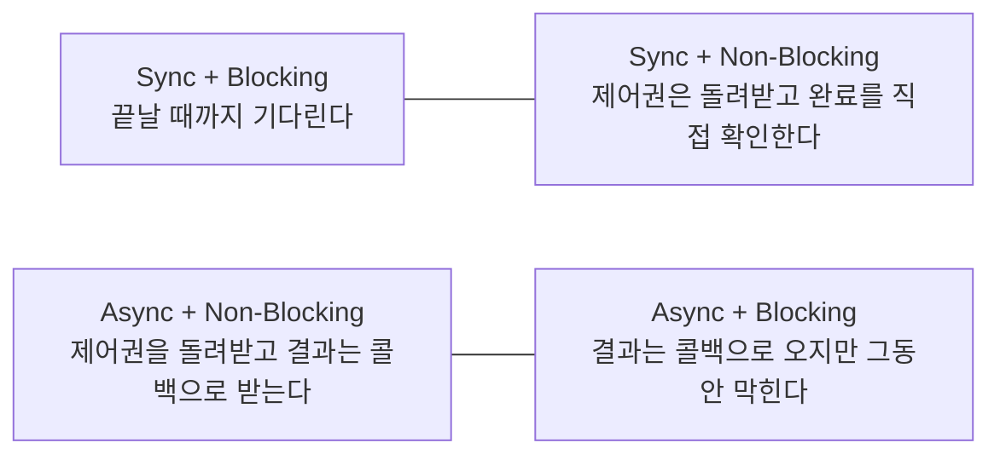

자바는 기본적으로 Sync/Block이고, 자바스크립트는 Async/NonBlock이다.

제어권의 반환과 결과값의 전달의 관점으로 실행흐름을 따라 Block과 Non-Block을 설명할 수 있다.

```javascript
function caller(){
		functionA();
		functionB();
		functionC();
}
```

```javascript
function functionA(){
			// do something
			return something;
}
```

이 두 가지 함수의 통신에서 제어권과 결과값의 이동에 대해서 유심히 보면 4가지 케이스를 구분할 수 있을 것이다.

---

## 두 축의 정의

동기화는 시간을 맞춰주는 것이다. 함수간의 통신에서 동기화란, 함수들의 제어권 반환, 결과값 전달의 시간을 맞춰주는 것이다.

Block / Non-Block: 제어권, 제어할 수 없는 대상을 어떻게 처리하는가? 제어권을 어떻게 누가 가지고 언제 반환하는가? 그 제어권을 어떻게 하느냐에 따라서 제어할 수 없는 대상을 어떻게 하느냐에 관한 개념

Synchronous / Asynchronous: 시간, 대상들의 시간을 일치시키는가? 제어권을 반환하는 시간, 결과값을 전달하는 시간, 혹은 어떤 함수가 끝나고 다음함수가 시작되는 시간에 그 값들이 일치가 되었는가에 관한 개념

정리하면 두 축은 서로 다른 질문에 답한다. Blocking과 Non-Blocking은 호출된 함수가 제어권을 바로 돌려주는지를 묻는다. 돌려주지 않고 작업이 끝날 때까지 쥐고 있으면 Blocking, 바로 돌려주면 Non-Blocking이다. Synchronous와 Asynchronous는 호출한 쪽이 결과를 받는 시점을 작업 완료 시점과 맞추는지를 묻는다. 호출한 쪽이 결과를 직접 기다리거나 확인하면 동기, 결과를 콜백 등으로 나중에 전달받으면 비동기다.

---

## 4가지 조합



- Sync + Blocking: 호출한 함수가 끝날 때까지 제어권이 돌아오지 않고, 돌아올 때 결과도 함께 받는다. 위의 `caller()`가 `functionA()`, `functionB()`, `functionC()`를 차례로 부르는 흐름이 이것이다.
- Sync + Non-Blocking: 제어권은 바로 돌아오지만, 호출한 쪽이 완료 여부를 반복해서 확인(폴링)하며 결과 시점을 직접 맞춘다.
- Async + Non-Blocking: 제어권이 바로 돌아오고, 결과는 작업이 끝났을 때 콜백으로 전달된다. 호출한 쪽은 그동안 다른 일을 한다.
- Async + Blocking: 결과는 콜백으로 받도록 해 놓고도 호출한 쪽이 어딘가에서 막혀 기다리는 경우다. 비동기의 이점이 사라지므로 대개 의도하지 않은 구성이다.

---

## Node.js 파일 API로 보는 차이

Node.js의 `fs` 모듈은 같은 기능을 동기 API와 콜백 API로 함께 제공한다. 공식 문서는 동기 API가 작업이 끝날 때까지 Node.js 이벤트 루프와 이후의 JavaScript 실행을 막는다고 설명한다 ([Node.js](https://nodejs.org/api/fs.html)).

```javascript
import { readFileSync, readFile } from 'node:fs';

// Sync + Blocking: 파일을 다 읽을 때까지 다음 줄로 가지 않는다
const data = readFileSync('a.txt', 'utf8');
console.log(data);

// Async + Non-Blocking: 바로 다음 줄로 넘어가고, 결과는 콜백으로 받는다
readFile('a.txt', 'utf8', (err, text) => {
  if (err) throw err;
  console.log(text);
});
console.log('readFile 호출 직후');
```

JavaScript가 이벤트 루프 위에서 단일 스레드로 동작하기 때문에 이 차이가 크다. MDN은 프로그램이 한 스레드로 이루어져 있으면 오래 걸리는 동기 호출을 기다리는 동안 다른 일을 전혀 할 수 없다고 설명한다 ([MDN](https://developer.mozilla.org/en-US/docs/Learn_web_development/Extensions/Async_JS/Introducing)).

---

## 주의할 점

- 동기와 Blocking, 비동기와 Non-Blocking은 자주 함께 나타나지만 같은 말이 아니다. 하나는 결과를 받는 시점, 다른 하나는 제어권의 반환에 관한 개념이다.
- 비동기 API를 쓰더라도 콜백 안에서 오래 걸리는 계산을 하면 그 시간 동안 이벤트 루프가 막힌다.
- "자바는 Sync/Block"은 전통적인 메서드 호출과 I/O 기준의 설명이다. Java에도 `CompletableFuture`나 NIO처럼 비동기·Non-Blocking 방식의 API가 있다.

## 참고

- [[10분 테코톡] 우의 Block vs Non-Block & Sync vs Async](https://www.youtube.com/watch?v=IdpkfygWIMk) — 우아한테크 (YouTube)
- [File system](https://nodejs.org/api/fs.html) — Node.js Documentation
- [Introducing asynchronous JavaScript](https://developer.mozilla.org/en-US/docs/Learn_web_development/Extensions/Async_JS/Introducing) — MDN Web Docs
