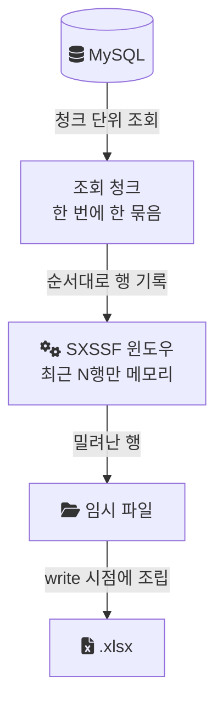
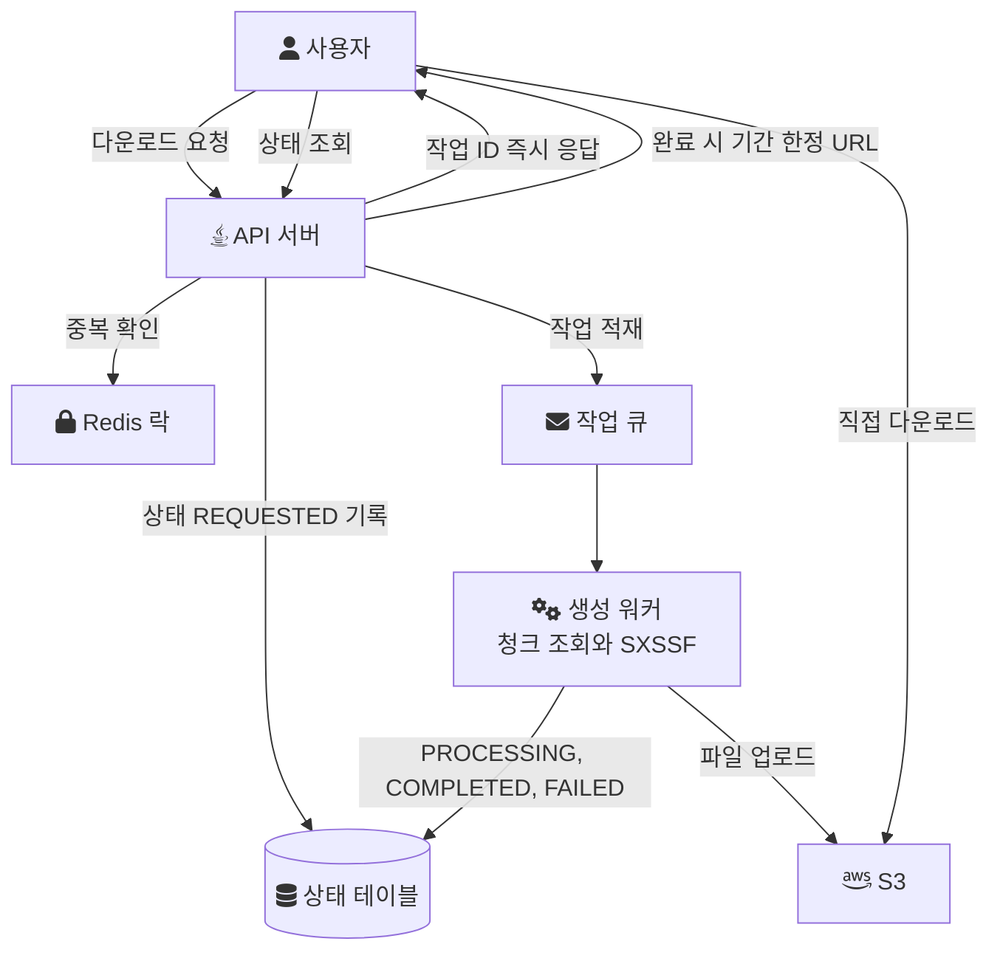
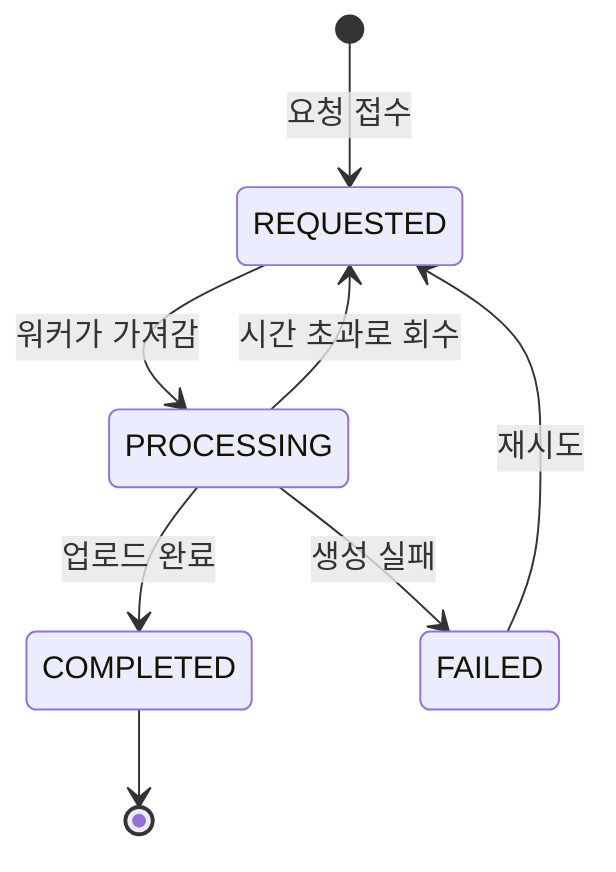
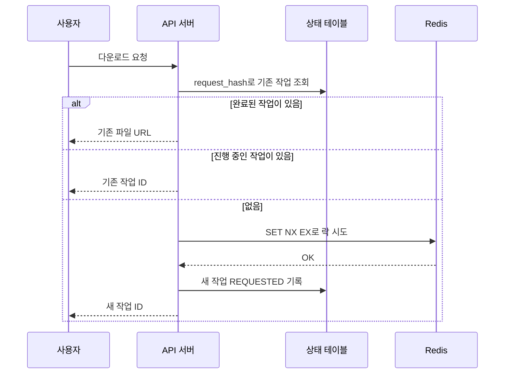

대용량 엑셀 다운로드는 처음에는 단순해 보인다. 쿼리를 실행하고, 결과로 파일을 만들고, 응답으로 내려주면 끝이다. 그런데 다운로드 건수가 수십만 건으로 커지고 같은 요청이 반복되면 이 기능 하나가 API 서버의 힙, DB 커넥션, 요청 스레드를 함께 붙잡는다.

이 글은 두 층으로 나뉜다. 앞쪽은 내가 실제로 겪고 고친 부분이다. 2022년 음원 플랫폼 회사에서 Excel 생성 방식을 스트리밍으로 바꿔 메모리 사용량을 1.2GB에서 180MB로 줄였다. 뒤쪽은 그 다음 단계로 흔히 거론되는 비동기 분리, 중복 요청 차단, 외부 스토리지 저장을 일반적인 설계로 정리한 것이다. 뒤쪽 설계는 내가 그 시스템에 적용했다고 확인된 내용이 아니므로, 구조와 판단 기준만 다룬다.

## 실제로 겪은 문제: 파일 하나를 만드는 데 1.2GB

당시 Excel 생성은 조회 결과를 한 번에 메모리에 올린 뒤 파일을 만드는 방식이었다. 수십만 건 규모에서 메모리 사용량이 급증했고 OOM(OutOfMemoryError)이 났다.

원인은 같은 데이터가 두 번 메모리에 올라가는 구조였다. 한 번은 조회 결과 리스트로, 또 한 번은 `XSSFWorkbook`이 만드는 행과 셀 객체로 올라갔다. 둘 다 파일 쓰기가 끝날 때까지 해제되지 않는다.

그래서 두 가지를 같이 바꿨다.

- Apache POI의 [SXSSF](/posts/apache-poi/) 스트리밍 API를 적용했다. SXSSF는 정해진 크기(기본 100행)의 슬라이딩 윈도우 안의 행만 메모리에 두고 나머지를 임시 파일로 내보낸다([Apache POI: SXSSF](https://poi.apache.org/components/spreadsheet/how-to.html#sxssf)).
- 대량 조회를 청크 단위로 나눠, 읽은 청크를 바로 워크북에 흘려보내도록 다시 설계했다.

워크북만 바꾸면 조회 리스트가 그대로 남고, 조회만 나누면 워크북이 그대로 남는다. 둘을 함께 바꿔야 입력과 출력 양쪽이 일정한 크기로 묶인다. 그 결과 메모리 사용량이 1.2GB에서 180MB로 85% 줄었고, 수십만 건 규모 데이터도 OOM 없이 처리됐다.

바뀐 생성 경로는 다음과 같다.



퇴사 후 같은 구조를 다시 만든 랩 코드는 [StreamingExcelExportService.java](https://github.com/polynomeer/engineering-lab/blob/d52297d0ad07c3d8a05a7471192a5655cb8b1378/career-lab/batch-excel/src/main/java/com/portfolio/batchlab/excel/StreamingExcelExportService.java)에 있다. 조회 페이지 2,000건과 윈도우 500행은 랩에서 정한 값이고 운영값이 아니다.

```java
// 랩 코드: 청크로 읽어 바로 행으로 쓴다 (일부)
do {
    page = repository.findBy...IdGreaterThanOrderByIdAsc(
            targetMonth, AGGREGATED, lastSeenId, PageRequest.of(0, 2_000));
    for (SettlementRecord record : page) {
        writeDataRow(sheet, rowNum++, record);
    }
    if (!page.isEmpty()) lastSeenId = page.get(page.size() - 1).getId();
} while (!page.isEmpty());
```

## 생성 비용을 더 줄이는 지점

스트리밍 전환 외에도 생성 단계에서 메모리와 디스크를 아끼는 지점이 몇 가지 있다. 아래는 POI 문서가 직접 권하거나 경고하는 것들이다.

- 셀 스타일과 폰트를 셀마다 만들지 않는다. POI 문서는 워크북의 고유 폰트 수가 32,767개로 제한되므로 셀마다 만들지 말고 재사용하라고 적는다([Apache POI: Busy Developers' Guide](https://poi.apache.org/components/spreadsheet/quick-guide.html)).
- 임시 파일을 반드시 지운다. SXSSF는 임시 파일을 만들고, 이 파일은 `dispose()`를 호출해 명시적으로 지워야 한다(같은 SXSSF 문서). 예외가 나도 지워지도록 `finally`에서 호출한다.
- 임시 파일 크기를 확인한다. 문서는 20MB 분량 CSV 데이터의 임시 XML이 1GB를 넘을 수 있다고 적고, `setCompressTempFiles(true)`로 gzip 압축을 켤 수 있다고 안내한다. 디스크가 작은 컨테이너에서는 이 값이 메모리보다 먼저 한계에 닿을 수 있다.
- 병합 영역, 하이퍼링크, 주석은 SXSSF에서도 메모리에만 저장된다. 대량 다운로드 양식에서는 이런 기능을 최소화한다.

여기까지 하면 파일 하나를 만드는 비용은 데이터 크기와 거의 무관하게 묶인다. 하지만 비용이 없어지지는 않는다. 수십만 건을 읽고 쓰는 시간은 그대로이고, 생성이 HTTP 요청 안에서 일어난다면 그 시간 동안 요청 스레드와 DB 커넥션이 묶인다. 이후 절은 이 남은 문제를 다루는 일반적인 설계다.

## 동기 처리에서 남는 문제

동기 방식에서는 요청 하나가 검증, 대량 조회, 파일 생성, 응답을 모두 맡는다. 생성 메모리를 줄여도 다음 문제는 남는다.

- 생성 시간이 길면 게이트웨이나 브라우저의 타임아웃에 걸린다.
- 버튼을 여러 번 누르거나 재시도가 일어나면 같은 파일을 여러 번 만든다.
- 다운로드 요청이 몰리면 일반 API가 쓸 스레드와 DB 커넥션이 줄어든다.

엑셀 다운로드는 중요하지만 즉시 응답이 꼭 필요한 작업은 아니다. 그래서 요청 접수와 파일 생성을 떼어 낼 수 있다.

## 일반적인 설계: 요청과 생성을 분리한다

분리한 구조에서 API 서버는 요청을 접수하고 작업 ID를 돌려준다. 실제 생성은 워커가 맡고, 사용자는 상태 조회나 알림으로 결과를 받는다.



이 구조로 바꾸면 API 서버는 긴 생성 작업을 하지 않는다. 대신 두 가지를 새로 책임져야 한다. 작업 상태를 어딘가에 남기는 것, 그리고 같은 작업이 두 번 생기지 않게 막는 것이다.

### 같은 요청을 식별하는 키

중복을 막으려면 먼저 "같은 요청"을 정의해야 한다. 보통은 다음 조합을 쓴다.

```text
request_hash = hash(userId + exportType + normalize(filter))
```

정규화가 핵심이다. 필터 키 순서, 빈 값, 날짜 형식이 다르면 같은 조건도 다른 해시가 된다. 키를 정렬하고 기본값을 채운 뒤 해시를 만들면 실질적으로 같은 요청이 같은 키로 묶인다. 사용자별로 권한에 따라 보이는 데이터가 다르다면 `userId`나 권한 범위를 키에 넣어야 다른 사람의 파일을 재사용하는 사고를 막을 수 있다.

### 상태 테이블

비동기로 바꾸면 작업 상태를 추적할 저장소가 필요하다.

```text
excel_export_request
- id
- requester_id
- request_hash
- status            REQUESTED, PROCESSING, COMPLETED, FAILED
- result_file_key
- error_message
- created_at, updated_at
```

상태는 다음처럼 움직인다.



이 테이블이 있으면 중복 요청에 기존 작업을 돌려줄 수 있고, 실패한 작업을 다시 시도할 수 있고, 오래 걸리는 작업을 찾아낼 수 있다. `PROCESSING`에서 `REQUESTED`로 돌아가는 화살표는 워커가 작업 도중 죽은 경우를 위한 것이다. 이 전이가 없으면 작업이 `PROCESSING`에 영원히 머문다. 마지막 갱신 시각이 일정 시간 넘게 멈춘 작업을 회수하는 식으로 구현한다.

### 락은 짧게, 상태는 길게

같은 조건의 생성이 동시에 두 번 시작되지 않게 하려면 Redis 락을 쓸 수 있다. Redis 문서는 `SET resource-name anystring NX EX max-lock-time`을 단순한 락 구현으로 소개한다([Redis: SET](https://redis.io/docs/latest/commands/set/)). `NX`는 키가 없을 때만 설정하고, `EX`는 만료 시간을 준다.

```text
SET export:{request_hash} {token} NX EX 600
```

같은 문서는 두 가지를 덧붙인다. 해제할 때는 고정 문자열 대신 추측할 수 없는 토큰을 넣고, 값이 일치할 때만 지우는 스크립트로 해제해야 한다. 그래야 만료 뒤 다른 클라이언트가 잡은 락을 지우지 않는다. 그리고 이 단순 패턴보다 Redlock 알고리즘을 권한다.

락만으로는 부족하다. 락은 만료되면 사라지므로 "이 요청은 이미 완료됐고 파일이 여기 있다"나 "지난번에 이런 이유로 실패했다"를 설명하지 못한다. 그래서 역할을 나눈다.

- 락: 생성이 시작되는 짧은 순간의 동시 진입을 막는다.
- 상태 테이블: 완료와 실패 이력을 오래 남긴다.

요청이 들어오면 상태 테이블을 먼저 보고, 완료된 작업이 있으면 그 파일을 돌려준다. 진행 중이면 기존 작업 ID를 돌려준다. 둘 다 아닐 때만 락을 잡고 새 작업을 만든다.



### 파일은 응답 본문 대신 외부 스토리지로

파일이 크면 생성 직후 HTTP 응답으로 흘려보내기보다 외부 스토리지에 올리는 편이 낫다. 워커가 파일을 S3에 올리고, 사용자에게는 presigned URL을 준다.

AWS 문서에 따르면 presigned URL은 URL을 만든 사용자의 자격 증명으로 객체에 대한 기간 한정 다운로드 권한을 준다. 만료 시간의 상한은 만드는 방법에 따라 다르다. 콘솔은 12시간, AWS CLI는 7일이다([Amazon S3: Sharing objects with presigned URLs](https://docs.aws.amazon.com/AmazonS3/latest/userguide/ShareObjectPreSignedURL.html)).

이렇게 하면 다음이 달라진다.

- 다운로드 트래픽이 API 서버를 거치지 않는다.
- 사용자가 다운로드를 다시 시도해도 파일을 다시 만들지 않는다.
- 같은 `request_hash`의 요청에 이미 만든 파일을 돌려줄 수 있다.

반대로 새로 생기는 비용도 있다. 파일 보관 기간과 삭제 정책을 정해야 하고, 원본 데이터가 바뀐 뒤에도 옛 파일을 돌려주지 않도록 재사용 유효 시간을 정해야 한다.

## 언제 비동기로 바꿔야 하나

모든 다운로드를 비동기로 만들 필요는 없다. 다음 중 하나라도 해당하면 동기 다운로드를 유지하기 어렵다.

- 생성 시간이 게이트웨이나 클라이언트 타임아웃에 가까워진다.
- 같은 조건의 반복 요청이 잦다.
- 다운로드가 몰리는 시간에 일반 API의 응답 시간이 함께 나빠진다.

그 전 단계라면 스트리밍 생성과 청크 조회만으로 충분할 수 있다. 메모리를 먼저 묶고, 그래도 시간과 동시성이 문제일 때 비동기로 나누는 순서가 비용이 적다. 요청을 미리 가볍고 무거운 것으로 나눠 경로를 고르는 방법은 [무거운 엑셀 다운로드 요청을 사전에 판별하는 방법](/posts/excel-condition-expector/)에 정리했다.

## 정리

내가 실제로 확인한 효과는 생성 단계의 메모리다. 조회를 청크로 나누고 SXSSF로 흘려 쓰자 1.2GB가 180MB가 됐다. 비동기 분리, 요청 해시, 상태 테이블, 락, 외부 스토리지는 그 다음 병목인 시간과 중복을 다루는 일반적인 설계다. 그중 락은 짧은 순간의 동시 진입만 막고, 완료와 실패의 기억은 상태 테이블이 맡는다는 점이 설계의 중심이다. 메시지 큐와 S3 사전 생성으로 나누는 설계는 [대량 엑셀 다운로드를 메시지 큐와 S3 사전 생성으로 나누는 설계](/posts/rebuilding-outsourced-system-2/)에서 따로 다룬다.

## 참고

- [Apache POI: SXSSF (Streaming Usermodel API)](https://poi.apache.org/components/spreadsheet/how-to.html#sxssf) — Apache POI
- [Apache POI: Busy Developers' Guide to HSSF and XSSF Features](https://poi.apache.org/components/spreadsheet/quick-guide.html) — Apache POI
- [Redis: SET](https://redis.io/docs/latest/commands/set/) — Redis Docs
- [Amazon S3: Sharing objects with presigned URLs](https://docs.aws.amazon.com/AmazonS3/latest/userguide/ShareObjectPreSignedURL.html) — AWS Docs
- 랩 코드 (commit `d52297d`)
  - [StreamingExcelExportService.java](https://github.com/polynomeer/engineering-lab/blob/d52297d0ad07c3d8a05a7471192a5655cb8b1378/career-lab/batch-excel/src/main/java/com/portfolio/batchlab/excel/StreamingExcelExportService.java) — GitHub
  - [LegacyExcelExportService.java](https://github.com/polynomeer/engineering-lab/blob/d52297d0ad07c3d8a05a7471192a5655cb8b1378/career-lab/batch-excel/src/main/java/com/portfolio/batchlab/excel/LegacyExcelExportService.java) — GitHub
