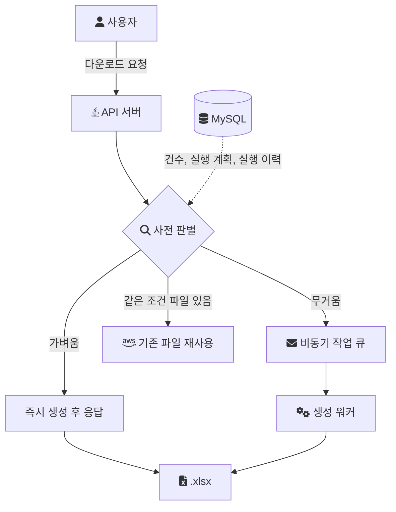
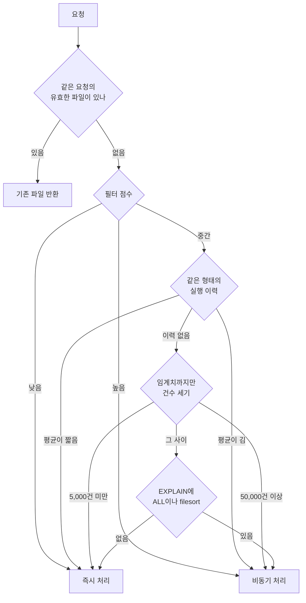

엑셀 다운로드 기능을 운영하다 보면 모든 요청을 같은 경로로 처리하기 어렵다. 어떤 요청은 수백 건이라 즉시 내려줘도 되지만, 어떤 요청은 수십만 건을 읽어야 해서 [비동기 경로](/posts/bulk-excel-performance/)로 넘기는 편이 낫다. 문제는 실행하기 전에는 그 차이가 보이지 않는다는 점이다.

이 글은 "이 요청을 즉시 처리해도 되는가, 비동기로 넘겨야 하는가"를 실행 전에 가늠하는 방법을 일반적인 설계로 정리한다. 내가 실제로 다룬 것은 Excel 생성 단계의 메모리였고(조회를 청크로 나누고 SXSSF 스트리밍으로 바꿔 1.2GB를 180MB로 줄였다), 요청 비용을 미리 판별하는 로직을 운영에 적용했다는 기록은 없다. 그래서 아래의 기준, 임계치, 점수는 모두 설계 예시다.

## 메모리를 묶은 뒤에 남는 것은 시간이다

생성을 스트리밍으로 바꾸면 메모리는 데이터 크기와 거의 무관하게 묶인다. 하지만 시간은 묶이지 않는다. 수십만 건을 읽고 쓰는 동안 DB 커넥션과 처리 스레드가 붙잡혀 있다.

그리고 시간은 건수만으로 정해지지 않는다.

- 조인이 많으면 행 하나를 만드는 비용이 커진다.
- 정렬 기준에 맞는 인덱스가 없으면 결과 전체를 모아 정렬해야 한다.
- 필터가 넓거나 인덱스를 못 타면 테이블 전체를 읽는다.

5만 건이어도 단순 조회면 빠를 수 있고, 5천 건이어도 조인과 정렬이 무거우면 느릴 수 있다. 요청을 받고 나서야 "생각보다 무거웠다"를 알게 되면 이미 DB와 서버 자원을 쓰기 시작한 뒤다.

## 판별의 위치

판별은 요청 접수와 실행 사이에 들어간다. 결과는 세 갈래다.



판별 기준은 여러 개를 쓸 수 있다. 각 기준은 드는 비용과 정확도가 다르다.

| 기준 | 판별 비용 | 정확도 | 약점 |
| --- | --- | --- | --- |
| 필터 점수 | 거의 없음 | 낮음 | 데이터 분포를 모른다 |
| 예상 건수 (`COUNT(*)`) | 조건에 따라 큼 | 건수는 정확 | 조인과 정렬 비용을 모른다 |
| 실행 계획 (`EXPLAIN`) | 작음 | 중간 | `rows`가 추정치다 |
| 과거 실행 이력 | 작음 | 높음 | 처음 보는 조건에는 없다 |

아래에서 하나씩 본다.

## 기준 1: 필터 복잡도 점수

가장 싼 기준은 요청 자체를 보고 점수를 매기는 것이다. DB에 묻지 않는다.

```text
기간 조건이 1년 이상          +2
텍스트 부분 검색이 있음        +1
여러 테이블 조인이 필요함      +2
사용자 지정 정렬이 있음        +1
필터 없는 전체 다운로드        +3
합계 4 이상이면 무거운 요청으로 분류 (예시)
```

장점은 운영 경험을 정책으로 옮길 수 있다는 점이다. "기간이 길고 전체를 받으면 늘 느렸다"는 관찰이 그대로 점수가 된다. 약점은 데이터 분포를 모른다는 점이다. 같은 1년 조건이라도 데이터가 몰린 기간과 빈 기간의 비용은 다르다. 그래서 점수는 단독 기준보다 첫 번째 거름망으로 쓴다.

## 기준 2: 예상 결과 건수

다음으로 현실적인 기준은 결과 건수다.

```sql
SELECT COUNT(*)
FROM target_table
WHERE ...
```

이 값이 임계치를 넘으면 비동기 경로로 보낸다. 예시 정책은 이렇다.

- 5,000건 미만: 즉시 처리
- 5,000건 이상 50,000건 미만: 다른 기준과 함께 판단
- 50,000건 이상: 비동기 처리

주의할 점은 `COUNT(*)` 자체가 싸지 않다는 것이다. MySQL 문서는 InnoDB가 테이블의 행 수를 내부에 따로 유지하지 않는다고 적는다. 동시에 실행되는 트랜잭션마다 보이는 행 수가 다를 수 있기 때문이다. 그래서 `COUNT(*)`는 현재 트랜잭션에 보이는 행을 인덱스를 따라가며 세고, 인덱스 레코드가 버퍼 풀에 없으면 시간이 걸린다([MySQL: Aggregate Function Descriptions](https://dev.mysql.com/doc/refman/8.0/en/aggregate-functions.html)). 무거운 요청을 걸러내려고 무거운 쿼리를 한 번 더 실행하는 셈이 될 수 있다.

판별에는 정확한 건수가 아니라 임계치를 넘는지만 필요하다. 그래서 세는 범위를 임계치에서 끊을 수 있다.

```sql
SELECT COUNT(*) FROM (
    SELECT 1
    FROM target_table
    WHERE ...
    LIMIT 50001
) t;
```

결과가 50,001이면 "50,000건 이상"이라는 것만 알면 충분하다. 최악의 경우에도 임계치만큼만 읽는다. 테이블 전체의 대략적인 행 수라면 MySQL 문서가 안내하듯 `SHOW TABLE STATUS`의 근삿값으로 충분할 때도 있다. 다만 필터가 걸린 요청에는 쓸 수 없다.

## 기준 3: 실행 계획

건수만으로는 조인과 정렬 비용을 모른다. 더 정밀한 판단이 필요하면 `EXPLAIN` 결과를 볼 수 있다. 보고 싶은 값은 대체로 다음이다([MySQL: EXPLAIN Output Format](https://dev.mysql.com/doc/refman/8.0/en/explain-output.html)).

- `type`이 `ALL`인가. 테이블 전체를 읽는다는 뜻이다.
- 어떤 인덱스를 쓰는가 (`key`).
- 읽어야 할 행 수 추정 (`rows`).
- `Extra`에 `Using filesort`나 `Using temporary`가 있는가. 정렬을 위한 추가 단계나 임시 테이블이 필요하다는 뜻이다.

`EXPLAIN`은 쿼리를 실행하지 않으므로 `COUNT(*)`보다 싸다. 대신 정확하지 않다. 문서는 `rows`를 MySQL이 실행에 필요하다고 믿는 행 수로 설명하고, InnoDB에서는 이 값이 추정치라 항상 정확하지는 않다고 적는다. 임계치 근처의 요청은 이 값만으로 오판할 수 있다.

요청마다 실행 계획을 뽑는 것도 비용이다. 그래서 보통은 범위를 좁힌다.

- 필터 조합의 형태(어떤 필터가 쓰였는지)별로 계획을 캐싱한다.
- 점수나 건수로 애매한 구간에 들어온 요청에만 적용한다.
- 운영 중 임계치를 조정하는 튜닝 도구로 쓴다.

## 기준 4: 과거 실행 이력

같은 필터 조합이 반복되는 기능이라면 가장 믿을 만한 기준은 지난번에 실제로 걸린 시간이다. 작업마다 다음을 남긴다.

```text
export_execution_log
- request_shape     어떤 필터를 썼는지 (값 제외)
- request_hash      필터 값까지 포함한 동일 요청 키
- row_count
- query_ms
- write_ms
- total_ms
- failed
```

`request_shape`는 값이 아니라 형태로 묶은 키다. "기간 + 상태 필터 + 정렬 없음" 같은 단위다. 같은 형태의 과거 평균 시간을 보면 처음 보는 값의 요청도 대략 가늠할 수 있다. `request_hash`는 값까지 같은 요청이다. 이 키로는 이미 만든 파일을 다시 쓸지 판단한다.

이력이 쌓이면 이런 정책이 가능해진다.

- 같은 형태의 평균 시간이 긴 요청은 바로 비동기로 보낸다.
- 자주 반복되는 같은 요청은 미리 파일을 만들어 둔다.
- 특정 형태의 요청에는 화면에서 미리 경고한다.

약점은 처음 보는 형태에는 이력이 없다는 점이다. 이때는 앞의 기준으로 돌아간다.

## 싼 기준으로 거르고, 애매한 구간에만 비싼 기준을 쓴다

네 기준을 모두 매번 쓸 필요는 없다. 싼 기준으로 확실한 쪽을 먼저 결정하고, 애매한 구간만 다음 기준으로 넘긴다.



코드로 옮기면 분기 순서가 그대로 드러난다.

```java
// 설계 예시: 싼 판별부터 순서대로
Route decide(ExportRequest req) {
    if (fileCache.hasValid(req.hash())) return Route.REUSE;

    int score = scorer.score(req);
    if (score <= 1) return Route.SYNC;
    if (score >= 4) return Route.ASYNC;

    Optional<Duration> avg = history.averageFor(req.shape());
    if (avg.isPresent()) {
        return avg.get().compareTo(SYNC_BUDGET) < 0 ? Route.SYNC : Route.ASYNC;
    }

    long capped = counter.countUpTo(req, 50_001);
    if (capped < 5_000) return Route.SYNC;
    if (capped >= 50_000) return Route.ASYNC;

    return planInspector.hasFullScanOrFilesort(req) ? Route.ASYNC : Route.SYNC;
}
```

판별이 틀릴 수도 있다. 즉시 처리로 보냈는데 생각보다 오래 걸리는 경우다. 그래서 동기 경로에도 안전장치를 둔다. 생성 도중 읽은 행 수나 경과 시간이 예산을 넘으면 그 요청을 멈추고 비동기 작업으로 다시 등록한 뒤 작업 ID를 응답한다. 판별은 대부분의 요청을 맞게 보내는 역할이고, 틀린 요청이 서버를 붙잡지 않게 막는 것은 이 안전장치의 역할이다.

## 사용자에게 경로를 설명한다

경로가 갈리면 사용자는 왜 이번 다운로드가 바로 내려오지 않는지 알아야 한다.

- "요청 범위가 커서 파일을 준비한 뒤 알려 드립니다."
- "같은 조건의 파일이 이미 있어 그 파일을 내려드립니다."

판별을 화면 쪽으로 당겨 올 수도 있다. 필터를 고르는 동안 예상 건수나 예상 경로를 보여 주면, 사용자가 범위를 좁혀 즉시 경로로 들어올 수 있다. 서버 입장에서는 무거운 요청 자체가 줄어든다.

## 비용과 한계

- 판별 자체가 비용이다. 건수 세기와 `EXPLAIN`은 DB에 묻는 일이므로, 판별이 생성보다 비싸지지 않도록 앞단에서 걸러야 한다.
- 임계치는 데이터가 자라면 낡는다. 이력을 보고 주기적으로 다시 맞춰야 한다.
- 이력 기반 판단은 데이터 분포가 바뀐 직후에 틀린다. 대량 적재 직후처럼 분포가 급변하는 시점을 알고 있어야 한다.
- 경로가 둘이 되면 테스트할 경로도 둘이 된다. 동기 경로와 비동기 경로가 같은 파일을 만드는지 확인하는 장치가 필요하다.

판별의 목표는 정확한 예측 모델이 아니라, 시스템이 과부하되기 전에 처리 경로를 고르는 분기 기준이다. 무거운 조건의 결과만 골라 캐싱하는 구조로 이 판별을 확장한 설계는 [조건 기반 예측 캐싱](/posts/condition-based-excel-processing/)에 있다.

## 참고

- [MySQL 8.0 Reference Manual: Aggregate Function Descriptions (COUNT)](https://dev.mysql.com/doc/refman/8.0/en/aggregate-functions.html) — MySQL Docs
- [MySQL 8.0 Reference Manual: EXPLAIN Output Format](https://dev.mysql.com/doc/refman/8.0/en/explain-output.html) — MySQL Docs
- [StreamingExcelExportService.java](https://github.com/polynomeer/engineering-lab/blob/d52297d0ad07c3d8a05a7471192a5655cb8b1378/career-lab/batch-excel/src/main/java/com/portfolio/batchlab/excel/StreamingExcelExportService.java) — GitHub: 랩 코드 (commit `d52297d`), 생성 단계의 메모리를 묶은 구현. 이 글의 판별 로직은 랩에 없다.
