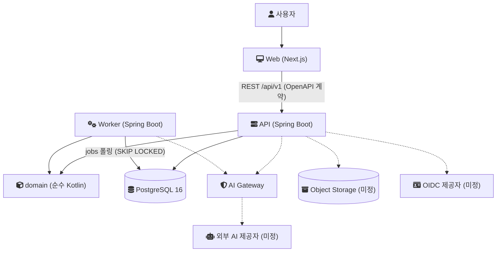
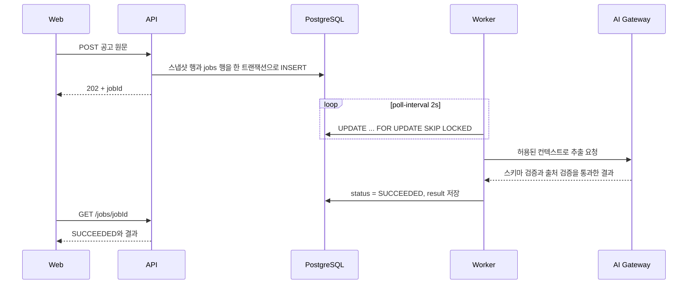
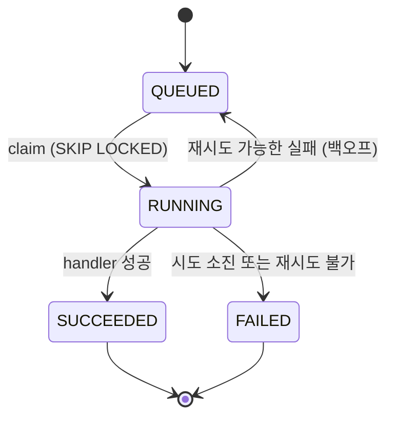

[ProofU](https://github.com/polynomeer/proofu)는 경력 사실과 증빙(Evidence)을 오래 쌓아 두고, 채용공고 요구사항에 맞춰 이력서와 자기소개서를 만드는 시스템이다. 만들어진 문장마다 어떤 사실과 증빙에서 나왔는지 거꾸로 따라갈 수 있어야 한다는 점이 일반적인 이력서 생성기와 다르다.

저장소의 첫 커밋은 2026-09-18이다. 이 글은 그날 새벽 첫 16개 커밋([`5d6874b`](https://github.com/polynomeer/proofu/commit/5d6874b3813fa54adceabdb51cf264734801271f)부터 [`a3620d5`](https://github.com/polynomeer/proofu/tree/a3620d5d5c67ede37bd46b825cb0e3c0eed0be1b)까지)이 세운 설계를 정리한다. 그 뒤에 붙은 기능은 설계가 어떻게 시험받았는지 보여 줄 때만 날짜와 함께 언급한다.

## 출발 조건

결론을 읽기 전에 조건부터 적는다.

- 개발자는 한 명이다. 저장소의 커밋 작성자는 한 명이고, 첫 16개 커밋은 약 45분 동안 들어갔다.
- 출시 전이라 트래픽과 데이터는 없다. 수치로 된 기준은 문서의 목표값뿐이다. 일반 읽기 p95(요청 95%가 이 시간 안에 끝난다는 뜻) 500ms 이하, 생성 요청 접수 1초 이하, 큐 지연 p95 2분 이하, 월간 API 가용성 99.5%가 그것이다([non-functional.md](https://github.com/polynomeer/proofu/blob/0ffce5dda30aba50eaad5cfe872004f0df2db9df/docs/architecture/non-functional.md), [monitoring.md](https://github.com/polynomeer/proofu/blob/0ffce5dda30aba50eaad5cfe872004f0df2db9df/docs/operations/monitoring.md)).
- 코드보다 문서가 먼저 있었다. 2026-09-16자 통합 개발 문서 v0.1과 디자인 기획서 v1.0(docx)을 두 번째 커밋 [`0ffce5d`](https://github.com/polynomeer/proofu/commit/0ffce5dda30aba50eaad5cfe872004f0df2db9df)에서 영역별 Markdown으로 나눴고, 초기 ADR 6개도 여기서 들어갔다.
- 사용자 데이터가 개인 경력이다. 개인정보 최소 수집, 삭제 가능성, 외부 AI 전송 통제가 처음부터 요구사항에 들어 있다.

## 풀려는 문제와 제약

비전 문서([vision.md](https://github.com/polynomeer/proofu/blob/0ffce5dda30aba50eaad5cfe872004f0df2db9df/docs/product/vision.md))가 꼽은 문제는 다섯 가지다. 경력 정보가 흩어져 일관성을 잃는다. 공고마다 이력서를 다시 쓰느라 사실 확인에 시간이 든다. 생성형 AI가 없는 성과를 만들어낼 수 있다. 제출한 문서와 당시 공고, 원천 데이터의 연결이 남지 않는다. 탈락 원인을 구조적으로 기록하지 않아 같은 문제가 반복된다.

여기서 설계를 가장 크게 좌우한 것은 세 번째와 네 번째다. 그래서 제품 원칙 중 두 가지가 데이터 모델로 바로 내려온다.

- 사실 우선: 사용자 사실과 Evidence가 생성 문장보다 우선한다. 근거 없는 문장은 최종본에 자동으로 들어가지 않는다.
- 재현 가능성: 공고 원문, 원천 데이터의 revision, 프롬프트, 모델을 스냅샷으로 남겨 과거 제출 상태를 그대로 다시 열 수 있어야 한다.

이 두 원칙 때문에 Evidence 모델에는 강한 불변식이 붙었다. 승인된 지원 문장의 사실 주장은 최소 하나의 Claim(주장)을 참조해야 한다. Evidence가 없는 Claim은 `UNSUPPORTED` 상태가 된다. AI는 Evidence의 검증 상태를 올릴 수 없다([evidence-model.md](https://github.com/polynomeer/proofu/blob/0ffce5dda30aba50eaad5cfe872004f0df2db9df/docs/domain/evidence-model.md)). 생성 문서의 각 블록은 `SUPPORTED`, `INFERRED`, `UNSUPPORTED` 중 하나의 확실성 등급을 갖고, 뒤의 두 등급은 사용자 승인 없이 내보낼 수 없다([version-lineage.md](https://github.com/polynomeer/proofu/blob/0ffce5dda30aba50eaad5cfe872004f0df2db9df/docs/domain/version-lineage.md)).

## 초기 아키텍처

설계 문서([system-overview.md](https://github.com/polynomeer/proofu/blob/0ffce5dda30aba50eaad5cfe872004f0df2db9df/docs/architecture/system-overview.md))가 그린 구조는 웹 클라이언트, API, 워커, 그리고 PostgreSQL 하나다. API 안에는 Career, Jobs, Matching, Documents, Applications 같은 도메인 모듈과 AI Gateway가 들어간다. 도메인 불변식은 Spring에 의존하지 않는 순수 Kotlin 모듈 `packages/domain`에 한 번만 구현하고, API와 워커가 이를 함께 쓴다.

아래 그림은 설계 문서의 논리 컴포넌트를 옮긴 것이다. 점선은 문서에만 있고 첫 커밋들에는 코드가 없던 부분이다.



데이터 흐름은 일곱 단계로 적혀 있다. 원천 데이터를 저장하고, 공고를 입력하면 원문 스냅샷을 만든 뒤 비동기 분석 작업을 발행한다. AI Gateway는 허용된 컨텍스트만 모델에 넘기고 구조화된 요구사항을 돌려받는다. 매칭은 요구사항별 후보 Evidence를 찾는다. 문서 생성은 선택된 Evidence와 템플릿을 고정한 뒤 비동기로 실행한다. 사용자가 승인하면 DOCX와 PDF를 만들고, 제출 시점에 관련 스냅샷을 불변으로 전환한다.

이 흐름에서 오래 걸리는 단계는 모두 큐를 거친다. 공고 분석 요청이 처리되는 과정을 설계 문서의 규칙(`202` + `jobId`, `GET /jobs/{id}` 폴링)대로 그리면 다음과 같다. 첫 커밋들에는 이 중 워커의 폴링 루프와 `jobs` 테이블만 있었다.



## 기술 선택과 이유

초기 ADR 0001–0006은 통합 개발 문서 §6.5의 표를 옮긴 것이다. 결정, 한 줄 이유, 재검토 조건은 있지만 검토한 대안은 없다. 대안이 기록된 것은 기술 스택을 정한 [ADR-0007](https://github.com/polynomeer/proofu/blob/0ffce5dda30aba50eaad5cfe872004f0df2db9df/docs/architecture/adr/0007-kotlin-spring-boot-and-nextjs.md)뿐이다. 그래서 아래 비교에서 "필요"는 저장소 문서에서 가져왔고, 대안 비교는 내가 그 필요에 비추어 사후에 다시 세운 것이다. 같은 비교를 저장소에도 [초기 기술 선택 비교](https://github.com/polynomeer/proofu/blob/f1c18f6fe78fd7862f6f1499101747b9521f9ca8/docs/architecture/tech-selection.md) 문서로 남겼다. 기술의 성질은 각 공식 문서에서 확인했다. ADR이라는 기록 방식 자체는 [ADR 정리 글](/posts/architecture-decision-records/)에 적어 두었다.

### 모듈형 모놀리스

필요는 두 가지로 적혀 있다. 하나는 경력 원천, 문서 계보, 제출 스냅샷을 한 트랜잭션 안에서 일관되게 다루는 것이다. 다른 하나는 리스크 표에서 가능성 "높음"으로 평가된 초기 과설계를 피하는 것이다([risks.md](https://github.com/polynomeer/proofu/blob/0ffce5dda30aba50eaad5cfe872004f0df2db9df/docs/project/risks.md)).

| 선택지 | 이 요구에 비춘 장점 | 이 요구에 비춘 단점 |
|---|---|---|
| 마이크로서비스 | 모듈별 독립 배포와 확장 | 원천, 계보, 스냅샷이 다른 저장소로 나뉘면 단일 트랜잭션이 사라지고, 경계를 잘못 그으면 옮기기 어렵다 |
| 경계 없는 모놀리스 | 가장 빠른 시작 | 불변식이 API와 워커에 흩어지고, 나중에 나눌 기준이 남지 않는다 |
| 모듈형 모놀리스 | DB 트랜잭션 하나, 경계는 패키지와 모듈로 표시 | 경계를 빌드가 강제하지 않으면 점점 흐려진다 |

Martin Fowler는 MonolithFirst(2015)에서 서비스 사이의 기능 이동이 모놀리스 안에서보다 훨씬 어렵다고 쓰고, 그래서 경계를 먼저 모놀리스 안에서 찾으라고 권한다. 사용자도 트래픽도 없는 상태에서 경계를 확정할 근거는 없었으므로 이 논리가 그대로 맞는다. [모듈러 모놀리스](/posts/modular-monolith-boundaries/)의 일반적인 경계 강제 방법과 비교하면, ProofU가 감수한 비용은 분명하다. 첫 커밋들에서 Gradle 모듈로 분리된 것은 `packages/domain`뿐이고, `apps/api` 안의 career, jobs, matching은 패키지 관례다. 경계 위반을 잡는 정적 검사는 없다.

### PostgreSQL 하나로 시작한 저장소

ADR-0002의 이유는 "관계 무결성과 JSON, 전문 검색 확장"이다. 저장소 문서를 모으면 요구가 더 구체적으로 보인다. Claim과 Evidence는 N:N이고, provenance 링크는 (문서 버전, 블록)을 (원천 유형, 원천 ID, revision)에 고정한다. 링크 목록과 잡 payload는 반정형이다. 공고 원문과 경력 서술에는 전문 검색이 필요하고, 의미 검색은 품질 평가 뒤에 선택적으로 켠다. 불변 테이블은 DB에서도 막아야 하고, 큐도 별도 인프라 없이 시작하고 싶다.

| 선택지 | 장점 | 단점 |
|---|---|---|
| MySQL 8.4 | 관계 무결성, CJK를 지원하는 ngram 전문 검색 파서(기본 토큰 크기 2) | 문서가 계획한 의미 검색 경로(pgvector)와 다르다 |
| MongoDB | 문서 단위 원자성, 반정형 데이터 | 공식 문서가 다중 문서 트랜잭션보다 비정규화를 권한다. 이 도메인은 N:N과 계보가 중심이라 임베딩이 맞지 않는다 |
| PostgreSQL 16 | 관계 무결성, 인덱싱되는 `jsonb`, GIN 전문 검색, pgvector, 행 트리거, `SKIP LOCKED` | 한국어 형태소 분석 구성이 기본으로 없다 |

PostgreSQL 문서는 `jsonb`가 인덱싱을 지원한다는 점을 `json`과의 차이로 들고, 텍스트 검색에는 GIN 인덱스를 우선 권한다. pgvector는 같은 DB 안에서 정확 검색과 근사 최근접 검색(HNSW, IVFFlat)을 제공한다. 결정은 PostgreSQL 16과 Flyway였고, SQL 마이그레이션은 `migrations/`가 단일 원천이다.

이 결정의 비용은 한국어 검색에서 드러난다. 초기 스키마의 전문 검색 인덱스는 `to_tsvector('simple', ...)`다. `simple` 사전은 토큰을 소문자로 바꾸고 불용어만 거른다. 로컬 PostgreSQL 16.13에서 직접 확인한 결과는 다음과 같다.

```sql
select to_tsvector('simple', 'Kotlin을 사용한 API 설계 경험');
-- 'api':3 'kotlin을':1 '경험':5 '사용한':2 '설계':4

select to_tsvector('simple', 'Kotlin을 사용한 API 설계 경험')
       @@ to_tsquery('simple', 'kotlin');
-- f
```

조사가 붙은 어절 `kotlin을`이 하나의 lexeme(검색 단위로 정규화된 단어)이 되어 `kotlin`으로는 찾히지 않는다. 같은 서버의 `pg_ts_config`에도 한국어 구성은 없었다. 첫 설계는 이 재현율 손실을 안고 시작했다.

### REST와 OpenAPI 계약

ADR-0003의 이유는 "명시적 계약과 클라이언트 타입 생성"이다. 재검토 조건이 "실시간 협업이 핵심 요구가 될 때"이므로, 초기에는 실시간 요구가 없다고 본 셈이다. API 규칙([conventions.md](https://github.com/polynomeer/proofu/blob/0ffce5dda30aba50eaad5cfe872004f0df2db9df/docs/api/conventions.md))은 오류 형식을 RFC 9457 [Problem Details](/posts/problem-detail/)로, 비동기 작업을 `202` + `jobId`로 정했다.

| 선택지 | 장점 | 단점 |
|---|---|---|
| GraphQL | 클라이언트가 응답 모양을 정하고, 타입 시스템을 인트로스펙션으로 조회한다 | HTTP 상태 코드 기반 Problem Details와 `202` 접수 모델에 맞추는 작업이 추가된다 |
| gRPC-Web | 강한 계약과 코드 생성 | 브라우저에서 쓰려면 Envoy 같은 프록시가 필요하다 |
| REST + OpenAPI 3.1 | Schema Object가 JSON Schema 2020-12의 상위 집합이고, `openapi-typescript`가 런타임 의존 없는 TS 타입을 만든다 | 계약 파일과 서버 구현이 따로 있어 어긋날 수 있다 |

세 방식의 일반적인 비교는 [REST, gRPC, GraphQL 글](/posts/rest-grpc-graphql/)에 있다. ProofU에서는 `packages/contracts/openapi.yaml`이 단일 원천이고, 웹은 생성된 타입과 `openapi-fetch`로 경로와 본문을 컴파일 시점에 검사한다. 서버는 springdoc으로 런타임 스펙을 노출하고, CI의 `contract-compatibility` 잡이 둘을 비교한다. 다만 첫 커밋들의 CI에서 이 비교는 `|| true`로 실패를 무시하는 권고 단계였다. 계약이 어긋날 수 있다는 비용을 당분간 사람이 보는 것으로 대신한 셈이다.

### PostgreSQL job 테이블로 만든 큐

ADR-0004는 AI 호출과 파일 변환의 긴 실행 시간을 API 요청에서 떼어 낸다. 큐 구현은 처음부터 "초기에는 PostgreSQL job 테이블(SKIP LOCKED), 지연이나 처리량이 문제가 되면 전용 브로커"였다. 환경 변수 범주에 `QUEUE_URL`과 dead letter queue가 이미 적혀 있어, 나중에 브로커로 바꾸는 것을 전제했다는 점도 보인다.

| 선택지 | 장점 | 단점 |
|---|---|---|
| Redis Streams | 컨슈머 그룹, `XACK`, pending 목록과 `XAUTOCLAIM`으로 죽은 소비자의 메시지를 회수한다 | 인프라가 하나 늘고, AOF 기본 설정(`everysec`)에서는 장애 시 최대 1초의 쓰기를 잃을 수 있다. 업무 데이터와 같은 트랜잭션에 넣을 수 없다 |
| RabbitMQ | 수동 ack에서 채널이 닫히면 미확인 메시지를 자동으로 재큐한다 | 인프라가 늘고, 재전달을 전제로 소비자를 멱등하게 만들어야 한다. DB 커밋과 발행 사이의 이중 쓰기 문제가 생긴다 |
| PostgreSQL + `SKIP LOCKED` | 잡 행을 업무 데이터와 같은 트랜잭션에서 넣는다. 추가 인프라가 없고, 여러 워커가 경합 없이 행을 가져간다 | 폴링 지연이 있고, 큐 처리량이 DB 부하가 된다. 브로커가 주는 재전달과 회수를 직접 만들어야 한다 |

DB 커밋과 브로커 발행 사이의 이중 쓰기 문제는 [Transactional Outbox 글](/posts/parity-pay-outbox/)에서 다룬 것과 같은 문제다. job 테이블은 잡 행 자체가 업무 데이터와 같은 트랜잭션에 들어가므로 이 문제가 처음부터 생기지 않는다. PostgreSQL 문서도 `SKIP LOCKED`가 일관되지 않은 뷰를 주므로 범용 작업에는 맞지 않지만, 큐 형태 테이블에서 여러 소비자의 락 경합을 피하는 용도로는 쓸 수 있다고 설명한다.

첫 커밋의 [`JobRepository`](https://github.com/polynomeer/proofu/blob/a3620d5d5c67ede37bd46b825cb0e3c0eed0be1b/apps/worker/src/main/kotlin/com/proofu/worker/jobs/JobRepository.kt)는 한 문장으로 잡을 집는다.

```sql
update jobs set status = 'RUNNING', started_at = now(), attempts = attempts + 1
where id in (
    select id from jobs
    where status = 'QUEUED' and scheduled_at <= now()
    order by scheduled_at
    for update skip locked
    limit ?
)
returning id, workspace_id, type, payload::text, attempts, max_attempts
```

실패하면 [지수 백오프](/posts/timeout-retry-backoff/)로 다시 큐에 넣는다. 대기 시간은 5초에서 시작해 두 배씩 늘고 300초에서 멈추며, `max_attempts`(기본 3)를 넘으면 `FAILED`가 된다. 이 규칙을 상태로 그리면 다음과 같다.



그림에는 빠진 전이가 하나 있다. `claim`은 행을 `RUNNING`으로 바꾼 뒤 바로 커밋하고, 처리는 그 트랜잭션 밖에서 한다. 그래서 워커가 처리 도중 죽으면 행이 `RUNNING`에 남고, 아무도 다시 집지 않는다. 브로커라면 ack 없이 끊긴 메시지를 되돌려 주지만, 직접 만든 큐에는 그 장치가 없었다. 이 구멍은 2026-09-24에 리스와 `StuckJobReaper`로 메워졌다([`587d8f3`](https://github.com/polynomeer/proofu/commit/587d8f32a8b7ee8d2902c16423a3c9aa0ab19bf9)).

### 제공자 중립 AI Gateway

ADR-0005의 이유는 "모델 교체 비용과 개인정보 정책 격리"다. 근거화 정책([grounding-policy.md](https://github.com/polynomeer/proofu/blob/0ffce5dda30aba50eaad5cfe872004f0df2db9df/docs/ai/grounding-policy.md))을 보면 Gateway가 맡을 일이 구체적으로 나온다. 민감도 `CONFIDENTIAL`, `RESTRICTED` 데이터는 허용되지 않은 컨텍스트에서 빼야 한다. 출력은 JSON Schema로 검증하고, 모델이 반환한 `sourceId`가 입력 집합에 실제로 있는지 서버가 다시 확인한다. 호출마다 비용을 기록하되 원문은 남기지 않는다. 수치 변환과 기간 계산은 모델이 아니라 결정적 코드가 한다.

| 선택지 | 장점 | 단점 |
|---|---|---|
| 기능 코드에서 제공자 SDK 직접 호출 | 코드가 가장 적다 | 민감도 필터, 화이트리스트 검증, 비용 기록이 호출 지점마다 반복되고, 하나만 빠져도 정책 위반이다 |
| 프레임워크 추상화(예: Spring AI `ChatClient`) | 제공자 공통 API, 응답의 엔티티 매핑과 스키마 검증 후 재시도 | 민감도 필터와 출처 화이트리스트는 도메인 규칙이라 어차피 직접 만들어야 하고, 추상화 층이 하나 늘어난다 |
| 자체 Gateway 한 곳 | 정책, 검증, 예산, 기록을 한 지점에서 강제하고 기능 코드는 제공자를 모른다 | Gateway를 직접 유지해야 하고, 제공자 고유 기능을 쓰는 순간 중립성이 깨진다 |

첫 커밋들에서 Gateway는 문서상의 결정이었고 코드는 없었다. 제공자는 같은 날 오후 [ADR-0008](https://github.com/polynomeer/proofu/blob/f9df540daddc876236788b9aed26d1226bf1527e/docs/architecture/adr/0008-ai-provider-anthropic-claude.md)에서 Anthropic Claude로 정해졌다. 이 ADR은 공고 원문 위치를 제공자의 인용(citations) 기능에 맡기려 했고, 그 의존을 Gateway의 추출 어댑터 한 곳에 격리한다고 적었다. 위 표의 마지막 단점, 즉 제공자 고유 기능을 쓰면 중립성이 깨진다는 비용을 받아들인 것이다. 그런데 그 기능은 구조화 출력과 함께 쓸 수 없었다. 그래서 몇십 분 뒤 [`47f019c`](https://github.com/polynomeer/proofu/commit/47f019c266bc141455749684933542698535ccc6)에서 모델이 원문 인용문을 돌려주고 서버가 위치를 계산해 검증하는 방식으로 바뀌었다. 결과적으로 제공자 의존이 사라졌다.

### 불변 제출 스냅샷

ADR-0006의 이유는 "감사와 재현 가능성"이다. 제출한 문서는 생성 후 갱신과 삭제를 금지하고, 정정은 새 스냅샷으로만 한다.

| 선택지 | 장점 | 단점 |
|---|---|---|
| 변경 가능한 레코드 + 감사 로그 | 구현이 단순하다 | 제출 당시 상태를 로그에서 역산해야 하고, 로그가 하나라도 빠지면 재현할 수 없다 |
| [이벤트 소싱](/posts/event-sourcing-and-cqrs/) | 모든 변경이 이벤트로 남아 어느 시점이든 재구성할 수 있다 | 모든 원천 데이터의 저장 모델이 바뀌어 MVP 범위를 크게 넘는다 |
| 스냅샷 행 + UPDATE/DELETE 거부 트리거 | 필요한 지점만 불변으로 고정한다 | 계정 삭제 같은 정당한 삭제 경로를 따로 열어야 한다 |

초기 스키마는 `reject_mutation()` 함수를 `BEFORE UPDATE OR DELETE ... FOR EACH ROW` 트리거로 `submission_snapshots`, `job_posting_snapshots`, `application_status_events`, `audit_events`에 걸었다. `provenance_links`에는 `BEFORE UPDATE`만 걸었다. 도메인 모듈의 불변식 테스트가 첫 번째 방어선이고 트리거는 두 번째 방어선이다. 이 방어선에도 틈이 있다. PostgreSQL 문서에 따르면 `TRUNCATE`는 행 수준 트리거를 실행하지 않는다. 계정 삭제 경로도 스키마 주석에 "전용 purge로 처리한다"고 예고만 되어 있었다.

### 언어와 프레임워크

이 결정만은 ADR-0007에 대안이 기록되어 있다. 원래 통합 개발 문서에서는 백엔드 언어가 TBD였고, 기준은 팀 숙련도, 문서 렌더링 생태계, 운영성이었다. 비교 대상은 TypeScript 풀스택(Next.js + NestJS), Next.js + Python FastAPI, Next.js + Kotlin Spring Boot였다. ADR은 Kotlin을 고른 근거로 강한 타입과 JVM 문서 생태계(docx4j, Apache POI, OpenPDF)를 들었다. 반대로 초기 세팅 비용과 두 언어를 함께 유지하는 비용은 감수한다고 적었다. 재검토 조건은 JVM 생태계에서 한글 글리프와 ATS 텍스트 추출 품질이 기준을 못 넘는 경우다.

첫 커밋 시점의 실제 버전은 Kotlin 2.3, Spring Boot 4.1, JDK 21, Next.js 16(App Router), React 19, Tailwind 4다. API와 워커 모두 `spring.threads.virtual.enabled: true`로 시작했다. API는 JPA를 `ddl-auto=validate`로만 쓴다. 스키마는 Flyway가 만들고, 엔티티는 스키마를 만들지 않는다.

## 첫 커밋들이 실제로 만든 것

첫 16개 커밋은 기능이 아니라 뼈대였다.

- 문서: docx 원본 보관, 영역별 Markdown 분리, ADR 0001–0007.
- 빌드: pnpm 워크스페이스와 Turborepo(웹, 계약), Gradle 멀티 프로젝트(`:domain`, `:api`, `:worker`).
- 도메인: Claim, Evidence, 지원 상태 전이, 확실성 등급, UUIDv7 식별자 같은 모델과 불변식, 그리고 그 단위 테스트.
- API: Problem Details 오류 처리, springdoc, 그리고 Testcontainers로 실제 PostgreSQL에 마이그레이션을 적용하는 테스트.
- DB: `V1__initial_schema.sql` 한 파일. enum은 `varchar` + `CHECK`로 두어 expand/contract 마이그레이션으로 값을 바꿀 수 있게 했다.
- 워커: `@Scheduled` 폴링 루프, `JobHandler` 등록, 재시도와 백오프.
- 계약: OpenAPI 3.1 파일과 생성 타입, 웹의 `openapi-fetch` 클라이언트.
- CI: 웹과 계약, JVM, 계약 비교의 세 잡. 로컬 인프라는 `postgres:16-alpine` 하나뿐이다.

API 엔드포인트, 화면, AI 호출은 이 뼈대 위에 같은 날 오전부터 차례로 붙었다.

## 설계가 남긴 질문

초기 문서가 스스로 열어 둔 항목은 다음과 같다([open-decisions.md](https://github.com/polynomeer/proofu/blob/0ffce5dda30aba50eaad5cfe872004f0df2db9df/docs/project/open-decisions.md)).

- 클라우드와 데이터 리전, OIDC 제공자, AI 제공자, 객체 저장소, 파일 악성코드 검사가 모두 TBD였다. 배포 문서는 불변 artifact 승격, smoke test, 기능 플래그 같은 원칙만 정했다. 관측성 문서도 신호와 SLI 목표만 정했다.
- DOCX/PDF 렌더링 라이브러리는 docx4j와 Apache POI + OpenPDF 사이에서 미정이었다. Kotlin을 고른 이유 중 하나가 이 생태계였으니, 스택 결정의 근거가 아직 검증 전이었던 셈이다.
- 큐는 "지연과 처리량이 문제가 되면 브로커로 교체"가 재검토 조건이다. 다만 이 조건을 판단할 큐 지연 지표는 아직 없었다.
- 한국어 전문 검색의 재현율, 그리고 의미 검색을 켤지 여부는 평가 데이터가 생긴 뒤의 문제로 남았다.

워커가 죽었을 때의 잡 회수는 이 목록에 없었다. 그 구멍은 앞에서 적은 대로 엿새 뒤 구현 중에 메워졌다.

## 참고

- [polynomeer/proofu](https://github.com/polynomeer/proofu) — 이 글의 코드와 문서 링크는 커밋 `5d6874b`, `0ffce5d`, `a3620d5`, `f9df540`, `47f019c`, `587d8f3`에 고정: 저장소
- [docs/architecture/tech-selection.md](https://github.com/polynomeer/proofu/blob/f1c18f6fe78fd7862f6f1499101747b9521f9ca8/docs/architecture/tech-selection.md) — GitHub: 재구성한 대안 비교
- [0001](https://github.com/polynomeer/proofu/blob/0ffce5dda30aba50eaad5cfe872004f0df2db9df/docs/architecture/adr/0001-modular-monolith.md) — GitHub: 초기 ADR
- [0002](https://github.com/polynomeer/proofu/blob/0ffce5dda30aba50eaad5cfe872004f0df2db9df/docs/architecture/adr/0002-postgresql-primary-store.md) — GitHub: 초기 ADR
- [0003](https://github.com/polynomeer/proofu/blob/0ffce5dda30aba50eaad5cfe872004f0df2db9df/docs/architecture/adr/0003-rest-and-openapi.md) — GitHub: 초기 ADR
- [0004](https://github.com/polynomeer/proofu/blob/0ffce5dda30aba50eaad5cfe872004f0df2db9df/docs/architecture/adr/0004-async-jobs.md) — GitHub: 초기 ADR
- [0005](https://github.com/polynomeer/proofu/blob/0ffce5dda30aba50eaad5cfe872004f0df2db9df/docs/architecture/adr/0005-provider-neutral-ai-gateway.md) — GitHub: 초기 ADR
- [0006](https://github.com/polynomeer/proofu/blob/0ffce5dda30aba50eaad5cfe872004f0df2db9df/docs/architecture/adr/0006-immutable-submission-snapshot.md) — GitHub: 초기 ADR
- [0007](https://github.com/polynomeer/proofu/blob/0ffce5dda30aba50eaad5cfe872004f0df2db9df/docs/architecture/adr/0007-kotlin-spring-boot-and-nextjs.md) — GitHub: 초기 ADR
- [`migrations/V1__initial_schema.sql`](https://github.com/polynomeer/proofu/blob/a3620d5d5c67ede37bd46b825cb0e3c0eed0be1b/migrations/V1__initial_schema.sql) — GitHub: 초기 스키마, CI:
- [`.github/workflows/ci.yml`](https://github.com/polynomeer/proofu/blob/a3620d5d5c67ede37bd46b825cb0e3c0eed0be1b/.github/workflows/ci.yml) — GitHub: 초기 스키마
- [SELECT Locking Clause](https://www.postgresql.org/docs/16/sql-select.html) — PostgreSQL Docs: PostgreSQL 16 문서
- [Text Search Indexes](https://www.postgresql.org/docs/16/textsearch-indexes.html) — PostgreSQL Docs: PostgreSQL 16 문서
- [Text Search Dictionaries](https://www.postgresql.org/docs/16/textsearch-dictionaries.html) — PostgreSQL Docs: PostgreSQL 16 문서
- [JSON Types](https://www.postgresql.org/docs/16/datatype-json.html) — PostgreSQL Docs: PostgreSQL 16 문서
- [CREATE TRIGGER](https://www.postgresql.org/docs/16/sql-createtrigger.html) — PostgreSQL Docs: PostgreSQL 16 문서
- [pgvector](https://github.com/pgvector/pgvector) — GitHub
- [MySQL 8.4 ngram Full-Text Parser](https://dev.mysql.com/doc/refman/8.4/en/fulltext-search-ngram.html) — MySQL Docs
- [MongoDB Transactions](https://www.mongodb.com/docs/manual/core/transactions/) — MongoDB Docs
- [Redis Streams](https://redis.io/docs/latest/develop/data-types/streams/) — Redis Docs
- [Redis persistence](https://redis.io/docs/latest/operate/oss_and_stack/management/persistence/) — Redis Docs
- [RabbitMQ Consumer Acknowledgements and Publisher Confirms](https://www.rabbitmq.com/docs/confirms) — RabbitMQ
- [OpenAPI Specification 3.1.0](https://spec.openapis.org/oas/v3.1.0.html) — OpenAPI Initiative
- [openapi-typescript](https://openapi-ts.dev/introduction) — openapi-ts.dev
- [RFC 9457 Problem Details for HTTP APIs](https://www.rfc-editor.org/rfc/rfc9457.html) — IETF
- [GraphQL Specification (October 2021)](https://spec.graphql.org/October2021/) — GraphQL
- [gRPC-Web basics](https://grpc.io/docs/platforms/web/basics/) — gRPC
- [Spring AI ChatClient](https://docs.spring.io/spring-ai/reference/api/chatclient.html) — Spring Docs
- [MonolithFirst](https://martinfowler.com/bliki/MonolithFirst.html) — Martin Fowler: (2015)
- [Event Sourcing](https://martinfowler.com/eaaDev/EventSourcing.html) — Martin Fowler: (2005)
