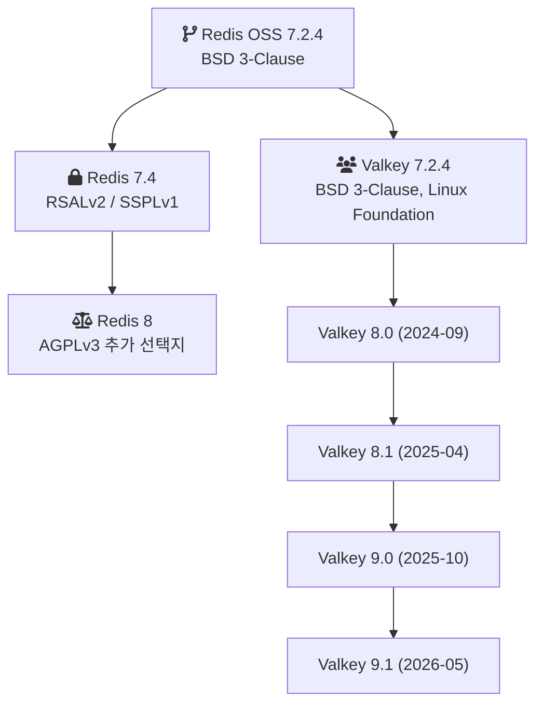
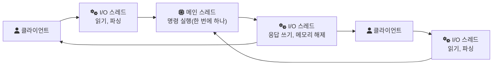
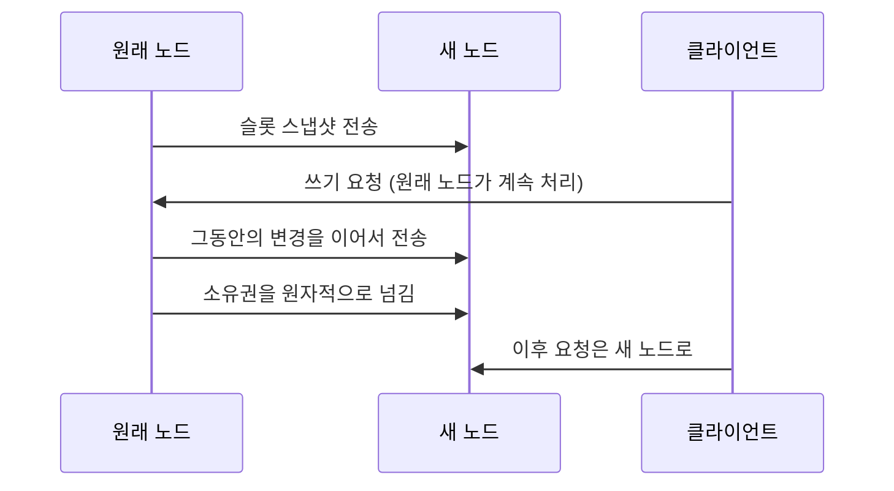
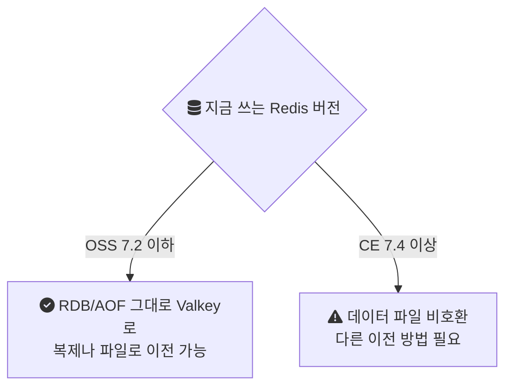

Redis를 쓰는 서비스라면 2024년 이후 "Valkey로 옮길까"라는 질문을 한 번쯤 받았을 것이다. AWS ElastiCache가 Valkey를 엔진으로 내놓으면서 같은 캐시를 더 싸게 쓸 수 있다는 안내가 붙었기 때문이다. 그런데 Valkey가 정확히 무엇인지는 흐릿하게 알려져 있다. "Redis의 오픈소스 버전"이라는 설명이 많은데, 반만 맞다.

이 글은 Valkey가 왜 생겼는지, Redis와 어디까지 같고 어디서부터 달라졌는지, 옮길 때 무엇을 확인해야 하는지를 공식 발표와 문서로 정리한다.

---

## 라이선스 변경이 먼저 있었다

2024년 3월 20일 Redis Inc.는 Redis 7.4부터 라이선스를 바꾼다고 발표했다. 그때까지 Redis는 BSD 3-Clause였다. BSD는 상업적 이용과 재배포, 매니지드 서비스 제공까지 거의 제한 없이 허용하는 라이선스다. 7.4부터는 RSALv2와 SSPLv1 중 하나를 고르는 이중 라이선스가 됐다([Redis 발표](https://redis.io/blog/redis-adopts-dual-source-available-licensing/)).

두 라이선스가 막는 것은 같은 방향이다.

- **RSALv2:** 소프트웨어를 상업화하거나 다른 사람에게 매니지드 서비스로 제공할 수 없다.
- **SSPLv1:** 서비스로 제공하려면 수정한 코드뿐 아니라 그 서비스를 운영하는 관리 계층 전체의 소스까지 공개해야 한다.

발표문은 이유도 직접 밝힌다. Redis의 상업적 매출 대부분이 대형 클라우드 사업자를 거쳐 나가고, 그 사업자들이 Redis의 투자를 상품화한다는 것이다. 사내 서비스나 개인 용도로 쓰는 사람에게는 달라지는 것이 없다고 했다. 대신 Redis와 경쟁하는 매니지드 서비스는 더 이상 새 버전을 무료로 쓸 수 없게 됐다.

Redis 스스로도 이 라이선스가 오픈소스가 아니라는 점을 인정했다. 같은 FAQ에 "this change means Redis is no longer open source under the OSI definition"라고 적었다. 이번 변경으로 Redis는 OSI 정의의 오픈소스가 아니게 됐다는 뜻이다.

---

## 8일 뒤 Valkey가 나왔다

2024년 3월 28일 Linux Foundation이 Valkey 프로젝트를 발표했다([Linux Foundation 발표](https://www.linuxfoundation.org/press/linux-foundation-launches-open-source-valkey-community)). 정리하면 이렇다.

- **출발점:** 라이선스가 바뀌기 직전의 마지막 BSD 버전인 Redis 7.2.4를 포크했다.
- **라이선스:** BSD 3-Clause를 그대로 유지한다.
- **소유:** 특정 회사가 아니라 Linux Foundation이 관리한다.
- **초기 지원:** AWS, Google Cloud, Oracle, Ericsson, Snap이 이름을 올렸다.

발표문에 따르면 프로젝트 기여자들이 라이선스 변경 직후 메인테이너, 커뮤니티, 기업의 지원을 모아 시작했다. 발표문은 이를 "recent license change announced by Redis Inc."에 대한 대응이라고 쓴다.

두 갈래가 나뉜 지점을 그리면 다음과 같다.

그래서 "Redis의 오픈소스 버전"이라는 설명은 7.2.4까지만 맞다. 그 뒤로 두 프로젝트는 각자 기능을 더해 왔고, 데이터 파일 형식부터 달라지기 시작했다(뒤에서 다룬다).

---

## Redis도 1년 뒤에 방향을 바꿨다

2025년 5월 1일 Redis는 Redis 8부터 AGPLv3를 선택지로 추가한다고 발표했다([Redis 발표](https://redis.io/blog/agplv3/)). AGPLv3는 OSI가 승인한 오픈소스 라이선스다. RSALv2와 SSPLv1을 없앤 것이 아니라 고를 수 있는 라이선스를 하나 더 둔 것이다. 같은 발표에서 Redis Stack에 있던 JSON, Time Series, 확률적 자료형, Query Engine을 Redis 8 본체에 합치고, 새 자료형인 vector set을 소개했다.

발표문은 SSPL로 바꾼 결정을 이렇게 돌아본다. AWS와 Google이 자기 포크를 유지하게 됐다는 목표는 이뤘지만, 커뮤니티와의 관계는 상했다는 것이다.

AGPLv3도 BSD와는 다르다. [AGPL](https://www.gnu.org/licenses/agpl-3.0.en.html)은 수정한 소프트웨어를 네트워크 서비스로 제공하면 그 수정본의 소스를 공개하라고 요구한다. 그래서 지금은 선택지가 셋이다.

| | 라이선스 | 매니지드 서비스로 제공할 때 |
| --- | --- | --- |
| Redis 7.2 이하 | BSD 3-Clause | 제약 없음 |
| Redis 8 이후 | RSALv2 / SSPLv1 / AGPLv3 중 선택 | 고른 라이선스에 따라 금지되거나 소스 공개 의무 |
| Valkey | BSD 3-Clause | 제약 없음 |

회사 안에서 캐시로 쓰는 대부분의 팀에게는 세 선택지 모두 쓸 수 있다. 차이가 실제로 문제 되는 곳은 Redis를 감싸 남에게 서비스로 파는 쪽, 그리고 사내 정책상 AGPL 계열을 쓰지 못하게 하는 조직이다.

---

## Valkey는 무엇을 바꿨나

라이선스 이야기만 있었다면 Valkey는 7.2.4에 머문 보존판이었을 것이다. 실제로는 2년 동안 주요 버전을 네 번 냈다.

### 8.0: 명령 실행은 한 스레드 그대로, I/O만 나눴다

Redis는 명령을 메인 스레드 하나에서 실행한다. 그래서 명령 하나하나가 원자적이고 구현이 단순하다. 대신 코어가 많은 서버에서도 한 코어가 처리량의 상한이 된다. 소켓에서 요청을 읽고 파싱하고 응답을 쓰는 일까지 그 스레드가 하기 때문이다.

Valkey 8.0(2024년 9월 16일)은 이 구조를 반쯤만 바꿨다. [Valkey 블로그](https://valkey.io/blog/unlock-one-million-rps/)에 따르면, 메인 스레드는 I/O 스레드에게 일을 나눠 준다. 클라이언트 요청 읽기와 파싱, 응답 쓰기, TCP 연결의 이벤트 폴링, 메모리 해제가 그 일이다. I/O 스레드가 그 일을 하는 동안 메인 스레드는 명령 실행에 시간을 더 쓴다. 명령 실행 자체는 여전히 한 스레드다. 블로그도 이 설계가 "keeps Valkey command execution single-threaded"라고 강조한다. 명령 실행을 단일 스레드로 유지한다는 뜻이다.

같은 글은 AWS EC2 C7g.16xlarge에서 I/O 스레드 8개로 잰 결과를 싣는다. 처리량은 초당 36만 요청에서 119만 요청으로 늘었고, 평균 지연은 1.792ms에서 0.542ms로 줄었다. 이 수치에는 다음 글에서 설명하는 메모리 prefetch 개선도 함께 들어 있다. 프로젝트가 직접 잰 값이니, 실제 효과는 각자의 워크로드에서 다시 재 봐야 한다.

이 구조에서 기억할 점이 있다. 명령 실행이 한 스레드라는 성질은 그대로다. 그래서 [Redis 단일 스레드가 멈추는 순간](/posts/redis-single-thread-stalls/)에서 본 문제는 Valkey에서도 똑같이 생긴다. 큰 Set의 `DEL`이나 `KEYS`가 다른 모든 클라이언트를 붙잡는 문제다. I/O 스레드는 네트워크 처리를 덜어 줄 뿐, 오래 걸리는 명령을 나눠 주지는 않는다.

### 9.0: 클러스터 운영의 오래된 불편을 고쳤다

Valkey 9.0(2025년 10월 21일)의 큰 변화는 클러스터 쪽에 몰려 있다([Valkey 9.0 발표](https://valkey.io/blog/introducing-valkey-9/)).

**원자적 슬롯 마이그레이션.** Redis와 Valkey 클러스터는 키를 16,384개 해시 슬롯으로 나누고([클러스터 명세](https://valkey.io/topics/cluster-spec/)), 슬롯 단위로 노드에 배치한다. 노드를 늘리거나 줄일 때는 슬롯을 옮겨야 한다. 지금까지는 운영자가 `CLUSTER GETKEYSINSLOT`과 `MIGRATE`를 키 묶음마다 반복해 옮겼다. 옮기는 동안 그 슬롯의 키에 들어온 요청은 `-ASK` 응답을 받고 대상 노드로 다시 보내야 했다([Valkey 블로그](https://valkey.io/blog/atomic-slot-migration/)). 9.0은 복제와 같은 원리로 슬롯을 통째로 옮긴다. 먼저 스냅샷을 만들어 보내고, 그동안 생긴 변경을 이어서 흘려보낸 뒤, 마지막에 소유권을 원자적으로 넘긴다. 프로젝트는 이 방식이 최대 9배 빠르고 클라이언트 리다이렉트가 없다고 설명한다.

**해시 필드 만료.** 해시 안의 필드마다 TTL을 다는 `HEXPIRE`, `HTTL`, `HPERSIST`가 들어왔다. 그전에는 해시 전체에만 만료를 걸 수 있어서, 필드별로 수명이 다르면 키를 쪼개야 했다. 참고로 Redis는 같은 이름의 명령을 7.4.0에 추가했다([Redis 문서](https://redis.io/docs/latest/commands/hexpire/)). 두 프로젝트가 같은 문제를 각자 풀었다.

**클러스터 모드의 번호 DB.** `SELECT 1`처럼 번호로 DB를 나누는 기능은 지금까지 단일 노드에서만 됐다. 9.0부터는 클러스터에서도 쓸 수 있다.

같은 발표는 성능 수치도 싣는다. 노드 2,000개까지 클러스터를 키워 초당 10억 요청을 넘겼다고 하고, 파이프라인 메모리 prefetch로 최대 40% 처리량이 늘었다고 한다. 역시 프로젝트가 직접 잰 값이다.

2026년 5월에는 9.1이 나왔고, 8월에는 9.1에서 문자열 키당 메모리 오버헤드를 최대 44% 줄인 과정을 다룬 글이 올라왔다([Valkey 블로그 목록](https://valkey.io/blog/)).

---

## 옮길 때 확인할 것

### 데이터 파일 호환은 7.2에서 끊긴다

[Valkey 마이그레이션 문서](https://valkey.io/topics/migration/)가 가장 먼저 말하는 것이 버전 경계다. Valkey는 Redis OSS 7.2와 그 이전 버전과 호환된다. RDB와 AOF 파일도 Redis OSS 7.2 형식을 읽고 쓴다. 하지만 Redis CE 7.4 이후가 만든 데이터 파일은 Valkey와 호환되지 않는다.

그래서 Redis 7.4 이상으로 이미 올린 서버는 RDB 파일을 Valkey에 그대로 넣을 수 없다. 반대로 7.2 이하에 머물러 있다면 경로가 단순하다. 7.2 이하의 BSD 버전은 라이선스 변경의 영향도 받지 않는다. Redis FAQ도 변경이 소급되지 않는다고 적었다.

### 매니지드 서비스라면 엔진 전환이다

ElastiCache를 쓰고 있다면 선택은 더 단순하다. AWS는 2024년 10월 8일 ElastiCache for Valkey를 내놓았다([AWS 발표](https://aws.amazon.com/about-aws/whats-new/2024/10/amazon-elasticache-valkey/)). 정리하면 다음과 같다.

- **가격:** 다른 엔진보다 서버리스는 33%, 노드 기반은 20% 낮다.
- **전환:** ElastiCache for Redis OSS에서 몇 번의 클릭으로, 다운타임 없이 업그레이드할 수 있다.
- **예약 노드:** 같은 패밀리 안에서는 할인을 그대로 유지한다.

매니지드 환경에서는 라이선스보다 이 가격 차이가 실제 이전 동기가 되는 경우가 많다.

### 클라이언트와 운영 도구

Valkey는 Redis OSS 7.2와의 호환을 내세운다. 그래서 먼저 확인할 것은 7.2 이후에 Redis에만 생긴 기능을 쓰고 있는지다. vector set이나 Redis 8 본체에 합쳐진 JSON, Query Engine 같은 기능에 의존한다면, Valkey에 같은 기능이 있는지부터 확인해야 한다.

Valkey 쪽은 공식 클라이언트로 [Valkey GLIDE](https://github.com/valkey-io/valkey-glide)를 낸다. 핵심은 Rust로 작성했고, Python, Java, Node.js, Go, C#, PHP 바인딩을 제공한다. Redis OSS 6.2, 7.0, 7.2도 지원한다.

---

## 어떻게 고를까

Valkey는 "Redis를 대체하는 새 제품"이라기보다 "라이선스가 바뀌기 전의 Redis를 이어서 개발하는 프로젝트"로 이해하는 편이 정확하다. 출발점이 같아서 7.2까지는 거의 같은 것으로 봐도 되고, 그 뒤로는 각자 다른 기능을 더하고 있다. Valkey는 I/O 스레드와 클러스터 운영 쪽, Redis는 본체에 합친 모듈과 새 자료형 쪽이다.

선택할 때 볼 것은 세 가지다.

- **라이선스 정책:** BSD가 필요한가, AGPL을 써도 되는가.
- **현재 버전:** 7.2 이하인가, 7.4 이상으로 이미 올렸는가.
- **기능 의존:** Redis 8에만 있는 기능을 쓰는가.

성능 수치는 양쪽 모두 각 프로젝트가 직접 발표한 것이라, 옮기기 전에 내 워크로드로 다시 재 보는 것이 맞다.

## 참고

- [Redis Adopts Dual Source-Available Licensing](https://redis.io/blog/redis-adopts-dual-source-available-licensing/) — Redis, 2024-03-20
- [Linux Foundation Launches Open Source Valkey Community](https://www.linuxfoundation.org/press/linux-foundation-launches-open-source-valkey-community) — linuxfoundation.org: Linux Foundation, 2024-03-28
- [Redis is now available under the AGPLv3 open source license](https://redis.io/blog/agplv3/) — Redis, 2025-05-01
- [Unlock 1 Million RPS: Experience Triple the Speed with Valkey](https://valkey.io/blog/unlock-one-million-rps/) — Valkey 블로그
- [Valkey 9.0: innovation, features, and improvements](https://valkey.io/blog/introducing-valkey-9/) — Valkey 블로그, 2025-10-21
- [Atomic Slot Migration](https://valkey.io/blog/atomic-slot-migration/) — Valkey 블로그
- [Migration from Redis to Valkey](https://valkey.io/topics/migration/) — Valkey 문서
- [HEXPIRE](https://redis.io/docs/latest/commands/hexpire/) — Redis 문서
- [Amazon ElastiCache now supports Valkey](https://aws.amazon.com/about-aws/whats-new/2024/10/amazon-elasticache-valkey/) — AWS, 2024-10-08
- [Valkey GLIDE](https://github.com/valkey-io/valkey-glide) — GitHub
- [Cluster specification](https://valkey.io/topics/cluster-spec/) — Valkey 문서
- [GNU Affero General Public License v3](https://www.gnu.org/licenses/agpl-3.0.en.html) — GNU
