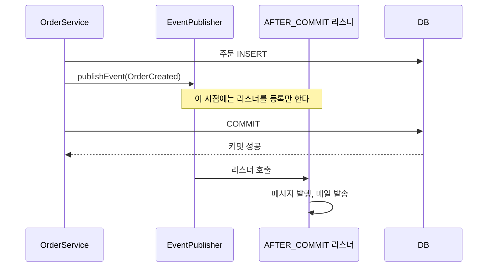

`@TransactionalEventListener`를 쓸 때 가장 먼저 확인할 것은 두 가지다.

- 이벤트가 실제로 트랜잭션 안에서 발행되는가
- 내가 원하는 실행 시점이 커밋 이후인가, 즉시 실행인가

리스너가 왜 호출되지 않는지 원인과 해결을 길게 다룬 글은 [@TransactionalEventListener가 무시되는 이유와 해결법](/posts/transactional-event-listener/)에 있다. 이 노트는 코드 리뷰나 장애 확인 때 빠르게 훑어볼 항목만 모은 것이다.

## 핵심 요약

- 기본 `@EventListener`는 발행 즉시 실행된다.
- `@TransactionalEventListener`는 트랜잭션 phase에 맞춰 실행된다.
- `AFTER_COMMIT`은 트랜잭션이 없으면 실행되지 않는다.
- `fallbackExecution = true`는 편하지만 "커밋 이후 보장"을 약하게 만든다.

각 항목의 근거는 Spring 문서에 있다.

- `@EventListener`: Spring의 이벤트 리스너는 기본적으로 동기로 이벤트를 받는다. `publishEvent()`는 모든 리스너가 처리를 마칠 때까지 블록되고, 리스너는 발행자의 트랜잭션 컨텍스트 안에서 실행된다([Spring: Standard and Custom Events](https://docs.spring.io/spring-framework/reference/core/beans/context-introduction.html)). 리스너에서 예외가 나면 발행한 쪽의 트랜잭션까지 롤백될 수 있다는 뜻이다.
- phase: `BEFORE_COMMIT`, `AFTER_COMMIT`(기본값), `AFTER_ROLLBACK`, 커밋과 롤백을 모두 포함하는 `AFTER_COMPLETION`이 있다([Spring: Transaction-bound Events](https://docs.spring.io/spring-framework/reference/data-access/transaction/event.html)).
- 트랜잭션이 없을 때: 같은 문서는 실행 중인 트랜잭션이 없으면 요구된 의미를 지킬 수 없으므로 리스너를 아예 호출하지 않는다고 적는다. Javadoc 표현으로는 이벤트가 버려진다(discarded).
- `fallbackExecution`: 이 값을 `true`로 두면 트랜잭션이 없어도 리스너가 실행된다. 기다릴 커밋이 없으므로 발행 즉시 실행되고, 리스너 입장에서는 "커밋된 데이터만 본다"는 전제가 사라진다.

## 실행 시점을 그림으로

`AFTER_COMMIT` 리스너는 `publishEvent()`를 호출한 순간이 아니라, 그 트랜잭션이 커밋된 뒤에 호출된다.



롤백되면 마지막 두 단계가 일어나지 않는다. 아래 "언제 적합한가"의 두 항목이 모두 이 성질에서 나온다.

```java
@Component
public class OrderEventHandler {

    @TransactionalEventListener(phase = TransactionPhase.AFTER_COMMIT)
    public void handle(OrderCreatedEvent event) {
        // 커밋이 확정된 주문에 대해서만 외부 메시지를 발행한다
    }
}
```

## 언제 적합한가

- DB 반영이 확정된 뒤 메시지를 발행해야 할 때
- 롤백되면 메일/알림/외부 연동도 함께 막아야 할 때

반대로 커밋 이후 작업이 실패해도 원래 트랜잭션은 이미 커밋되어 있다는 점은 기억해야 한다. 리스너가 메시지 발행에 실패하면 DB에는 주문이 있는데 메시지는 없는 상태가 된다. 이 간격이 허용되지 않는 작업이라면 리스너 안에서 재시도하거나, 이벤트를 같은 트랜잭션 안에서 별도 테이블에 기록해 두고 나중에 발행하는 방식을 검토한다.

## 주의할 점

- self-invocation 때문에 `@Transactional`이 빠져 있지 않은지
- 테스트에서 트랜잭션 설정 때문에 리스너가 기대와 다르게 동작하지 않는지
- 비동기 처리와 함께 섞었을 때 트랜잭션 경계가 달라지지 않는지

### self-invocation

`@Transactional`은 프록시를 통해 동작한다. 같은 클래스 안에서 `this.place()`처럼 자기 메서드를 호출하면 프록시를 거치지 않으므로 트랜잭션이 시작되지 않는다([Spring: Using @Transactional](https://docs.spring.io/spring-framework/reference/data-access/transaction/declarative/annotations.html)). 그 메서드 안에서 이벤트를 발행하면 트랜잭션이 없는 발행이 되고, `AFTER_COMMIT` 리스너는 호출되지 않는다. 예외도 로그도 없이 조용히 건너뛰므로 발견이 늦다.

### 테스트의 트랜잭션

Spring TestContext 프레임워크에서 테스트 메서드에 `@Transactional`을 붙이면, 테스트 트랜잭션은 기본적으로 테스트가 끝난 뒤 자동으로 롤백된다([Spring: Transaction Management in tests](https://docs.spring.io/spring-framework/reference/testing/testcontext-framework/tx.html)). 커밋이 일어나지 않으니 `AFTER_COMMIT` 리스너도 호출되지 않는다. 리스너 동작을 테스트하려면 `@Commit`을 쓰거나, 테스트 안에서 `TestTransaction.flagForCommit()`과 `TestTransaction.end()`로 트랜잭션을 커밋시킨 뒤 결과를 확인한다.

### 리스너 안에서 DB를 다시 쓸 때

`TransactionalEventListener` Javadoc에는 경고가 있다. `AFTER_COMMIT`, `AFTER_ROLLBACK`, `AFTER_COMPLETION` 시점에는 트랜잭션이 이미 커밋 또는 롤백됐지만 트랜잭션 자원은 아직 활성 상태일 수 있다. 그래서 이 시점에 실행한 데이터 접근 코드는 원래 트랜잭션에 "참여"하지만, 그 변경은 커밋되지 않는다([TransactionalEventListener Javadoc](https://docs.spring.io/spring-framework/docs/current/javadoc-api/org/springframework/transaction/event/TransactionalEventListener.html)).

리스너에서 이력 테이블에 INSERT를 했는데 저장되지 않는다면 이 경우다. 새 트랜잭션이 필요하면 리스너 메서드에 `@Transactional(propagation = Propagation.REQUIRES_NEW)`를 붙인다. Spring 6.1부터는 `RestrictedTransactionalEventListenerFactory`가 이런 잘못된 조합을 검출해, 트랜잭션 이벤트 리스너에 붙은 `@Transactional`은 `REQUIRES_NEW`와 `NOT_SUPPORTED`만 허용한다([RestrictedTransactionalEventListenerFactory Javadoc](https://docs.spring.io/spring-framework/docs/current/javadoc-api/org/springframework/transaction/annotation/RestrictedTransactionalEventListenerFactory.html)).

### 비동기와 섞을 때

리스너에 `@Async`를 함께 붙이면 리스너는 다른 스레드에서 실행된다. 커밋 이후에 호출된다는 점은 같지만, 리스너는 발행한 스레드의 트랜잭션 자원을 공유하지 않는다. 반대로 `@Async` 메서드 안에서 이벤트를 발행하는 경우는 다르다. 새 스레드에는 호출한 쪽의 트랜잭션이 이어지지 않으므로, 그 메서드에 따로 트랜잭션이 없다면 `AFTER_COMMIT` 리스너는 호출되지 않는다. 문서도 6.1 기준으로 `PlatformTransactionManager`가 관리하는 트랜잭션의 경우 리스너가 현재 스레드에 묶인 트랜잭션을 본다고 적는다.

## 한 줄 결론

이 애너테이션은 "이벤트 리스너"보다 "트랜잭션 경계 이후 작업 예약"으로 이해하는 편이 훨씬 정확하다.

## 참고

- [Transaction-bound Events](https://docs.spring.io/spring-framework/reference/data-access/transaction/event.html) — Spring Framework Reference
- [Standard and Custom Events](https://docs.spring.io/spring-framework/reference/core/beans/context-introduction.html) — Spring Framework Reference
- [Using @Transactional](https://docs.spring.io/spring-framework/reference/data-access/transaction/declarative/annotations.html) — Spring Framework Reference
- [TransactionalEventListener](https://docs.spring.io/spring-framework/docs/current/javadoc-api/org/springframework/transaction/event/TransactionalEventListener.html) — Spring Framework Javadoc
- [RestrictedTransactionalEventListenerFactory](https://docs.spring.io/spring-framework/docs/current/javadoc-api/org/springframework/transaction/annotation/RestrictedTransactionalEventListenerFactory.html) — Spring Framework Javadoc
- [Transaction Management (TestContext)](https://docs.spring.io/spring-framework/reference/testing/testcontext-framework/tx.html) — Spring Framework Reference
