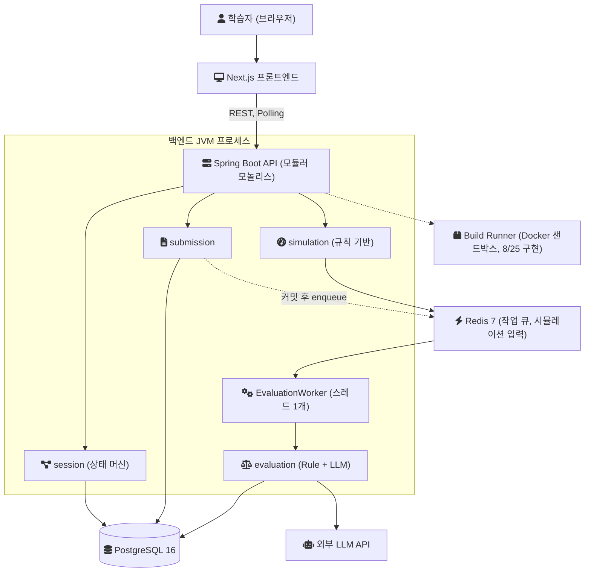
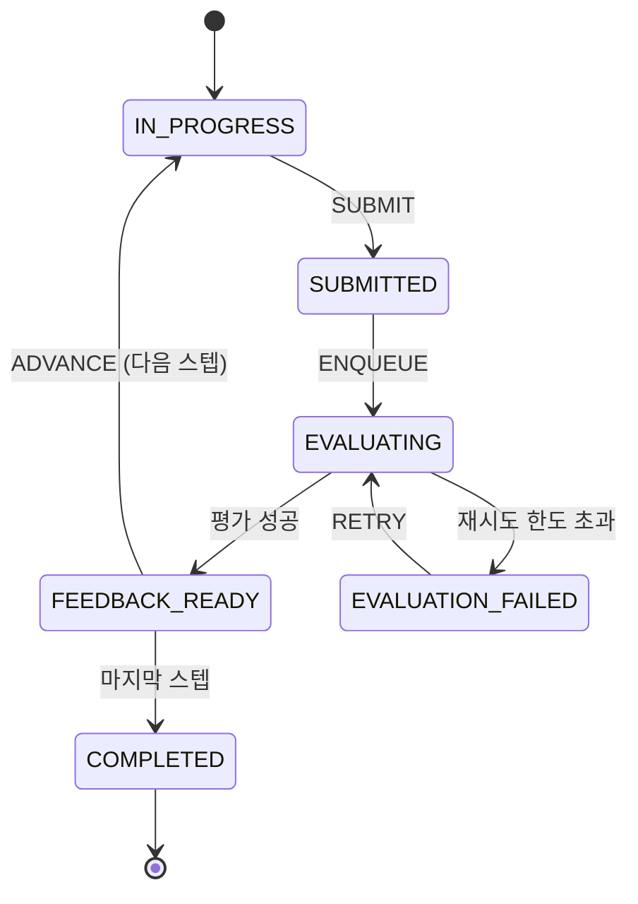
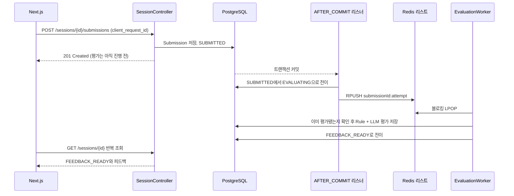

[GitHub 저장소](https://github.com/polynomeer/sys-drill)

SysDrill 저장소의 첫 커밋은 2026-08-24이다. 이 글은 그날의 커밋들이 보여 주는 설계를 정리한다. 무엇을 풀려고 했는지, 컴포넌트와 데이터가 어떻게 흐르게 했는지, 그리고 언어·아키텍처·저장소·큐·시뮬레이션·평가·샌드박스·프론트엔드를 각각 무엇과 비교해서 골랐는지다. 지금 저장소 설명에 있는 Toxiproxy·k6·Kafka 기반 실제 인프라 시뮬레이션은 첫날에 없었고, 첫날 문서가 Phase 3로 미뤄 둔 항목이었다. 그래서 이 글에서는 미뤄 둔 이유만 다룬다.

근거는 두 갈래다. 첫날 오후에 쓴 설계 문서([`ARCHITECTURE.md`](https://github.com/polynomeer/sys-drill/blob/aeb30292af87f8198428e95ce4e4eead8b2582f5/docs/ARCHITECTURE.md), [`PRD.md`](https://github.com/polynomeer/sys-drill/blob/f672f7df97e9a45d22a1a45c3f14f8051698333c/docs/PRD.md))와 그 근거가 된 원본 기획서([`docs/archive`](https://github.com/polynomeer/sys-drill/tree/92f932a38e46243c0813f76d4c556653d8313ea4/docs/archive))에는 모듈러 모놀리스, Kafka 미도입, Polling, 규칙 기반 시뮬레이션의 이유가 적혀 있다. 반면 Kotlin, PostgreSQL, Next.js, Redis 리스트 큐를 어떤 대안과 비교했는지는 적혀 있지 않았다. 이 글을 쓰면서 그 비교를 첫 커밋과 기존 문서를 근거로 재구성해 [ADR-0053](https://github.com/polynomeer/sys-drill/blob/175f61a39d05fb4346c0076aee408821ed23c6a2/docs/adr/0053-initial-tech-selection-reconstructed.md)(ADR은 Architecture Decision Record, 결정의 맥락·대안·결과를 남기는 짧은 문서)으로 저장소에 남겼다. 아래에서 그 ADR을 인용할 때는 재구성이라는 점을 밝혀 둔다.

## 무엇을 풀려고 했는가

[PRD](https://github.com/polynomeer/sys-drill/blob/f672f7df97e9a45d22a1a45c3f14f8051698333c/docs/PRD.md)는 문제를 "백엔드 개발자의 실무 경험 공백"으로 적었다. CRUD와 API는 만들어 봤지만 대용량 트래픽, 분산 시스템 운영, 장애 대응을 겪어 보지 못한 개발자가 많다. 예를 들어 Redis를 "캐시로 쓰면 빠르다" 수준으로 아는 것과, hit ratio가 떨어질 때 부하가 DB로 옮겨 가는 것을 판단할 수 있는 것 사이에 간격이 있다. 실제 장애는 조직이 일부러 재현할 수 없으니, 이 간격은 책이나 강의로 메우기 어렵다.

그래서 SysDrill은 네 가지 모드를 하나의 루프로 묶는 훈련 플랫폼으로 정의됐다. Build(작은 컴포넌트를 직접 구현), Design(도메인 요구사항으로 시스템 설계), 꼬리설계(트래픽·정합성·예산 같은 조건을 바꿔 다시 설계), Wargame(트래픽·장애 이벤트에 대응)이다. 평가는 정답 맞히기가 아니라 판단 과정을 본다. 같은 scale-out이라도 무엇을 보고 언제 했는지에 따라 점수가 달라진다.

설계 판단의 조건은 다음과 같다. 결론이 다른 상황에 옮겨질 수 있는지 판단하는 데 필요하다.

- 개인 프로젝트이고, 첫날 하루 동안 기획 문서 10건을 하나의 PRD와 아키텍처 문서로 수렴시킨 뒤 바로 구현에 들어갔다.
- MVP(Minimum Viable Product, 핵심 가설을 검증할 최소 제품)의 목표는 "설계 → 조건 변경 → 장애 대응" 루프가 가치 있는지 검증하는 것이다. 시나리오는 3개(선착순 쿠폰, 알림 이벤트, 대규모 상품 조회), Build 과제는 2개(Rate Limiter, Queue)로 잡았다.
- 사용자마다 실제 인프라를 띄우지 않는다. 아키텍처 문서의 원칙 7은 "100% digital twin을 약속하지 않는다"이다.
- 로컬 실행 환경은 한 대의 개발 기계 위 docker-compose(PostgreSQL 16, Redis 7)다. 실제 사용자 트래픽은 없다.
- AI 평가는 외부 LLM API를 쓰고, 수초에서 수십 초가 걸릴 수 있다고 가정했다.

## 초기 아키텍처

첫날 기준으로 실제 프로세스는 Spring Boot 백엔드 하나와 Next.js 프론트엔드, 그리고 PostgreSQL·Redis 컨테이너였다. 평가 워커는 아키텍처 문서상 별도 워커지만 첫 구현은 같은 JVM 안의 백그라운드 스레드였다. 아래 그림은 [ARCHITECTURE.md §2·§14](https://github.com/polynomeer/sys-drill/blob/aeb30292af87f8198428e95ce4e4eead8b2582f5/docs/ARCHITECTURE.md)의 논리 구조에 첫날 구현을 겹친 것이다. Build Runner 샌드박스는 설계에는 있었지만 구현은 다음 날(2026-08-25)이었으므로 점선으로 표시했다.

데이터는 세 가지 집계(Aggregate, 함께 일관성을 지키는 객체 묶음)를 중심으로 흐른다. Scenario는 어떤 사건이 어떤 조건에서 일어나는지를 버전과 함께 정의하고, Session은 사용자가 무엇을 선택했는지를 기록하고, SimulationState는 그 선택의 결과로 시스템이 지금 어떤 상태인지를 나타낸다. 세션은 시작할 때 시나리오 버전을 고정한다. 같은 시나리오의 문구나 규칙이 나중에 바뀌어도 과거 세션의 평가를 재현할 수 있게 하려는 것이다.

세션의 상태 전이는 [ARCHITECTURE.md §5](https://github.com/polynomeer/sys-drill/blob/aeb30292af87f8198428e95ce4e4eead8b2582f5/docs/ARCHITECTURE.md)의 표 그대로 구현됐다. 전이는 `UPDATE ... WHERE id=? AND status=?` 형태의 조건부 UPDATE로 해서 중복 제출과 잘못된 진행을 막는다.

답안 제출에서 평가까지의 흐름은 다음과 같다. 제출 API는 평가가 끝날 때까지 기다리지 않는다. 프론트엔드는 세션 상태를 주기적으로 조회(Polling)해 결과가 준비됐는지 확인한다.

## 언어와 프레임워크: Kotlin과 Spring Boot 4.1

첫날 스캐폴딩 커밋([`c077f21`](https://github.com/polynomeer/sys-drill/blob/c077f2164b0882d9228064b7e505530ccd58f3bc/backend/build.gradle.kts))은 Spring Boot 4.1.1, Kotlin 2.3.21, Java 21 툴체인을 썼다. 원본 기획서 중 하나는 Kotlin + Spring Boot를 "도메인 상태와 비동기 작업, 운영 안정성에 적합"하다고 적었고, 이 서비스가 상태 전이·멱등성·재처리를 가르치므로 애플리케이션 구조도 그것을 드러내는 편이 좋다고 했다. 다른 기획서는 TypeScript + NestJS를 함께 후보로 올렸지만, 왜 버렸는지는 남아 있지 않다. 아래 비교는 ADR-0053의 재구성이다.

| 후보 | 이 프로젝트의 필요와 맞는 점 | 걸리는 점 |
|---|---|---|
| Kotlin + Spring Boot (채택) | 트랜잭션, 트랜잭션 단계에 묶인 이벤트 리스너, JPA·Redis·Flyway를 한 프레임워크에서 쓴다. `SystemState` 같은 계산 모델을 data class로 짧게 쓴다 | Kotlin 클래스는 기본이 `final`이라 플러그인이 필요하다 |
| Java + Spring Boot | 같은 생태계, 플러그인 불필요 | 널 가능성을 타입으로 표현하지 못한다 |
| TypeScript + NestJS | 프론트엔드와 언어 통일. Node.js 위에서 Express(기본)나 Fastify를 쓴다 | 저장소에 지지하거나 배제한 근거가 없다 |

Spring Boot 4.1.1은 Java 17 이상을 요구하고 Java 26까지 호환된다고 문서에 적혀 있다([System Requirements](https://docs.spring.io/spring-boot/system-requirements.html)). Spring Framework는 API 전체에 JSpecify 널 주석을 달았고, Kotlin 2.1부터 이 주석을 엄격하게 반영한다([Kotlin null-safety](https://docs.spring.io/spring-framework/reference/languages/kotlin/null-safety.html)). 그래서 Spring API의 널 가능성이 Kotlin 타입으로 드러난다.

대가는 두 가지였다. 하나는 설정이다. Kotlin 공식 문서는 클래스와 멤버가 기본적으로 `final`이라 Spring AOP처럼 `open` 클래스가 필요한 프레임워크에서 불편하다고 설명한다([all-open plugin](https://kotlinlang.org/docs/all-open-plugin.html)). JPA는 인자 없는 생성자가 필요해서 `kotlin-jpa`(no-arg 플러그인 래퍼)를 쓴다([no-arg plugin](https://kotlinlang.org/docs/no-arg-plugin.html)). 실제로 `build.gradle.kts`에는 `@Entity`·`@MappedSuperclass`·`@Embeddable`을 여는 `allOpen` 블록이 있다. 다른 하나는 메이저 버전 전환기의 함정이다. [`PLAN.md`](https://github.com/polynomeer/sys-drill/blob/a70cab2a9d6ebc81679dfa3eaa563aa144215eb0/PLAN.md)의 첫날 기록에는 테스트 자동구성 패키지 이동, `@Transactional`과 `@TransactionalEventListener`를 한 메서드에 함께 쓸 수 없는 제약, `@Modifying(clearAutomatically = true)`가 flush 없이 영속성 컨텍스트를 비워 직전 `save()`가 유실되는 문제가 적혀 있다.

## 아키텍처 형태: 모듈러 모놀리스와 분리된 워커

이 선택은 저장소에 이유가 적혀 있다. 원본 설계 문서는 [모듈러 모놀리스](/posts/modular-monolith-boundaries/)를 고른 이유를 네 가지로 들었다. 제품 도메인과 학습 UX가 빨리 바뀔 수 있으니 서비스 경계보다 실험 속도가 중요하다. 세션·답안·평가 상태를 하나의 트랜잭션 모델로 다루기 쉽다. 처음부터 마이크로서비스로 가면 배포·네트워크·분산 추적·데이터 일관성 비용이 생긴다. 모듈 경계를 유지하면 나중에 평가·리포트를 떼어내기 쉽다. 그리고 부하와 보안 특성이 다른 두 영역, 즉 지연이 큰 AI 평가와 사용자 코드를 실행하는 Build Runner만 워커로 분리한다.

Martin Fowler도 같은 방향을 권한다. 그는 "you shouldn't start a new project with microservices"라고 썼다([MonolithFirst](https://martinfowler.com/bliki/MonolithFirst.html), 2015). 애플리케이션이 충분히 커질 거라 확신해도 새 프로젝트를 마이크로서비스로 시작하지 말라는 뜻이다.

첫날 스캐폴딩은 `identity`, `content`, `scenario`, `session`, `submission`, `evaluation`, `simulation`, `reporting` 여덟 개 패키지를 빈 채로 먼저 만들었다. 대가는 경계를 컴파일러가 강제하지 않는다는 점이다. 그래서 1단계에서 집계 사이의 참조는 JPA 연관관계 대신 UUID 필드로만 둔다는 규칙을 세웠다(`Session.userId: UUID`). 한 세션 객체가 사용자 객체 그래프를 지연 로딩하거나 cascade 저장하는 일을 구조적으로 막기 위한 것이다. 이 규칙은 다음 날 ADR-0001로 정리됐다.

## 주 저장소: PostgreSQL과 JSONB

아키텍처 문서는 사용자·시나리오 버전·세션·제출·평가처럼 정합성이 필요한 데이터를 PostgreSQL에 둔다고 적었다. ERD 원칙은 이렇다. 조회와 필터링에 쓰는 타입·상태·점수·시간은 정규 컬럼으로 둔다. 자주 바뀌는 시나리오 규칙, 시뮬레이션 효과, AI 구조화 결과는 JSONB로 둔다. 평가 결과의 모양이 프롬프트를 고칠 때마다 바뀔 수 있으니, 그 부분만 스키마 변경 없이 받겠다는 뜻이다.

PostgreSQL 문서에 따르면 `jsonb`는 분해된 바이너리 형식으로 저장된다. 그래서 입력은 조금 느리지만 처리할 때 다시 파싱하지 않고, 인덱스를 지원한다. 문서는 대부분의 애플리케이션에 `jsonb`를 권한다([JSON Types](https://www.postgresql.org/docs/16/datatype-json.html)). 첫날 밤에는 부분 유니크 인덱스도 썼다. 제출의 [멱등성 키](/posts/idempotency-key-design/)인 `client_request_id`가 처음에는 전역 UNIQUE였는데, 서로 다른 세션이 우연히 같은 문자열을 쓰면 충돌한다. 그래서 `V3` 마이그레이션에서 `(session_id, client_request_id) WHERE client_request_id IS NOT NULL` 인덱스로 범위를 좁혔다. 부분 인덱스는 조건식을 만족하는 행만 담는 인덱스이고, 일부 행에만 유일성을 강제하는 용도가 문서 예제로 나와 있다([Partial Indexes](https://www.postgresql.org/docs/16/indexes-partial.html)).

MySQL이나 문서형 DB와의 비교는 당시 문서에 없었다. ADR-0053도 그 비교를 새로 하지 않고 공백으로 남겼다. 이 글에서 말할 수 있는 것은 이 프로젝트가 관계형 정합성, JSON 컬럼, 부분 유니크 인덱스를 한 엔진에서 쓰려 했다는 데까지다. 대가로 JSONB는 Kotlin에서 원시 JSON 문자열(`String?`)로 다루기로 했고, 타입 안전한 접근은 뒤로 미뤘다.

## 작업 큐: Redis 리스트, 그리고 Kafka를 쓰지 않은 이유

Kafka를 쓰지 않은 이유는 저장소에 적혀 있다. 아키텍처 문서는 "MVP에서는 Kafka를 도입하지 않는다"고 쓰고, 이벤트를 여러 독립 소비자가 쓰거나 장기 이벤트 보존이 실제 제품 요구가 될 때 검토한다고 했다. 워게임 시나리오 안에서 Kafka lag를 다루는 것은 시뮬레이션 대상일 뿐, 백엔드 자체의 인프라 요구가 아니라는 구분도 같이 적었다. Redis는 세션 캐시와 시뮬레이션 입력 저장에 어차피 필요했으므로, 큐를 Redis 위에 두면 추가 인프라가 없다.

어떤 Redis 자료구조로 큐를 만들지는 문서에 비교가 없었다. 첫 구현([`c0c391a`](https://github.com/polynomeer/sys-drill/commit/c0c391a3d684b5063b6890845040f5f9d54cdfbd))은 리스트에 `RPUSH`하고 워커가 타임아웃이 있는 블로킹 `LPOP`(`BLPOP`)으로 꺼내는 가장 단순한 형태였다. 아래 비교는 ADR-0053의 재구성이다.

| 후보 | 1차 출처의 성질 | 이 프로젝트 기준 |
|---|---|---|
| 리스트 + `BLPOP` (채택) | 꺼낸 원소는 리스트에서 지워진다. 처리 중 클라이언트가 죽으면 그 원소는 사라진다 | 추가 인프라 없음. 재시도, DLQ 리스트, 멱등성 확인은 앱이 구현 |
| 리스트 + `LMOVE` processing 리스트 | 꺼내면서 processing 리스트로 옮기고, 처리 후 `LREM`. 오래 남은 항목을 다시 넣는 감시자가 필요 | 유실은 막지만 감시자를 만들어야 함 |
| Redis Streams 소비자 그룹 | 확인(`XACK`) 전 메시지가 PEL(Pending Entries List)에 남고 `XAUTOCLAIM`으로 회수 | 같은 Redis로 가능, API 표면이 큼 |
| Amazon SQS | 받은 메시지는 visibility timeout(기본 30초) 동안 숨겨지고, 지우지 않으면 다시 보인다 | 로컬 docker-compose만으로 개발하려는 조건과 맞지 않음 |
| Kafka | 소비 후에도 이벤트를 지우지 않고 토픽별 보존 기간을 둔다 | 보존과 다중 소비자가 아직 요구가 아님 |

출처는 Redis의 [`BLPOP`](https://redis.io/docs/latest/commands/blpop/), [`LMOVE`](https://redis.io/docs/latest/commands/lmove/), [Streams](https://redis.io/docs/latest/develop/data-types/streams/) 문서, AWS의 [visibility timeout](https://docs.aws.amazon.com/AWSSimpleQueueService/latest/SQSDeveloperGuide/sqs-visibility-timeout.html) 문서, Kafka의 [Introduction](https://kafka.apache.org/intro)이다. Kafka의 저장 구조는 [Kafka의 저장 구조](/posts/kafka-storage-internals/)에 따로 정리했다.

이 선택의 대가는 표 첫 줄에 있다. 워커가 job을 꺼낸 뒤 처리하기 전에 죽으면 그 job은 Redis에서도 사라진다. 첫 구현의 재시도(최대 3회)와 dead-letter 리스트는 처리 중 예외가 났을 때만 동작하고, 프로세스가 죽는 경우는 다루지 않는다. 반대 방향의 중복 전달은 다뤘다. 워커는 같은 `submission_id`의 활성 평가가 이미 있으면 건너뛴다. 아키텍처 문서 §8이 at-least-once 전달을 전제로 중복 소비에 안전해야 한다고 적었기 때문이다.

같은 날 큐 자체와 별개로 순서 문제를 하나 겪었다. 트랜잭션 안에서 바로 enqueue하면, 워커가 다른 트랜잭션에서 커밋되기 전의 Submission을 조회해 찾지 못하고 job을 버린다. 그래서 트랜잭션 안에서는 Spring 이벤트만 발행하고, 실제 enqueue는 [`@TransactionalEventListener`](/posts/transactional-event-listener-checklist/)의 `AFTER_COMMIT` 단계에서 한다. Spring 문서는 이 리스너가 기본적으로 트랜잭션의 커밋 단계에 묶인다고 설명한다([Transaction-bound Events](https://docs.spring.io/spring-framework/reference/data-access/transaction/event.html)). 이 규칙은 다음 날 Build 파이프라인에서 같은 버그를 다시 만난 뒤 ADR-0004가 됐다. DB 커밋과 메시지 발행 사이의 더 일반적인 해법인 Outbox는 이후 [ParityPay 5편](/posts/parity-pay-outbox/)에서 다뤘다. 아키텍처 문서도 "같은 트랜잭션 또는 Outbox Pattern"을 적었지만, 첫 구현은 커밋 후 리스너 쪽을 택했다. 커밋 직후 enqueue 전에 프로세스가 죽으면 job이 빠진다는 점은 Outbox와 다른 대가다.

## 시뮬레이션: 실제 인프라 대신 규칙 기반 상태 계산

이 선택도 이유가 적혀 있다. 원본 제품 기획서는 처음부터 사용자마다 실제 Kubernetes·Kafka·Redis 클러스터를 만들면 비용과 운영 복잡도가 급증한다고 적었다. PRD의 리스크 표에도 "실제 인프라 비용 폭증"이 있고, 대응은 "MVP는 규칙 기반 상태 시뮬레이션"이다. 로드맵은 컨테이너 기반 의존성, k6 부하 생성, Toxiproxy 네트워크 장애 주입을 Phase 3로 두고, Phase 1~2에서 학습 가치를 확인한 뒤에만 투자한다고 했다.

시뮬레이션은 `NextState = f(CurrentState, Incident, DesignTraits, AppliedAction, Time)` 형태의 순수 함수다. 병목은 utilization(들어오는 부하 ÷ 최대 용량)으로 계산하고 구간마다 증상을 정했다. 60% 미만은 안정, 60~80%는 latency 증가, 80~95%는 p95/p99 급등, 95% 이상은 에러 증가, 100%를 넘으면 timeout과 drop이다. 아키텍처 문서는 이 방식이 실제 인프라를 재현하지 않지만 교육적으로 유의미한 인과를 보여 주는 것이 목적이라고 밝혔다.

첫날 밤에 구현한 인시던트는 하나다([`2da8390`](https://github.com/polynomeer/sys-drill/commit/2da83905b37e929b4448c17bd6bb14717b76b8d0)). 선착순 쿠폰에서 트래픽이 20배가 되고 Redis latency가 늘면 DB 쓰기 hotspot이 생긴다. 시작 상태는 p95 640ms, 에러율 0.30이다. Rate limit 강화, 캐시 TTL 증가, DB 커넥션 풀 증가 세 액션을 차례로 적용하면 p95 80ms, 에러율 0.001로 돌아온다. 이 숫자는 측정값이 아니라 상수와 공식으로 손계산한 값이고, 단위 테스트가 그 손계산과 대조한다. 계산 결과인 `SystemState`는 저장하지 않고, Redis에는 다시 계산하는 데 필요한 입력만 둔다.

| 후보 | 비교 |
|---|---|
| 규칙 기반 순수 함수 (채택) | 싸고 결정적이며, 숫자를 공식으로 추적할 수 있다 |
| 세션별 실제 컨테이너 인프라 | 비용과 기동 시간. 저장소가 Phase 3로 미룸 |
| 데이터 기반 범용 엔진 | 인시던트가 하나일 때는 일반화 근거가 없어 콘텐츠가 늘 때로 미룸 |

대가는 PRD가 스스로 적어 둔 "장난감처럼 보임" 리스크다. 수치가 실제 시스템에서 나온 것이 아니므로, 훈련에서 얻은 감각이 실제로 옮겨지는지는 이 설계만으로 보장되지 않는다.

## 평가: Rule과 LLM의 하이브리드

아키텍처 문서는 평가를 두 층으로 나눴다. 요구사항 누락이나 임계값 위반처럼 결정 가능한 사실은 규칙 엔진이 판정한다. 트레이드오프의 타당성, 설명 품질, 꼬리질문 생성은 LLM이 맡는다. LLM 출력은 자유 텍스트가 아니라 `top_risks`, `missed_points`, `followup_questions` 같은 구조화 JSON으로 강제하고, 검증을 통과한 결과만 저장한다. 프롬프트를 바꿨을 때 회귀 테스트를 할 수 있게 하려는 것이다.

| 후보 | 비교 |
|---|---|
| Rule + LLM (채택) | 규칙이 놓치지 말아야 할 항목을 잡고, LLM이 설명과 질문을 만든다 |
| LLM 단독 | PRD 리스크 표의 "LLM 피드백이 뻔함", 그리고 재현성 원칙과 충돌 |
| 규칙 단독 | 트레이드오프 설명과 꼬리질문을 만들 수 없다 |

첫날 구현([`8728376`](https://github.com/polynomeer/sys-drill/commit/8728376afeef79ec3e760fcf862c8b53de2555f2))은 Anthropic Claude API를 Spring의 `RestClient`로 호출했다. 점수는 모델이 보고한 합계를 믿지 않고 루브릭(100점) 차원별로 다시 계산해 범위 안으로 자른다. API 키가 없으면 예외 대신 오프라인 고정 응답을 돌려줘서, 키 없이도 파이프라인 전체를 테스트할 수 있게 했다. 대가는 외부 API 의존과 비용이다. 아키텍처 문서가 저장하라고 한 토큰 수·비용 메타데이터는 첫날에는 모델 이름과 지연 시간만 저장하고 뒤로 미뤘다.

## 코드 실행 격리: Docker 컨테이너, 다음 단계로 gVisor·Firecracker

사용자 코드를 실행하는 경로는 Build Mode 하나다. 아키텍처 문서 §11은 이 경로에만 강한 격리를 두기로 하고 조건을 적었다. 실행마다 새 컨테이너나 VM을 쓰고, CPU·메모리·시간을 제한하고, outbound 네트워크를 기본 차단하고, privileged 모드와 호스트 마운트를 금지한다. 기술 표에는 "Docker 기반 격리 워커, 보안 요구 증가 시 gVisor/Firecracker 검토"라고 적었다. 구현은 다음 날 9단계였고, 그 결과가 ADR-0007이다.

| 후보 | 1차 출처의 성질 |
|---|---|
| Docker 컨테이너 (채택) | 기본은 자원 제한이 없고 `--cpus`, `--memory`로 상한을 건다. `--network none`이면 loopback만 생긴다 |
| gVisor | 사용자 공간에서 도는 애플리케이션 커널. 호환성 저하와 시스템 콜당 오버헤드를 대가로 격리를 강화한다 |
| Firecracker | KVM으로 microVM을 만든다. 호스트에 하드웨어 가상화와 Linux 4.14 이상이 필요하다 |

출처는 Docker의 [resource constraints](https://docs.docker.com/engine/containers/resource_constraints/)와 [none network driver](https://docs.docker.com/engine/network/drivers/none/), [gVisor](https://gvisor.dev/docs/), [Firecracker](https://firecracker-microvm.github.io/) 문서다. 컨테이너는 호스트 커널을 공유한다. ADR-0053은 이 위험을 받아들인 이유를 다음처럼 재구성했다. MVP는 개발 기계에서도 돌아야 하므로 KVM 요구를 지지 않고, 업그레이드 경로만 문서에 남겼다. 실행 형태(제출·단계마다 컨테이너 하나)는 격리 기술을 바꿔도 그대로 둘 수 있다.

## 프론트엔드와 실시간 갱신: Next.js와 Polling

프론트엔드는 `create-next-app`으로 만든 Next.js 16.3.2, React 19.2.8, TypeScript, Tailwind CSS, App Router 구성이었다([`4f430ec`](https://github.com/polynomeer/sys-drill/commit/4f430ecd667272d83fb490d1ee02746049329fe3)). 원본 기획서가 남긴 이유는 "데스크톱 중심 설계 인터페이스와 관리 콘솔"이라는 한 줄뿐이다. React 문서는 새 앱을 Next.js App Router 같은 프레임워크로 시작하길 권하고, Vite 등으로 처음부터 만들면 라우팅과 데이터 페칭 도구를 직접 골라야 한다고 설명한다([Creating a React App](https://react.dev/learn/creating-a-react-app)). 첫날 화면들은 클라이언트 컴포넌트에서 백엔드 API를 호출하는 구조였고, 서버 렌더링이 필요하다는 근거는 문서에 없다. 그래서 ADR-0053은 Next.js를 고른 이유를 라우팅·TypeScript·Tailwind가 갖춰진 기본 구성으로 재구성했고, Vite 기반 SPA로도 같은 MVP를 만들 수 있었다고 적었다. Next.js 16은 2025-10-21에 나왔고 Turbopack을 기본 번들러로 바꿨으며 `params` 접근을 비동기로 바꿨다([Next.js 16](https://nextjs.org/blog/next-16)). 최신 메이저를 쓴 대가로 이런 변경을 따라가야 한다.

실시간 갱신은 저장소에 이유가 있다. 평가는 수초에서 수십 초가 걸리므로 "제출 완료"와 "평가 완료"를 나눠 보여 준다. 원본 설계 문서는 Polling이 가장 단순해 MVP에 맞고, SSE는 평가 진행 단계를 알려 줄 필요가 생길 때, WebSocket은 공동 세션이나 실시간 멀티플레이 전에는 필요성이 낮다고 적었다. MDN은 SSE가 서버에서 클라이언트로만 가는 단방향 연결이고, HTTP/2가 아니면 브라우저·도메인당 동시 연결이 6개로 제한된다고 설명한다([Using server-sent events](https://developer.mozilla.org/en-US/docs/Web/API/Server-sent_events/Using_server-sent_events)). Wargame 화면도 같은 Polling으로 시뮬레이션 상태를 갱신했다.

## 첫날 커밋이 실제로 만든 것

2026-08-24 13시대의 커밋들은 문서였다. 하루 동안 쓴 원본 기획서 10건을 `docs/archive`로 옮기고, 그중 가장 구체적으로 수렴한 방향을 PRD, ARCHITECTURE, ROADMAP으로 정리하고, 구현 순서를 단계별로 적은 `PLAN.md`를 만들었다. 원본끼리 결론이 다른 부분이 있었고, PRD는 "가장 최근이고 가장 구체적으로 수렴한 방향"을 택했다고 적었다.

15시 57분부터 자정을 조금 넘길 때까지 `PLAN.md`의 0~7단계가 구현됐다. 각 단계는 완료 기준과 "진행 중 발견한 결정 사항"을 `PLAN.md`에 남기는 커밋으로 끝났다.

| 단계 | 커밋 | 내용 |
|---|---|---|
| 0 | `c077f21`, `4f430ec`, `9198da8` | 백엔드·프론트엔드 스캐폴딩, docker-compose(Postgres는 다른 프로젝트와 겹치지 않게 호스트 5433, API는 8081) |
| 1 | `0413a00` | 핵심 스키마 11개 테이블, JPA 엔티티, 집계 간 UUID 참조 |
| 2 | `0519211` | 세션 상태 머신, 선착순 쿠폰 시나리오 시드 |
| 3 | `c0c391a` | Redis 큐와 평가 워커, 재시도와 dead-letter, `V3` 부분 유니크 인덱스 |
| 4 | `2da8390` | 쿠폰 인시던트 규칙 기반 시뮬레이션 |
| 5 | `8728376` | Rule + LLM 평가, PromptTemplate 버전 관리 |
| 6 | `6a2188f` | 온보딩, 대시보드, 설계 워크스페이스, Polling 대기 화면 |
| 7 | `e7f72fc` (8/25 00:05) | 꼬리설계 배너, Wargame Live 콘솔 |

설계와 구현이 달라진 곳도 기록에 남아 있다. PRD의 MVP 범위에는 회원가입·로그인이 있었지만 어느 단계에도 배정되지 않았고, 6단계는 닉네임만 있는 게스트 프로필로 대신했다. 설계 워크스페이스의 구조화 입력 8개 항목은 단일 textarea와 체크리스트가 됐다. 평가기가 아직 원문 텍스트 하나만 읽으므로 구조화 폼을 먼저 만들 이유가 없다는 판단이었다. 자동저장은 서버 draft API 없이 localStorage에만 한다.

## 설계가 열어 둔 질문

첫날 문서와 기록이 스스로 열어 둔 질문은 다음과 같다.

- 실제 인증. 게스트 프로필은 여러 기기에서 이어 하기를 지원하지 못한다. `PLAN.md`는 이를 계속 남은 공백으로 표시했다.
- 큐의 유실 구간. `BLPOP` 뒤 처리 전 종료와 커밋 뒤 enqueue 전 종료는 첫 구현에서 다루지 않았다. 아키텍처 문서는 Outbox와 DLQ를 언급했지만 첫 구현은 리스트 기반 dead-letter까지였다.
- 워커의 독립 배포. 아키텍처 문서는 AI 평가 워커가 API보다 먼저 병목이 될 가능성이 크다고 보고 큐 깊이 기준 수평 확장을 계획했지만, 첫 워커는 같은 JVM 안의 스레드 하나였다.
- 시뮬레이션 일반화. 인시던트 하나에 맞춘 상수와 공식이었고, 콘텐츠가 늘면 일반화할지 다시 보기로 했다.
- 실제 인프라. 로드맵 Phase 3(컨테이너 의존성, k6, Toxiproxy, OpenTelemetry)는 규칙 기반 시뮬레이션으로 학습 가치를 확인한 뒤에만 투자한다는 조건이 붙어 있었다.
- 관측과 배포. OpenTelemetry·Prometheus·Grafana와 ECS/Fargate 수준의 컨테이너 배포는 계획이었고, 첫날에는 Actuator 헬스체크만 있었다.

## 참고

저장소 문서 (커밋 고정)

- [SysDrill 저장소](https://github.com/polynomeer/sys-drill) — GitHub
- [docs/ARCHITECTURE.md @ aeb3029](https://github.com/polynomeer/sys-drill/blob/aeb30292af87f8198428e95ce4e4eead8b2582f5/docs/ARCHITECTURE.md) — GitHub: 시스템 아키텍처 설계서 초판
- [docs/PRD.md @ f672f7d](https://github.com/polynomeer/sys-drill/blob/f672f7df97e9a45d22a1a45c3f14f8051698333c/docs/PRD.md) — GitHub: 제품 요구사항 정의서 초판
- [PLAN.md @ a70cab2](https://github.com/polynomeer/sys-drill/blob/a70cab2a9d6ebc81679dfa3eaa563aa144215eb0/PLAN.md) — GitHub: 0~7단계 완료 시점의 작업계획서와 결정 기록
- [docs/archive @ 92f932a](https://github.com/polynomeer/sys-drill/tree/92f932a38e46243c0813f76d4c556653d8313ea4/docs/archive) — GitHub: 원본 기획서 10건
- [docs/adr @ 2c8e7eb](https://github.com/polynomeer/sys-drill/tree/2c8e7eb984ea1beb668b827f644e81809138238e/docs/adr) — GitHub: ADR-0001, 0004, 0007, 0010 (2026-08-25 회고 작성)
- [ADR-0053 @ 175f61a](https://github.com/polynomeer/sys-drill/blob/175f61a39d05fb4346c0076aee408821ed23c6a2/docs/adr/0053-initial-tech-selection-reconstructed.md) — GitHub: 초기 기술 선택의 이유와 대안 (2026-10-05 재구성)

1차 출처

- [System Requirements (4.1.1)](https://docs.spring.io/spring-boot/system-requirements.html) — Spring Boot
- [Kotlin Null-safety](https://docs.spring.io/spring-framework/reference/languages/kotlin/null-safety.html) — Spring Framework
- [Transaction-bound Events](https://docs.spring.io/spring-framework/reference/data-access/transaction/event.html) — Spring Framework
- [All-open compiler plugin](https://kotlinlang.org/docs/all-open-plugin.html) — Kotlin
- [No-arg compiler plugin](https://kotlinlang.org/docs/no-arg-plugin.html) — Kotlin Docs
- [Documentation](https://docs.nestjs.com/) — NestJS
- [MonolithFirst](https://martinfowler.com/bliki/MonolithFirst.html) — Martin Fowler: (2015)
- [JSON Types](https://www.postgresql.org/docs/16/datatype-json.html) — PostgreSQL 16
- [Partial Indexes](https://www.postgresql.org/docs/16/indexes-partial.html) — PostgreSQL Docs
- [BLPOP](https://redis.io/docs/latest/commands/blpop/) — Redis
- [LMOVE](https://redis.io/docs/latest/commands/lmove/) — Redis Docs
- [Streams](https://redis.io/docs/latest/develop/data-types/streams/) — Redis Docs
- [Amazon SQS visibility timeout](https://docs.aws.amazon.com/AWSSimpleQueueService/latest/SQSDeveloperGuide/sqs-visibility-timeout.html) — AWS
- [Introduction](https://kafka.apache.org/intro) — Apache Kafka
- [Resource constraints](https://docs.docker.com/engine/containers/resource_constraints/) — Docker
- [None network driver](https://docs.docker.com/engine/network/drivers/none/) — Docker Docs
- [gVisor documentation](https://gvisor.dev/docs/) — gVisor
- [Firecracker](https://firecracker-microvm.github.io/) — Firecracker
- [Creating a React App](https://react.dev/learn/creating-a-react-app) — React
- [Next.js 16](https://nextjs.org/blog/next-16) — Next.js
- [Using server-sent events](https://developer.mozilla.org/en-US/docs/Web/API/Server-sent_events/Using_server-sent_events) — MDN
