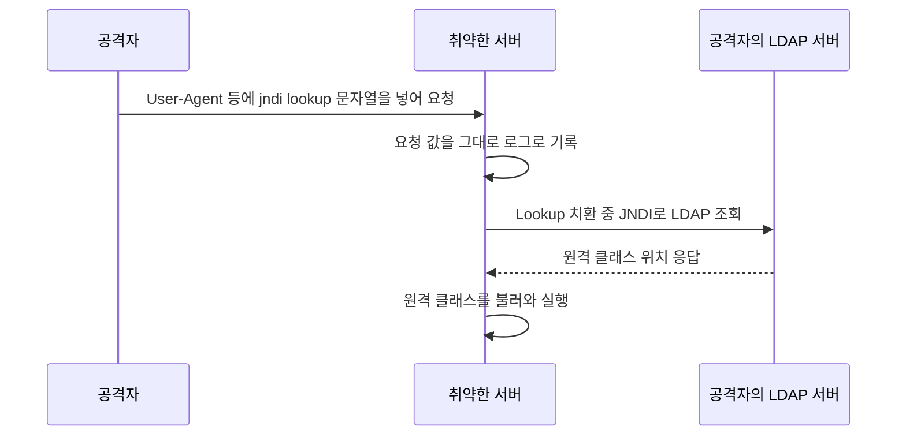

## 무엇이 문제였나

Log4j 취약점은 보통 `Log4Shell`로 불린다. 핵심은 로그 메시지 안의 특정 문자열이 원격 조회로 이어질 수 있었고, 그 결과 원격 코드 실행까지 이어질 수 있었다는 점이다.

가장 널리 알려진 이슈는 `CVE-2021-44228`이다.

NVD에는 2021년 12월 10일에 등록되었고, 같은 날 CISA의 '실제 악용이 확인된 취약점(KEV)' 목록에도 올랐다([NVD, CVE-2021-44228](https://nvd.nist.gov/vuln/detail/CVE-2021-44228)). Apache Logging 보안 페이지는 CVSS 3.1 점수를 최고점인 10.0(CRITICAL)으로 매기고, 영향받는 구성 요소를 `log4j-core`로 명시한다([Apache Logging Services, Security](https://logging.apache.org/security.html)).

## 어떻게 동작했나

Log4j 2에는 Lookup이라는 기능이 있다. `${prefix:key}` 형태의 표현식을 만나면 prefix에 해당하는 조회기로 값을 찾아 치환한다. 예를 들어 `${env:HOME}`은 환경 변수를, `${sys:user.name}`은 시스템 프로퍼티를 읽는다. 조회기 목록에는 JNDI(Java Naming and Directory Interface, 이름으로 원격 객체나 디렉터리 정보를 찾는 Java API)를 쓰는 `jndi`도 있었다([Log4j Manual, Lookups](https://logging.apache.org/log4j/2.x/manual/lookups.html)).

문제는 이 치환이 설정 파일뿐 아니라 로그 메시지와 그 파라미터에도 적용되었다는 점이다. Apache의 설명에 따르면 JNDI 기능은 공격자가 제어하는 LDAP 등의 JNDI 엔드포인트로부터 보호되지 않았고, 로그 메시지나 파라미터를 제어할 수 있는 공격자는 LDAP 서버에서 불러온 임의의 코드를 실행할 수 있었다.

서버가 하는 일은 "받은 헤더 값을 로그로 남긴다"뿐이다. 사용자 입력을 로그에 남기는 코드는 거의 모든 서비스에 있으므로, 로그에 찍히는 값이라면 어디든 공격 입구가 될 수 있었다.

## 왜 영향이 컸나

이 취약점이 크게 퍼진 이유는 세 가지다.

- Log4j 2가 매우 널리 사용됐다.
- 단순 문자열 입력만으로도 트리거될 수 있었다.
- 서버 내부까지 깊이 포함된 라이브러리라 탐지가 어려웠다.

즉 애플리케이션 코드에서 Log4j를 직접 쓰지 않아도, 의존성 트리 어딘가에 포함돼 있으면 영향을 받을 수 있었다.

반대로 영향이 없는 경우도 구분해야 한다. Apache는 이 취약점이 `log4j-core` JAR에만 해당하고, `log4j-api`만 쓰고 `log4j-core`가 없는 애플리케이션은 영향을 받지 않는다고 밝혔다. Log4j 1은 Lookup 기능이 없어 위험이 낮지만, 설정에서 JNDI를 쓰는 `JMSAppender`를 쓰면 별도 취약점(CVE-2021-4104)에 해당한다. 또한 Log4j 1은 2015년에 지원이 끝나 이후 보고된 취약점은 검토도 수정도 되지 않는다. Spring Boot는 스타터를 쓰면 기본으로 Logback을 쓰므로([Spring Boot Reference, Logging](https://docs.spring.io/spring-boot/reference/features/logging.html)), Log4j 2 스타터로 바꾸지 않은 프로젝트라면 `log4j-core`가 어디서 들어왔는지부터 확인하는 것이 순서다. 로깅 라이브러리 간의 관계는 [Log4j vs Logback vs Log4j2](/posts/log4j-logback-log4j2/)에 정리했다.

## 한 번의 패치로 끝나지 않았다

첫 수정 버전인 2.15.0 이후에도 관련 취약점이 이어서 나왔다. Apache 보안 페이지 기준으로 정리하면 다음과 같다(Java 8 이상용 버전).

| CVE | 내용 | CVSS | 수정 버전 |
| --- | --- | --- | --- |
| CVE-2021-44228 | 메시지의 JNDI Lookup으로 원격 코드 실행 | 10.0 | 2.15.0 |
| CVE-2021-45046 | 2.15.0의 수정이 기본값이 아닌 설정(Thread Context Lookup)에서 불완전 | 9.0 | 2.16.0 |
| CVE-2021-45105 | 자기 참조 Lookup으로 무한 재귀, `StackOverflowError`로 프로세스 종료 | 5.9 | 2.17.0 |

NVD 설명에 따르면 2.15.0에서는 메시지 Lookup 치환이 기본으로 꺼졌고, 2.16.0에서는 이 기능이 완전히 제거되었다. Java 7과 Java 6 환경을 위해서는 각각 2.12.x, 2.3.x 계열의 별도 보안 릴리스가 나왔다. 처음 2.15.0으로 올린 서비스도 후속 수정이 나올 때마다 다시 올려야 했다는 뜻이다.

## 실무 대응 포인트

실제 대응은 다음 순서로 이뤄진다.

1. 사용 중인 Log4j 버전 확인
2. 직접/간접 의존성 포함 여부 확인
3. 안전한 버전으로 업그레이드
4. 취약 기능 비활성화 여부 검토
5. 침해 흔적과 이상 로그 점검

보안 사고에서 중요한 것은 "우리 코드에 직접 import가 없었다"가 아니라 **배포 산출물에 포함됐는가**다.

각 단계를 구체적으로 보면 이렇다.

- 1~2단계는 소스가 아니라 빌드 결과를 봐야 한다. Gradle이라면 `./gradlew dependencies`, Maven이라면 `mvn dependency:tree`로 간접 의존성까지 펼쳐 보고, 이미 배포된 JAR나 컨테이너 이미지 안에 `log4j-core`가 들어 있는지도 확인한다. 직접 만든 애플리케이션이 아니라 함께 배포되는 미들웨어나 도구가 Log4j를 품고 있을 수도 있다.
- 3단계는 그 시점의 최신 보안 버전으로 올린다. 위 표처럼 수정이 이어졌으므로 "2.15.0 이상"이 아니라 보안 페이지가 안내하는 최신 버전을 기준으로 삼아야 한다.
- 4단계는 당장 업그레이드할 수 없을 때의 임시 조치다. 임시 조치는 이후 발견된 변형까지 막아 준다는 보장이 없으므로, 업그레이드를 대신할 수 없다.
- 5단계는 패치와 별개다. 패치 전에 이미 공격이 들어왔을 수 있으므로, 접근 로그에서 `${jndi:` 같은 패턴이 담긴 요청과 서버에서 바깥 LDAP 서버로 나간 연결을 찾아봐야 한다.

## 배운 점

- 로깅 라이브러리도 공격 표면이 될 수 있다.
- 의존성 관리는 기능 관리가 아니라 보안 관리이기도 하다.
- SBOM, 취약점 스캐너, 의존성 점검 체계가 중요하다.

SBOM(Software Bill of Materials)은 소프트웨어에 들어간 구성 요소와 버전의 목록이다. 이런 사건에서 가장 먼저 답해야 하는 질문은 "우리 서비스 중 어디에 `log4j-core`가 들어 있는가"인데, 배포 산출물마다 SBOM을 만들어 두면 이 질문이 목록 검색 한 번으로 줄어든다.

## 정리

Log4j 취약점은 단일 라이브러리 문제를 넘어, 현대 애플리케이션이 오픈소스 의존성에 얼마나 깊게 기대고 있는지를 드러낸 사건이었다. 운영 중인 서비스라면 기능 코드뿐 아니라 의존성 공급망까지 같이 관리해야 한다.

## 참고

- [Security Vulnerabilities](https://logging.apache.org/security.html) — Apache Logging Services
- [CVE-2021-44228](https://nvd.nist.gov/vuln/detail/CVE-2021-44228) — NVD
- [Lookups](https://logging.apache.org/log4j/2.x/manual/lookups.html) — Apache Log4j 2 Manual
- [Logging](https://docs.spring.io/spring-boot/reference/features/logging.html) — Spring Boot Reference
