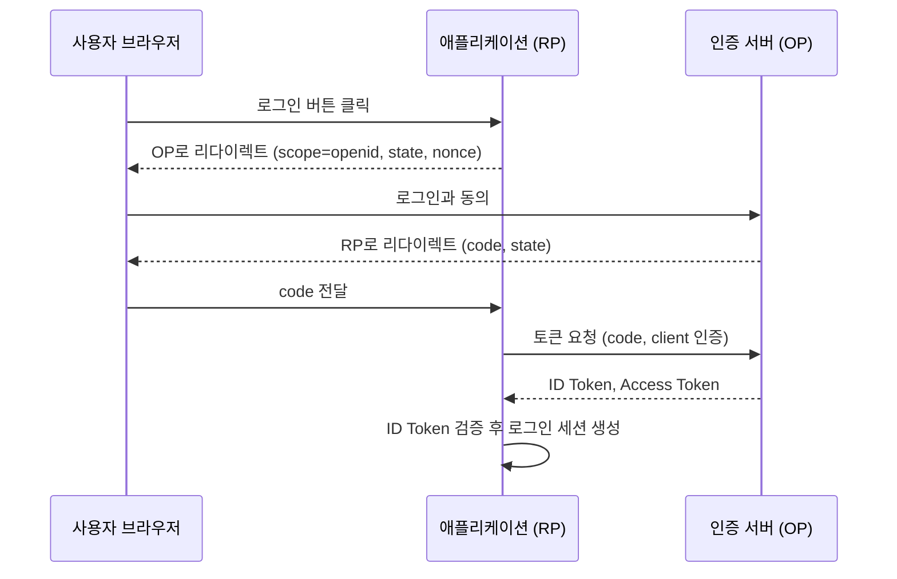

## OpenID Connect란

OpenID Connect, 줄여서 `OIDC`는 OAuth 2.0 위에 사용자 인증 계층을 올린 규격이다. OAuth 2.0이 "권한 위임"에 집중한다면, OIDC는 "이 사용자가 누구인가"를 표준 방식으로 전달한다.

즉 OIDC는 로그인 문제를 다룬다.

명세의 소개 문장도 같은 말을 한다. OpenID Connect 1.0은 OAuth 2.0 프로토콜 위의 단순한 신원(identity) 계층이고, 클라이언트가 인가 서버의 인증 결과를 바탕으로 최종 사용자의 신원을 확인하고 기본 프로필 정보를 얻게 해 준다([OpenID Connect Core 1.0](https://openid.net/specs/openid-connect-core-1_0.html)).

명세에서 쓰는 용어 몇 개를 먼저 정리한다.

- OP(OpenID Provider): 사용자를 인증하고 ID Token을 발급하는 쪽이다. 소셜 로그인 제공자나 사내 인증 서버가 여기에 해당한다.
- RP(Relying Party): OP의 인증 결과를 믿고 사용자를 로그인시키는 애플리케이션이다. OAuth 2.0의 클라이언트에 해당한다.
- End-User: 로그인하는 사람이다.

---

## OAuth 2.0만으로는 부족한 이유

OAuth 2.0 토큰만으로는 리소스 접근 권한 위임은 가능하지만, 그 토큰이 누구를 의미하는지 애플리케이션이 일관된 방식으로 해석하기 어렵다.

Access Token은 리소스 서버에 보여 주라고 발급된 것이다. 형식도 정해져 있지 않아, 어떤 제공자는 [JWT](/posts/jwt-vs-opaque-tokens/)를 주고 어떤 제공자는 의미 없는 문자열을 준다. 애플리케이션이 Access Token을 받았다는 사실만으로 "이 사용자가 방금 우리 앱에 로그인했다"고 판단하면, 다른 앱을 위해 발급된 토큰을 들고 온 공격자도 로그인시킬 수 있다. 로그인에는 "누구를 위해, 언제, 어느 앱을 위해 발급됐는가"를 확인할 수 있는 별도의 증명이 필요하다.

OIDC는 이를 위해 다음을 표준화했다.

- `ID Token`
- `UserInfo Endpoint`
- 인증 요청 파라미터와 응답 규약

---

## 핵심 요소

### ID Token

사용자 식별 정보를 담는 토큰이다. 보통 JWT 형식으로 전달되며, `sub`, `iss`, `aud`, `exp` 같은 클레임을 포함한다.

명세는 ID Token이 JWS로 서명되어야 한다고 정하고, 필수 클레임을 다음과 같이 정의한다.

| 클레임 | 의미 |
| --- | --- |
| `iss` | 발급자(Issuer) 식별자. `https` URL이다 |
| `sub` | 발급자 안에서 사용자를 식별하는 값. 재할당되지 않는다 |
| `aud` | 이 토큰을 받을 대상. RP의 `client_id`가 반드시 들어 있다 |
| `exp` | 만료 시각. 이 시각 이후에는 토큰을 받아들이면 안 된다 |
| `iat` | 발급 시각 |

인증 요청에 `nonce`를 보냈다면 ID Token에도 같은 값이 들어온다. 이 값으로 토큰이 지금 이 로그인 요청에 대한 응답인지 확인해 재전송 공격을 막는다.

`sub`만으로 사용자를 식별하면 안 된다는 점도 명세에 있다. `sub`는 발급자 안에서만 고유하므로, `iss`와 `sub`를 함께 써야 사용자에 대한 안정적인 식별자가 된다(명세 5.7절). 여러 OP를 지원하는 서비스라면 회원 테이블의 외부 계정 키를 `(iss, sub)` 쌍으로 둔다. 이메일은 사용자가 바꿀 수 있으므로 식별자로 쓰지 않는다.

### UserInfo Endpoint

필요하면 별도 API 호출로 사용자 프로필 정보를 가져올 수 있다.

RP는 토큰 응답으로 받은 Access Token을 이 엔드포인트에 보내고, 이름이나 이메일 같은 클레임을 JSON으로 받는다. ID Token에 모든 프로필을 넣지 않고 필요할 때 조회하게 해 토큰 크기를 작게 유지할 수 있다.

### Scope

`openid` 스코프가 반드시 포함돼야 OIDC 흐름으로 간주된다. 추가로 `profile`, `email` 같은 스코프를 통해 필요한 사용자 정보를 요청할 수 있다.

---

## Authorization Code Flow

명세는 인증 경로를 세 가지로 나눈다. Authorization Code Flow(`response_type=code`), Implicit Flow(`response_type=id_token token` 또는 `id_token`), 그리고 다른 응답 타입을 조합하는 Hybrid Flow다. 서버를 가진 웹 애플리케이션에서 가장 흔히 쓰는 것은 Authorization Code Flow다.

이 흐름에서 토큰은 브라우저를 거치지 않고 RP 서버와 OP 사이에서 직접 오간다. 브라우저 주소창에 남는 것은 한 번 쓰고 버리는 `code`뿐이다.

---

## ID Token 검증

RP는 받은 ID Token을 그대로 믿지 않고 검증해야 한다. 명세 3.1.3.7절의 검증 단계 중 핵심은 다음과 같다.

1. `iss`가 OP의 발급자 식별자와 정확히 일치하는가.
2. `aud`에 자기 `client_id`가 들어 있는가. 신뢰하지 않는 다른 대상이 함께 들어 있으면 거부한다.
3. 서명이 OP가 제공한 키로 검증되는가. 토큰 엔드포인트와 직접 통신해 받은 경우에는 TLS 서버 검증으로 발급자 확인을 대신할 수 있다고 명세는 허용한다.
4. 현재 시각이 `exp` 이전인가.
5. 요청에 보낸 `nonce`와 토큰의 `nonce`가 같은가.

OP의 발급자 식별자, 토큰 엔드포인트, 서명 키 위치(`jwks_uri`) 같은 정보는 보통 `/.well-known/openid-configuration` 문서에서 얻는다([OpenID Connect Discovery 1.0](https://openid.net/specs/openid-connect-discovery-1_0.html)).

---

## 어디에 쓰이나

- 소셜 로그인
- 기업 SSO
- 사내 통합 로그인
- 여러 서비스 간 공통 로그인

즉 인증 서버와 애플리케이션을 분리하는 구조에서 자주 등장한다. 여러 애플리케이션이 같은 OP를 쓰면 한 번 로그인으로 모두 이용하는 [Single Sign-On](/posts/single-sign-on/)이 된다.

---

## 자주 하는 실수

- Access Token을 로그인 증명으로 쓰기: Access Token은 API 호출용이다. 로그인 여부는 ID Token으로 판단한다.
- ID Token을 API 호출에 쓰기: 반대 방향의 실수다. ID Token의 `aud`는 RP 자신이므로 다른 API 서버가 받아들일 토큰이 아니다.
- `state`와 `nonce` 생략: 명세는 `state`를 요청과 콜백 사이의 상태를 유지하는 값으로, 보통 브라우저 쿠키와 묶어 CSRF를 막는 데 쓴다고 설명한다. `nonce`는 ID Token 재전송 공격을 완화하는 값이다. 둘 다 요청마다 새로 만들어 세션에 보관했다가 응답과 비교한다.
- 로그인 이후의 상태: ID Token 검증이 끝나면 RP는 자체 세션이나 토큰으로 로그인 상태를 유지한다. ID Token의 만료 시각은 RP와 OP 사이의 로그인 세션 수명과 무관하다고 명세가 따로 적어 둔다. 세션과 토큰의 차이는 [Session and JWT](/posts/session-and-jwt/)에 정리했다.

---

## 정리

OIDC는 OAuth 2.0을 대체하는 규격이 아니라, 그 위에 인증 정보를 얹는 표준이다. 외부 로그인이나 통합 인증을 붙일 때는 OAuth와 OIDC를 구분해서 이해해야 한다.

## 참고

- [OpenID Connect Core 1.0](https://openid.net/specs/openid-connect-core-1_0.html) — OpenID Foundation
- [OpenID Connect Discovery 1.0](https://openid.net/specs/openid-connect-discovery-1_0.html) — OpenID Foundation
