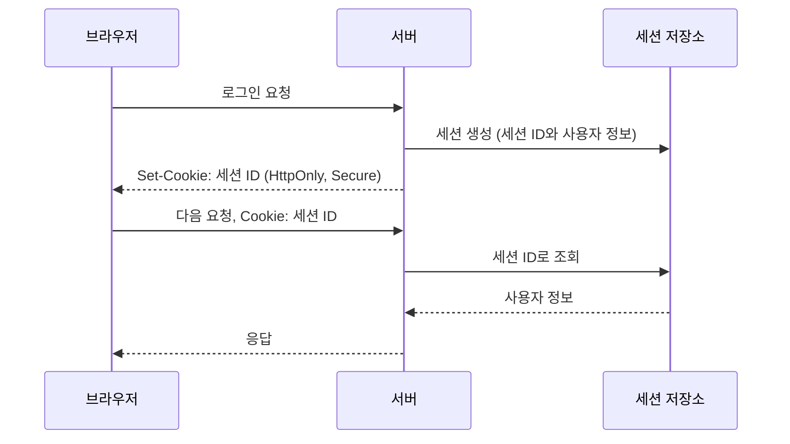

## 두 방식의 공통점

세션과 JWT는 모두 "HTTP가 기본적으로 상태를 기억하지 않는다"는 문제를 보완하기 위한 장치다. 사용자가 로그인한 뒤 다음 요청에서도 인증 상태를 이어가려면, 서버나 토큰 어딘가에 인증 정보를 유지해야 한다.

둘의 차이는 그 정보를 "어디에" 두느냐다. 세션은 서버에 두고 클라이언트에는 그것을 찾는 열쇠만 준다. JWT는 정보 자체를 서명해서 클라이언트에게 들려 보낸다. 인증 일반은 [Authentication](/posts/authentication/)에, 토큰 방식 전반은 [Token Authentication](/posts/token-authentication/)에 정리했다.

---

## 세션 기반 인증

세션 방식에서는 서버가 로그인 상태를 저장한다.

흐름은 보통 다음과 같다.

1. 사용자가 로그인 요청을 보낸다.
2. 서버가 인증에 성공하면 세션 저장소에 로그인 상태를 만든다.
3. 브라우저에는 세션 ID가 담긴 쿠키를 내려준다.
4. 이후 요청마다 쿠키가 함께 전달된다.
5. 서버는 세션 ID로 사용자 상태를 조회한다.

장점:

- 서버가 즉시 로그인 상태를 폐기하기 쉽다.
- 권한 변경과 강제 로그아웃에 유리하다.
- 민감한 정보를 토큰에 담지 않아도 된다.

단점:

- 서버나 세션 저장소가 상태를 유지해야 한다.
- 분산 환경에서 세션 공유 전략이 필요하다.

### 세션 ID를 안전하게 다루는 법

세션 방식의 보안은 결국 세션 ID를 지키는 문제다. 세션 ID를 손에 넣은 사람은 그 사용자로 인정받기 때문이다. OWASP Session Management Cheat Sheet가 권하는 기본은 다음과 같다([OWASP Session Management Cheat Sheet](https://cheatsheetseries.owasp.org/cheatsheets/Session_Management_Cheat_Sheet.html)).

- 세션 ID는 최소 64비트 엔트로피를 갖도록 암호학적으로 안전한 난수로 만들고, 그 자체로는 아무 의미도 담지 않는다. 사용자 정보는 서버 쪽 세션에만 둔다.
- 쿠키에 `Secure`(HTTPS로만 전송), `HttpOnly`(JavaScript의 `document.cookie`로 읽을 수 없음), `SameSite`(다른 사이트에서 시작된 요청에 쿠키를 싣지 않음, CSRF 방어)를 붙인다.
- 로그인처럼 권한 수준이 바뀌는 시점에는 세션 ID를 새로 발급한다. 그래야 공격자가 미리 심어 둔 세션 ID를 피해자가 그대로 쓰게 만드는 세션 고정 공격을 막는다.
- 로그아웃 시에는 쿠키만 지우지 말고 서버에서 세션을 실제로 무효화한다(Java Servlet이라면 `HttpSession.invalidate()`). 쿠키 삭제만으로는 이미 탈취된 세션 ID가 계속 유효하다.
- 일정 시간 활동이 없으면 끊는 유휴 타임아웃과, 활동과 무관한 최대 수명인 절대 타임아웃을 서버에서 강제한다.

### 분산 환경에서의 세션

서버가 여러 대이면 1번 서버에서 만든 세션을 2번 서버가 모른다. 해결 방법은 크게 둘이다. 같은 사용자의 요청을 항상 같은 서버로 보내는 방법(sticky session)은 단순하지만, 그 서버가 죽으면 세션이 사라지고 부하가 고르게 나뉘지 않을 수 있다. 세션을 Redis 같은 공용 저장소에 두는 방법은 어느 서버로 가도 같은 세션을 읽지만, 모든 요청이 저장소를 조회하므로 저장소가 새로운 의존 대상이자 장애 지점이 된다.

---

## JWT 기반 인증

JWT 방식에서는 인증 정보를 토큰 안에 담아 전달한다. 서버는 토큰 서명과 만료 시간을 검증하고, 별도의 세션 조회 없이 요청을 처리할 수 있다.

RFC 7519는 JWT를 두 당사자 사이에 클레임(claim)을 전달하기 위한 간결하고 URL에 안전한 표현으로 정의한다([RFC 7519](https://www.rfc-editor.org/rfc/rfc7519.html)). 서명된 JWT는 `헤더.페이로드.서명` 세 부분을 base64url로 인코딩해 점으로 잇는다. 페이로드에는 표준으로 등록된 클레임과 애플리케이션이 정한 클레임이 들어간다.

| 클레임 | 의미 |
| --- | --- |
| `iss` | 발급자 |
| `sub` | 주체(보통 사용자 ID) |
| `aud` | 이 토큰을 받아야 할 대상 |
| `exp` | 만료 시각 |
| `iat` | 발급 시각 |
| `jti` | 토큰 고유 ID |

서버가 토큰을 받으면 최소한 서명이 올바른지, `exp`가 지나지 않았는지, `iss`와 `aud`가 기대한 값인지를 확인해야 한다. 서명만 보고 `aud`를 확인하지 않으면, 같은 키로 서명된 다른 서비스용 토큰을 받아들이게 된다.

장점:

- 서버가 상태를 덜 가지는 구조에 유리하다.
- 서비스 간 토큰 전달이 쉽다.
- 로컬 검증이 가능해 확장성이 좋다.

단점:

- 발급한 토큰을 즉시 폐기하기 어렵다.
- 토큰 크기가 커질 수 있다.
- 만료 전략과 재발급 전략이 중요하다.

단점들은 JWT의 구조에서 바로 나온다. 서버가 저장소를 조회하지 않고 서명만으로 판단하므로, 서버 쪽에서 "이 토큰은 이제 무효"라고 표시할 곳이 없다. 즉시 폐기가 필요하면 폐기된 `jti` 목록을 따로 두고 조회해야 하는데, 그러면 세션 방식처럼 요청마다 저장소를 보게 된다. 그래서 보통은 access token의 만료를 짧게 두고, 만료되면 refresh token으로 새로 받는 방식으로 폐기 지연의 범위를 줄인다.

또 서명된 JWT의 페이로드는 암호화된 것이 아니라 인코딩되어 있을 뿐이라 누구나 읽을 수 있다. 세션 방식의 장점에서 "민감한 정보를 토큰에 담지 않아도 된다"는 항목이 바로 이 차이다.

### 토큰은 어디에 보관하는가

브라우저에서 JWT를 쓸 때는 보관 위치도 결정해야 한다. `localStorage`에 두면 페이지의 JavaScript가 언제든 읽을 수 있으므로, XSS(악성 스크립트 삽입) 취약점이 하나만 있어도 토큰이 유출된다. `HttpOnly` 쿠키에 두면 스크립트로 읽을 수 없지만, 브라우저가 쿠키를 자동으로 실어 보내므로 세션 쿠키와 마찬가지로 `SameSite` 같은 CSRF 대책이 필요하다. 쿠키에 담는 순간 전달 방식은 세션과 비슷해지고, 차이는 서버가 저장소를 조회하는지에만 남는다.

---

## 무엇을 기준으로 고를까

다음 질문으로 판단하면 된다.

- 강제 로그아웃이 자주 필요한가
- 여러 서비스에서 토큰 검증이 자주 일어나는가
- 중앙 세션 저장소 운영 비용을 감당할 수 있는가
- 짧은 만료와 재발급 전략을 설계할 수 있는가

| 항목 | 세션 | JWT |
| --- | --- | --- |
| 인증 상태 위치 | 서버 세션 저장소 | 토큰 자체 |
| 요청마다 저장소 조회 | 필요 | 불필요 |
| 즉시 폐기 | 세션 삭제로 바로 가능 | 만료까지 유효(폐기 목록을 두면 조회 필요) |
| 클라이언트에 노출되는 정보 | 의미 없는 ID | 디코딩 가능한 클레임 |
| 여러 서비스에서 검증 | 저장소 공유 필요 | 검증 키만 있으면 가능 |

JWT와 의미 없는 문자열 토큰(opaque token)의 비교는 [JWT vs Opaque Token](/posts/jwt-vs-opaque-tokens/)에서 이어서 다룬다.

---

## 정리

세션은 통제에 강하고, JWT는 분산 검증에 강하다. 둘 중 하나가 항상 우월한 것은 아니다. 인증 시스템에서 더 중요하게 보는 비용이 무엇인지에 따라 선택이 달라진다.

## 참고

- [OWASP Session Management Cheat Sheet](https://cheatsheetseries.owasp.org/cheatsheets/Session_Management_Cheat_Sheet.html) — OWASP Cheat Sheet Series
- [RFC 7519, JSON Web Token (JWT)](https://www.rfc-editor.org/rfc/rfc7519.html) — IETF
