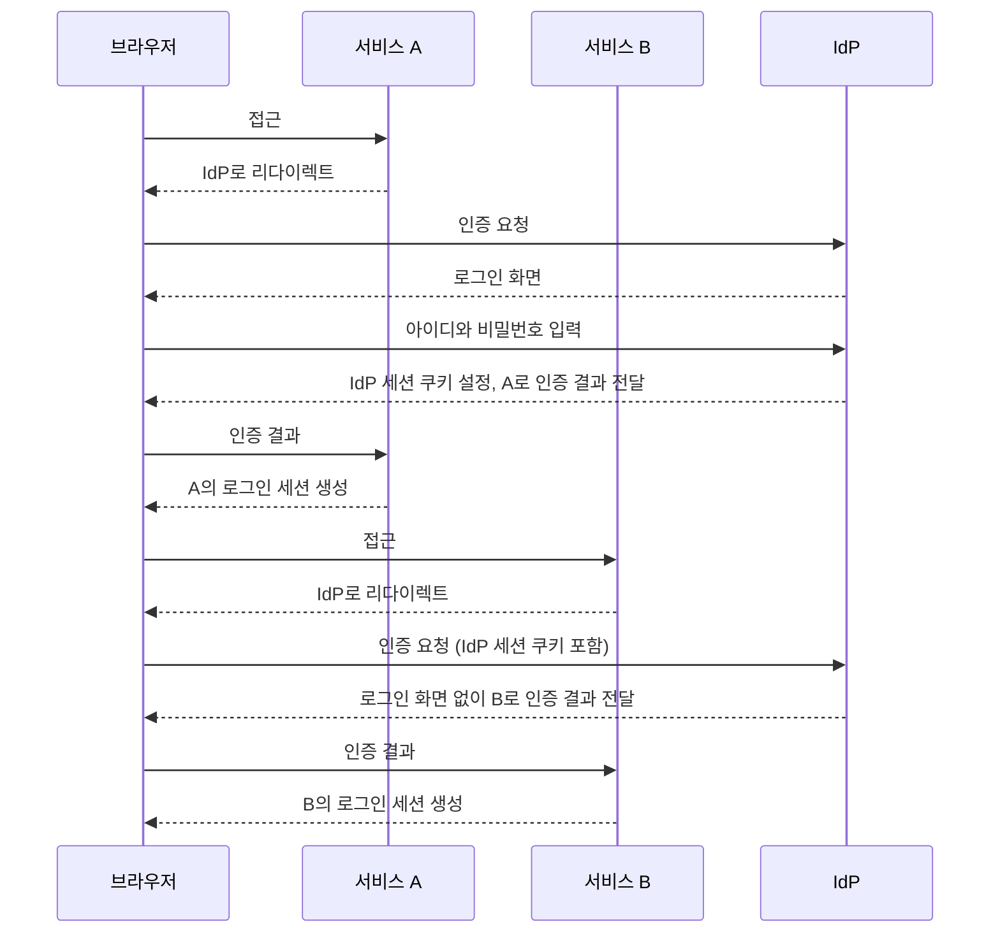

## SSO란

SSO, 즉 Single Sign-On은 한 번의 로그인으로 여러 시스템을 이용할 수 있게 하는 방식이다. 사용자는 애플리케이션마다 다시 로그인하지 않고, 중앙 인증 시스템이 발급한 인증 결과를 공유받는다.

용어를 먼저 맞춰 둔다. 사용자를 인증하는 중앙 시스템을 IdP(Identity Provider, 신원 제공자)라고 하고, IdP의 인증 결과를 믿고 서비스를 제공하는 애플리케이션을 SP(Service Provider)라고 한다. OIDC에서는 같은 역할을 각각 OP와 RP라고 부른다.

## 왜 필요한가

서비스가 여러 개로 늘어나면 각각의 로그인 화면과 사용자 저장소를 따로 운영하는 것이 비효율적이다.

SSO를 도입하면:

- 사용자 경험이 좋아진다.
- 계정 관리가 중앙화된다.
- 권한 회수와 보안 정책 적용이 쉬워진다.

세 번째 항목은 퇴사자 처리를 생각하면 분명해진다. 서비스마다 계정이 따로 있으면 모든 서비스에서 계정을 하나씩 비활성화해야 하고, 하나라도 빠뜨리면 그 서비스에는 계속 접근할 수 있다. SSO에서는 IdP 계정 하나를 막으면 새 로그인이 모든 서비스에서 막힌다. 다단계 인증 같은 정책도 IdP 한곳에 적용하면 된다.

## 일반적인 구조

구조는 보통 다음과 같다.

1. 사용자가 서비스 A에 접근한다.
2. 서비스 A는 중앙 인증 서버로 리다이렉트한다.
3. 사용자가 로그인하면 인증 서버가 토큰이나 세션을 발급한다.
4. 서비스 A는 이를 검증하고 로그인 상태를 만든다.
5. 이후 서비스 B에 접근해도 같은 인증 서버를 통해 재로그인 없이 처리된다.

즉 핵심은 개별 서비스가 인증을 직접 처리하지 않고, 신뢰할 수 있는 인증 제공자를 공유하는 것이다.

5단계에서 재로그인이 필요 없는 이유는 IdP가 자기 도메인에 로그인 세션을 쿠키로 남겨 두기 때문이다. 서비스 B도 사용자를 IdP로 리다이렉트하지만, 브라우저가 IdP에 그 세션 쿠키를 함께 보내므로 IdP는 로그인 화면 없이 바로 인증 결과를 돌려준다.

그림에서 보이듯 세션은 세 개다. IdP의 세션, 서비스 A의 세션, 서비스 B의 세션이다. SSO는 이 세션들을 하나로 합치는 것이 아니라, IdP 세션 하나로 각 서비스의 세션을 손쉽게 만들어 주는 구조다. 이 구분은 아래 로그아웃 문제에서 중요해진다.

## 자주 함께 나오는 표준

- `SAML`
- `OAuth 2.0`
- `OpenID Connect`

요즘 웹 서비스에서는 OIDC 기반 SSO를 많이 사용한다.

각 표준의 역할은 다르다.

- SAML: OASIS의 SAML 기술 개요는 SAML을 온라인 비즈니스 파트너 사이에서 보안 정보를 기술하고 교환하기 위한 XML 기반 프레임워크로 정의한다([SAML V2.0 Technical Overview](http://docs.oasis-open.org/security/saml/Post2.0/sstc-saml-tech-overview-2.0.html)). IdP가 서명한 XML 어설션(assertion)을 브라우저를 거쳐 SP에 전달한다. 기업용 SaaS와 사내 시스템 연동에서 오래 쓰여 왔다.
- OAuth 2.0: 권한 위임 규격이다. 그 자체는 사용자가 누구인지 전달하는 방법을 정하지 않으므로 단독으로는 SSO 규격이 아니다.
- OpenID Connect: OAuth 2.0 위에 ID Token과 사용자 정보 조회를 표준화한 신원 계층이다. JSON과 JWT를 쓰므로 웹과 모바일 앱에서 다루기 쉽다. 흐름과 ID Token 검증은 [OpenID Connect](/posts/openid-connect/)에 정리했다.

## 로그아웃이 로그인보다 어렵다

로그인은 IdP 세션 하나로 여러 서비스 세션을 만들면 끝나지만, 로그아웃은 반대로 흩어진 세션을 모두 정리해야 한다. 서비스 A에서 로그아웃 버튼을 눌러 A의 세션만 지우면, IdP 세션이 남아 있으므로 A에 다시 접근하는 순간 재로그인 없이 다시 로그인된다.

OIDC는 이 문제를 별도 명세로 다룬다.

- RP-Initiated Logout: RP가 OP에게 최종 사용자의 로그아웃을 요청하는 방법을 정의한다([RP-Initiated Logout 1.0](https://openid.net/specs/openid-connect-rpinitiated-1_0.html)).
- Front-Channel Logout: OP가 사용자 에이전트(브라우저)를 통해 각 RP에 로그아웃을 알린다([Front-Channel Logout 1.0](https://openid.net/specs/openid-connect-frontchannel-1_0.html)).
- Back-Channel Logout: OP가 브라우저를 거치지 않고 RP와 직접 통신해 로그아웃을 알린다([Back-Channel Logout 1.0](https://openid.net/specs/openid-connect-backchannel-1_0.html)).

브라우저를 통하는 방식은 사용자의 브라우저가 각 RP의 로그아웃 주소를 실제로 호출해야 전달되고, 서버 간 직접 통신 방식은 RP가 OP로부터 요청을 받을 수 있는 엔드포인트를 열어 두어야 한다. 어느 쪽이든 각 서비스가 "이 사용자의 세션을 지운다"는 처리를 구현해야 전체 로그아웃이 완성된다.

## 도입할 때 생각할 것

- IdP는 단일 장애점이 된다. IdP가 멈추면 이미 로그인한 사용자는 각 서비스 세션으로 버티지만, 새 로그인은 모든 서비스에서 막힌다.
- 세션 수명을 계층별로 정한다. IdP 세션, 서비스 세션, 토큰 만료가 각각 다르면 "로그아웃했는데 왜 아직 들어가지는가" 같은 문의가 생긴다.
- 권한은 여전히 각 서비스의 몫이다. SSO는 "누구인가"를 공유할 뿐, 그 사용자가 서비스 안에서 무엇을 할 수 있는지는 각 서비스가 판단한다.

## 정리

SSO는 로그인 화면을 하나로 줄이는 기능이 아니라, **인증 책임을 중앙화하는 아키텍처 선택**이다. 서비스가 여러 개로 나뉘는 순간, 사용자 경험과 보안 운영 모두에서 효과가 커진다.

## 참고

- [SAML V2.0 Technical Overview](http://docs.oasis-open.org/security/saml/Post2.0/sstc-saml-tech-overview-2.0.html) — OASIS
- [OpenID Connect Core 1.0](https://openid.net/specs/openid-connect-core-1_0.html) — OpenID Foundation
- [OpenID Connect RP-Initiated Logout 1.0](https://openid.net/specs/openid-connect-rpinitiated-1_0.html) — OpenID Foundation
- [OpenID Connect Front-Channel Logout 1.0](https://openid.net/specs/openid-connect-frontchannel-1_0.html) — OpenID Foundation
- [OpenID Connect Back-Channel Logout 1.0](https://openid.net/specs/openid-connect-backchannel-1_0.html) — OpenID Foundation
