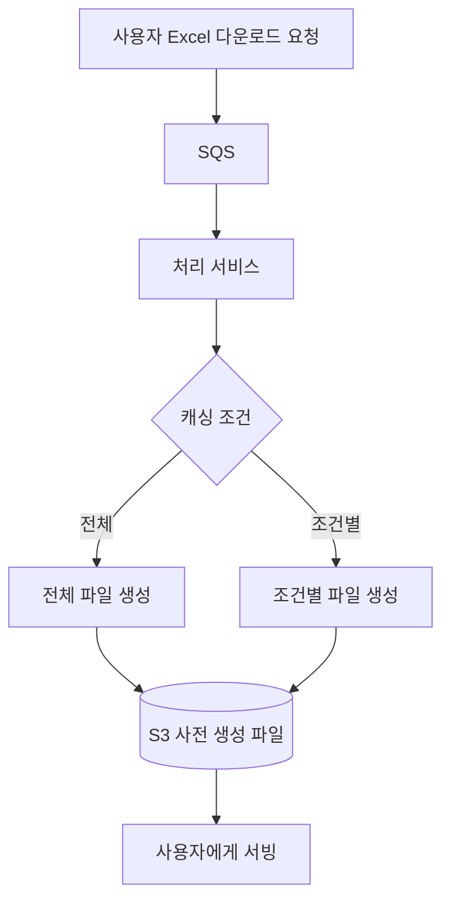
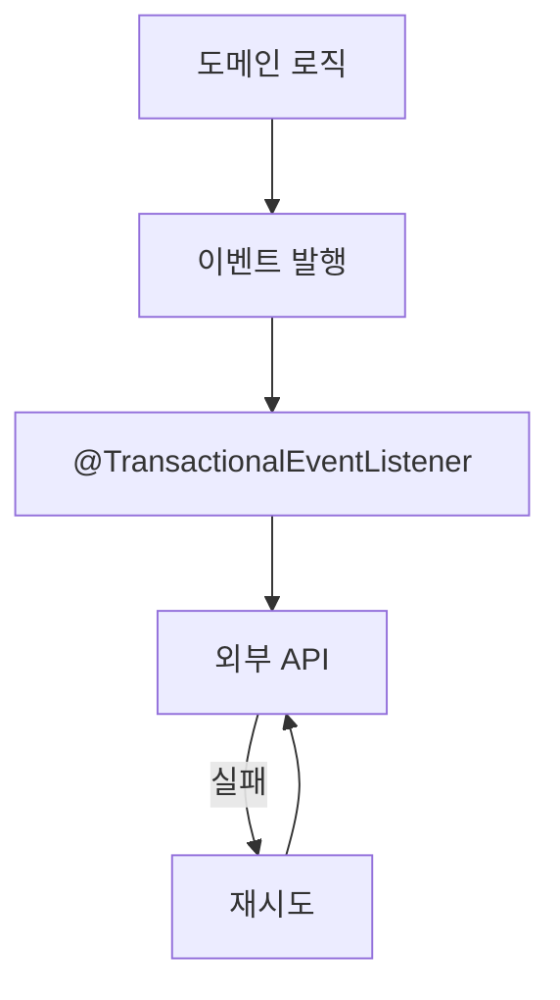

이력서에 적은 프로젝트를 기준으로 나올 만한 기술 질문, 화이트보드에서 그릴 수 있는 아키텍처, 백엔드 시스템 디자인 예상 문제를 정리한 준비 노트다.

## 이력서 기반 예상 질문

### 아키텍처와 시스템 디자인

1. MCP 개편에서 기존 시스템 구조의 어떤 점이 문제였고, 어떻게 리팩토링했는가.
2. 대용량 음원 데이터를 안정적으로 처리하기 위한 구조를 설계할 때 고려한 점은 무엇인가.
3. MDS 프로젝트에서 CQRS 패턴을 적용한 이유는 무엇이며, 이 패턴이 어떤 문제를 해결했는가.
4. 계약 코드 생성 성능 병목을 어떻게 개선했고, 이 설계가 안전한 이유는 무엇인가.
5. 분산 락(DB 기반, Redis 기반) 각각의 장단점과 사용 상황에 대한 판단 기준은 무엇이었는가.
6. Spring Batch 기반 배치 시스템에서 OOM이나 GC 병목을 해결한 방법과 그 효과는 무엇인가.
7. 패키지 구조를 Package by Component로 구성한 이유와 이 방식의 장단점은 무엇인가.
8. ISMS 인증 대응 시 어떤 보안 아키텍처 개선을 했고, 왜 그것이 효과적이었는가.

### 성능과 확장성

1. 2분에서 10초로 줄인 계약 생성 병목의 원인은 무엇이었고, 개선 포인트는 무엇인가.
2. 음원 API 응답 속도를 83% 줄인 구조적 방법은 무엇인가. 네트워크 오버헤드를 어떻게 줄였는가.
3. Excel 처리 시 메모리 사용량을 1.2GB에서 180MB로 줄인 기술적 전략은 무엇인가.
4. 레거시 API 통합 설계 시 어떤 기준으로 API를 통합하고 데이터 페이로드를 최적화했는가.

### 안정성과 운영 효율성

1. 정산 중 계약 변경이 발생할 때 데이터 정합성을 어떻게 보장했는가.
2. SQS 기반 Excel 자동화 구조에서 메시지 포맷 표준화가 중요한 이유는 무엇인가.
3. Redis 락의 해제 타이밍 문제를 어떻게 해결했고, 이를 일반화한다면 어떻게 할 수 있는가.
4. 외부 API와의 통신 안정성은 어떤 구조로 보장했는가.

### 협업과 의사결정

1. 기획자, 프론트엔드와 API를 통합할 때 갈등이나 트레이드오프가 있었는가. 그 과정은 어땠는가.
2. Package by Component 방식 도입을 팀 내에서 어떻게 설득하고 정착시켰는가.
3. 클라우드 전환 프로젝트에서 운영자나 다른 팀과 협업할 때 어려움은 없었는가.

## 화이트보드에서 설명할 수 있는 아키텍처

### MCP 3.0 개편: 복잡한 레거시를 모듈화한 정적 타입 구조

그릴 수 있는 요소는 다음과 같다.

- Swagger, DTO, Bean Validation 기반의 요청/응답 구조
- 도메인 레이어 분리 (예외 처리, 로그, 변경 이력 공통화)
- 계약 코드 생성 방식의 변화: `SELECT ... FOR UPDATE`, 캐싱, 낙관적 락 순서로 개선
- API 통합 구조와 불필요한 네트워크 요청 제거

InnoDB에서 `SELECT ... FOR UPDATE`는 읽은 행과 관련 인덱스 레코드에 `UPDATE`를 실행한 것과 같은 잠금을 걸고, 트랜잭션이 커밋되거나 롤백될 때까지 다른 트랜잭션의 갱신을 막는다([MySQL 8.4 Reference Manual, Locking Reads](https://dev.mysql.com/doc/refman/8.4/en/innodb-locking-reads.html)). 첫 단계의 병목을 설명할 때 이 성질을 근거로 쓴다.

설명할 포인트는 세 가지다.

- 정적 타입을 도입한 이유: 유지보수, 디버깅, 감사 추적 가능성
- 낙관적 락으로 성능과 정합성을 함께 확보한 이유
- 비정형 로직을 도메인 중심 구조로 정리한 경험

### MDS(음원 유통 시스템)

그릴 수 있는 요소는 다음과 같다.

- Package by Component 구조도
- CQRS 구조 (Command와 Query 분리)
- 읽기 DB와 쓰기 DB 분리
- ArchUnit, SonarCloud 적용 구조

CQRS는 정보를 갱신하는 모델과 읽는 모델을 다르게 두는 패턴이고, 두 모델이 같은 데이터베이스를 공유할 수도 있고 별도 데이터베이스를 쓸 수도 있다([Martin Fowler, CQRS](https://martinfowler.com/bliki/CQRS.html)). 그래서 읽기 DB와 쓰기 DB 분리는 CQRS의 필수 조건이 아니라 MDS에서 선택한 구성으로 설명한다.

설명할 포인트는 두 가지다.

- CQRS가 정산 안정성과 성능에 어떤 영향을 주었는가
- 아키텍처 품질 관리가 왜 중요한지를 실제 사례로

### 대용량 Excel 처리: 비동기 큐, 캐싱, S3 사전 생성

그릴 요소는 사용자의 Excel 다운로드 요청이 SQS를 거쳐 처리 서비스로 가고, 캐싱 조건에 따라 전체 또는 조건별로 파일을 만든 뒤, S3에 미리 생성해 둔 파일을 서빙하는 흐름이다.

설명할 포인트는 사용자 응답 속도와 처리 자원 사이의 트레이드오프, 그리고 어떤 파일을 미리 만들지 판단하는 캐시 로직과 예측 모델의 필요성이다.

### 크리에이터 스튜디오 외부 연동: 이벤트 기반 외부 API 호출

도메인에서 이벤트를 발행하고 `@TransactionalEventListener`가 외부 API를 호출하며, 실패하면 재시도한다.

`@TransactionalEventListener`는 기본적으로 트랜잭션의 커밋 단계(`AFTER_COMMIT`)에 묶이고, 실행 중인 트랜잭션이 없으면 `fallbackExecution`을 `true`로 두지 않는 한 호출되지 않는다([Spring Framework Reference, Transaction-bound Events](https://docs.spring.io/spring-framework/reference/data-access/transaction/event.html)). 외부 호출을 커밋 이후로 미루면 롤백된 데이터에 대해 외부 시스템이 먼저 갱신되는 상황을 막을 수 있다.

설명할 포인트는 외부 호출을 트랜잭션과 분리해야 하는 이유와 데이터 불일치를 방지한 구조적 전략이다.

## 백엔드 시스템 디자인 예상 문제

### 개인 자산 통합 관리 서비스

사용자가 여러 금융기관의 데이터를 연동해 자신의 자산 현황을 확인하는 서비스다.

- 주기적 데이터 수집과 실시간 연동 중 어느 방식을 택할지
- API rate limit 대응
- 외부 기관 API 실패 시 처리 전략
- 사용자 요청 응답 속도와 백그라운드 수집의 분리
- 민감 데이터 암호화와 보안 설계

### 대용량 정산 처리 시스템

월 단위로 수백만 건의 정산 데이터를 처리해야 하고, 처리 도중 계약 변경이나 이의 제기가 들어올 수 있다.

- 정산 처리 중 데이터 정합성 확보 (분산 락, 이중 검증 등)
- 배치와 실시간 처리의 분리 구조
- 이의 제기 후 수정 가능성에 대비한 버전 관리 또는 이력 저장
- 처리 시간 최적화 (청크 처리, 병렬성)

### 사용자 행동 로그 수집과 분석

앱 내 사용자 행동을 추적해 마케팅과 사용자 맞춤형 기능에 활용한다.

- 이벤트 수집, 큐, 비동기 파이프라인으로 이어지는 구조
- Kafka 또는 SQS 기반 수집 구조
- 실시간 분석과 비동기 분석의 경계
- 데이터 중복 방지와 일관성 유지
- Redshift, BigQuery, S3 저장소 구성

### 파일 기반 대용량 Excel 처리

100만 건 이상의 데이터를 Excel로 업로드하고 다운로드해야 한다.

- Excel 다운로드 요청을 큐 기반으로 비동기 처리
- Apache POI의 스트리밍 방식 사용
- S3에 미리 생성된 템플릿 캐싱
- 업로드 시 유효성 검증 분리 (pre-validation)
- 처리 결과 알림 구조 (Slack, 이메일 등)

Apache POI에서 쓰기 쪽 스트리밍은 SXSSF로, 슬라이딩 윈도우 안의 행만 메모리에 두고 나머지는 디스크로 내보낸다(기본 윈도우는 100행). 읽기 쪽에서 메모리가 문제라면 XSSF의 기반 XML을 이벤트 방식으로 직접 처리한다([Apache POI, Spreadsheet How-To](https://poi.apache.org/components/spreadsheet/how-to.html)). 다운로드와 업로드에 쓰는 API가 다르다는 점을 구분해서 말한다.

### API Gateway와 인증을 포함한 마이크로서비스 구조

여러 서비스가 독립적으로 배포되고 서로 통신하는 구조다.

- JWT 또는 OAuth2 기반 인증 흐름
- 사용자 권한 검증 위치 (Gateway와 서비스 내부 중 어디서 할지)
- 서비스 간 통신 방식 (REST, gRPC)
- 장애 전파 방지: Circuit Breaker, Retry, Timeout
- 로깅과 추적: Correlation ID, MDC, Kibana 연동

### 요청 처리량이 갑자기 급증하는 상황

예를 들어 특정 마케팅 이벤트로 트래픽이 평소의 20배로 늘어나는 경우다.

- Auto-scaling 정책
- 캐싱 전략 (Redis, CDN 등)
- 쓰기 요청 스로틀링
- 요청 큐잉과 지연 처리 (backpressure)
- 장애 대비 graceful degradation 설계

## 면접에서 설명하는 방식

이력서 질문과 시스템 디자인 문제에 공통으로 적용할 원칙을 하나로 모았다.

- 기술 이름보다 도입한 이유를 먼저 말한다. "왜 Redis가 아니라 DB 기반 락을 썼는가" 같은 의사결정 과정을 이야기 흐름으로 풀어야 한다.
- 숫자와 결과를 함께 말한다. 2분에서 10초, OOM 0건 같은 성능 지표가 설명의 설득력을 높인다.
- 항상 트레이드오프를 언급한다. "이 구조는 안정성은 확보되지만 비용이 약간 늘어난다", "성능은 좋지만 운영 복잡성이 올라간다"처럼 양면을 함께 말한다.
- 질문이 애매하면 요구사항을 다시 정의해 달라고 요청한다. 실시간인지 배치인지 같은 조건부터 확인한다.
- 고려할 요소를 확장성, 안정성 같은 관점별로 나눠서 말한다.
- 화이트보드에서는 흐름, 컴포넌트, 병목, 대응 방식 순서로 설명한다. 예를 들어 사용자의 Excel 요청이 큐에서 처리되고 응답이 반환되는 흐름부터 그린다.

## 참고

- [MySQL 8.4 Reference Manual, Locking Reads](https://dev.mysql.com/doc/refman/8.4/en/innodb-locking-reads.html)
- [Martin Fowler, CQRS](https://martinfowler.com/bliki/CQRS.html)
- [Spring Framework Reference, Transaction-bound Events](https://docs.spring.io/spring-framework/reference/data-access/transaction/event.html)
- [Apache POI, Spreadsheet How-To](https://poi.apache.org/components/spreadsheet/how-to.html)
