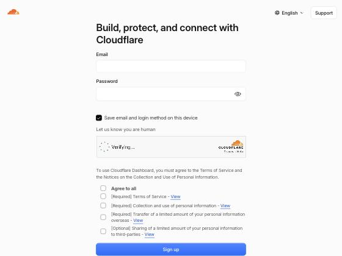
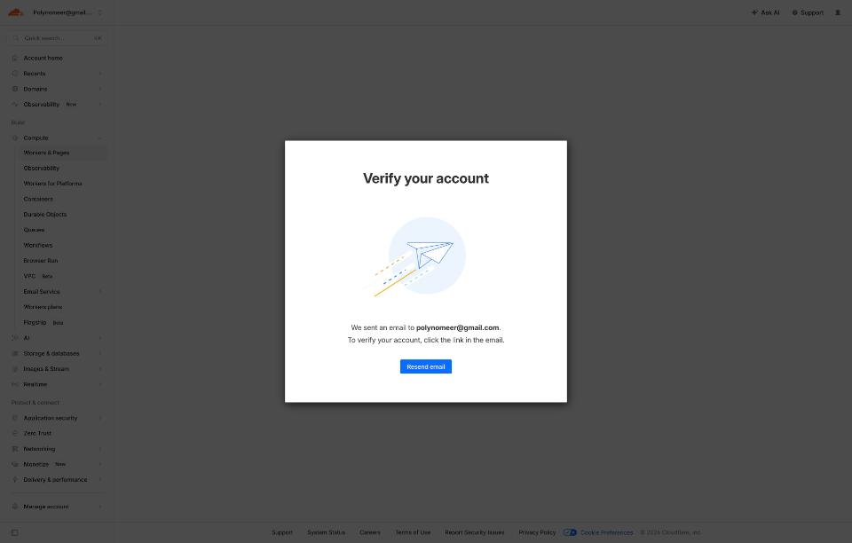
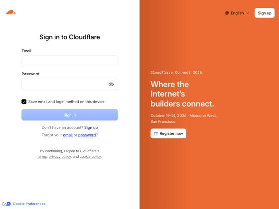
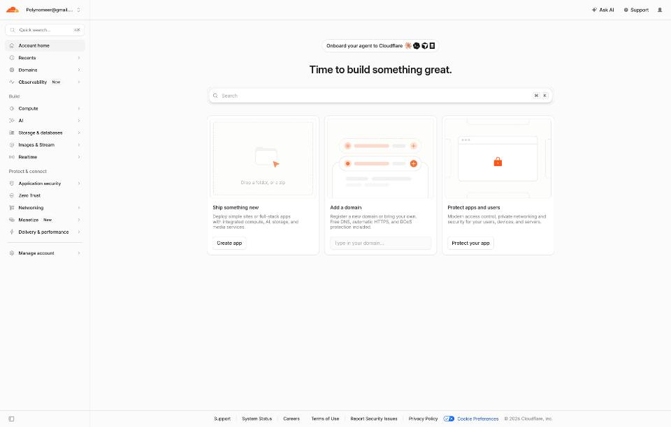
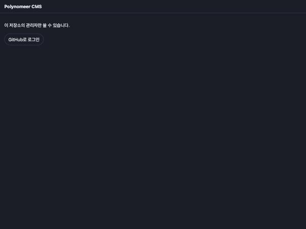
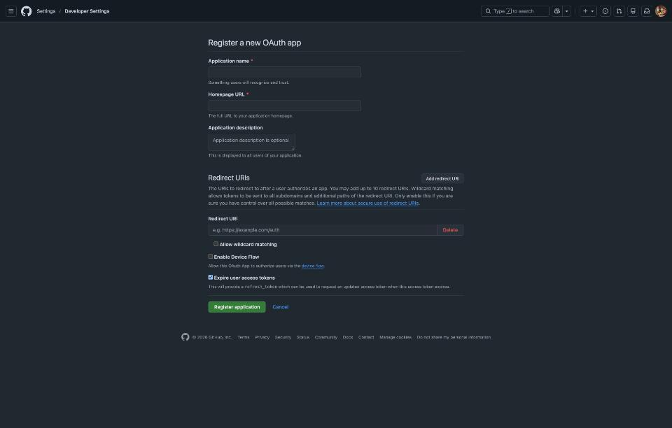
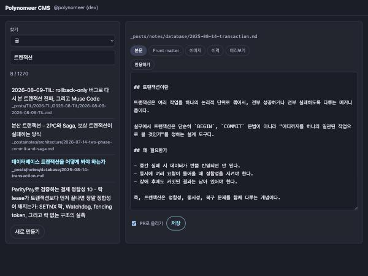

# CMS 배포 가이드

편집기(`cms/`)를 Cloudflare Workers 에 올리는 절차. 처음 한 번만 하면 된다.
올린 뒤의 사용법은 [`cms-usage-guide.md`](./cms-usage-guide.md), 왜 이렇게 만들었는지는
[`../features/cms-content-contract.md`](../features/cms-content-contract.md)에 있다.

## 이 문서의 스크린샷에 대해

전부 실제 화면이다. 지어낸 그림은 없다.

터미널 출력도 실제로 돌린 결과만 실었고, 형태만 적은 블록은 그렇다고 표시했다. 명령은
wrangler 4.147.0, GitHub·Cloudflare 화면은 2026-10-03 기준이다.

아직 못 찍은 화면이 두 개 있다. `wrangler` 의 권한 승인 페이지와, 실제로 배포될 때의 터미널
출력이다. 그 자리에는 무엇이 보일지 글로 적어 두었다.

## 무엇이 올라가는가

```
    브라우저
       │  https://polynomeer-cms.<...>.workers.dev
       ▼
 ┌─────────────────────────────┐
 │ Cloudflare Worker           │
 │                             │
 │  src/ui/*     편집 화면      │ ── 정적 파일 9개
 │  src/worker.js 로그인·커밋   │
 └──────┬───────────────┬──────┘
        │               │
        ▼               ▼
   GitHub OAuth     GitHub API
   (본인 확인)      (글 커밋 / PR)
                         │
                         ▼
                 polynomeer.github.io
                      저장소
```

| | |
| --- | --- |
| Worker | `cms/src/worker.js`. 로그인과 GitHub 커밋을 처리한다 |
| 정적 파일 | `cms/src/ui/` 의 아홉 개. 편집 화면 자체다 |
| GitHub OAuth App | 본인 확인용. GitHub 쪽에 따로 만든다 |
| secret 3개 | Cloudflare 에만 넣는다. git 에 올리지 않는다 |

데이터베이스도 Durable Object 도 R2 도 쓰지 않는다. 글은 저장소에 커밋되고, 그게 전부다.

## 준비물

- Cloudflare 계정 (무료 플랜으로 충분하다 — 1단계에서 만든다)
- Node — 이 저장소에서 쓰는 버전이면 된다
- 블로그 저장소를 소유한 GitHub 계정
- 터미널 15분

## 순서가 왜 이런가

이 절차에서 헷갈리는 지점은 하나뿐이다. **OAuth App 에는 Worker 주소가 필요한데, 그 주소는
배포해야 나온다.**

그래서 배포가 먼저다. secret 없이 올라간 Worker 는 고장난 게 아니다. 화면은 뜨고 로그인만 안
된다. 3단계에서 주소를 받고, 4~6단계에서 로그인을 붙인다.

```
1 가입 ──→ 2 wrangler login ──→ 3 배포 ──┐
                                        │ 주소를 받는다
                                        ▼
6 확인 ←── 5 secret 3개 ←── 4 OAuth App 만들기
```

---

## 1. Cloudflare 가입

<https://dash.cloudflare.com/sign-up> 에서 이메일과 비밀번호만 넣으면 끝난다. 카드도 도메인도
필요 없다.



동의 항목 중 **[Optional] 제3자 제공**은 체크하지 않아도 가입된다. 나머지 `[Required]` 세 개만
있으면 된다.

가입하면 확인 메일이 온다. **링크를 눌러 이메일을 인증한다.**

인증을 건너뛰면 대시보드에는 들어가지지만 Workers 를 쓰려는 순간 이 화면에서 막힌다.



메일을 못 받았으면 **Resend email** 을 누른다. 스팸함도 본다.

> **이미 계정이 있으면** 이 단계를 건너뛴다. <https://dash.cloudflare.com/login>
>
> 

인증까지 끝나면 대시보드가 이렇게 보인다.



**Add a domain** 이 눈에 띄지만 무시한다. 이 편집기는 `workers.dev` 하위 도메인을 쓰므로
도메인이 필요 없다. 왼쪽 **Compute → Workers & Pages** 가 나중에 배포된 Worker 가 보일 곳이다.

## 2. 터미널에서 Cloudflare 에 로그인

```bash
cd ~/Study/polynomeer.github.io/cms
npx wrangler login
```

`wrangler` 는 설치해 둘 필요가 없다. `npx` 가 알아서 받는다. 처음 한 번은 받느라 조금 걸린다.

브라우저가 열리고 **Allow** 를 누르면 터미널로 돌아온다.
*(찍지 못한 화면: Cloudflare 권한 승인 페이지. "Wrangler 가 계정에 접근하도록 허용할까요"
한 장이다.)*

된 건지 확인한다.

```bash
npx wrangler whoami
```

로그인 전에는 이렇게 나온다. 아래 내용이 보이면 아직 1~2단계가 안 끝난 것이다.

```
 ⛅️ wrangler 4.147.0
────────────────────
Getting User settings...
You are not authenticated. Please run `wrangler login`.
```

로그인됐으면 계정 이메일과 Account ID 가 표로 나온다.

## 3. 먼저 배포해서 주소를 받는다

올리기 전에 설정이 맞는지만 확인할 수 있다. 이 명령은 **아무것도 올리지 않는다.**

```bash
npx wrangler deploy --dry-run
```

실제 출력이다.

```
 ⛅️ wrangler 4.147.0
────────────────────
✨ Read 9 files from the assets directory /Users/hammac/Study/polynomeer.github.io/cms/src/ui
Total Upload: 32.45 KiB / gzip: 9.94 KiB
Your Worker has access to the following bindings:
Binding                                            Resource
env.ASSETS                                         Assets
env.ADMIN_GITHUB_IDS ("62940574")                  Environment Variable
env.GITHUB_OWNER ("polynomeer")                    Environment Variable
env.GITHUB_REPO ("polynomeer.github.io")           Environment Variable
env.DEFAULT_BRANCH ("main")                        Environment Variable
env.SITE_URL ("https://polynomeer.github.io")      Environment Variable

--dry-run: exiting now.
```

파일 9개와 변수 5개가 보이면 설정은 정상이다. 이제 진짜로 올린다.

```bash
npx wrangler deploy
```

처음 배포하는 계정이면 **`*.workers.dev` 하위 도메인을 하나 정하라고 묻는다.** 아무거나
정하면 되고, 나중에 바꾸기 번거로우니 한 번에 정한다. 출력 마지막 줄에 주소가 찍힌다.

대강 이런 모양이다 — **아래는 실제 출력이 아니라 형태만 적은 것이다.** 이 명령은 계정
안에서만 돌아가므로 확인할 수 없었다.

```
Uploaded polynomeer-cms (…)
Deployed polynomeer-cms triggers (…)
  https://polynomeer-cms.<정한-이름>.workers.dev
```

**이 주소를 적어 둔다.** 아래에서 세 번 쓴다.

지금 열어 보면 이 화면이 뜬다. 버튼을 눌러도 아직 안 된다. **정상이다** — secret 을 아직 안
넣었다.



## 4. GitHub OAuth App 만들기

<https://github.com/settings/developers> → **New OAuth App**.



| 항목 | 넣을 값 |
| --- | --- |
| Application name | 아무거나 (`polynomeer-cms`) |
| Homepage URL | 3단계에서 받은 주소 |
| Application description | 비워 둬도 된다 |
| **Redirect URI** | 3단계에서 받은 주소 + `/auth/callback` |
| Allow wildcard matching | **끄기** |
| Enable Device Flow | **끄기** |
| **Expire user access tokens** | **끄기** (기본값이 켜짐 — 아래) |

문서나 블로그에서 **Authorization callback URL** 이라고 부르는 칸이 지금은 **Redirect URIs**
아래의 **Redirect URI** 다. 같은 것이다.

### Redirect URI 는 한 글자도 틀리면 안 된다

Worker 가 보내는 값과 같아야 하고, Worker 는 `https://<주소>/auth/callback` 을 보낸다.
끝에 `/` 를 붙이지 않는다.

```
맞음   https://polynomeer-cms.example.workers.dev/auth/callback
틀림   https://polynomeer-cms.example.workers.dev/auth/callback/
틀림   http://polynomeer-cms.example.workers.dev/auth/callback
```

### Expire user access tokens 는 꺼 둔다

기본으로 켜져 있다. 켜 두면 발급된 토큰이 8시간 뒤 만료되고, 갱신하려면 `refresh_token` 을
써야 한다. **이 편집기는 `refresh_token` 을 쓰지 않는다** — `cms/src/worker.js` 는
`access_token` 만 세션에 담는다.

세션 자체도 8시간이라 실제로는 비슷한 때 함께 끝나지만, 토큰이 먼저 죽으면 로그아웃이 아니라
**저장할 때 502** 로 나타난다. 알아보기 어려운 실패가 하나 느는 것 말고 얻는 게 없으니 끈다.

### 만들고 나서 두 가지를 챙긴다

- **Client ID** — 화면에 그냥 보인다. 비밀이 아니다
- **Client secret** — `Generate a new client secret` 를 눌러 만든다. **그 화면을 벗어나면
  다시 못 본다.** 바로 5단계로 간다. 잃어버렸으면 새로 만들면 된다

이 App 은 `repo` scope 를 요구한다. 저장소 contents 에 commit 할 수 있는 가장 좁은 고전
scope 가 그것이다.

## 5. 관리자 GitHub ID 확인

로그인은 **숫자 ID** 하나만 허용한다. 계정 이름이 아니라 숫자다.

```bash
curl -s https://api.github.com/users/polynomeer | grep '"id"'
```

```
  "id": 62940574,
```

`cms/wrangler.jsonc` 의 `ADMIN_GITHUB_IDS` 에 이미 이 값이 들어 있다. 같으면 할 일이 없다.
다르면 고치고 `npx wrangler deploy` 를 다시 한다. 이 값은 비밀이 아니라서 git 에 있어도 된다.

## 6. secret 세 개 넣기

세션 서명에 쓸 값을 먼저 만든다.

```bash
openssl rand -base64 48
```

출력(64자)을 복사해 두고, 세 개를 차례로 넣는다. 각 명령이 값을 물으면 붙여넣고 Enter 를
친다. **입력은 화면에 보이지 않는다.** 붙여넣기가 됐는지 안 보여도 그냥 Enter 를 치면 된다.

```bash
npx wrangler secret put SESSION_SECRET        # 방금 만든 64자
npx wrangler secret put GITHUB_CLIENT_ID      # 4단계의 Client ID
npx wrangler secret put GITHUB_CLIENT_SECRET  # 4단계의 Client secret
```

- `SESSION_SECRET` 은 **32자 이상**이어야 한다. 짧으면 Worker 가 거부한다
- secret 은 넣는 즉시 적용된다. **다시 배포하지 않아도 된다**
- 세 값 모두 `wrangler.jsonc` 에 쓰지 않는다. 그 파일은 git 에 올라간다

넣은 목록은 볼 수 있다. 값은 못 본다.

```bash
npx wrangler secret list
```

## 7. 되는지 확인

주소를 열고 순서대로 본다.

1. **GitHub로 로그인** → GitHub 승인 화면 → 돌아온다
2. 머리줄에 `@polynomeer` 가 뜬다
3. 왼쪽 목록에 글이 1,200개 넘게 뜨고, **한글 제목으로 검색된다**
4. 아무 글이나 열어 한 글자 고치고 **저장** → `커밋 …` 과 `PR #…` 이 뜬다
5. GitHub 에서 그 PR 이 실제로 열렸는지 본다

4단계까지 되면 이런 화면이다.



*(위 그림은 로컬 개발 서버에서 찍었다. 배포본도 같은 화면이고, 다른 점은 머리줄의 계정
이름에 `(dev)` 가 붙지 않는다는 것뿐이다.)*

여기까지 되면 끝이다.

---

## 잘 안 될 때

실시간 로그부터 본다. 다른 터미널에 띄워 두고 다시 시도하면 원인이 바로 보인다.

```bash
npx wrangler tail
```

| 증상 | 원인 | 조치 |
| --- | --- | --- |
| 승인 후 돌아오는 길에 **500** | `SESSION_SECRET` 이 없거나 32자 미만 | 6단계를 다시 |
| `Sign-in could not be verified` | callback URL 불일치, 또는 브라우저가 쿠키를 막음 | 4단계 URL 을 글자 그대로 확인 |
| `This account cannot sign in here` | `ADMIN_GITHUB_IDS` 가 로그인한 계정과 다름 | 5단계 |
| `GitHub refused the authorization code` | Client ID 나 secret 이 틀림 | 6단계를 다시 |
| 로그인은 되는데 목록이 비어 있음 | `GITHUB_OWNER` / `GITHUB_REPO` 가 틀림 | `wrangler.jsonc` 고치고 재배포 |
| 글자만 나오고 모양이 없음 | 정적 파일이 안 올라감 | `npx wrangler deploy` 를 다시 |
| 저장이 **502** | 토큰 권한 부족 | OAuth App 이 `repo` scope 인지 확인 |

**500 과 거부는 다르다.** 비밀번호처럼 틀렸다고 알려 주는 게 아니라, `SESSION_SECRET` 이
없으면 콜백에서 서명하다 터진다. 로그에 `session secret must be at least 32 characters`
가 보이면 그것이다.

로그인 실패 메시지 중에는 **일부러 뭉뚱그린 것**이 있다. 허용 목록에 없는 계정과 잘못된
토큰이 같은 응답을 받는다 — 이 화면이 누가 관리자인지 알려 주면 안 되기 때문이다.

## 고친 뒤 다시 올리기

```bash
npx wrangler deploy
```

전체가 다시 올라간다. 되돌리려면:

```bash
npx wrangler deployments list
npx wrangler rollback
```

## 비용과 공개 범위

`workers.dev` 무료 한도 안에서 돈다. 혼자 쓰는 편집기라 한도 근처에도 가지 않는다.

주소는 공개되지만 그 자체로는 문제가 아니다.

- 로그인하지 않으면 **로그인 화면 외에는 아무것도 없다.** `/api/*` 는 전부 세션을 요구한다
- 허용 목록은 **요청마다 다시 확인한다.** `ADMIN_GITHUB_IDS` 에서 ID 를 빼고 재배포하면 이미
  로그인된 세션도 다음 요청에서 끊긴다
- 쓰기는 `_posts/`, `assets/img/`, 사전 네 곳으로 제한된다. `_config.yml` 이나 워크플로는
  토큰에 권한이 있어도 Worker 가 거부한다
- GitHub 토큰은 서명된 HttpOnly 쿠키 안에만 있고 응답 본문이나 URL 에 나오지 않는다
- 화면에 `noindex, nofollow` 가 걸려 있다

주소를 더 가리고 싶으면 Cloudflare Access 를 Worker 앞에 두면 된다. 코드는 건드리지 않는다.

## 그만 쓸 때

```bash
npx wrangler delete
```

GitHub 쪽 OAuth App 도 지운다. 저장소에는 아무 흔적도 남지 않는다 — 편집기가 만든 것은
글 커밋뿐이다.
